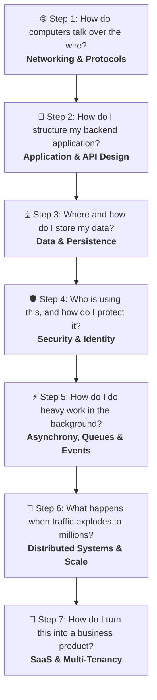

# 🗺️ Master Roadmap: The 7-Step Software Building Journey

#SystemDesign #WebDev #BackendArchitecture #Roadmap #MOC

> **The Core Philosophy:** Building software is not a collection of isolated tricks. It is a logical, progressive story of solving constraints: from transmitting raw electrical packets across the globe, to writing single-server business logic, to persisting state, to securing data, to decoupling background workloads, and finally scaling out to millions of distributed users and commercial SaaS.

---

## 🧭 The 7 Levels of Architecture

---

## 🌐 Step 1: "How do computers talk over the wire?"
### 📡 Domain: `01_Networking_And_Protocols`
> *Before you write a single line of backend logic, you must understand how data travels physically across the wire, how domains resolve, and how clients establish secure sessions.*

- [ ] [[01_How does the modern web works|01. How Does the Modern Web Work?]] — The high-level request/response cycle from browser to server.
- [ ] [[02_12 Essential Network Protocols for Developers|02. 12 Essential Network Protocols for Developers]] — The comprehensive guide to TCP/IP, DNS, HTTP/HTTPS, WebSockets, UDP, SSH, and mail protocols.
- [ ] [[03_Network Debugging Tools _ Seeing The Matrix|03. Network Debugging Tools: Seeing the Matrix]] — Inspecting real traffic using Wireshark, tcpdump, ping, traceroute, and cURL.

---

## 🧩 Step 2: "How do I structure my backend application?"
### 🏗️ Domain: `02_Application_And_API_Design`
> *How do you organize code and business logic on the inside (Application Design), and how do you design clean, safe communication contracts on the outside (API Design)?*

#### 🏛️ Inside the Process: Application Architecture (`Application/`)
- [ ] [[00_Application Architecture Styles_ Decision Quadrant & Patterns|00. Application Architecture Styles: Decision Quadrant & Patterns]] — The definitive guide & quadrant comparing Macro System Architectures (Monolith, Microservices, Serverless, EDA) and Micro Code Structures (MVC, Vertical Slices, Clean, CQRS) across Domain Complexity vs Scale.
- [ ] [[01_Architectural Decision Framework_ How to Choose & Prioritize by Use Case|01. Architectural Decision Framework: Prioritizing by Use Case]] — The 3-filter decision algorithm, 8 archetypal project recipes (including Microservices, Serverless & the Hybrid Model), and avoiding over-engineering traps.
- [ ] [[02_The 5 Hidden Architectural Realities Before Starting a Major Project|02. The 5 Hidden Architectural Realities Before Starting a Major Project]] — The Transactional Outbox pattern, SaaS Multi-Tenancy models, Eventual Consistency UX traps, Distributed Tracing (OpenTelemetry), and the Strangler Fig migration pattern.

#### 🌐 Outside Contract: Web API Design (`API/`)
- [ ] [[00_API Design Patterns_ Architectural, Operational & Infrastructure|00. API Design Patterns Master Catalog]] — The comprehensive taxonomy of architectural styles (REST, gRPC, GraphQL, Webhooks), data operations (pagination, idempotency), and gateway routing (BFF).
- [ ] [[01_API Design Paradigms_ REST, GraphQL, gRPC|01. API Design Paradigms (REST, GraphQL, gRPC)]] — Choosing the right contract: à la carte REST, concierge GraphQL, or high-speed binary gRPC.
- [ ] [[02_RESTful API Design Standards_ Contracts, Versioning & Pagination|02. RESTful API Design Standards]] — Resource modeling, HTTP verb semantics, URI versioning, Keyset pagination, and RFC 7807 error formats.
- [ ] [[03_Idempotency_ Building Safe and Resilient APIs|03. Idempotency: Building Safe & Resilient APIs]] — Protecting endpoints against network retries with the Idempotency-Key header pattern.
- [ ] [[04_The DTO Pattern & Architectural Boundaries|04. The DTO Pattern & Architectural Boundaries]] — Decoupling internal entities from public network contracts and preventing over-posting vulnerabilities.

#### 📡 In Motion: Web Communication & Request Lifecycles (`Web_Communication/`)
- [ ] [[01_The Lifecycle of an HTTP Request_ From Frontend to Database and Back|01. The Lifecycle of an HTTP Request: From Frontend to Database and Back]] — The primary synchronous journey: Edge Ingress, Middleware Pipeline, Model Binding, Controllers, DTOs, Services, Entities, Repositories vs. DAOs, EF Core ChangeTracker, Connection Pooling, and DB Transaction.
- [ ] [[02_Modern Web Communication Paradigms_ Beyond Request-Response|02. Modern Web Communication Paradigms: Beyond Request-Response]] — The complete spectrum beyond synchronous HTTP: WebSockets (SignalR), Server-Sent Events (SSE), Webhooks, WebRTC (P2P), Mobile Push (APNs/FCM), Queue RPC, and Local-First CRDTs.

---

## 🗄️ Step 3: "Where and how do I store my data?"
### 💾 Domain: `03_Data_And_Persistence`
> *Computers reboot, but data must endure. How do you choose the right filing system, model relational tables, abstract access in code, and accelerate reads with memory caching?*

#### 🏛️ Pillar 1: Database Fundamentals & Storage Models (`01_Fundamentals_And_Storage/`)
- [ ] [[0_Database Fundamentals_Choosing the Right Filing System|01. Database Fundamentals: Choosing the Right Filing System]] — The core criteria for selecting relational, document, or key-value stores. Includes storage internals and Graph databases.
- [ ] [[5_NoSQL Database _ The Specialized Archives|02. NoSQL Databases: The Specialized Archives]] — Document, Key-Value, Wide-Column, and Graph storage tradeoffs.

#### 📊 Pillar 2: SQL Mastery & Relational Modeling (`02_SQL_Mastery/`)
- Complete 10-chapter curriculum: Relational normalization, basic/multi-table queries, joins, aggregations, subqueries, DDL constraints, DML transactions, PL/SQL, and database administration.

#### 🔒 Pillar 3: Transactions & Concurrency Control (`03_Transactions_And_Concurrency_Control/`)
- **Transactions (`Transactions/`):** ACID foundations, transaction lifecycle, atomicity, consistency, isolation, durability, and practical PostgreSQL transaction management (Notes 01–07).
- **Concurrency Control (`Concurrency/`):** Read phenomena, phantom reads, serializable vs. repeatable read, shared vs. exclusive locks, deadlock detection & resolution, Two-Phase Locking (2PL), double booking prevention, and PostgreSQL EvalPlanQual (EPQ) internals (Notes 01–06).

#### ⚡ Pillar 4: Database Indexing (`04_Indexing/`)
- In-depth B+ Trees on disk, Clustered vs. Heap tables (PostgreSQL vs. SQL Server), covering indexes, selectivity, composite index leftmost prefix rule, and query execution plans.

#### 🚀 Pillar 5: Data Access & Performance (`05_Data_Access_And_Performance/`)
- [ ] [[01_ORM & JPA _ Bridging Objects and Databases|01. ORM & JPA: Bridging Objects and Databases]] — Mapping object graphs, N+1 query problem, and abstraction boundaries.
- [ ] [[02_Caching Strategies_Making Your Application Faster|02. Caching Strategies: Making Applications Faster]] — Cache-Aside, Write-Through, Write-Behind, and Redis eviction algorithms.
- [ ] [[03_Full-Text Search Engines (e.g. , Elasticsearch)|03. Full-Text Search Engines (Elasticsearch)]] — Inverted indexes, tokenization, fuzzy search, and analytical queries.
- [ ] [[04_SQL Pagination at Scale_ Why OFFSET Kills Performance and How Keyset (Seek) Pagination Solves It|04. SQL Pagination at Scale: Keyset vs. Offset]] — Why `OFFSET` degrades linearly, and how B-Tree Keyset (Cursor) pagination achieves $O(1)$ constant time.
- [ ] [[05_Database Connection Pooling_ Mechanics, Node.js Benchmark, and Sizing Strategies|05. Database Connection Pooling: Sizing & Benchmarks]] — Physical cost of TCP/TLS/process handshakes, 1,000 requests benchmark, optimal sizing formula, and PgBouncer.

#### 🧩 Pillar 6: Database Partitioning (`06_Database_Partitioning/`)
- Complete curriculum (Notes 01–06): Horizontal vs. vertical partitioning, Range/List/Hash strategies, Partitioning vs. Sharding deep dive, 10-million-row PostgreSQL benchmark, trade-offs, and dynamic partition automation (1 billion rows).

#### 🌐 Pillar 7: Database Sharding (`07_Database_Sharding/`)
- Complete curriculum (Notes 01–05): Distributed sharding architecture, routing, consistent hashing, multi-node PostgreSQL cluster with Docker, building a sharded URL shortener in Node.js, Vitess architecture, and the database scaling escalation ladder.

#### 🔄 Pillar 8: Database Replication (`08_Database_Replication/`)
- Complete curriculum (Notes 01–04): Master-Standby vs. Multi-Master, eventual consistency in relational databases, synchronous vs. asynchronous quorums (`synchronous_commit`), hands-on PostgreSQL streaming replication lab with Docker (`standby.signal`), and multi-region WAN topology.

#### 🎯 Pillar 9: Database Cursors (`09_Database_Cursors/`)
- Complete curriculum (Notes 01–05): Client-Side vs. Server-Side cursors, PostgreSQL SQL syntax & lifecycle (`FETCH`, `MOVE`), trade-offs (statefulness, `autovacuum` xmin horizon table bloat, DDL locks), hands-on 1-million-row Python benchmark, and the stateless web architecture verdict.

#### 🗄️ Pillar 10: Specialized NoSQL Databases (`10_NoSQL database/`)
- Document stores, Key-Value engines, Wide-Column stores, and Graph databases.

#### 🔐 Pillar 11: Database Security & Wire Protocol Internals (`11_Database_Security/`)
- [ ] [[01_Securing Database In-Transit Traffic_ PostgreSQL TLS_SSL Configuration, OpenSSL, and pg_hba.conf|01. Securing Database In-Transit Traffic with TLS/SSL]] — The death of the private network fallacy, PostgreSQL opportunistic `SSLRequest` handshake, Docker lab (PostgreSQL 12 & pgAdmin 4), OpenSSL 4096-bit RSA keys, `chmod 600` permission enforcement, client `sslmode` tiers (`prefer` vs `verify-full`), and `pg_hba.conf` `hostssl` firewalling & mTLS.
- [ ] [[02_PostgreSQL Wire Protocol Security_ Wireshark Packet Analysis, Handshake Anatomy, and Information Disclosure|02. PostgreSQL Wire Protocol Under the Microscope]] — Layer 4 TCP to Layer 7 Protocol 3.0 framing, Wireshark packet capture analysis, authentication challenge-response (`AuthenticationMD5Password` vs `SCRAM-SHA-256`), cleartext query leakage (`'Q'` and `'D'`), error frame information disclosure (`auth.c` and `CheckPW` line leakage), and socket teardown race conditions (TCP `RST`).
- [ ] [[03_MongoDB Wire Protocol & Security_ Wireshark TLS Decryption, SASL_SCRAM Handshake, and OP_MSG Anatomy|03. MongoDB Wire Protocol & Security Under the Microscope]] — TLS 1.3 decryption using `SSLKEYLOGFILE`, `isMaster` cluster & shard topology discovery, 4-step SASL/SCRAM authentication handshake chattiness, `OP_MSG` extensible framing (OpCode 2013), driver lazy loading mechanics, and client-side vs. server-side cursor batching.
- [ ] [[04_Maximum Query Size & Protocol Limits_ TCP Segmentation, Parser Memory Crashes, and DoS Vectors|04. Maximum SQL Query Size & Wire Limits]] — Physical TCP packet segmentation (1 to 960 segments for 1.3 MB), PostgreSQL 32-bit protocol limits vs. engine reality, recursive AST parser stack overflow (`max_stack_depth`), Postmaster supervisor crash recovery, query-induced Denial of Service (DoS), and hardened array parameterization (`ANY($1)`).

---

## 🛡️ Step 4: "Who is using this, and how do I protect it?"
### 🔒 Domain: `04_Security_And_Identity`
> *The internet is hostile. How do you verify who the user is, enforce what they can do, store passwords safely, and prevent malicious exploits?*

- [ ] [[00. Stateless vs. Stateful Application Design_ Architecture  Distributed Systems|00. Stateless vs. Stateful Architecture]] — The state management foundation: in-memory server sessions vs. stateless client tokens.
- [ ] [[01. Authentication vs. Authorization_ Architecture _ Implementation|01. Authentication vs. Authorization]] — Identity ("Who are you?") vs. Permissions ("What are you allowed to do?").
- [ ] [[02. Secure Password Storage_ Threat Modeling _ Defensive Cryptography|02. Secure Password Storage: Last Line of Defense]] — Why plain text and raw MD5/SHA256 are catastrophic.
- [ ] [[03. Password Hashing Algorithms_ PBKDF2_ Bcrypt_ Scrypt_ Argon2id _ .NET Implementation|03. Hashing, Salting & Bcrypt]] — Cryptographic work factors, salts, and slow one-way hashing functions.
- [ ] [[04_Authentication Protocols|04. Authentication Protocols]] — Basic auth, session cookies, and bearer tokens compared.
- [ ] [[05_JWT(JSON Web Token)_Features,Predecessor Limitations , and Workflow|05. JWT: Features, Limitations & Workflow]] — Header, Payload, Signature, and stateless token mechanics.
- [ ] [[06_JWT Bearer Tokens vs JWT Cookie-Based Authentication|06. JWT Bearer Tokens vs. JWT Cookie-Based Authentication]] — XSS vs. CSRF tradeoffs and secure token storage strategies (`HttpOnly`, `SameSite`).
- [ ] [[07_OAuth 2.0 & OpenID Connect (OIDC)|07. OAuth 2.0 & OpenID Connect (OIDC)]] — Delegated authorization and federated identity protocols.
- [ ] [[08_OAuth 2.0 Grant Types_Choosing the Right Protocol|08. OAuth 2.0 Grant Types: Choosing the Right Flow]] — Authorization Code with PKCE, Client Credentials, and refresh tokens.
- [ ] [[09_Common Vulnerability Prevention|09. Common Vulnerability Prevention (OWASP)]] — Defending against SQL Injection, XSS, CSRF, and IDOR.
- [ ] [[10_Secrets Management , Protecting Your Master Keys|10. Secrets Management]] — Keeping credentials, API keys, and certificates out of Git using Vault/KMS.
- [ ] [[11_API Security Best Practices|11. API Security Best Practices]] — Rate limiting, CORS headers, input sanitization, and endpoint hardening.
- [ ] [[12_Infrastructure Security_Defense in Depth|12. Infrastructure Security: Defense in Depth]] — VPCs, firewalls, network isolation, and principle of least privilege.

---

## ⚡ Step 5: "How do I do heavy work in the background?"
### ⏱️ Domain: `05_Asynchrony_Queues_And_Events`
> *A web request should finish in under 200 milliseconds. How do you process slow tasks (sending emails, image processing, complex computations) without locking the user's thread?*

- [ ] [[01_Concurrency vs. Parallelism_ A Subtle But Crucial Distinction|01. Concurrency vs. Parallelism]] — Juggling multiple tasks vs. doing multiple tasks simultaneously at the CPU level.
- [ ] [[02_Asynchronous Programming_The Efficient Short_Order Cook|02. Asynchronous Programming: The Efficient Short-Order Cook]] — Event loops, non-blocking I/O, Promises, and reactive programming.
- [ ] [[03_Message Queues & Pub_Sub Systems_ The Internal Mailroom|03. Message Queues & Pub/Sub Systems]] — Decoupling producers and consumers with RabbitMQ, Kafka, and SQS.
- [ ] [[04_Event-Driven Architecture (EDA) _ A Paradigm of Reaction|04. Event-Driven Architecture (EDA)]] — Systems that emit and react to events asynchronously instead of blocking RPC chains.

---

## 🚀 Step 6: "What happens when traffic explodes to millions?"
### 🌐 Domain: `06_Distributed_Systems_And_Scale`
> *A single server and a single database hit their physical hardware ceiling. How do you split traffic, decompose code into independent microservices, and ensure high availability despite node crashes?*

- [ ] [[01_Scalability Concepts _ Horizontal vs. Vertical Scaling|01. Scalability Concepts: Horizontal vs. Vertical]] — Scaling up (bigger machine) vs. scaling out (more machines).
- [ ] [[02_Load Balancing & Reverse Proxies , Managing Web Traffic|02. Load Balancing & Reverse Proxies]] — Distributing client requests, Layer 4 vs Layer 7, and SSL termination.
- [ ] [[03_Advanced Load Balancing Strategies|03. Advanced Load Balancing Strategies]] — Consistent hashing, weighted round-robin, and geo-DNS routing.
- [ ] [[04_Rate Limiting & Throttling _ Protecting Your Service|04. Rate Limiting & Throttling]] — Protecting services from traffic surges, noisy neighbors, and brute-force attacks.
- [ ] [[05_Monolith vs. Microservices _ High_Level Application Architecture|05. Monolith vs. Microservices]] — Single deployable unit vs. distributed independent services.
- [ ] [[06_Domain-Driven Design (DDD) Aligning Code with Business|06. Domain-Driven Design (DDD)]] — Bounded contexts, aggregates, and entities aligning code with real business domains.
- [ ] [[07_API Gateways _ The Front Office for Your Microservices|07. API Gateways: The Front Office for Microservices]] — Centralized routing, SSL termination, authentication, and telemetry.
- [ ] [[08_Service Discovery _ The Factory Directory|08. Service Discovery: The Factory Directory]] — How microservices find dynamically changing IP addresses of peer containers.
- [ ] [[09_Database Replication & Sharding _ Scaling Your Data Layer|09. Database Replication & Sharding]] — Read replicas, primary-replica topologies, and horizontal partitioning (sharding).
- [ ] [[10_Distributed Transactions & The Saga Pattern|10. Distributed Transactions & The Saga Pattern]] — Maintaining eventual consistency across microservices with compensating transactions.
- [ ] [[11_Resilience & Fault Tolerance Patterns|11. Resilience & Fault Tolerance Patterns]] — Circuit Breakers, Retries with Exponential Backoff, Bulkheads, and Fallbacks.

---

## 🏢 Step 7: "How do I turn this into a business product?"
### 💼 Domain: `07_SaaS_And_Production_Architecture`
> *How do you build a cloud software product that serves hundreds of different paying corporate clients safely, isolated, and efficiently on shared infrastructure?*

- [ ] [[01_SaaS Architecture Foundations|01. SaaS Architecture Foundations]] — Multi-tenant architecture mechanisms, tenant isolation (siloed vs pooled), onboarding, and tiering.

---

## 📈 Learning Progression Checklist

Use this progression as your roadmap:
1. **Master Step 1 & Step 2 first** $\rightarrow$ Build confidence writing clean, stateless web APIs that talk over HTTP.
2. **Master Step 3 & Step 4 next** $\rightarrow$ Persist data correctly with relational/caching models and protect endpoints with bulletproof authentication.
3. **Master Step 5** $\rightarrow$ Learn to push long-running work to asynchronous background queues.
4. **Tackle Step 6 & Step 7** $\rightarrow$ Step into senior engineering territory: microservices, distributed data consistency, fault tolerance, and multi-tenant SaaS architecture.
