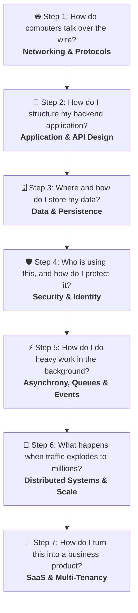

# 🗺️ Master Roadmap: The 7-Step Software Building Journey

#SystemDesign #WebDev #BackendArchitecture #Roadmap #MOC

> **The Core Philosophy:** Building software is not a collection of isolated tricks. It is a logical, progressive story of solving constraints: from transmitting raw electrical packets across the globe, to writing single-server business logic, to persisting state, to securing data, to decoupling background workloads, and finally scaling out to millions of distributed users and commercial SaaS.

---

## 🧭 The 7 Levels of Architecture

---

## 🌐 Step 1: "How do computers talk over the wire?"
### 📡 Domain: `01_Networking_And_Protocols`
> *Before you write a single line of backend logic, you must understand how data travels physically across the wire, how domains resolve, and how clients establish secure sessions.*

- [ ] [[01_How does the modern web works|01. How Does the Modern Web Work?]] — The high-level request/response cycle from browser to server.
- [ ] [[02_12 Essential Network Protocols for Developers|02. 12 Essential Network Protocols for Developers]] — The comprehensive guide to TCP/IP, DNS, HTTP/HTTPS, WebSockets, UDP, SSH, and mail protocols.
- [ ] [[03_Network Debugging Tools _ Seeing The Matrix|03. Network Debugging Tools: Seeing the Matrix]] — Inspecting real traffic using Wireshark, tcpdump, ping, traceroute, and cURL.

---

## 🧩 Step 2: "How do I structure my backend application?"
### 🏗️ Domain: `02_Application_And_API_Design`
> *How do you organize code and business logic on the inside (Application Design), and how do you design clean, safe communication contracts on the outside (API Design)?*

#### 🏛️ Inside the Process: Application Architecture (`Application/`)
- [ ] [[00_Application Architecture Styles_ Decision Quadrant & Patterns|00. Application Architecture Styles: Decision Quadrant & Patterns]] — The definitive guide & quadrant comparing Macro System Architectures (Monolith, Microservices, Serverless, EDA) and Micro Code Structures (MVC, Vertical Slices, Clean, CQRS) across Domain Complexity vs Scale.
- [ ] [[01_Architectural Decision Framework_ How to Choose & Prioritize by Use Case|01. Architectural Decision Framework: Prioritizing by Use Case]] — The 3-filter decision algorithm, 8 archetypal project recipes (including Microservices, Serverless & the Hybrid Model), and avoiding over-engineering traps.
- [ ] [[02_The 5 Hidden Architectural Realities Before Starting a Major Project|02. The 5 Hidden Architectural Realities Before Starting a Major Project]] — The Transactional Outbox pattern, SaaS Multi-Tenancy models, Eventual Consistency UX traps, Distributed Tracing (OpenTelemetry), and the Strangler Fig migration pattern.

#### 🌐 Outside Contract: Web API Design (`API/`)
- [ ] [[00_API Design Patterns_ Architectural, Operational & Infrastructure|00. API Design Patterns Master Catalog]] — The comprehensive taxonomy of architectural styles (REST, gRPC, GraphQL, Webhooks), data operations (pagination, idempotency), and gateway routing (BFF).
- [ ] [[01_API Design Paradigms_ REST, GraphQL, gRPC|01. API Design Paradigms (REST, GraphQL, gRPC)]] — Choosing the right contract: à la carte REST, concierge GraphQL, or high-speed binary gRPC.
- [ ] [[02_RESTful API Design Standards_ Contracts, Versioning & Pagination|02. RESTful API Design Standards]] — Resource modeling, HTTP verb semantics, URI versioning, Keyset pagination, and RFC 7807 error formats.
- [ ] [[03_Idempotency_ Building Safe and Resilient APIs|03. Idempotency: Building Safe & Resilient APIs]] — Protecting endpoints against network retries with the Idempotency-Key header pattern.
- [ ] [[04_The DTO Pattern & Architectural Boundaries|04. The DTO Pattern & Architectural Boundaries]] — Decoupling internal entities from public network contracts and preventing over-posting vulnerabilities.

#### 📡 In Motion: Web Communication & Request Lifecycles (`Web_Communication/`)
- [ ] [[01_The Lifecycle of an HTTP Request_ From Frontend to Database and Back|01. The Lifecycle of an HTTP Request: From Frontend to Database and Back]] — The primary synchronous journey: Edge Ingress, Middleware Pipeline, Model Binding, Controllers, DTOs, Services, Entities, Repositories vs. DAOs, EF Core ChangeTracker, Connection Pooling, and DB Transaction.
- [ ] [[02_Modern Web Communication Paradigms_ Beyond Request-Response|02. Modern Web Communication Paradigms: Beyond Request-Response]] — The complete spectrum beyond synchronous HTTP: WebSockets (SignalR), Server-Sent Events (SSE), Webhooks, WebRTC (P2P), Mobile Push (APNs/FCM), Queue RPC, and Local-First CRDTs.

---

## 🗄️ Step 3: "Where and how do I store my data?"
### 💾 Domain: `03_Data_And_Persistence`
> *Computers reboot, but data must endure. How do you choose the right filing system, model relational tables, abstract access in code, and accelerate reads with memory caching?*

#### 🏛️ Pillar 1: Database Fundamentals & Storage Models (`01_Fundamentals_And_Storage/`)
- [ ] [[0_Database Fundamentals_Choosing the Right Filing System|01. Database Fundamentals: Choosing the Right Filing System]] — The core criteria for selecting relational, document, or key-value stores. Includes storage internals and Graph databases.
- [ ] [[5_NoSQL Database _ The Specialized Archives|02. NoSQL Databases: The Specialized Archives]] — Document, Key-Value, Wide-Column, and Graph storage tradeoffs.

#### 📊 Pillar 2: SQL Mastery & Relational Modeling (`02_SQL_Mastery/`)
- Complete 10-chapter curriculum: Relational normalization, basic/multi-table queries, joins, aggregations, subqueries, DDL constraints, DML transactions, PL/SQL, and database administration.

#### 🔒 Pillar 3: Transactions & Concurrency Control (`03_Transactions_And_Concurrency_Control/`)
- **Transactions (`Transactions/`):** ACID foundations, transaction lifecycle, atomicity, consistency, isolation, durability, and practical PostgreSQL transaction management (Notes 01–07).
- **Concurrency Control (`Concurrency/`):** Read phenomena, phantom reads, serializable vs. repeatable read, shared vs. exclusive locks, deadlock detection & resolution, Two-Phase Locking (2PL), double booking prevention, and PostgreSQL EvalPlanQual (EPQ) internals (Notes 01–06).

#### ⚡ Pillar 4: Database Indexing (`04_Indexing/`)
- [ ] [[01_Database Indexing Fundamentals_ Full Table Scans vs. Index Seeks|01. Fundamentals: Full Table Scans vs. Index Seeks]] — The $O(N)$ vs $O(\log N)$ search problem on 10M+ rows, physical disk pages (8KB), OS buffer pool, selectivity tipping points, and write amplification.
- [ ] [[02_B-Trees and B+ Trees Architecture_ Internal Mechanics and Page Layout|02. B-Trees & B+ Trees Architecture]] — Why databases use B+ Trees over Hash Maps and BSTs, "slim" internal nodes (keys only), page fanout, doubly-linked leaf range scans, search traversals, and page splits.
- [ ] [[03_Storage Engine Layouts_ Clustered Indexes vs. Heap Tables (PostgreSQL vs. MySQL vs. SQL Server)|03. Storage Engine Layouts: Clustered vs. Heap Tables]] — Clustered tables (MySQL InnoDB & SQL Server) vs. Heap tables (PostgreSQL), direct TIDs vs. indirect PK lookups, write amplification & the Uber migration, and why random UUIDs destroy clustered indexes.
- [ ] [[04_Index Design Strategies_ Composite, Covering (INCLUDE), and Partial Indexes|04. Index Design Strategies]] — Multi-column composite indexes and the Leftmost Prefix Rule, Covering Indexes (`INCLUDE`) for Index-Only Scans (`Heap Fetches: 0`), partial/filtered indexes, and the unindexed foreign key trap.
- [ ] [[05_Query Planning & Execution Plans_ EXPLAIN, Scan Types, and Database Statistics|05. Query Planning & Execution Plans]] — The PostgreSQL scan hierarchy (`Seq Scan`, `Index Scan`, `Bitmap Scan`, `Index-Only Scan`), deconstructing `EXPLAIN (ANALYZE, BUFFERS)` metrics, selectivity formulas, and the stale statistics trap (`ANALYZE`).
- [ ] [[06_Production Index Management_ Concurrent Builds, Index Bloat, and Scale|06. Production Index Management & Operations]] — Zero-downtime indexing with `CREATE INDEX CONCURRENTLY`, detecting and cleaning invalid indexes, index bloat defragmentation (`REINDEX CONCURRENTLY`), and the scaling escalation ladder.
- [ ] [[07_Probabilistic Indexing & Modern Storage_ Bloom Filters and LSM-Trees|07. Probabilistic Indexing & Modern Storage]] — The expensive "does it exist?" check, Bloom filter bit arrays, false positive mathematics, and eliminating non-existent disk reads in LSM-Tree SSTables (Cassandra, RocksDB).

#### 🚀 Pillar 5: Data Access & Performance (`05_Data_Access_And_Performance/`)
- [ ] [[01_ORM & JPA _ Bridging Objects and Databases|01. ORM & JPA: Bridging Objects and Databases]] — Mapping object graphs, N+1 query problem, and abstraction boundaries.
- [ ] [[02_Caching Strategies_Making Your Application Faster|02. Caching Strategies: Making Applications Faster]] — Cache-Aside, Write-Through, Write-Behind, and Redis eviction algorithms.
- [ ] [[03_Full-Text Search Engines (e.g. , Elasticsearch)|03. Full-Text Search Engines (Elasticsearch)]] — Inverted indexes, tokenization, fuzzy search, and analytical queries.
- [ ] [[04_SQL Pagination at Scale_ Why OFFSET Kills Performance and How Keyset (Seek) Pagination Solves It|04. SQL Pagination at Scale: Keyset vs. Offset]] — Why `OFFSET` degrades linearly, and how B-Tree Keyset (Cursor) pagination achieves $O(1)$ constant time.
- [ ] [[05_Database Connection Pooling_ Mechanics, Node.js Benchmark, and Sizing Strategies|05. Database Connection Pooling: Sizing & Benchmarks]] — Physical cost of TCP/TLS/process handshakes, 1,000 requests benchmark, optimal sizing formula, and PgBouncer.

#### 🧩 Pillar 6: Database Partitioning (`06_Database_Partitioning/`)
- Complete curriculum (Notes 01–06): Horizontal vs. vertical partitioning, Range/List/Hash strategies, Partitioning vs. Sharding deep dive, 10-million-row PostgreSQL benchmark, trade-offs, and dynamic partition automation (1 billion rows).

#### 🌐 Pillar 7: Database Sharding (`07_Database_Sharding/`)
- Complete curriculum (Notes 01–05): Distributed sharding architecture, routing, consistent hashing, multi-node PostgreSQL cluster with Docker, building a sharded URL shortener in Node.js, Vitess architecture, and the database scaling escalation ladder.

#### 🔄 Pillar 8: Database Replication (`08_Database_Replication/`)
- Complete curriculum (Notes 01–04): Master-Standby vs. Multi-Master, eventual consistency in relational databases, synchronous vs. asynchronous quorums (`synchronous_commit`), hands-on PostgreSQL streaming replication lab with Docker (`standby.signal`), and multi-region WAN topology.

#### 🎯 Pillar 9: Database Cursors (`09_Database_Cursors/`)
- Complete curriculum (Notes 01–05): Client-Side vs. Server-Side cursors, PostgreSQL SQL syntax & lifecycle (`FETCH`, `MOVE`), trade-offs (statefulness, `autovacuum` xmin horizon table bloat, DDL locks), hands-on 1-million-row Python benchmark, and the stateless web architecture verdict.

#### 🗄️ Pillar 10: Specialized NoSQL Databases (`10_NoSQL database/`)
- Document stores, Key-Value engines, Wide-Column stores, and Graph databases.

#### 🔐 Pillar 11: Database Security & Wire Protocol Internals (`11_Database_Security/`)
- [ ] [[01_Securing Database In-Transit Traffic_ PostgreSQL TLS_SSL Configuration, OpenSSL, and pg_hba.conf|01. Securing Database In-Transit Traffic with TLS/SSL]] — The death of the private network fallacy, PostgreSQL opportunistic `SSLRequest` handshake, Docker lab (PostgreSQL 12 & pgAdmin 4), OpenSSL 4096-bit RSA keys, `chmod 600` permission enforcement, client `sslmode` tiers (`prefer` vs `verify-full`), and `pg_hba.conf` `hostssl` firewalling & mTLS.
- [ ] [[02_PostgreSQL Wire Protocol Security_ Wireshark Packet Analysis, Handshake Anatomy, and Information Disclosure|02. PostgreSQL Wire Protocol Under the Microscope]] — Layer 4 TCP to Layer 7 Protocol 3.0 framing, Wireshark packet capture analysis, authentication challenge-response (`AuthenticationMD5Password` vs `SCRAM-SHA-256`), cleartext query leakage (`'Q'` and `'D'`), error frame information disclosure (`auth.c` and `CheckPW` line leakage), and socket teardown race conditions (TCP `RST`).
- [ ] [[03_MongoDB Wire Protocol & Security_ Wireshark TLS Decryption, SASL_SCRAM Handshake, and OP_MSG Anatomy|03. MongoDB Wire Protocol & Security Under the Microscope]] — TLS 1.3 decryption using `SSLKEYLOGFILE`, `isMaster` cluster & shard topology discovery, 4-step SASL/SCRAM authentication handshake chattiness, `OP_MSG` extensible framing (OpCode 2013), driver lazy loading mechanics, and client-side vs. server-side cursor batching.
- [ ] [[04_Maximum Query Size & Protocol Limits_ TCP Segmentation, Parser Memory Crashes, and DoS Vectors|04. Maximum SQL Query Size & Wire Limits]] — Physical TCP packet segmentation (1 to 960 segments for 1.3 MB), PostgreSQL 32-bit protocol limits vs. engine reality, recursive AST parser stack overflow (`max_stack_depth`), Postmaster supervisor crash recovery, query-induced Denial of Service (DoS), and hardened array parameterization (`ANY($1)`).
- [ ] [[05_Database Access Control & Principle of Least Privilege_ DDL on Startup Anti-Pattern, Role Separation, and Blast Radius Mitigation|05. Database Access Control & Least Privilege (PoLP)]] — The `CREATE TABLE IF NOT EXISTS` startup anti-pattern, table ownership privilege escalation, SQL injection blast radius mitigation (blocking `DROP TABLE`), DDL vs. DML segregation (`schema_owner` vs. `app_user`), Kubernetes multi-pod catalog deadlocks, and route-based connection pooling (read-only vs. read-write pools).
- [ ] [[06_Route-Based Connection Pools & Granular Database Permissions_ Implementation, Sequences, and Predicate Permissions|06. Route-Based Connection Pools & Granular RBAC]] — Multi-pool Express architecture (`db_read`, `db_create`, `db_delete`), sequence `USAGE` trap on `INSERT`, predicate `SELECT` trap on `DELETE ... WHERE`, traffic-based pool sizing, and error sanitization (CWE-209).

---

## 🛡️ Step 4: "Who is using this, and how do I protect it?"
### 🔒 Domain: `04_Security_And_Identity`
> *The internet is hostile. How do you verify who the user is, enforce what they can do, store passwords safely, and prevent malicious exploits?*

- [ ] [[00. Stateless vs. Stateful Application Design_ Architecture  Distributed Systems|00. Stateless vs. Stateful Architecture]] — The state management foundation: in-memory server sessions vs. stateless client tokens.
- [ ] [[01. Authentication vs. Authorization_ Architecture _ Implementation|01. Authentication vs. Authorization]] — Identity ("Who are you?") vs. Permissions ("What are you allowed to do?").
- [ ] [[02. Secure Password Storage_ Threat Modeling _ Defensive Cryptography|02. Secure Password Storage: Last Line of Defense]] — Why plain text and raw MD5/SHA256 are catastrophic.
- [ ] [[03. Password Hashing Algorithms_ PBKDF2_ Bcrypt_ Scrypt_ Argon2id _ .NET Implementation|03. Hashing, Salting & Bcrypt]] — Cryptographic work factors, salts, and slow one-way hashing functions.
- [ ] [[04_Authentication Protocols|04. Authentication Protocols]] — Basic auth, session cookies, and bearer tokens compared.
- [ ] [[05_JWT(JSON Web Token)_Features,Predecessor Limitations , and Workflow|05. JWT: Features, Limitations & Workflow]] — Header, Payload, Signature, and stateless token mechanics.
- [ ] [[06_JWT Bearer Tokens vs JWT Cookie-Based Authentication|06. JWT Bearer Tokens vs. JWT Cookie-Based Authentication]] — XSS vs. CSRF tradeoffs and secure token storage strategies (`HttpOnly`, `SameSite`).
- [ ] [[07_OAuth 2.0 & OpenID Connect (OIDC)|07. OAuth 2.0 & OpenID Connect (OIDC)]] — Delegated authorization and federated identity protocols.
- [ ] [[08_OAuth 2.0 Grant Types_Choosing the Right Protocol|08. OAuth 2.0 Grant Types: Choosing the Right Flow]] — Authorization Code with PKCE, Client Credentials, and refresh tokens.
- [ ] [[09_Common Vulnerability Prevention|09. Common Vulnerability Prevention (OWASP)]] — Defending against SQL Injection, XSS, CSRF, and IDOR.
- [ ] [[10_Secrets Management , Protecting Your Master Keys|10. Secrets Management]] — Keeping credentials, API keys, and certificates out of Git using Vault/KMS.
- [ ] [[11_API Security Best Practices|11. API Security Best Practices]] — Rate limiting, CORS headers, input sanitization, and endpoint hardening.
- [ ] [[12_Infrastructure Security_Defense in Depth|12. Infrastructure Security: Defense in Depth]] — VPCs, firewalls, network isolation, and principle of least privilege.

---

## ⚡ Step 5: "How do I do heavy work in the background?"
### ⏱️ Domain: `05_Asynchrony_Queues_And_Events`
> *A web request should finish in under 200 milliseconds. How do you process slow tasks (sending emails, image processing, complex computations) without locking the user's thread?*

- [ ] [[01_Concurrency vs. Parallelism_ A Subtle But Crucial Distinction|01. Concurrency vs. Parallelism]] — Juggling multiple tasks vs. doing multiple tasks simultaneously at the CPU level.
- [ ] [[02_Asynchronous Programming_The Efficient Short_Order Cook|02. Asynchronous Programming: The Efficient Short-Order Cook]] — Event loops, non-blocking I/O, Promises, and reactive programming.
- [ ] [[03_Message Queues & Pub_Sub Systems_ The Internal Mailroom|03. Message Queues & Pub/Sub Systems]] — Decoupling producers and consumers with RabbitMQ, Kafka, and SQS.
- [ ] [[04_Event-Driven Architecture (EDA) _ A Paradigm of Reaction|04. Event-Driven Architecture (EDA)]] — Systems that emit and react to events asynchronously instead of blocking RPC chains.

---

## 🚀 Step 6: "What happens when traffic explodes to millions?"
### 🌐 Domain: `06_Distributed_Systems_And_Scale`
> *A single server and a single database hit their physical hardware ceiling. How do you split traffic, decompose code into independent microservices, and ensure high availability despite node crashes?*

- [ ] [[01_Scalability Concepts _ Horizontal vs. Vertical Scaling|01. Scalability Concepts: Horizontal vs. Vertical]] — Scaling up (bigger machine) vs. scaling out (more machines).
- [ ] [[02_Load Balancing & Reverse Proxies , Managing Web Traffic|02. Load Balancing & Reverse Proxies]] — Distributing client requests, Layer 4 vs Layer 7, and SSL termination.
- [ ] [[03_Advanced Load Balancing Strategies|03. Advanced Load Balancing Strategies]] — Consistent hashing, weighted round-robin, and geo-DNS routing.
- [ ] [[04_Rate Limiting & Throttling _ Protecting Your Service|04. Rate Limiting & Throttling]] — Protecting services from traffic surges, noisy neighbors, and brute-force attacks.
- [ ] [[05_Monolith vs. Microservices _ High_Level Application Architecture|05. Monolith vs. Microservices]] — Single deployable unit vs. distributed independent services.
- [ ] [[06_Domain-Driven Design (DDD) Aligning Code with Business|06. Domain-Driven Design (DDD)]] — Bounded contexts, aggregates, and entities aligning code with real business domains.
- [ ] [[07_API Gateways _ The Front Office for Your Microservices|07. API Gateways: The Front Office for Microservices]] — Centralized routing, SSL termination, authentication, and telemetry.
- [ ] [[08_Service Discovery _ The Factory Directory|08. Service Discovery: The Factory Directory]] — How microservices find dynamically changing IP addresses of peer containers.
- [ ] [[09_Database Replication & Sharding _ Scaling Your Data Layer|09. Database Replication & Sharding]] — Read replicas, primary-replica topologies, and horizontal partitioning (sharding).
- [ ] [[10_Distributed Transactions & The Saga Pattern|10. Distributed Transactions & The Saga Pattern]] — Maintaining eventual consistency across microservices with compensating transactions.
- [ ] [[11_Resilience & Fault Tolerance Patterns|11. Resilience & Fault Tolerance Patterns]] — Circuit Breakers, Retries with Exponential Backoff, Bulkheads, and Fallbacks.

---

## 🏢 Step 7: "How do I turn this into a business product?"
### 💼 Domain: `07_SaaS_And_Production_Architecture`
> *How do you build a cloud software product that serves hundreds of different paying corporate clients safely, isolated, and efficiently on shared infrastructure?*

- [ ] [[01_SaaS Architecture Foundations|01. SaaS Architecture Foundations]] — Multi-tenant architecture mechanisms, tenant isolation (siloed vs pooled), onboarding, and tiering.

---

## 🤖 Step 8: "How do I build and scale with AI agents?"
### 🧠 Domain: `08_AI_Coding`
> *How do software engineers collaborate with autonomous coding agents, structure agent-friendly repositories, and leverage AI tooling without introducing unmaintainable code slop?*

#### 🛠️ Part 1: Agent Runtime & Harness (`0_Agent_Harness/`)
- [ ] [[01_The Three Buckets of AI Tooling_ Chat, Autocomplete, and Autonomous Coding Agents|01. The Three Buckets of AI Tooling: Chat, Autocomplete, and Autonomous Coding Agents]] — Deconstructing the AI spectrum, the ReAct loop, model orchestration via OpenCode, and deterministic test harnesses.
- [ ] [[02_Agent-Friendly Architecture_ The Unix Philosophy vs. Vibe-Coding Slop|02. Agent-Friendly Architecture: The Unix Philosophy vs. Vibe-Coding Slop]] — Why text-in/text-out dominates LLMs, the 5 pillars of agent-friendly codebases, the perils of vibe-coding ("slop begets slop"), and automated remediation with Ruff.
- [ ] [[03_Agent Configuration Architecture_ Runtime Hierarchy, Permissions Guardrails, and Secrets|03. Agent Configuration Architecture: Runtime Hierarchy, Permissions Guardrails, and Secrets]] — Deep merge configuration mechanics (global vs. project), JSONC schema validation, granular shell permission policies (allow/ask/deny), credential substitution ({env:VAR}), and TUI preferences.
- [ ] [[04_Headless Agent Automation_ CLI Scripting, Unix Streams, and Adversarial Reviews|04. Headless Agent Automation: CLI Scripting, Unix Streams, and Adversarial Reviews]] — Non-interactive execution with `opencode run`, standard streams (`stdout` vs `stderr`), headless permission auto-rejection, `--format json`, multi-turn `--continue`, and adversarial multi-model review loops.
- [ ] [[05_Client-Server Architecture & Frontends_ Background Daemons, Web Pairing, and Desktop Handoff|05. Client-Server Architecture & Frontends: Background Daemons, Web Pairing, and Desktop Handoff]] — The distributed agent topology (`opencode service`), Terminal UI (TUI) vs. Web UI (`opencode pair`) vs. Native Desktop, OS clipboard/drag-and-drop, and IDE handoff workflows.
- [ ] [[06_Remote Agent Architecture_ Cloud Servers, Mobile Tunnels, and Team Chat Protocols (ACP)|06. Remote Agent Architecture: Cloud Servers, Mobile Tunnels, and Team Chat Protocols (ACP)]] — Remote server daemon deployment (`opencode serve`), transport hardening (SSH tunneling vs Tailscale WireGuard), execution privilege contexts, mobile pairing via OpenTunnel, and enterprise Slack/Discord integration via ACP & OpenClaw.

#### 🧠 Part 2: Models & Providers (`1_Models_Providers/`)
- [ ] [[01_Providers vs. Models_ The Separation of Capability and Infrastructure|01. Providers vs. Models: The Separation of Capability and Infrastructure]] — Decoupling neural network intelligence from hosting infrastructure, multi-provider hosting, the `<provider_id>/<model_id>` standard, and project schema validation.
- [ ] [[02_Token Economics, Pricing Tiers, and Cost Optimization in Coding Agents|02. Token Economics, Pricing Tiers, and Cost Optimization in Coding Agents]] — Frontier SOTA vs. High-Speed Flash tiers, the Coding Agent Cost Paradox (why input tokens dominate), Prompt Caching mechanics, token math equations, and hybrid model routing.
- [ ] [[03_Open-Weight Models & Parameter Weights_ Training CapEx vs. Inference OpEx|03. Open-Weight Models & Parameter Weights: Training CapEx vs. Inference OpEx]] — What neural weights physically represent, open-weight vs. open-source distinctions, upfront training supercomputing costs (CapEx) vs. ongoing per-token inference (OpEx), and the business model paradox.
- [ ] [[04_Self-Hosting LLMs & Hardware Constraints_ VRAM Math, Quantization, and Local Inference Servers|04. Self-Hosting LLMs & Hardware Constraints: VRAM Math, Quantization, and Local Inference Servers]] — The VRAM bottleneck, FP16 vs INT4/INT8 quantization rules of thumb, Mixture of Experts (MoE) memory footprints, local network inference servers (LM Studio/Ollama), and the hardware vs. cloud trade-off matrix.
- [ ] [[05_Reasoning Models, Thinking Tokens, and OpenCode Model Variants|05. Reasoning Models, Thinking Tokens, and OpenCode Model Variants]] — Chain-of-Thought evolution into test-time compute, OpenCode model variants (`Ctrl+T`, `/thinking`), Fast Mode tradeoffs, and debugging integer division truncation edge cases.
- [ ] [[06_Commercial Billing Strategies_ Pay-per-Token APIs vs. Flat-Rate Subscriptions|06. Commercial Billing Strategies: Pay-per-Token APIs vs. Flat-Rate Subscriptions]] — Metered unit costs vs. flat-rate developer subscriptions, runaway loop risks, power-user leverage (\$1,000 value for \$200), and the Anthropic 3rd-party credential restriction.
- [ ] [[07_Operational Cost Optimization_ Sane Defaults, Session Telemetry, and the Token vs. Time Myth|07. Operational Cost Optimization: Sane Defaults, Session Telemetry, and the Token vs. Time Myth]] — The two cost levers (`/models` & `Ctrl+T`), the sane default strategy, deconstructing OpenCode's context sidebar telemetry, and why slow tests/DB I/O do not burn LLM tokens.

#### 🔧 Part 3: Agent Tooling & Execution (`2_Tools/`)
- [ ] [[01_The Tool-Calling Architecture_ How Agents Execute Actions via the Harness|01. The Tool-Calling Architecture: How Agents Execute Actions via the Harness]] — JSON Schema tool definitions, who executes tool calls (the agent harness vs the LLM), the ReAct execution lifecycle, and text-in/text-out realities.
- [ ] [[02_Built-in Tools vs. The Shell Escape Hatch_ Context, Mutation, and Guardrails|02. Built-in Tools vs. The Shell Escape Hatch: Context, Mutation, and Guardrails]] — Built-in suite (`read`, `glob`, `grep`, `edit`, `write`, `webfetch`), why specialized tools beat raw Bash (token efficiency, Markdown conversion, size guards), and the `shell` tool as the essential escape hatch.
- [ ] [[03_Authoring Custom Tools with TypeScript Plugins_ Architecture, Code Mode, and Runtime Registration|03. Authoring Custom Tools with TypeScript Plugins: Architecture, Code Mode, and Runtime Registration]] — Writing custom tools via `@opencode/plugin` and `Plugin.define()`, Bun runtime setup, direct invocations vs. Code Mode orchestration, hot reloading with `/reload`, and test assertions.
- [ ] [[04_Granular Tool Permissions_ Evaluation Precedence, Wildcard Scoping, and Custom Tool Security|04. Granular Tool Permissions: Evaluation Precedence, Wildcard Scoping, and Custom Tool Security]] — Tri-state permission rules (allow/ask/deny), the "last matching rule wins" precedence rule, action grouping, .env guardrails, and custom tool subprocess execution boundaries.
- [ ] [[05_Agent Sandboxing & Blast Radius Containment_ Docker, Disposable VMs, and Unattended Autonomy|05. Agent Sandboxing & Blast Radius Containment: Docker, Disposable VMs, and Unattended Autonomy]] — Containing blast radius, hardware vs. disposable VM vs. Docker isolation, bind mount/credential/network security pitfalls, and the productivity paradox of unattended autonomous agents.

#### 📝 Part 4: Prompting & Agent Alignment (`3_Prompting/`)
- [ ] [[01_Engineering-Grade Prompting_ Specificity, Constraints, and Validation Instructions|01. Engineering-Grade Prompting: Specificity, Constraints, and Validation Instructions]] — The 5 pillars of agent prompting (specificity, constraints, context, edge cases, validation), agent strengths vs. blind spots (the taste deficit), and lexer string escape debugging.
- [ ] [[02_Plan Mode vs. Build Mode & Socratic Prompting_ Alignment, Checklists, and Interactive Brainstorming|02. Plan Mode vs. Build Mode & Socratic Prompting: Alignment, Checklists, and Interactive Brainstorming]] — Mutation-blocked Plan Mode vs. active Build Mode, the "Plan-in-Build" pattern, the two rules of alignment, and Socratic questioning as an anti-blocker hack.
- [ ] [[03_Real-Time Agent Control_ Canceling, Mid-Flight Steering, and Guardrail Cancel Conditions|03. Real-Time Agent Control: Canceling, Mid-Flight Steering, and Guardrail Cancel Conditions]] — Mitigating runaway loops, hard interrupts with `Esc Esc`, mid-flight steering at step boundaries (`Enter`), the 10-second observation rule, and baking proactive cancel conditions into prompts.
- [ ] [[04_Prompt Box Ergonomics_ File Ingestion (@), Keyboard Shortcuts, and Direct Shell Mode (!)|04. Prompt Box Ergonomics: File Ingestion (@), Keyboard Shortcuts, and Direct Shell Mode (!)]] — Direct context attachment via `@`, input shortcuts (`Shift+Enter`, `Ctrl+J`, external editor handoff `Ctrl+X, E`), clipboard management, and executing zero-token local commands via direct shell mode (`!`).
- [ ] [[05_Prompt Queueing, Scope Anchoring, and Step-by-Step Task Decomposition|05. Prompt Queueing, Scope Anchoring, and Step-by-Step Task Decomposition]] — Steering vs. queueing (`Ctrl+X, Enter`), scope containment against blast-radius creep, the abstraction trap (over vs under abstraction), pattern anchoring, and modular task decomposition.
- [ ] [[06_Speech-to-Text for Coding Agents_ Voice Brain Dumps, Local STT Tools, and Context Density|06. Speech-to-Text for Coding Agents: Voice Brain Dumps, Local STT Tools, and Context Density]] — Overcoming the typing bottleneck with voice brain dumps, LLMs as semantic noise filters, dedicated local on-device STT tools (Handy, Hex), zero audio egress privacy, and push-to-talk workflows.

#### 🤖 Part 5: Specialized Agents & Hyperparameters (`4_Agents/`)
- [ ] [[01_Custom Subagents Architecture_ Personas, Scoped Tooling, and Cycle Limits|01. Custom Subagents Architecture: Personas, Scoped Tooling, and Cycle Limits]] — Multi-layered agent taxonomy (Harness vs. Continuous 24/7 bots vs. Session subagents), the 4 configuration pillars (system prompt, model, permissions, cycle limits), zero-mutation code reviewer persona in `opencode.jsonc`, and autonomous cycle exhaustion defense.
- [ ] [[02_Model Hyperparameters & Temperature_ Softmax Logit Scaling, Determinism, and the Overtuning Anti-Pattern|02. Model Hyperparameters & Temperature: Softmax Logit Scaling, Determinism, and the Overtuning Anti-Pattern]] — Softmax temperature mathematics ($T \to 0$ peak sharpening vs $T \to 1.0$ entropy flattening), DeepSeek thinking mode overrides (`reasoning_effort: "none"`), configuring `body.temperature` in `opencode.jsonc`, the Sloperator slogans empirical study, and why hyperparameter overtuning is a software engineering anti-pattern.
- [ ] [[03_Declarative Agent Configuration via Markdown_ Frontmatter Architecture, Hot Reloading, and Step Bounding|03. Declarative Agent Configuration via Markdown: Frontmatter Architecture, Hot Reloading, and Step Bounding]] — Markdown agent definitions (`.opencode/agents/*.md`), YAML frontmatter metadata vs system prompt body, dynamic hot reloading without restarts, the final-step tool suppression protocol (`steps: N`), and the custom agent vs skill threshold.
- [ ] [[04_Subagents & Context Isolation_ Child Sessions, Cost Routing, and the Explore Pattern|04. Subagents & Context Isolation: Child Sessions, Cost Routing, and the Explore Pattern]] — Resolving context window pollution with isolated child sessions, built-in subagents (`explore` vs `general`), model tier arbitrage (Flash explorers vs Frontier builders), `@` invocation steering, and compiler regression test discovery.
- [ ] [[05_Subagent Permissions & Invocation Control_ Least-Privilege Delegation, Precedence Ordering, and Approval Gates|05. Subagent Permissions & Invocation Control: Least-Privilege Delegation, Precedence Ordering, and Approval Gates]] — Mitigating the Confused Deputy problem, subagent permission action rules, the sequential "last matching rule wins" precedence engine, namespace wildcards (`orchestrator-*`), approval gates (`ask`), and human UI sovereignty.

#### 🧠 Part 6: Context Window Management & Optimization (`5_Context/`)
- [ ] [[01_The Context Window as Working Memory_ The Inference Pipeline, Token Anatomy, and Attention Degradation|01. The Context Window as Working Memory: The Inference Pipeline, Token Anatomy, and Attention Degradation]] — Deconstructing LLM working memory (RAM analogy), the end-to-end inference pipeline, token anatomy (context vs prompt vs tool outputs), the "Tab Hoarder" anti-pattern, and quadratic attention penalties.
- [ ] [[02_Context Curation & Lexer Debugging Case Study_ Scanner State Machines, Off-by-One Line Counting, and Regression Harnesses|02. Context Curation & Lexer Debugging Case Study: Scanner State Machines, Off-by-One Line Counting, and Regression Harnesses]] — Context-driven compiler diagnostics, the Sloperator comment-line counting bug, scanner state transition mechanics, multiline error reporting, and defensive regression testing with pytest.
- [ ] [[03_Context Accumulation Economics_ Stateless Reprocessing, Prompt Caching Math, and On-Demand Retrieval|03. Context Accumulation Economics: Stateless Reprocessing, Prompt Caching Math, and On-Demand Retrieval]] — The quadratic token accumulation trap (stateless LLM reprocessing), the invisible token iceberg (reasoning traces and tool outputs), prompt caching economics (Gemini Argon 95% discount), and JIT on-demand context retrieval.
- [ ] [[04_Context Hygiene & Search Filtering_ Gitignore, Ripgrep Ignore, and Watcher Event Suppression|04. Context Hygiene & Search Filtering: Gitignore, Ripgrep Ignore, and Watcher Event Suppression]] — Ripgrep engine mechanics in agent harnesses, decoupling Git tracking from search indexing via `.ignore` (lockfile isolation), and suppressing build churn with `watcher.ignore`.
- [ ] [[05_The Lost-in-the-Middle Phenomenon_ Primacy-Recency Attention Curves and High-Density Documentation|05. The Lost-in-the-Middle Phenomenon: Primacy-Recency Attention Curves and High-Density Documentation]] — The Liu et al. U-shaped attention curve, the Inverted Pyramid documentation pattern (front-loading commands in the first 20 lines), and decoupling specifications (`docs/spec.md`) from concise READMEs.
- [ ] [[06_Session Compaction & Context Pruning_ Lossy Distillation, Safety Buffers, and Long-Running Workflows|06. Session Compaction & Context Pruning: Lossy Distillation, Safety Buffers, and Long-Running Workflows]] — Preventing raw API hard stops, lossy semantic compaction mechanics, the hybrid summary + sliding window model (`keep.tokens`), headroom safety buffers (`buffer`), and guided `/compact` at Git commit boundaries.
- [ ] [[07_Context State Manipulation_ Undo-Redo Snapshots, Session Forking, and Git Worktree Sandboxing|07. Context State Manipulation: Undo-Redo Snapshots, Session Forking, and Git Worktree Sandboxing]] — The Context-as-a-Resource paradigm, escaping the correction spiral via `/undo` & `/redo` with Git working tree snapshots, branching history with `/fork`, and dual-layer context/disk isolation via Git Worktrees.
- [ ] [[08_Secrets in Context & Egress Prevention_ Permission Hardening, Shell Sandboxing Blindspots, and Transcript Sprawl|08. Secrets in Context & Egress Prevention: Permission Hardening, Shell Sandboxing Blindspots, and Transcript Sprawl]] — The context egress threat model, why local models do not eliminate secret leaks (transcript sprawl & model switching), shell escape hatch blindspots, and declarative `*.env` read denial policies in `opencode.jsonc`.

#### 📜 Part 7: Agent Instruction Rules & Conventions (`6_Rules/`)
- [ ] [[01_AGENTS.md Specification & Hierarchical Scoping_ Resolution Tree, Additive Merging, and Monorepo Precedence|01. AGENTS.md Specification & Hierarchical Scoping: Resolution Tree, Additive Merging, and Monorepo Precedence]] — The AGENTS.md standard, directory traversal resolution (CWD to project root), additive global merging (`~/.config/opencode/AGENTS.md`), bootstrapping with `/init`, and dynamic JIT nested rule injection in monorepos.
- [ ] [[02_Authoring High-Density Agent Rules_ Style Guides, Guardrails, Git Workflows, and Anti-Patterns|02. Authoring High-Density Agent Rules: Style Guides, Guardrails, Git Workflows, and Anti-Patterns]] — The 6 core sections of production rule files, contrast pairs ("Good" vs "Bad" code), mock-free testing conventions, Git review workflows, and the "What to Leave Out" razor against documentation redundancy.
- [ ] [[03_Document Separation & Rule Maintenance_ README vs AGENTS, Stale Rule Poisoning, and Self-Updating Workflows|03. Document Separation & Rule Maintenance: README vs AGENTS, Stale Rule Poisoning, and Self-Updating Workflows]] — The documentation triad (human README vs agent AGENTS.md vs satellite specs), the stale rule poisoning hazard, the self-updating agent feedback loop, and compiler operator precedence calibration.

#### 🔄 Part 8: Automated Feedback Loops & Type Safety (`7_FeedBack_Loop/`)
- [ ] [[01_The Automated Feedback Loop Architecture_ The ReAct Verification Cycle, Check Tiers, and Fast Failure Recovery|01. The Automated Feedback Loop Architecture: The ReAct Verification Cycle, Check Tiers, and Fast Failure Recovery]] — The 4-stage verification cycle (Attempt $\to$ Check $\to$ Inspect $\to$ Repeat), the 5-tier check pyramid (Compilers $\to$ Types $\to$ Linters $\to$ Formatters $\to$ Tests), shift-left early failure detection, and diagnostic fidelity.
- [ ] [[02_Static Typing as AI Guardrails_ Compile-Time Contracts, Interface Integrity, and Compounding Error Prevention|02. Static Typing as AI Guardrails: Compile-Time Contracts, Interface Integrity, and Compounding Error Prevention]] — Why static types are 10x more valuable for AI than humans, compile-time AST contracts, suffocating compounding multi-file error cascades, and fast static typecheckers (`ty check`, `pyright`, `tsc --noEmit`).
- [ ] [[03_Automated Formatting as a Token Optimizer_ AST Offloading, Final-Step Deferral, and Tooling|03. Automated Formatting as a Token Optimizer: AST Offloading, Final-Step Deferral, and Tooling]] — Eliminating the mechanical formatting token tax, modern native formatters (`ruff format`, `oxfmt`, `gofmt`), the "Final-Step Deferral" pattern, and diff noise prevention.
- [ ] [[04_Test-Driven Agent Verification_ Unit vs Integration, Eliminating Whack-a-Mole Regressions, and Table-Driven Tests|04. Test-Driven Agent Verification: Unit vs Integration, Eliminating Whack-a-Mole Regressions, and Table-Driven Tests]] — Structural validity vs behavioral correctness, escaping the Whack-a-Mole regression cycle, Table-Driven Testing matrices, and fast local test loops in `AGENTS.md`.
- [ ] [[05_AI Test Economics & Ephemeral Scaffolding_ Permanent Regressions vs Disposable Verification|05. AI Test Economics & Ephemeral Scaffolding: Permanent Regressions vs Disposable Verification]] — Authoring CapEx collapse vs maintenance OpEx tax, the 100% coverage vanity metric, permanent domain invariants vs ephemeral scaffolding tests, and golden master characterization backfilling.

#### ⚡ Part 9: Reusable Agent Skills (`8_Skills/`)
- [ ] [[01_Agent Skills Architecture_ Reusable Workflows, Context Isolation, and Discovery Roots|01. Agent Skills Architecture: Reusable Workflows, Context Isolation, and Discovery Roots]] — The Prompts vs Rules vs Skills trade-off spectrum, the `.agents/skills/<name>/SKILL.md` open standard, YAML frontmatter schemas, discovery roots (`.agents`, `.opencode`, `.claude`), and the `@validate` 4-tier check upgrade.
- [ ] [[02_Authoring Production Skills_ Checklists, Asset Bundling, and Automated Test Generators|02. Authoring Production Skills: Checklists, Asset Bundling, and Automated Test Generators]] — Structuring production runbooks, the `pull-request` Git workflow skill, the `create-test-program` compiler test generator, and automated end-to-end output verification.
- [ ] [[03_Autonomous Skill Execution & Access Control_ The Native Skill Tool, Permission Boundaries, and Vendor Distribution|03. Autonomous Skill Execution & Access Control: The Native Skill Tool, Permission Boundaries, and Vendor Distribution]] — The native `skill` tool schema, autonomous prompt self-injection, the two production archetypes (proprietary SOPs vs vendor package skills), and declarative permission access control (`action: "skill"`).
- [ ] [[04_Composable Skill Architecture & The Extension Taxonomy_ Unix Modularity, High-Level Orchestrators, and Tool vs Skill vs Agent|04. Composable Skill Architecture & The Extension Taxonomy: Unix Modularity, High-Level Orchestrators, and Tool vs Skill vs Agent]] — The Unix philosophy for agent skills ("Do one thing and do it well"), decomposing the `gitstuff` monolithic anti-pattern into atomic skills (`review`, `commit`, `sync`, `publish`), high-level composite orchestrators, and the definitive decision matrix for Tools vs Skills vs Agents.

#### ⌨️ Part 10: Custom Commands (`9_Commands/`)
- [ ] [[01_Custom Commands Architecture_ TUI Shortcuts, Dynamic Prompting, Shell Injection, and Skills vs Commands|01. Custom Commands Architecture: TUI Shortcuts, Dynamic Prompting, Shell Injection, and Skills vs Commands]] — Skills vs Commands architectural trade-offs, TUI slash execution (`/`), positional arguments (`$1`, `$ARGUMENTS`), pre-execution shell injection (`!`lsof\``), the playground daemon assignment, and the unified 6-primitive extensibility taxonomy.

#### 🌐 Part 11: Model Context Protocol (`10_MCP/`)
- [ ] [[01_The Model Context Protocol (MCP) Architecture_ Tripartite Topology, JSON-RPC Transports, and Remote Server Integration|01. The Model Context Protocol (MCP) Architecture: Tripartite Topology, JSON-RPC Transports, and Remote Server Integration]] — Solving the $M \times N$ integration crisis, the tripartite architecture (Host, Client, Server), JSON-RPC 2.0 communication layer, local stdio vs remote Streamable HTTP, declarative `opencode.jsonc` setup, secret hygiene via `{env:...}`, and Context7 integration.
- [ ] [[02_MCP Authentication Architecture_ API Keys, Dynamic Client Registration, and OAuth 2.0 Integration|02. MCP Authentication Architecture: API Keys, Dynamic Client Registration, and OAuth 2.0 Integration]] — API Key headers vs OAuth 2.0 flows, Dynamic Client Registration (RFC 7591) for zero-config Notion auth, pre-registered client credentials (GitHub pattern), credential isolation in `~/.config/opencode/auth.json`, and CLI lifecycle commands.
- [ ] [[03_Code Mode & Deferred Tool Discovery_ Mitigating Tool Fatigue, Programmatic Tool Composition, and Token Optimization|03. Code Mode & Deferred Tool Discovery: Mitigating Tool Fatigue, Programmatic Tool Composition, and Token Optimization]] — Solving the tool fatigue / catalog bloat crisis, Cloudflare Code Mode (`@opencode/codemode`), deferred tool discovery via dynamic search, programmatic response filtering/pruning ($>99\%$ token savings), and the SlopLang identifier regex case study.
- [ ] [[04_MCP Context Hygiene & Permission Boundaries_ Disabling Servers, Granular Tool Denials, and Attention Optimization|04. MCP Context Hygiene & Permission Boundaries: Disabling Servers, Granular Tool Denials, and Attention Optimization]] — The context tax of inactive servers, the 2-to-3 active MCP rule, server-level deactivation (`disabled: true`), surgical tool-level denials via permission rules (`action: "<mcp>_<tool>"`), and tool catalog introspection.

#### 🖥️ Part 12: Computer Use & GUI Automation (`11_Compute_use/`)
- [ ] [[01_Computer Use & Multimodal Agent Interaction_ Visual Feedback Loops, GUI Automation, and Blast Radius Containment|01. Computer Use & Multimodal Agent Interaction: Visual Feedback Loops, GUI Automation, and Blast Radius Containment]] — Closing the syntactic DOM vs visual reality gap, multimodal visual feedback loops (Observe $\to$ Act $\to$ Inspect $\to$ Repeat), desktop controllers vs browser-scoped automation (Playwright/CDP), the verification hierarchy pyramid, and blast radius containment against session hijacking.
- [ ] [[02_Browser Automation & Accessibility Trees_ Semantic Locators, Headless Feedback Loops, and Visual Blindspots|02. Browser Automation & Accessibility Trees: Semantic Locators, Headless Feedback Loops, and Visual Blindspots]] — The 3 layers of browser introspection, the headless reproduction/debugging loop, Accessibility Trees (Roles, Names, States) as agent operating maps, visual blindspots (z-index, clipping, responsive overflow), the Div Soup anti-pattern, and the Sloperator playground stale output interview analysis.
- [ ] [[03_Vision Models in UI Engineering_ The Hybrid Interaction Pattern, Responsive Geometry, and Visual Assertions|03. Vision Models in UI Engineering: The Hybrid Interaction Pattern, Responsive Geometry, and Visual Assertions]] — Multimodal vision capabilities, the "Pixels Are Bad Selectors" law, the Hybrid Interaction Pattern (semantic driving + visual inspection), responsive geometry at 375px mobile vs 1280px desktop, and Playwright automated bounding box/readability assertions.
- [ ] [[04_Browser MCP Servers_ Playwright MCP vs Chrome DevTools MCP, Isolated Profiles, and Deep Runtime Telemetry|04. Browser MCP Servers: Playwright MCP vs Chrome DevTools MCP, Isolated Profiles, and Deep Runtime Telemetry]] — Playwright MCP (`@playwright/mcp`) for user journey automation, Chrome DevTools MCP (`chrome-devtools-mcp`) for deep runtime network/console/Lighthouse/memory profiling, isolated ephemeral profiles (`--isolated`), and the Sloperator crash output recovery case study.

#### 🧩 Part 13: Harness Extensibility & Plugins (`12_Plugins/`)
- [ ] [[01_The OpenCode Plugin Architecture_ In-Harness Execution, Lifecycle Hooks, and Plugins vs Tools|01. The OpenCode Plugin Architecture: In-Harness Execution, Lifecycle Hooks, and Plugins vs Tools]] — In-harness execution vs LLM tool calls, the `@opencode/plugin` API (`Plugin.define`), lifecycle hooks (`execute.before`, `execute.after`), the Boots interview analysis (deterministic turn notifications vs probabilistic tool calls), and context hygiene.
- [ ] [[02_Plugin Runtime & Scoping_ Dependency Management, Audit Logging, and The Playground Shell Guardrail|02. Plugin Runtime & Scoping: Dependency Management, Audit Logging, and The Playground Shell Guardrail]] — Global vs project-level plugin scoping (`.opencode/plugins/` vs `~/.config/`), Bun package management in `.opencode/package.json`, pre-execution shell command interception (`playground-log.ts`), and enterprise security guardrails.
- [ ] [[03_NPM Plugin Distribution & Transform Pipelines_ Declarative Installation, Tool Definition Mutation, and Steering via Transforms|03. NPM Plugin Distribution & Transform Pipelines: Declarative Installation, Tool Definition Mutation, and Steering via Transforms]] — Declarative npm package distribution via `opencode.jsonc`, isolated package caching, Hooks vs Transforms architecture, mutating tool definitions via `ctx.tool.transform`, and the `run-slop.ts` steering case study.
- [ ] [[04_Runtime Hook Pipelines & Custom Plugin Tools_ Session Interception, Provider Request Modification, and Tools.add()|04. Runtime Hook Pipelines & Custom Plugin Tools: Session Interception, Provider Request Modification, and Tools.add()]] — The complete runtime hook taxonomy (`execute.before`/`after`, `context`, `http.request`/`response`), fail-closed semantics, registering typed custom tools via `tools.add()` inside `ctx.tool.transform()`, tool namespacing, and the Hacker News top comment fetcher case study.
- [ ] [[05_Publishing OpenCode Plugins to NPM_ ESM Architecture, Direct TypeScript vs Compiled Exports, and Registry Packaging|05. Publishing OpenCode Plugins to NPM: ESM Architecture, Direct TypeScript vs Compiled Exports, and Registry Packaging]] — Publishing to public/private npm registries, local vs published module symmetry, compiled JS (`dist/index.js`) vs direct TypeScript source (`src/index.ts`), package manifest specification, and production packaging checklists.

#### 🏆 Part 14: AI Engineering Best Practices (`13_Best_Practices/`)
- [ ] [[01_Engineering Accountability in the AI Era_ Ownership, Blame Allocation, and The Value of Human Judgment|01. Engineering Accountability in the AI Era: Ownership, Blame Allocation, and The Value of Human Judgment]] — The collapse of LOC as a productivity metric, the 5 human value pillars (architecture, security, product pushback, prompting care, end-to-end accountability), and the fallacy of "The agent wrote it".
- [ ] [[02_Evidence-Based AI Debugging_ Hypotheses Generation, Structured Instrumentation, and Lexical Scope Resolution|02. Evidence-Based AI Debugging: Hypotheses Generation, Structured Instrumentation, and Lexical Scope Resolution]] — The speculative patching failure cascade, the anti-speculation steering directive, minimal reproduction scripts, runtime environment scope traversal stacks, and the Sloperator nearest-scope assignment case study.
- [ ] [[03_AI-Driven Code Refactoring_ Behavioral Invariance, Dedicated Refactor Commits, and Abstraction Layer Extraction|03. AI-Driven Code Refactoring: Behavioral Invariance, Dedicated Refactor Commits, and Abstraction Layer Extraction]] — The triad of codebase modifications (features, fixes, refactors), preventing code slop through refactoring, the dedicated refactor commit doctrine, AST introspection validation, and the Sloperator interpreter arithmetic extraction case study.
- [ ] [[04_Codebase Quality as an AI Accelerator_ The Two Truths, Steering the Slop Cannon, and Long-Term Architectural Stewardship|04. Codebase Quality as an AI Accelerator: The Two Truths, Steering the Slop Cannon, and Long-Term Architectural Stewardship]] — The paradox of AI coding, why great codebases matter more, the Two Truths of AI productivity vs codebase destruction, aiming the "slop cannon" (minimal diffs, existing patterns, Chesterton's Fence), and the human engineer as architectural sovereign.
- [ ] [[05_The 4-Stage AI Development Lifecycle_ Incremental Decomposition, The Exploration Phase, and Escaping the One-Shot Slot Machine|05. The 4-Stage AI Development Lifecycle: Incremental Decomposition, The Exploration Phase, and Escaping the One-Shot Slot Machine]] — Escaping the "one-shot slot machine" antipattern, exponential decay of multi-token accuracy, the 4-stage lifecycle (Explore $\to$ Plan $\to$ Implement $\to$ Verify), the critical role of codebase and external web exploration (`webfetch`), and calibrating workflow by task blast radius.
- [ ] [[06_Multi-Agent Parallelism via Git Worktrees_ Concurrent Execution, Directory Isolation, and Cognitive Load Management|06. Multi-Agent Parallelism via Git Worktrees: Concurrent Execution, Directory Isolation, and Cognitive Load Management]] — Overcoming agent turn latency, why same-directory agents fail (file collisions, lock contention), Git worktrees architecture (`git worktree add`), the 2-agent human cognitive limit (~1.5x throughput), and the `sloperator-dev` parallel review case study.
- [ ] [[07_The Evergreen Agent Architecture_ SOTA Model Evolution, Negative Prompt Engineering, and Harness Convergence|07. The Evergreen Agent Architecture: SOTA Model Evolution, Negative Prompt Engineering, and Harness Convergence]] — Rapid model obsolescence, negative prompt engineering ("Remove more prompting than you add"), pruning legacy rules from `AGENTS.md`, harness feature convergence (plugins $\to$ core primitives), the law of minimal customization, and enduring computer science fundamentals.

---

## 📈 Learning Progression Checklist

Use this progression as your roadmap:
1. **Master Step 1 & Step 2 first** $\rightarrow$ Build confidence writing clean, stateless web APIs that talk over HTTP.
2. **Master Step 3 & Step 4 next** $\rightarrow$ Persist data correctly with relational/caching models and protect endpoints with bulletproof authentication.
3. **Master Step 5** $\rightarrow$ Learn to push long-running work to asynchronous background queues.
4. **Tackle Step 6 & Step 7** $\rightarrow$ Step into senior engineering territory: microservices, distributed data consistency, fault tolerance, and multi-tenant SaaS architecture.
5. **Adopt Step 8** $\rightarrow$ Supercharge engineering velocity with autonomous coding agents while enforcing strict architectural boundaries against code slop.
