#API #SystemDesign #Architecture #APIDesignPatterns #Microservices #WebDev

> [!abstract] Comprehensive Framework
> When discussing API design patterns, the topic spans four core functional categories:
> 1. **Architectural Styles & Protocols:** How communication contracts and endpoints are structured globally.
> 2. **Operational & Data Processing Patterns:** How resource data is requested, filtered, and safely manipulated.
> 3. **Evolutionary & Lifecycle Patterns:** How the API evolves, handles errors, and deprecates without breaking clients.
> 4. **Infrastructure & Gateway Routing Patterns:** How APIs are securely exposed, aggregated, and routed in production networks.

---

## 🗺️ The API Design Pattern Landscape

```mermaid
flowchart TD
    API["API Design Patterns"]
    
    API --> C1["1. Architectural Styles"]
    API --> C2["2. Operational & Data"]
    API --> C3["3. Evolutionary & Lifecycle"]
    API --> C4["4. Infrastructure & Routing"]

    C1 --> C1a["REST"]
    C1 --> C1b["RPC / gRPC"]
    C1 --> C1c["GraphQL"]
    C1 --> C1d["Event-Driven / Pub-Sub"]
    C1 --> C1e["WebSockets"]
    C1 --> C1f["Webhooks"]
    C1 --> C1g["SOAP"]

    C2 --> C2a["Pagination (Offset vs Cursor)"]
    C2 --> C2b["Idempotency (Safe Retries)"]
    C2 --> C2c["Field Selection"]
    C2 --> C2d["HATEOAS"]
    C2 --> C2e["Batching / Bundling"]
    C2 --> C2f["CQRS"]
    C2 --> C2g["DTO Pattern (Boundary Protection)"]

    C3 --> C3a["API Versioning"]
    C3 --> C3b["Contract-First (OpenAPI)"]
    C3 --> C3c["RFC 7807 Problem Details"]

    C4 --> C4a["API Gateway"]
    C4 --> C4b["BFF (Backend for Frontend)"]
    C4 --> C4c["Facade & Adapter"]
```



---

# 🌐 1. Architectural Styles & Protocol Patterns

These patterns define the core contract, transport mechanism, and structural layout of an API.

### 1.1 REST (Representational State Transfer)
The dominant resource-oriented web pattern. It maps standard HTTP verbs (`GET`, `POST`, `PUT`, `PATCH`, `DELETE`) to specific resource collections or individual entities (e.g., `/users`, `/orders/123`).
- **Characteristics:** Stateless, cacheable, uniform interface, human-readable JSON payloads.
- **Best For:** Public web APIs, CRUD applications, broadly consumed SaaS integrations.

### 1.2 RPC (Remote Procedure Call) & gRPC
An action- or verb-oriented approach (e.g., calling `/getUserDetails` or invoking remote procedures). **gRPC** is its modern, high-performance evolution developed by Google:
- **Characteristics:** Built on **HTTP/2** multiplexing, uses **Protocol Buffers (Protobuf)** for compact binary serialization, strictly typed `.proto` contracts, bidirectional streaming.
- **Best For:** Internal microservice-to-microservice communication, latency-critical real-time distributed backends.

### 1.3 GraphQL
A declarative, query-based design pattern that gives clients precise control over requested data.
- **Characteristics:** Single endpoint (typically `/graphql`). Clients send query documents specifying the exact fields and nested relationships required.
- **Advantages:** Completely eliminates **over-fetching** (receiving unwanted fields) and **under-fetching** (making multiple network round-trips for related entities).
- **Best For:** Complex frontend applications, mobile apps operating on bandwidth-constrained networks, rapid UI iterations.

### 1.4 Event-Driven / Pub-Sub (AsyncAPIs)
A pattern built around asynchronous events rather than traditional synchronous request-response cycles.
- **Characteristics:** The backend streams state changes dynamically to consumers via message brokers (e.g., Apache Kafka, RabbitMQ, AWS SQS/SNS).
- **Best For:** Decoupled background workflows, order-processing pipelines, real-time analytics feeds.

### 1.5 WebSockets
A full-duplex, persistent TCP connection pattern allowing simultaneous, two-way client-server communication over a single long-lived channel.
- **Characteristics:** Initiated via an HTTP upgrade handshake, eliminates repeated header overhead.
- **Best For:** Live financial tickers, real-time chat platforms, collaborative document editing, online gaming.

### 1.6 Webhooks (Inverted HTTP Pattern)
An inverted request-response model where the API server makes an asynchronous HTTP `POST` request to a pre-configured client callback URL when an internal event occurs.
- **Characteristics:** "Don't call us, we'll call you." Eliminates constant client polling.
- **Best For:** Payment notifications (e.g., Stripe charging a card), CI/CD build alerts (e.g., GitHub pushes), third-party SaaS event notifications.

### 1.7 SOAP (Simple Object Access Protocol)
A rigid enterprise legacy protocol standard relying on XML message envelopes and predefined WSDL (Web Services Description Language) contracts.
- **Characteristics:** Strict built-in WS-Security standards, heavy envelope overhead, protocol-agnostic (can run over HTTP, SMTP, JMS).
- **Best For:** Legacy banking systems, telecommunications, government enterprise integrations.

---

# ⚙️ 2. Operational & Data Processing Patterns

These patterns handle how APIs optimize large datasets, ensure reliable deliveries, and manage resource scale.

### 2.1 Pagination
Prevents massive database scans and payload bloating when collections are requested:
- **Offset-based:** Uses `page` and `pageSize` (or `limit` and `offset`). Simple to implement and allows skipping to arbitrary pages, but suffers from $O(N)$ performance degradation and data drift bugs on active tables.
- **Cursor-based (Keyset):** Tracks a sequential, indexed pointer (e.g., `after_id=8942`). Executes in constant $O(1)$ database seek time, remains immune to insertion drift, and powers infinite scrolling.

### 2.2 Idempotency (Safe Retries)
A guarantee that performing identical sequential requests yields the exact same server state without duplicate side-effects.
- **Mechanism:** Clients generate an `Idempotency-Key` UUID in the request header. If a network drop causes the client to retry a `POST` request, the server recognizes the key and returns the cached original result without re-executing the operation (preventing duplicate billing).

### 2.3 Resource Decomposition & Field Selection
Allows clients to dynamically specify which properties to return using query parameters (e.g., `GET /items?fields=id,name,price`).
- **Benefit:** Reduces database read load and minimizes network payload sizes for mobile consumers.

### 2.4 HATEOAS (Hypermedia As The Engine Of Application State)
A sub-pattern of pure REST where server responses embed discoverable hyperlinks (`_links`) directing the client toward subsequent valid actions based on current business state.
- **Example:** An unpaid order response includes a link to `"href": "/orders/123/pay"`, which disappears once the order is fulfilled.

### 2.5 Request Bundling / Batching
Packages multiple distinct API requests into a single network payload wrapper to bypass physical connection overhead and network round-trip latency.
- **Example:** Sending `POST /api/batch` with an array of 5 sub-requests instead of making 5 separate sequential HTTP calls.

### 2.6 CQRS (Command Query Responsibility Segregation)
Segregates the structural design of read operations (queries) from write operations (commands).
- **Benefit:** Allows optimizing read APIs against denormalized views or cache replicas, while write APIs execute transactional business logic against the primary database.

### 2.7 The DTO (Data Transfer Object) Pattern
An architectural boundary pattern that strictly separates the internal domain entities and database tables from the public network contract.
- **Why it matters:** Prevents **Mass Assignment (Over-posting)** security vulnerabilities (e.g., attackers injecting `isAdmin=true`), prevents leaking sensitive fields (`password_hash`), eliminates circular JSON serialization crashes, and shields client apps from breaking when database columns are renamed.
- **Deep Dive:** See [[04_The DTO Pattern & Architectural Boundaries|04. The DTO Pattern & Architectural Boundaries]].

---

# 🔄 3. Evolutionary & Lifecycle Patterns

These ensure an API can grow, deprecate cleanly, and remain maintainable without breaking client applications.

### 3.1 API Versioning
Explicitly managing breaking schema changes over time:
- **URI Path Versioning:** `/api/v1/customers` (Most explicit, universally cacheable).
- **Query Parameter Versioning:** `/api/customers?version=1.0`.
- **Header / Content Negotiation Versioning:** `Accept: application/vnd.company.v1+json`.

### 3.2 API Contract-First Design
An architectural discipline where engineering teams author the formal API interface specification inside standardized formats (like **OpenAPI / Swagger** or **AsyncAPI**) *before* any backend code is written.
- **Benefit:** Enables client teams (frontend/mobile) to generate mock servers and client SDKs immediately, allowing parallel development while backend engineers write implementation logic.

### 3.3 Error Standardization (RFC 7807 / RFC 9457 Problem Details)
Enforces a standardized, predictable schema for all error responses across every endpoint:
```json
{
  "type": "https://api.example.com/errors/item-not-found",
  "title": "Item Not Found",
  "status": 404,
  "detail": "Product with ID 9482 does not exist.",
  "instance": "/api/v1/products/9482"
}
```

---

# 🏢 4. Infrastructure & Gateway Routing Patterns

These dictate how microservices and distributed internal applications securely publish their resources externally.

### 4.1 API Gateway
A centralized reverse proxy that serves as the single public entry point for client applications.
- **Responsibilities:** Request routing, SSL termination, authentication/authorization token inspection, global rate limiting, cross-cutting telemetry, and CORS handling.

### 4.2 BFF (Backend for Frontend)
Instead of forcing a single, generic API Gateway to serve every device, separate mini-gateways are constructed per platform client:
- **Mobile BFF:** Aggregates endpoints, compresses images, and strips heavy fields for mobile networks.
- **Web Desktop BFF:** Returns rich nested data graphs for broad browser dashboards.
- **Third-Party Partner BFF:** Implements strict rate limits and partner API keys.

### 4.3 Facade & Adapter Patterns
Structural infrastructure layers placed in front of complex, legacy, or mismatched internal microservices to present a clean, modern, and unified consumer interface.

---

# 📊 Master Comparison Matrix

| Pattern | Category | Communication Flow | Transport | Key Advantage |
| :--- | :--- | :--- | :--- | :--- |
| **REST** | Architectural | Request-Response | HTTP/1.1 or HTTP/2 | Universal adoption, caching, predictable CRUD |
| **gRPC** | Architectural | RPC / Streaming | HTTP/2 (Protobuf) | Ultra-low latency, binary efficiency, strict contracts |
| **GraphQL** | Architectural | Declarative Query | HTTP POST | Eliminates over/under-fetching, flexible for UIs |
| **Webhooks** | Architectural | Reverse Event Push | HTTP POST | Event-driven notifications without client polling |
| **Cursor Pagination** | Operational | Paginated Read | Any | $O(1)$ constant DB seek, zero data drift |
| **Idempotency** | Operational | Safe Retries | Custom Header | Prevents double billing on network timeouts |
| **DTO Pattern** | Operational / Security | In-Memory Projection | In-App / Serializer | Prevents over-posting & shields internal database schema |
| **OpenAPI Contract-First**| Lifecycle | Specification | YAML / JSON | Parallel frontend/backend development |
| **BFF** | Infrastructure | Platform Gateway | Any | Platform-tailored payloads (Mobile vs Desktop) |

---

# 🔗 Related Notes in this Vault
- [[01_API Design Paradigms_ REST, GraphQL, gRPC|01. API Design Paradigms (REST, GraphQL, gRPC)]]
- [[02_RESTful API Design Standards_ Contracts, Versioning & Pagination|02. RESTful API Design Standards: Contracts, Versioning & Pagination]]
- [[03_Idempotency_ Building Safe and Resilient APIs|03. Idempotency: Building Safe & Resilient APIs]]
- [[04_The DTO Pattern & Architectural Boundaries|04. The DTO Pattern & Architectural Boundaries]]
