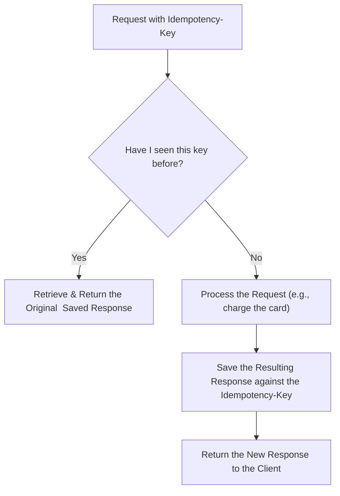

#CoreConcept #API #SystemDesign #BestPractice #Networking

> An operation is **idempotent** if it can be repeated safely multiple times without changing the result beyond the initial application. It's a crucial principle for building robust systems that can handle network failures and request retries.

---

> [!note] The Core Analogy: Elevator vs. Vending Machine
> This simple analogy makes the concept crystal clear.
>
> -   **✅ Idempotent: The Elevator Button**
>     Pressing the button for the 8th floor calls the elevator. Pressing it 10 more times **doesn't** call 10 more elevators. The system's state is simply "the 8th floor has been requested," and further identical requests don't change that state.
>
> -   **❌ Not Idempotent: The Vending Machine Button**
>     Pressing the "dispense snack" button gets you one snack. Pressing it again gets you a **second snack**. Each request changes the state of the system (and your wallet) in a new way.

---

## Idempotency in [[HTTP/HTTPS|HTTP]] Methods

By convention, certain HTTP methods are expected to be idempotent, while others are not.

| HTTP Method | Idempotent? | Reason |
| :--- | :---: | :--- |
| **`GET`** | ✅ Yes | Retrieving the same resource multiple times doesn't change it. |
| **`PUT`** | ✅ Yes | Replacing a resource with the same data multiple times results in the same final state. |
| **`DELETE`**| ✅ Yes | Deleting a resource once removes it. Subsequent delete calls will result in a `404 Not Found`, but the resource is still gone—the state doesn't change further. |
| **`PATCH`** | ⚠️ Maybe | Can be idempotent if the operation is "set this value to X," but not if it's "add 10 to this value." |
| **`POST`** | ❌ No | Submitting the same request multiple times is expected to **create a new resource** each time. |

---

## Why This Matters to a Developer: The Unreliable Internet

> [!danger] The Double-Charge Problem
> The internet is unreliable. Networks fail, requests time out. A client (like a mobile app) might send a `POST /charge_customer` request, the server might process it successfully, but the success response gets lost on the way back. The client, thinking the request failed, will **automatically retry it**.
>
> If your `POST` endpoint is not designed to be idempotent, **you will charge the customer twice.** This is a catastrophic failure for your business and your users.

By designing your state-changing endpoints (especially critical ones like payments or order submissions) to be idempotent, you make your system resilient to these inevitable network errors.

---

## The Professional Solution: The Idempotency Key

The standard technique for making a non-idempotent operation (like `POST`) behave idempotently is to use an **Idempotency Key**.

> **The Flow:**
> 1.  The **client** generates a unique ID for each request (e.g., a UUID) that it wants to protect from duplication.
> 2.  The client sends this ID in a custom HTTP header, like `Idempotency-Key: a1b2c3d4-e5f6-7890-gh12-i3j4k5l6m7n8`.
> 3.  The **server** implements the following logic:




This ensures that if the server receives the same request with the same key multiple times, it will only process it **once**. For all subsequent retries, it will simply return the original, saved response without performing the action again.

---

# 💻 Technology Illustration (.NET / C#)

In an ASP.NET Core API, idempotency is typically implemented as an **Endpoint Filter** backed by a distributed cache (like Redis):

```csharp
// Idempotency Filter in ASP.NET Core:
public class IdempotencyFilter(IDistributedCache cache) : IEndpointFilter
{
    public async ValueTask<object?> InvokeAsync(
        EndpointFilterInvocationContext context, 
        EndpointFilterDelegate next)
    {
        var httpContext = context.HttpContext;
        if (!httpContext.Request.Headers.TryGetValue("Idempotency-Key", out var key))
        {
            return await next(context); // Proceed normally if no key provided
        }

        string cacheKey = $"idempotency:{key}";
        
        // 1. Check if the request was already processed:
        var cachedResponse = await cache.GetStringAsync(cacheKey);
        if (cachedResponse is not null)
        {
            // Return cached response immediately, bypassing payment/order processing:
            return Results.Content(cachedResponse, "application/json", statusCode: StatusCodes.Status200OK);
        }

        // 2. Execute business logic:
        var result = await next(context);

        // 3. Cache response against the key for 24 hours:
        if (result is IStatusCodeHttpResult { StatusCode: 200 or 201 })
        {
            await cache.SetStringAsync(cacheKey, JsonSerializer.Serialize(result), new DistributedCacheEntryOptions
            {
                AbsoluteExpirationRelativeToNow = TimeSpan.FromHours(24)
            });
        }

        return result;
    }
}
```

---

# 💡 Why This Matters to a Developer

1. **Defending Against Duplicate Payments:** Payment processors (Stripe, Adyen) mandate idempotency keys because mobile networks frequently drop connections right after a credit card charge succeeds.
2. **Safe Automated Retries:** Resilient microservices use automated retry policies (e.g., with Polly in .NET). Idempotency guarantees that retrying a failed HTTP call is 100% safe.