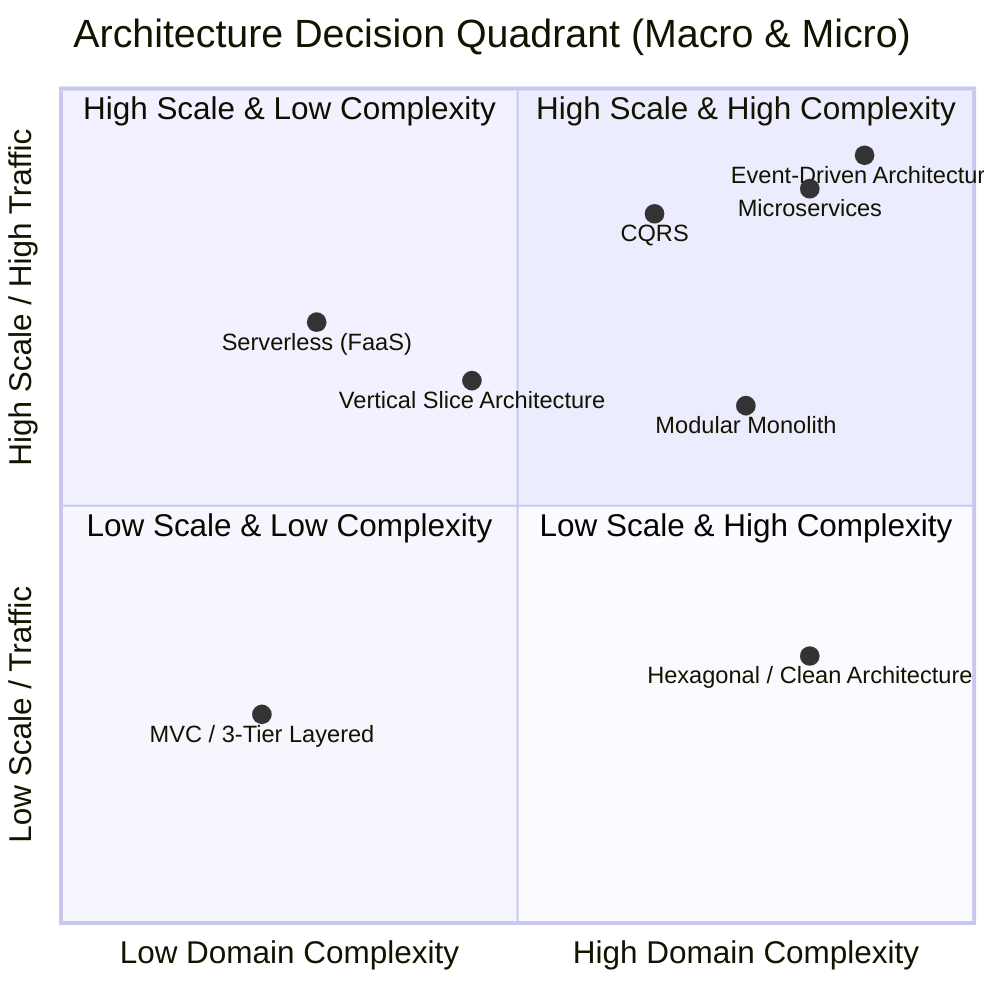

#Architecture #ApplicationDesign #SystemDesign #CleanArchitecture #VerticalSlice #CQRS #EventDriven #DotNet

> [!abstract] Comprehensive Architectural Guide
> While **API Design** dictates how the outside world calls an application, **Application Design** dictates how the internal code, business logic, dependencies, and data flows are organized inside the process. Choosing the wrong architecture leads to monolithic "ball of mud" codebases, high maintenance friction, and scaling bottlenecks.

---

# 🌐 1. The Architectural Categorization System

Architectures must not be viewed as a flat list of competing options. They operate at two fundamentally different scopes:

```
                               ┌────────────────────────────────┐
                               │     ARCHITECTURE TAXONOMY     │
                               └───────────────┬────────────────┘
                                               │
               ┌───────────────────────────────┴───────────────────────────────┐
               ▼                                                               ▼
┌──────────────────────────────┐                                ┌──────────────────────────────┐
│  Category 1: SYSTEM DESIGN   │                                │ Category 2: APPLICATION DESIGN│
│      (The Macro Scope)       │                                │   (The Micro / Code Scope)   │
│ • Network & Process Bounds   │                                │ • In-Process Folder/Classes  │
│ • Deployment Topologies      │                                │ • Structural Boundaries      │
│ • Database Boundaries        │                                │ • Data Flow Channels         │
└──────────────┬───────────────┘                                └──────────────┬───────────────┘
               │                                                               │
     ┌─────────┴─────────┐                                           ┌─────────┴─────────┐
     ▼                   ▼                                           ▼                   ▼
 [Monoliths &]       [Distributed &]                         [By Boundaries]      [By Data Flow]
 [Bounded Modules]   [Ephemeral Compute]                     ├─ Horizontal (MVC)   └─ CQRS
 ├─ Modular Monolith ├─ Microservices                        ├─ Concentric (Clean)
 └─ Classic Monolith ├─ Serverless (FaaS)                    └─ Vertical (Slices)
                     └─ Event-Driven (EDA)
```

### 🌐 Category 1: System Design (The Macro Scope — "Core Mega Architectures")
These patterns dictate how whole applications, operating systems, and databases interact across network and deployment boundaries:
- **Modular Monolith:** Dictates system-wide organization within a single deployment unit. It groups code into independent, loosely coupled bounded contexts or modules that share a runtime process but maintain strict internal boundaries without cross-module database coupling.
- **Microservices Architecture:** Decomposes a system into independently deployable, network-isolated services. Crucially, **each microservice owns its private, exclusive database**. Services communicate across the network via gRPC, HTTP REST, or message queues. Primarily driven by **team scaling and independent deployment cadences**.
- **Serverless / Function-as-a-Service (FaaS):** Eliminates 24/7 dedicated web server processes in favor of ephemeral, event-triggered compute units (Azure Functions, AWS Lambda). Automatically scales from 0 to thousands of instances on demand with zero idle server cost.
- **Event-Driven Architecture (EDA):** Relies on asynchronous message brokers (Kafka, RabbitMQ, Azure Service Bus) to decouple entire systems so producers and consumers react to domain events without direct network dependencies.

### 📦 Category 2: Application Design (The Micro / Internal Scope)
These patterns focus purely on how internal code is structured inside a single compiled process. They do not care about network topology or cloud deployments; they dictate folders, classes, interfaces, and assemblies:

#### A. By Dependency & Structural Boundaries
- **MVC / 3-Tier Layered Architecture (Horizontal Boundaries):** Code is split by technical identity (`Presentation -> Business Logic -> Data Access`). Dependencies strictly point down the stack.
- **Hexagonal / Clean Architecture (Concentric / Inward Boundaries):** The core business domain sits purely at the center without outside dependencies. Infrastructure, UI, and Databases sit on the outer rim and point inward using abstraction interfaces (Ports & Adapters).
- **Vertical Slice Architecture (Feature-Centric Boundaries):** Rejects global horizontal layers. Code is bundled tightly by business capability (`CancelOrder`, `ViewProductDetails`), cutting straight through the presentation, logic, and data tiers in an isolated vertical column.

#### B. By Data Flow Separation
- **CQRS (Command Query Responsibility Segregation):** A specialized data-flow pattern. It splits internal code paths into two distinct channels: **Commands** for executing business invariants that modify state, and **Queries** optimized solely for reading and projecting database records directly to the UI.

---

### 🗺️ Structural Mapping Overview

| Architecture | Scope | Primary Boundary Strategy | Core Optimization |
| :--- | :--- | :--- | :--- |
| **Modular Monolith** | System Design (Macro) | In-Process Bounded Modules | High domain complexity, single deployment unit |
| **Microservices** | System Design (Macro) | Network & Dedicated Database per Service | Team autonomy, independent CI/CD, targeted scaling |
| **Serverless (FaaS)** | System Design (Macro) | Ephemeral Event-Triggered Runtimes | Zero idle cost, automated elasticity, background jobs |
| **Event-Driven** | System Design (Macro) | Network / Event Stream Channels | High scale, extreme system decoupling, async workflows |
| **Clean Architecture** | Application Design (Micro) | Concentric / Layer Inversion (Inward) | Domain purity, highly testable business logic |
| **Vertical Slices** | Application Design (Micro) | Functional Slices (Feature-by-Feature) | High feature velocity, minimal cross-talk |
| **MVC / 3-Tier** | Application Design (Micro) | Horizontal Layers (Role-by-Role) | Simple CRUD, low domain complexity |
| **CQRS** | Application Design (Micro) | Behavioral Channels (Read vs. Write) | High performance read/write asymmetry |

---

# 🧭 2. The Architectural Decision Quadrant

Every application architecture is an optimization for two fundamental constraints:
1. **Domain Complexity (X-Axis):** The intricacy of business rules, validation invariants, regulatory workflows, and domain calculations (e.g., a simple CRUD blog vs. a multi-currency core banking ledger).
2. **Scale & Traffic (Y-Axis):** The volume of concurrent requests, asynchronous workloads, throughput demands, and read/write asymmetry.

```
High Scale / Traffic
       ▲
       │
       │       [ CQRS ]                  [ Microservices ]         [ Event-Driven ]
       │     (Read/Write split)         (Team & node scale)       (Async Kafka/Queues)
       │
       │   [ Serverless (FaaS) ]        [ Vertical Slices ]       [ Modular Monolith ]
       │   (Elastic on-demand compute)  (Feature-driven / MediatR)(Independent bounded modules)
       │
       │       [ MVC / 3-Tier ]                                   [ Hexagonal / Clean ]
       │     (Traditional CRUD layers)                            (Domain purity / Ports & Adapters)
       │
       └────────────────────────────────────────────────────────────────────────────────────────►
   Low Domain Complexity                                                     High Domain Complexity
   (Simple CRUD, few rules)                                                (Intricate logic, workflows)
```



---

# 🏛️ 3. Deep Dive into the 6 Architecture Styles

---

## 1. MVC vs. Layered (3-Tier) Architecture

Developers often use the term "MVC" sloppily to mean "Controllers and Services." But in true software architecture, **MVC** and **Layered (N-Tier)** solve two different problems:

```
┌────────────────────────────────────────────────────────────────────────────────────────┐
│                        TRUE FULL-STACK MVC (Presentation Pattern)                      │
│                                                                                        │
│     Browser ──(HTTP GET)──►  [ Controller ]                                            │
│                                   │                                                    │
│                                   ├─► Interacts with Service/DB to build [ Model ]     │
│                                   │                                          │         │
│                                   ▼                                          ▼         │
│     Browser ◄──(HTML)──────  [ View (.cshtml / Razor) ] ◄── (Binds Model) ──┘         │
└────────────────────────────────────────────────────────────────────────────────────────┘
                                            │
                                            ▼
┌────────────────────────────────────────────────────────────────────────────────────────┐
│                        LAYERED / 3-TIER ARCHITECTURE (System Structure)                │
│                                                                                        │
│   [ Presentation Layer ]  ──► Controllers (MVC Views OR Web API Endpoints)             │
│            │                                                                           │
│            ▼                                                                           │
│   [ Business Logic Layer ] ──► Domain Services & Application Logic                     │
│            │                                                                           │
│            ▼                                                                           │
│   [ Data Access Layer ]   ──► Repositories & Entity Framework Core                     │
│            │                                                                           │
│            ▼                                                                           │
│   [ Database Engine ]     ──► SQL Tables                                               │
└────────────────────────────────────────────────────────────────────────────────────────┘
```

---

### A. True Full-Stack MVC (Model - View - Controller)
MVC was originally designed as a **User Interface pattern** for applications where the server renders the frontend directly (**Server-Side Rendering / SSR**).

1. **The Controller:** Handles incoming HTTP requests, coordinates business logic, selects which View to render, and passes data to it.
2. **The Model (ViewModel):** A data transfer object specifically shaped for the UI's needs (e.g., `OrderSummaryViewModel`), containing formatted text, display flags, and form validation rules.
3. **The View:** The presentation template written in HTML and Razor (`.cshtml`). It takes the Model and compiles it into pure HTML/CSS strings sent back to the browser.

#### C# / .NET Reality: ASP.NET Core MVC with Razor
```csharp
// 1. The Controller
public class ProductsController(IProductService productService) : Controller
{
    // GET /Products/Details/5
    public async Task<IActionResult> Details(int id)
    {
        var product = await productService.GetByIdAsync(id);
        if (product is null) return NotFound();

        // 2. The Model (ViewModel)
        var viewModel = new ProductDetailsViewModel(
            product.Name, 
            product.Price.ToString("C"), 
            product.StockCount > 0
        );

        // 3. The View: Selects Views/Products/Details.cshtml
        return View(viewModel); 
    }
}
```

```html
<!-- Views/Products/Details.cshtml (The View) -->
@model ProductDetailsViewModel

<h1>@Model.Name</h1>
<p>Price: @Model.FormattedPrice</p>
@if (Model.IsInStock) {
    <span class="badge bg-success">In Stock</span>
}
```

> [!tip] Modern .NET Alternative: Razor Pages
> In modern full-stack .NET, Microsoft recommends **Razor Pages** over traditional MVC controllers for page-focused apps. In Razor Pages, the Controller and ViewModel are fused into a single file-backed code-behind (`PageModel`), reducing ceremony: `Index.cshtml` + `Index.cshtml.cs`.

---

### B. What Happened to the "View" in Modern Web APIs? (The Headless Shift)
When frontend frameworks like **React, Angular, Vue, and native mobile apps** took over, the "View" was stripped out of the backend:
- The backend became a **"Headless" Web API**: Controllers stop returning `View(model)` (HTML) and start returning raw **JSON DTOs** (`Results.Ok(dto)`).
- The "View" now executes on the client device's browser using JavaScript.
- Because the View is gone, backend architectures evolved into the **Layered (3-Tier)** model (`Controllers -> Services -> Repositories`), which many developers still mistakenly refer to as "MVC."

#### C# / .NET Reality: Layered (3-Tier) Web API
```csharp
// 1. Presentation Layer: Controller (Only handles HTTP & DTOs)
[ApiController, Route("api/products")]
public class ProductsController(IProductService productService) : ControllerBase
{
    [HttpGet("{id}")]
    public async Task<IActionResult> GetById(int id)
    {
        var productDto = await productService.GetProductAsync(id);
        return productDto is not null ? Ok(productDto) : NotFound();
    }
}

// 2. Business Logic Layer: Service (Orchestrates domain rules)
public class ProductService(IProductRepository repository) : IProductService
{
    public async Task<ProductDto?> GetProductAsync(int id)
    {
        var entity = await repository.FindByIdAsync(id);
        return entity is not null ? new ProductDto(entity.Id, entity.Name, entity.Price) : null;
    }
}

// 3. Data Access Layer: Repository (Direct SQL / EF Core)
public class ProductRepository(AppDbContext db) : IProductRepository
{
    public Task<Product?> FindByIdAsync(int id) => db.Products.FindAsync(id).AsTask();
}
```

---

### The Trade-Offs of Full-Stack MVC
- ✅ **Pros:** 
  - Ultra-fast initial page loads (HTML arrives pre-rendered from the server).
  - Excellent SEO (search engine crawlers read plain HTML effortlessly).
  - No need to manage a separate Node.js / React build pipeline or complex API versioning contracts.
- ❌ **Cons:** 
  - Server CPU overhead (rendering complex HTML templates at scale).
  - Tightly coupled to web browsers—cannot natively power iOS or Android apps without building a separate API.

### Where it Sits on the Quadrant
- **Low Domain Complexity, Low-to-Moderate Scale:** E-commerce stores, SaaS dashboards, internal enterprise portals, and content websites where full-stack .NET teams want maximum development speed without frontend sprawl.

---

## 2. Vertical Slice Architecture (Feature-Driven)

Instead of cutting the system horizontally by technical layers, Vertical Slices cut the codebase vertically by **business use-cases / features**.

```
Features/
├── Orders/
│   ├── CreateOrder/
│   │   ├── CreateOrderEndpoint.cs    (HTTP Route)
│   │   ├── CreateOrderCommand.cs     (Input DTO)
│   │   ├── CreateOrderHandler.cs     (Business Logic)
│   │   └── CreateOrderValidator.cs   (FluentValidation)
│   ├── GetOrderById/
│   │   ├── GetOrderByIdEndpoint.cs
│   │   ├── GetOrderByIdQuery.cs
│   │   └── GetOrderByIdHandler.cs    (Fast raw Dapper SQL query)
│   └── CancelOrder/
```

### The Core Philosophy
Minimize coupling between distinct features while maximizing cohesion within a single feature. Each slice has its own pipeline and can choose its own optimal data access tool.

### The Trade-Offs
- ✅ **Pros:**
  - **Zero Feature Coupling:** Changing `CancelOrder` has an absolute 0% chance of breaking `GetOrderById`.
  - **Optimized Per Slice:** Complex writes can use a rich domain model, while fast reads in the same project can bypass domain abstractions and execute high-speed raw SQL.
  - **High Team Velocity:** Multiple developers work on different features without merge conflicts in shared `OrderService.cs` files.
- ❌ **Cons:** Code duplication across slices (e.g., repeating small queries instead of forcing an artificial shared helper).

### Where it Sits on the Quadrant
- **Moderate Complexity, Moderate-to-High Scale.** Perfect for growing products, microservice internals, and teams prioritizing rapid feature delivery.

### C# / .NET Reality
Popularized by Jimmy Bogard; implemented via **MediatR** or **FastEndpoints**:
```csharp
// Features/Orders/CreateOrder/CreateOrderSlice.cs (Entire feature self-contained!)

// 1. Public API Contract & Command
public record CreateOrderRequest(Guid CustomerId, decimal Amount);
public record CreateOrderCommand(Guid CustomerId, decimal Amount) : IRequest<Guid>;

// 2. HTTP Endpoint (Minimal API)
public static class CreateOrderEndpoint
{
    public static void Map(WebApplication app) =>
        app.MapPost("/api/orders", async (CreateOrderRequest req, ISender sender) =>
        {
            var orderId = await sender.Send(new CreateOrderCommand(req.CustomerId, req.Amount));
            return Results.Created($"/api/orders/{orderId}", orderId);
        });
}

// 3. Feature Logic Handler (Directly touches EF Core or Dapper for this slice)
public class CreateOrderHandler(AppDbContext db) : IRequestHandler<CreateOrderCommand, Guid>
{
    public async Task<Guid> Handle(CreateOrderCommand cmd, CancellationToken ct)
    {
        var order = new Order(cmd.CustomerId, cmd.Amount);
        db.Orders.Add(order);
        await db.SaveChangesAsync(ct);
        return order.Id;
    }
}
```

---

## 3. Hexagonal Architecture (Ports & Adapters / Clean / Onion)

The **Domain Model is the absolute center of the universe**. The domain has zero external dependencies—it knows nothing about HTTP, databases, third-party APIs, or frameworks.

```
                  ┌─────────────────────────────────┐
                  │      Adapters (Infrastructure)   │
                  │   [EF Core]   [Stripe]   [Redis] │
                  │                 │               │
                  │                 ▼ (Implements)  │
                  │       Ports (Interfaces)        │
                  │                 │               │
                  │                 ▼               │
                  │   ┌─────────────────────────┐   │
[ HTTP Request ] ─┼─► │    Application Layer    │   │
                  │   │   (Use Cases / Commands)│   │
                  │   │             │           │   │
                  │   │             ▼           │   │
                  │   │     Domain Core         │   │
                  │   │  (Entities & Invariants)│   │
                  │   └─────────────────────────┘   │
                  └─────────────────────────────────┘
```

### The Core Philosophy: The Dependency Inversion Rule
Dependencies point inward only:
- **Ports:** Interfaces defined by the application/domain (e.g., `IPaymentGateway`, `IOrderRepository`).
- **Adapters:** Infrastructure implementations on the outside (e.g., `StripePaymentGateway`, `SqlOrderRepository`).

---

### 🧅 The Concentric Rings of Onion Architecture (Jeffrey Palermo, 2008)

While Hexagonal Architecture defined how to decouple the application from external tools at the boundary, **Onion Architecture** answered what the *inside* of the domain looks like by arranging it into concentric rings:

```
               ┌─────────────────────────────────────────┐
               │         OUTER RING: Infrastructure      │
               │      (EF Core, SQL, REST APIs, UI)      │
               │   ┌─────────────────────────────────┐   │
               │   │    RING 2: Application Services │   │
               │   │   (Orchestration / Use Cases)   │   │
               │   │   ┌─────────────────────────┐   │   │
               │   │   │  RING 1: Domain Services│   │   │
               │   │   │   ┌─────────────────┐   │   │   │
               │   │   │   │   CORE: Domain  │   │   │   │
               │   │   │   │      Model      │   │   │   │
               │   │   │   │   (Entities &   │   │   │   │
               │   │   │   │  Value Objects) │   │   │   │
               │   │   │   └─────────────────┘   │   │   │
               │   │   └─────────────────────────┘   │   │
               │   └─────────────────────────────────┘   │
               └─────────────────────────────────────────┘
                                    ▲
                                    │
                (Dependencies point strictly INWARD)
```

#### The Rings from Inside Out:
1. **Core: Domain Model (`Order`, `Customer`, `Money`):**
   - Pure C# classes with zero references to EF Core, ASP.NET, or any NuGet package.
   - Encapsulates state and business validation rules (invariants).
2. **Ring 1: Domain Services:**
   - Business logic that spans multiple entities (e.g., `OrderPricingService` calculating taxes and multi-currency discounts). Still zero infrastructure dependencies.
3. **Ring 2: Application Services:**
   - Coordinates workflows (e.g., "Load order from repository port, invoke pricing service, save via repository port").
   - Defines interfaces (**Ports**) like `IOrderRepository`, `IEmailSender`.
4. **Outer Ring: Infrastructure & UI:**
   - Implements the interfaces (**Adapters**): `SqlOrderRepository` (EF Core), `SendGridEmailSender`, and controllers.

> [!important] The Golden Law of the Onion
> **All dependencies point strictly inward toward the center.**  
> Outer layers can see inner layers. Inner layers have **zero awareness** of outer layers.

---

### ⚖️ Hexagonal vs. Onion vs. Clean: What's the Difference?

These three patterns are members of the same **Concentric Architectural Family**. They are not competitors; each added a layer of refinement over time:

| Architecture | Creator & Year | Core Focus | What It Contributed |
| :--- | :--- | :--- | :--- |
| **Hexagonal** | Alistair Cockburn (2005) | **The Boundary** | Introduced **Ports & Adapters**. Established symmetry between inputs (HTTP/CLI) and outputs (DB/Message Broker). |
| **Onion** | Jeffrey Palermo (2008) | **The Internal Domain** | Defined how to structure the code inside the domain using concentric rings (Entities $\rightarrow$ Domain Services $\rightarrow$ Application Services). |
| **Clean** | Robert C. Martin (2012) | **The Synthesis** | Popularized the concept under the name **"Clean Architecture"**, unifying Palermo's rings and Cockburn's ports under "Use Cases" and "Entities". |

---

### 💻 Practical .NET Reality: How Engineers Use It Today

Because Jeffrey Palermo is a prominent .NET architect, Onion Architecture is deeply ingrained in the C# community. When a .NET job posting or engineering team says:
- *"We use Onion Architecture"*
- *"We use Clean Architecture"*
- *"We use Hexagonal Architecture"*

They mean the **exact same Visual Studio solution structure**:

```
MyApp.sln
├── MyApp.Domain/          <-- Core & Ring 1 (Entities, Domain Services) - 0 external dependencies
├── MyApp.Application/     <-- Ring 2 (Use Cases, Commands, Interface Ports) - References Domain
├── MyApp.Infrastructure/  <-- Outer Ring (EF Core, SQL, Third-Party APIs) - References Application
└── MyApp.WebApi/          <-- Outer Ring (Controllers, Program.cs) - References Application & Infrastructure
```

#### Symbolic Code Implementation Across the 4 Projects:
```csharp
// 1. MyApp.Domain: Core Domain Entity (Pure C# - 0 dependencies)
namespace MyApp.Domain.Entities;
public class Order(Guid customerId, decimal total)
{
    public Guid Id { get; } = Guid.NewGuid();
    public Guid CustomerId { get; } = customerId;
    public decimal Total { get; } = total > 0 ? total : throw new ArgumentException("Total must be positive");
}

// 2. MyApp.Application: Port (Interface) & Use Case
namespace MyApp.Application.Ports;
public interface IOrderRepository
{
    Task SaveAsync(Domain.Entities.Order order);
}

namespace MyApp.Application.UseCases;
public class CreateOrderUseCase(IOrderRepository repository)
{
    public async Task<Guid> ExecuteAsync(Guid customerId, decimal amount)
    {
        var order = new Domain.Entities.Order(customerId, amount);
        await repository.SaveAsync(order);
        return order.Id;
    }
}

// 3. MyApp.Infrastructure: Adapter (Implements Port with EF Core)
namespace MyApp.Infrastructure.Adapters;
public class SqlOrderRepository(AppDbContext db) : Application.Ports.IOrderRepository
{
    public async Task SaveAsync(Domain.Entities.Order order)
    {
        db.Orders.Add(order);
        await db.SaveChangesAsync();
    }
}

// 4. MyApp.WebApi: Presentation (Calls Application Use Case)
[ApiController, Route("api/orders")]
public class OrdersController(CreateOrderUseCase useCase) : ControllerBase
{
    [HttpPost]
    public async Task<IActionResult> Create(CreateOrderRequest req) =>
        Ok(await useCase.ExecuteAsync(req.CustomerId, req.Amount));
}
```

---

### The Trade-Offs of Concentric Architectures
- ✅ **Pros:**
  - **Pure Domain Testing:** 100% of business logic can be unit-tested in milliseconds without databases or mocking HTTP servers.
  - **Framework Independence:** Swapping PostgreSQL for SQL Server requires zero changes to core business logic.
- ❌ **Cons:** High boilerplate overhead, numerous mapping layers, excessive project references. An anti-pattern for simple CRUD applications.

### Where it Sits on the Quadrant
- **High Domain Complexity, Moderate Scale.** The gold standard for financial ledgers, insurance calculation engines, and healthcare systems with long lifecycles.

---

## 4. Modular Monolith (Component Architecture)

A single deployable process divided into strictly isolated, independent business modules (e.g., `CatalogModule`, `OrderingModule`, `BillingModule`).

```
┌────────────────────────────────────────────────────────┐
│               Single Deployable Process (.NET)         │
│                                                        │
│  ┌──────────────────┐            ┌──────────────────┐  │
│  │  Ordering Module │            │  Billing Module  │  │
│  │  ├── Domain      │            │  ├── Domain      │  │
│  │  ├── Features    │            │  ├── Features    │  │
│  │  └── Data (DB 1) │            │  └── Data (DB 2) │  │
│  └────────┬─────────┘            └────────▲─────────┘  │
│           │                               │            │
│           └──────► [In-Memory Event Bus] ─┘            │
│                 (No direct DB cross-queries!)          │
└────────────────────────────────────────────────────────┘
```

### The Core Philosophy
Enjoy microservice-level domain isolation and boundary enforcement **without the distributed systems pain** (no network latency, no Kubernetes orchestration, no distributed transaction sagas).

### The Trade-Offs
- ✅ **Pros:**
  - Independent domain development with simple single-command deployment.
  - Natural stepping stone: if `BillingModule` ever needs independent scaling, it can be extracted into a standalone microservice in hours because its boundaries are already strictly enforced.
- ❌ **Cons:** Requires architectural discipline or tooling (e.g., ArchUnitNET) to prevent developers from taking shortcuts and referencing another module's internal classes.

### Where it Sits on the Quadrant
- **High Domain Complexity, Moderate-to-High Scale.** The modern default for scaling development teams before jumping to microservices.

### C# / .NET Reality
Modules are distinct C# projects with internal logic marked `internal`. Only interface contracts and event records are `public`. Modules communicate in-memory via MediatR notifications or public interfaces—never direct cross-module database queries:

```csharp
// --- 1. PUBLIC CONTRACT (Ordering.Contracts.dll - Referenced by other modules) ---
public record OrderPlacedNotification(Guid OrderId, Guid CustomerId, decimal Amount) : INotification;

// --- 2. ORDERING MODULE (Ordering.Module.dll - Classes are internal!) ---
namespace Ordering.Internal;

internal class CreateOrderHandler(OrderingDbContext db, IMediator mediator)
{
    public async Task<Guid> Handle(CreateOrderRequest req)
    {
        var order = new Order(req.CustomerId, req.Amount);
        db.Orders.Add(order);
        await db.SaveChangesAsync();

        // In-memory decoupled broadcast: Billing reacts without Ordering knowing!
        await mediator.Publish(new OrderPlacedNotification(order.Id, order.CustomerId, order.Amount));
        return order.Id;
    }
}

// --- 3. BILLING MODULE (Billing.Module.dll - Own private DbContext & tables) ---
namespace Billing.Internal;

// Listens to the public contract with zero knowledge of Ordering's internal database
internal class CreateInvoiceOnOrderPlaced(BillingDbContext billingDb) 
    : INotificationHandler<OrderPlacedNotification>
{
    public async Task Handle(OrderPlacedNotification notification, CancellationToken ct)
    {
        billingDb.Invoices.Add(new Invoice(notification.OrderId, notification.Amount));
        await billingDb.SaveChangesAsync(ct);
    }
}
```

---

## 5. CQRS (Command Query Responsibility Segregation)

Separates the data model for **Writes (Commands)** from the data model for **Reads (Queries)**.

```
[ Client Request ]
       │
       ├─► Write Path: [Command] ──► Domain Rules ──► Primary DB (Normalized SQL)
       │                                                     │
       │                                                     ▼ (Async Projection)
       └─► Read Path:  [Query]   ──────────────────► Read Store (Denormalized Cache / Elastic)
```

### The Core Philosophy
Reading and writing are two fundamentally different problems:
- **Commands:** Must enforce strict business rules, ACID transactions, and domain invariants (`TransferMoneyCommand`).
- **Queries:** Need raw speed, zero joins, and pre-aggregated DTOs (`GetAccountSummaryQuery`).

### The Trade-Offs
- ✅ **Pros:** Unmatched read throughput. Eliminates expensive multi-table joins on hot database paths.
- ❌ **Cons:** Data synchronization overhead. When using separate read and write databases, you must design for **eventual consistency**.

### Where it Sits on the Quadrant
- **High Scale / Traffic (High Read/Write Asymmetry) + Moderate-to-High Complexity.** E-commerce product catalogs, social media feeds, live dashboards.

### C# / .NET Reality
Commands execute through Entity Framework Core with transactional safety and domain invariants; Queries execute directly via lightweight **Dapper** micro-ORM or Redis/Elasticsearch projections:

```csharp
// --- WRITE SIDE: Command (Strict domain rules & ACID transactions via EF Core) ---
public record CancelOrderCommand(Guid OrderId, string Reason);

public class CancelOrderHandler(AppDbContext db)
{
    public async Task Handle(CancelOrderCommand cmd, CancellationToken ct)
    {
        var order = await db.Orders.FindAsync(cmd.OrderId) 
            ?? throw new KeyNotFoundException("Order not found");

        order.Cancel(cmd.Reason); // Domain invariant check
        await db.SaveChangesAsync(ct);
    }
}

// --- READ SIDE: Query (Zero tracking, zero domain entities, fast raw SQL via Dapper) ---
public record OrderSummaryDto(Guid Id, string Status, decimal TotalAmount, DateTime CreatedAt);

public class GetOrderSummaryHandler(IDbConnection dbConnection)
{
    public async Task<OrderSummaryDto?> Handle(Guid orderId)
    {
        const string sql = """
            SELECT Id, Status, TotalAmount, CreatedAt 
            FROM Orders 
            WHERE Id = @OrderId
            """;
        return await dbConnection.QuerySingleOrDefaultAsync<OrderSummaryDto>(sql, new { OrderId = orderId });
    }
}
```

---

## 6. Event-Driven Architecture (EDA)

Components do not call each other via synchronous RPC/HTTP. Instead, when a state transition occurs, an entity publishes an **Event** (`OrderPlacedEvent`), and decoupled consumers react asynchronously via message brokers.

```
[ Ordering Service ] ──► Publishes "OrderPlaced" ──► [ Message Broker (Kafka / RabbitMQ) ]
                                                              │
                                      ┌───────────────────────┴───────────────────────┐
                                      ▼                                               ▼
                           [ Inventory Service ]                             [ Notification Service ]
                           (Decrements stock)                                (Sends customer email)
```

### The Core Philosophy: "Tell, Don't Ask"
Producers emit facts about what already happened. Producers do not know, nor do they care, who or how many consumers react to that event.

### The Trade-Offs
- ✅ **Pros:** Extreme scalability, temporal decoupling (if the email service is down, orders still succeed; emails process when it recovers), high resilience.
- ❌ **Cons:** Difficult distributed debugging, eventual consistency, requires distributed tracing (OpenTelemetry) and idempotency across consumers.

### Where it Sits on the Quadrant
- **High Scale / Traffic, High Domain Complexity.** Asynchronous order fulfillment, high-volume telemetry pipelines, cross-service workflows.

### C# / .NET Reality
Powered by messaging libraries like **MassTransit** or **Wolverine** over Azure Service Bus, RabbitMQ, or Apache Kafka:

```csharp
// 1. Immutable Event Contract (Shared contract DLL)
public record OrderPlacedEvent(Guid OrderId, Guid CustomerId, decimal Amount, DateTime PlacedAt);

// 2. Producer: Ordering Service (Emits fact to message broker)
public class CheckoutService(IPublishEndpoint publishEndpoint, AppDbContext db)
{
    public async Task PlaceOrder(Order order)
    {
        db.Orders.Add(order);
        await db.SaveChangesAsync();

        // Broadcast to broker: Producer does NOT know nor care who is listening!
        await publishEndpoint.Publish(new OrderPlacedEvent(
            order.Id, order.CustomerId, order.Total, DateTime.UtcNow));
    }
}

// 3. Consumer: Notification Worker (Runs in a completely separate process)
public class SendEmailOnOrderPlaced(IEmailSender email) : IConsumer<OrderPlacedEvent>
{
    public async Task Consume(ConsumeContext<OrderPlacedEvent> context)
    {
        var evt = context.Message;
        await email.SendAsync(evt.CustomerId, $"Your order {evt.OrderId} for {evt.Amount:C} is confirmed!");
    }
}
```

---

## 7. Microservices Architecture

The system is decomposed into a suite of small, network-isolated services, where **each microservice owns its private, exclusive database**. No service is permitted to query another service's database directly.

```
       [ Client / Frontend ]
                 │
           [ API Gateway (YARP) ]
          ┌──────┴──────┐ (HTTP / gRPC)
          ▼             ▼
   ┌─────────────┐   ┌─────────────┐
   │ Order API   │   │ Billing API │
   │  Container  │   │  Container  │
   └──────┬──────┘   └──────┬──────┘
          │                 │
     [(Orders DB)]     [(Billing DB)]
          │                 ▲
          └─► [Kafka/Bus] ──┘ (Async Events)
```

### The Core Philosophy: Team Autonomy & Conway's Law
Microservices is fundamentally an **organizational architecture**, not a purely technical one. It aligns with *Conway's Law*: large engineering organizations (50–200+ engineers) cannot coordinate deployments within a single monolithic codebase. Microservices allow "Team Orders" (5 developers) to ship to production on a Tuesday without waiting for "Team Billing".

### The Trade-Offs
- ✅ **Pros:**
  - **Independent Deployments:** Zero release coupling; a bug in the catalog does not bring down authentication.
  - **Targeted Hardware Scaling:** Scale the 100,000 req/sec search service across 40 nodes while running the 10 req/sec checkout service on 2 nodes.
  - **Technology Freedom:** Teams can pick specialized stacks where appropriate (e.g., C# for high-performance APIs, Python for machine learning).
- ❌ **Cons:**
  - **The Distributed Systems Tax:** Network latency, partial network failures, distributed tracing complexity (OpenTelemetry), and the loss of ACID transactions (requires complex Saga patterns and eventual consistency).
  - **DevOps Overhead:** Requires sophisticated container orchestration (Kubernetes), service meshes, centralized logging, and API gateways.

### Where it Sits on the Quadrant
- **High Scale / Traffic, High Domain Complexity (50+ Engineers).** Massive organizations with multiple autonomous cross-functional teams.

### C# / .NET Reality
Containerized ASP.NET Core services running in **Docker / Kubernetes**, routed via **YARP** (API Gateway), and communicating internally via **gRPC** (sync RPC) and **MassTransit** (async events):

```csharp
// --- 1. API GATEWAY (Program.cs in Gateway using YARP) ---
// Reverse proxy terminates public HTTPS and routes to internal service containers
app.MapReverseProxy(); 

// --- 2. ORDER MICROSERVICE: gRPC Endpoint (Runs in Order container with private DB) ---
public class OrderGrpcService(OrdersPrivateDbContext db) : OrderApi.OrderApiBase
{
    public override async Task<OrderResponse> GetOrder(OrderRequest request, ServerCallContext context)
    {
        var order = await db.Orders.FindAsync(Guid.Parse(request.OrderId));
        if (order is null) throw new RpcException(new Status(StatusCode.NotFound, "Order not found"));

        return new OrderResponse { OrderId = order.Id.ToString(), Amount = (double)order.Total };
    }
}

// --- 3. BILLING MICROSERVICE: gRPC Client (Runs in Billing container with private DB) ---
public class BillingProcessor(OrderApi.OrderApiClient orderClient, BillingPrivateDbContext billingDb)
{
    public async Task ProcessBillingAsync(string orderId)
    {
        // Synchronous network call across containers — Billing NEVER touches Orders DB directly!
        var order = await orderClient.GetOrderAsync(new OrderRequest { OrderId = orderId });

        billingDb.Invoices.Add(new Invoice(order.OrderId, (decimal)order.Amount));
        await billingDb.SaveChangesAsync();
    }
}
```

---

## 8. Serverless / Function-as-a-Service (FaaS)

Eliminates persistent, always-running server processes (`Program.cs` listening 24/7 on port 5000) in favor of **ephemeral, event-triggered compute handlers**.

```
[ Trigger Event ]
 (HTTP request / Blob upload / Queue message / Cron timer)
        │
        ▼
[ Cloud Provider spins up micro-container (0ms - 500ms) ]
        │
        ▼
[ Run: ProcessPayment(order) ]  <-- Your only code
        │
        ▼
[ Return Response & Shut Down / Freeze Container ]
```

### The Core Philosophy: "Pay Zero When Idle"
You write single-purpose execution handlers and upload them to the cloud provider. The cloud vendor handles provisioning, scaling from 0 to 5,000 instances during spikes, and de-provisioning when idle. You pay strictly for the execution time (in milliseconds) and memory consumed.

### The Trade-Offs
- ✅ **Pros:**
  - **Zero Idle Infrastructure Cost:** If an internal reporting API is used 10 times a day, your hosting cost is literally pennies.
  - **Instant Automated Elasticity:** Handles sudden 10,000-request spikes without configuring auto-scaling VM rules.
  - **No OS / Server Maintenance:** No security patching of virtual machines or web server daemons.
- ❌ **Cons:**
  - **Cold Starts:** If the function has not been invoked recently, the first caller experiences a 500ms–2000ms delay while the cloud provider spins up the container.
  - **Local Development Friction:** Difficult to test and orchestrate complex local workflows compared to running a standard ASP.NET Core application.
  - **Vendor Lock-in & Fragmentation:** An application split across 60 separate lambdas becomes difficult to visualize, monitor, and debug as a cohesive domain.

### Where it Sits on the Quadrant
- **Low-to-Moderate Domain Complexity, High Elasticity / Bursty Spikes.** Background workers, webhooks (Stripe/PayPal), scheduled cron jobs, image/PDF processing, and sporadic event consumers.

### C# / .NET Reality
Implemented using **Azure Functions** (.NET 8/9 Isolated Worker Model) or **AWS Lambda** (.NET Lambda Annotations framework):
```csharp
// Example A: HTTP Trigger (Webhooks / Ephemeral APIs)
[Function("ProcessStripeWebhook")]
public async Task<HttpResponseData> RunHttp(
    [HttpTrigger(AuthorizationLevel.Anonymous, "post")] HttpRequestData req)
{
    var payload = await req.ReadAsStringAsync();
    // Validate signature & acknowledge webhook in milliseconds...
    var response = req.CreateResponse(HttpStatusCode.OK);
    return response;
}

// Example B: Queue / Event Trigger (Background Workers & Spiky Jobs)
// The cloud runtime scales from 0 to 1,000 instances during spikes, then shuts down ($0 idle cost)
[Function("GenerateInvoiceOnQueueMessage")]
public async Task RunQueue(
    [QueueTrigger("pending-invoices", Connection = "AzureWebJobsStorage")] string orderIdJson)
{
    var orderId = JsonSerializer.Deserialize<Guid>(orderIdJson);
    await pdfService.GenerateAndStoreInvoicePdfAsync(orderId);
}
```

---

# 📊 4. Master Architecture Comparison Matrix

| Architecture | Scope | Primary Organizing Principle | Boundary Coupling | Optimal Team Size | Ideal Use Case | The Primary Failure Mode |
| :--- | :--- | :--- | :--- | :--- | :--- | :--- |
| **MVC / Layered** | Micro (App) | Technical Layers (UI, Logic, DB) | High (Vertical) | 1–5 Devs | Standard CRUD, internal admin panels | 3,000-line "God Service" classes |
| **Vertical Slices** | Micro (App) | Business Features / Slices | Ultra-Low | 3–15 Devs | Rapid feature growth, diverse query needs | Minor code duplication across slices |
| **Hexagonal / Clean** | Micro (App) | Domain Purity (Inward Rules) | Low | 5–20 Devs | Banking, insurance, complex core domain | Excessive boilerplate & mapper fatigue |
| **Modular Monolith** | Macro (System) | Bounded Business Modules | Medium (Isolated) | 10–50 Devs | Complex products scaling team boundaries | Developers leaking cross-module state |
| **CQRS** | Micro (App) | Read Model vs. Write Model | Decoupled | 5–30 Devs | Massive read-to-write ratio (100:1) | Sync lag & eventual consistency bugs |
| **Serverless (FaaS)** | Macro (System) | Ephemeral Event Triggers | Event-driven | 1–15 Devs | Bursty workloads, webhooks, cron jobs | Cold starts & architecture fragmentation |
| **Microservices** | Macro (System) | Independent Services & Private DBs | Network Boundary | 50+ Devs (Multi-team) | Large enterprises with autonomous release cycles | Distributed transaction hell & network latency |
| **Event-Driven** | Macro (System) | Asynchronous Event Streams | Loosely Coupled | 20+ Devs | Asynchronous distributed workflows | Distributed trace loss & out-of-order events |

---

# 🚀 5. The Pragmatic Evolution Path

Great architects do not jump straight to the top right of the quadrant. Systems evolve naturally as pressure demands:

```
Step 1: Start with Vertical Slices or Modular Monolith
        (Maximizes velocity, clean boundaries, fast debugging)
                   │
                   ▼ (When read traffic explodes)
Step 2: Introduce CQRS on hot query paths
        (Fast Dapper / Redis read projections, keeping commands transactional)
                   │
                   ▼ (When offloading background tasks & spikes)
Step 3: Offload heavy tasks to Serverless Functions (Azure Functions / AWS Lambda)
        (Webhooks, PDF generation, image resizing, nightly cron jobs at zero idle cost)
                   │
                   ▼ (When workflows span multiple systems asynchronously)
Step 4: Introduce Event-Driven background messaging (Kafka / RabbitMQ / Service Bus)
        (Decouple billing, inventory, notifications via message queues)
                   │
                   ▼ (Only when team size (50+) or physical scaling mandates independent deployment)
Step 5: Extract Modular Monolith Bounded Contexts into Microservices
```

---

# 🔗 Related Notes in this Vault
- [[01_Architectural Decision Framework_ How to Choose & Prioritize by Use Case|01. Architectural Decision Framework: Prioritizing by Use Case]]
- [[02_The 5 Hidden Architectural Realities Before Starting a Major Project|02. The 5 Hidden Architectural Realities Before Starting a Major Project]]
- [[00_API Design Patterns_ Architectural, Operational & Infrastructure|00. API Design Patterns Master Catalog]]
- [[03_Idempotency_ Building Safe and Resilient APIs|03. Idempotency: Building Safe & Resilient APIs]]
- [[04_The DTO Pattern & Architectural Boundaries|04. The DTO Pattern & Architectural Boundaries]]
