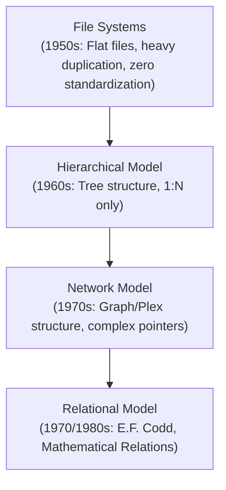
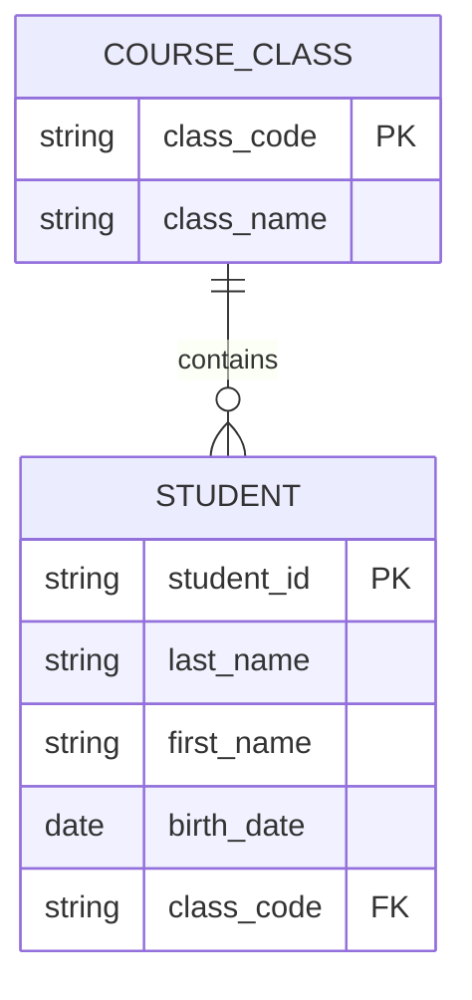
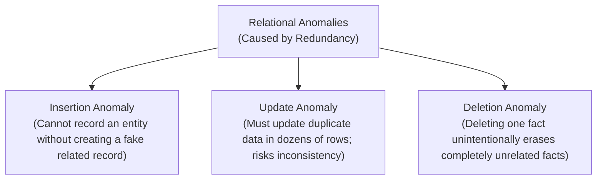
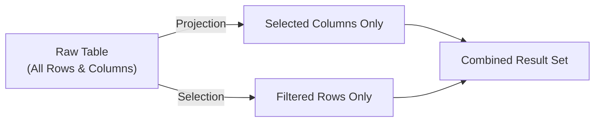

#SQL #RelationalModel #Normalization #DatabaseDesign #SystemDesign #DataModeling #RDBMS

> [!abstract] Brief Description
> This note establishes the theoretical foundations of modern database systems. It covers the historical evolution from hierarchical and network structures to Edgar F. Codd’s Relational Model, defines core mathematical relational concepts (relations, tuples, attributes, domains, keys), explains functional dependencies, provides step-by-step methodologies for 1NF, 2NF, and 3NF normalization, and introduces the 5 core sub-languages of SQL alongside projection, arithmetic operations, concatenation, and deduplication.

---

> [!note] 📖 The Core Analogy: The City Planning Blueprint vs. Construction Registry
> Imagine organizing a city's complete property and residential records:
> - **The Hierarchical Model (The Strict Feudal Tree):** Every resident is filed strictly under a single household, under a single borough, under a single central municipality. If a resident moves or owns property across multiple boroughs, the entire tree structure breaks down because an entity can only have a single parent.
> - **The Network Model (The Tangled Web of Cables):** Residents can link to multiple addresses and landlords directly. However, traversing records requires navigating complex physical pointers; if one link snaps, searching the web becomes an intractable maze.
> - **The Relational Model (The Standardized Grid Ledger):** Instead of hardcoded pointer paths, all information is stored in clean, independent, two-dimensional tables (grids of rows and columns). Tables connect dynamically through shared values (keys).
> - **Normalization (Eliminating Duplicate Town Hall Filings):** Rather than re-writing the landlord's complete name, home address, and tax ID on every single tenant’s lease paper (which creates errors if the landlord moves), normalization breaks the records into atomic, specialized tables connected by reference IDs.

---

## 🏛️ 1. Evolution of Database Models

A **database** is a coherent, organized collection of structured data stored electronically on computer media to capitalize on business knowledge, facilitate automated management, and provide a clear view of interrelated facts.

Historically, databases evolved through three major paradigms:



### 1. The Hierarchical Model (1960s)
* **Architecture:** Data is organized in an inverted tree-like hierarchy (parent-child relationships).
* **Traversal:** Data can only be accessed starting from the root node downward.
* **Cardinality:** Each child record has strictly **one single parent** ($1:N$).
* **Limitations:**
  * Severe lack of standardization.
  * Tedious query paths (cannot jump directly to leaf nodes).
  * **Cannot represent Many-to-Many ($N:M$) relationships** natively (e.g., a customer having multiple accounts across multiple branch offices).

### 2. The Network Model (1970s)
* **Architecture:** Similar to hierarchical trees, but allows a child record to link to **multiple parent records** (graph/plex structure).
* **Advantages:** Naturally models $N:M$ associations (e.g., Teachers $\leftrightarrow$ Classes $\leftrightarrow$ Students); reduces raw data duplication.
* **Limitations:**
  * Extremely complex internal pointer chains.
  * Difficult to design, maintain, and scale.
  * Schema refactoring broke existing application code that navigated hardwired physical paths.

### 3. The Relational Model (1970s–Present)
* Introduced in 1970 by **Edgar Frank Codd** (IBM mathematician).
* Rooted in mathematical set theory and first-order predicate logic.
* Organizes all data into **two-dimensional tables** called **Relations**. Physical storage pointers are hidden from the user; queries declare *what* data is desired, not *how* to physically traverse disks.

---

## 📐 2. The Relational Model: Core Concepts & Terminology

The relational model replaces proprietary pointers with standardized mathematical structures:

| Academic Relational Term | Common SQL Term | Formal Definition | Example |
| :--- | :--- | :--- | :--- |
| **Relation** | Table | A two-dimensional structure defining a specific entity/fact with a name and fixed columns. | `Student` |
| **Attribute** | Column / Field | A named property or characteristic describing the relation. | `first_name`, `birth_date` |
| **Domain** | Data Type & Check Range | The set of all valid, atomic values permitted for an attribute. | `price > 0 AND price <= 5000`, `city IN ('Fez', 'Rabat')` |
| **Tuple ($n$-tuple)** | Row / Record | A single horizontal entry representing an instance of the relation. | `(E1, Karimi, Karim, 1990-12-15)` |
| **Degree / Arity** | Column Count | Total number of attributes in the relation schema. | A table with 4 columns has degree 4. |
| **Cardinality** | Row Count | Total number of tuples currently stored in the relation. | A table with 1,500 records has cardinality 1,500. |

### Relational Schema Notation
A relation schema is represented by its relation name followed by its attribute list in parentheses. **Key attributes are underlined**:

$$\text{Student}(\underline{\text{student\_id}}, \text{last\_name}, \text{first\_name}, \text{birth\_date}, \text{class\_code})$$

A complete relational database schema is a collection of interrelated relation schemas.

---

## 🔑 3. Relational Keys & Integrity Rules

Integrity rules ensure data remains accurate, consistent, and valid over time.

### 1. Primary Key (PK)
* **Definition:** The minimal subset of attributes whose values uniquely distinguish any given tuple from all other tuples in the relation.
* **Entity Integrity Rule:** Every base relation **must** possess a primary key, and **no component of a primary key may ever be `NULL`**.

### 2. Foreign Key (FK)
* **Definition:** An attribute (or combination of attributes) in one relation that references the primary key of another relation (or the same relation).
* **Referential Integrity Rule:** A foreign key value must either:
  1. Match an existing primary key value in the referenced relation, OR
  2. Be entirely `NULL` (indicating the relationship is optional/unassigned).



---

## ⚡ 4. Functional Dependencies ($X \rightarrow Y$)

Normalization relies strictly on the mathematical concept of **Functional Dependency (FD)**.

> [!abstract] Definition: Functional Dependency
> In a relation $R$, attribute $Y$ is functionally dependent on attribute $X$ (denoted **$X \rightarrow Y$**) if and only if each distinct value of $X$ determines exactly **one** value of $Y$.
> - $X$ is called the **Determinant**.
> - $Y$ is called the **Dependent**.
>
> *Note:* The reciprocal ($Y \rightarrow X$) is not necessarily true!

### Example:
* `customer_id` $\rightarrow$ `customer_name` *(Knowing the customer ID yields exactly one name).*
* The reverse (`customer_name` $\rightarrow$ `customer_id`) is **false**, because two different customers can share the exact same name.

### Types of Dependencies:
1. **Full Functional Dependency:** $X \rightarrow Y$ where $Y$ depends on the entire attribute set $X$, and cannot be determined by any strict subset of $X$.
2. **Partial Functional Dependency:** In a composite key $(A, B)$, if $A \rightarrow Y$, then $Y$ depends on only *part* of the key.
3. **Transitive Dependency:** If $X \rightarrow Y$ and $Y \rightarrow Z$ (where $Y$ is non-key and does not determine $X$), then $Z$ is transitively dependent on $X$ through $Y$.

---

## 🧹 5. Normalization: 1NF, 2NF, and 3NF Demystified

Without normalization, relational tables suffer from severe **anomalies**:



### The Unnormalized Problem Case: `SUPPLIER` Table
Consider an unnormalized schema:
$$\text{SUPPLIER}(\text{supplier\_name}, \text{address}, \text{product}, \text{price})$$

* **Update Anomaly:** If a supplier changes their address, every row featuring a product from that supplier must be updated. Missing one row leaves the database corrupted.
* **Insertion Anomaly:** We cannot register a new supplier who does not currently offer a product.
* **Deletion Anomaly:** If a supplier currently offers only one product and we delete that product, we permanently lose the supplier's name and address.

Normalization solves this by systematically decomposing relations without loss of information.

---

### 🥇 First Normal Form (1NF)
> [!important] Rule for 1NF
> A relation is in **1NF** if and only if **all attribute values are atomic** (indivisible). Multi-valued attributes, lists, sets, or nested sub-records are strictly forbidden.

#### Violation Example:
$$\text{Student}(\underline{\text{student\_id}}, \text{last\_name}, \text{first\_name}, \text{phones})$$

| student_id | last_name | first_name | phones (Multi-valued!) |
| :--- | :--- | :--- | :--- |
| `E1` | Karimi | Karim | `(0535607080, 0661234567)` |

#### Normalized to 1NF:
Split the multi-valued attribute into atomic scalar columns or separate rows:

| student_id | last_name | first_name | mobile_phone | landline_phone |
| :--- | :--- | :--- | :--- | :--- |
| `E1` | Karimi | Karim | `0661234567` | `0535607080` |

---

### 🥈 Second Normal Form (2NF)
> [!important] Rule for 2NF
> A relation is in **2NF** if:
> 1. It is already in **1NF**.
> 2. **All non-key attributes are fully functionally dependent on the ENTIRE primary key** (elimination of partial key dependencies).
>
> *(Note: Any 1NF relation whose primary key consists of a single attribute is automatically in 2NF!)*

#### Violation Example:
Composite Key: $(\underline{\text{supplier\_id}}, \underline{\text{article\_id}})$
$$\text{SupplierCatalog}(\underline{\text{supplier\_id}}, \underline{\text{article\_id}}, \text{supplier\_address}, \text{price})$$

* Functional Dependencies:
  * $(\text{supplier\_id}, \text{article\_id}) \rightarrow \text{price}$ *(Full dependency on whole key)*
  * $\text{supplier\_id} \rightarrow \text{supplier\_address}$ *(Partial dependency on only half the key!)*

#### Decomposition into 2NF:
Isolate the partially dependent attribute into its own relation:

1. **`Supplier`**: $(\underline{\text{supplier\_id}}, \text{supplier\_address})$
2. **`CatalogPricing`**: $(\underline{\text{supplier\_id}}, \underline{\text{article\_id}}, \text{price})$

---

### 🥉 Third Normal Form (3NF)
> [!important] Rule for 3NF
> A relation is in **3NF** if:
> 1. It is already in **2NF**.
> 2. **No non-key attribute is transitively dependent on the primary key** (i.e., a non-key attribute must NOT depend on another non-key attribute).

#### Violation Example:
$$\text{Car}(\underline{\text{car\_vin}}, \text{model}, \text{color}, \text{fuel\_type}, \text{horsepower})$$

* Primary Key: $\text{car\_vin}$
* Dependencies:
  * $\text{car\_vin} \rightarrow \text{model}, \text{color}$
  * $\text{model} \rightarrow \text{fuel\_type}, \text{horsepower}$ *(Transitive: $\text{car\_vin} \rightarrow \text{model} \rightarrow \text{fuel\_type}$)*

#### Decomposition into 3NF:
Isolate the non-key determinant into a reference table:

1. **`Car`**: $(\underline{\text{car\_vin}}, \text{color}, \text{model\_code})$
2. **`CarModel`**: $(\underline{\text{model\_code}}, \text{model\_name}, \text{fuel\_type}, \text{horsepower})$

---

## 🗄️ 6. The Relational DBMS (RDBMS) & ACID Responsibilities

A **Database Management System (DBMS / SGBD)** is the system software that enables creating, querying, updating, and administering relational databases.

### Core Objectives of an RDBMS:
1. **Model Enforcement:** Enforce mathematical relation structures, data types, and primary/foreign key constraints.
2. **Transparent Data Sharing:** Allow hundreds of concurrent client applications (web services, desktop applications, APIs) to read and write without collisions.
3. **Data Security & Privacy:** Restrict unauthorized reads/modifications via user accounts and permissions.
4. **Crash Resistance & Fault Tolerance:** Survive power outages and hardware failures without corrupting records.
5. **High Storage Capacity & Indexing:** Efficiently store gigabytes or terabytes of records on secondary storage while providing millisecond lookup speeds.

---

## 🌐 7. The 5 Sub-Languages of SQL

SQL (**Structured Query Language**) was designed by IBM in the 1970s (originally SEQUEL) and became the ANSI/ISO standard language for relational systems. SQL operations are divided into five functional sub-languages:

| Sub-Language | Full Name | Purpose | Primary Commands |
| :--- | :--- | :--- | :--- |
| **DQL / LRD** | Data Query Language | Retrieve records matching criteria from one or more tables. | `SELECT` |
| **DML / LMD** | Data Manipulation Language | Modify stored data tuples without altering the table architecture. | `INSERT`, `UPDATE`, `DELETE`, `MERGE` |
| **DDL / LDD** | Data Definition Language | Create, modify, rename, or drop structural database objects. | `CREATE`, `ALTER`, `DROP`, `RENAME`, `TRUNCATE` |
| **TCL** | Transaction Control Language | Manage and finalize state changes made by DML operations. | `COMMIT`, `ROLLBACK`, `SAVEPOINT` |
| **DCL / LCD** | Data Control Language | Manage user privileges and security access control. | `GRANT`, `REVOKE` |

---

## 🔍 8. SQL Projection, Operators & Basic Expressions

The foundational query statement in SQL is `SELECT`. It possesses three mathematical capabilities:
1. **Selection:** Filtering specific **rows** (tuples) based on boolean predicates.
2. **Projection:** Choosing specific **columns** (attributes) to display.
3. **Join:** Combining related rows across multiple tables via shared keys.



### General Syntax Rules:
* Statements terminate with a semicolon (`;`).
* SQL keywords are **case-insensitive** (`SELECT` is identical to `select`), but by universal engineering convention, **SQL keywords are UPPERCASE**, while table/column identifiers are lowercase.
* White space and indentation have no semantic meaning; clauses are written across multiple lines for readability.

### 1. Basic Projection & Aliasing
```sql
-- Select specific attributes with column aliases
SELECT 
    student_id AS code,
    first_name,
    last_name
FROM student;

-- Select all attributes using wildcard
SELECT * FROM student;
```

### 2. Arithmetic Expressions
SQL supports standard arithmetic operators (`*`, `/`, `+`, `-`) on numerical values and dates.
* **Precedence:** Multiplication and division precede addition and subtraction. Use parentheses `()` to enforce order.

```sql
-- Salary adjustment calculation
SELECT 
    employee_id,
    last_name,
    salary,
    salary + 500 AS adjusted_salary,
    (salary * 1.10) - 50 AS bonus_net
FROM employee;
```

### 3. String Concatenation
* Standard ANSI / Oracle concatenation operator: `||`
* Built-in function: `CONCAT(str1, str2)`

```sql
-- Standard ANSI / Oracle operator
SELECT 
    last_name || ' ' || first_name AS full_name
FROM student;

-- Function approach
SELECT 
    CONCAT(CONCAT(last_name, ' '), first_name) AS full_name
FROM student;
```

### 4. Deduplication with `DISTINCT`
By default, SQL queries return duplicate rows. The `DISTINCT` keyword eliminates duplicate tuples from the output projection:

```sql
-- List unique cities represented in the student population
SELECT DISTINCT city FROM student;
```

---

## ✏️ 9. Solved Academic Exercises (From Course Slides)

### Exercise 1: Projections & Aliasing
**Schema:** `Student (cin, last_name, first_name, age, address, phone)`

1. *Display all records in the `Student` table:*
   ```sql
   SELECT * FROM student;
   ```
2. *Display the last names, first names, and ages of all students:*
   ```sql
   SELECT last_name, first_name, age FROM student;
   ```
3. *Display the national identity number (`cin`) renamed as `code`:*
   ```sql
   SELECT cin AS code FROM student;
   ```

### Exercise 2: Arithmetic Operators
**Schema:** `Employee (id, last_name, first_name, salary)`
* *Display last names, first names, and salary increased by 500 for all employees:*
  ```sql
  SELECT 
      last_name,
      first_name,
      salary + 500 AS augmented_salary
  FROM employee;
  ```

### Exercise 3: Concatenation
* *Display the full name of students in a single column named `nom_prenom`:*
  ```sql
  SELECT last_name || ' ' || first_name AS nom_prenom 
  FROM student;
  ```

### Exercise 4: Duplicate Elimination
**Schema:** `Student (cin, last_name, first_name, age, city)`
* *Display student cities without any duplicates:*
  ```sql
  SELECT DISTINCT city FROM student;
  ```

---

> [!summary] Key Takeaways
> - **Core concept:** The relational model organizes data into mathematically rigorous two-dimensional tables (relations) where access is declarative, eliminating the fragile, hardcoded pointers of hierarchical and network models.
> - **Key implementation detail:** Normalization decomposes tables to eliminate redundancy and prevent insertion, update, and deletion anomalies. 1NF mandates atomic values; 2NF eliminates partial dependencies on composite keys; 3NF eliminates transitive dependencies between non-key columns.
> - **Best practice:** Always use clear column aliases (`AS alias_name`) and explicit column lists in production queries; avoid unqualified `SELECT *` in software backends to prevent performance overhead and broken field mappings.
