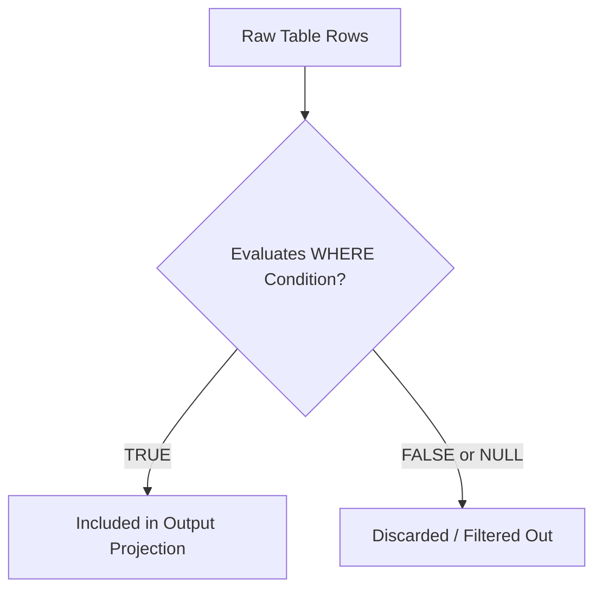
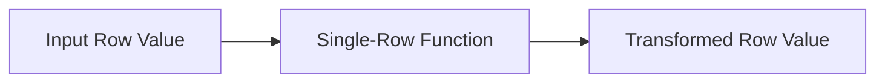
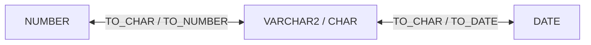

#SQL #DataQueryLanguage #SQLFunctions #DataFiltering #Sorting #NullHandling

> [!abstract] Brief Description
> This note covers the mechanics of data selection and record transformation in SQL. It details row-level filtering using the `WHERE` clause with comparison (`BETWEEN`, `LIKE`, `IN`, `IS NULL`) and logical operators (`AND`, `OR`, `NOT`), sorting via `ORDER BY`, and explores single-row (scalar) functions: string manipulation, numerical rounding, date arithmetic, explicit type conversions (`TO_CHAR`, `TO_DATE`, `TO_NUMBER`), null-handling utilities (`NVL`, `NVL2`, `NULLIF`, `COALESCE`), and conditional branching with `CASE`.

---

> [!note] 📖 The Core Analogy: The Quality Control & Packaging Assembly Line
> Imagine raw manufactured parts moving along a factory conveyor belt:
> - **The `WHERE` Clause (The Optical Sorter):** A gatekeeper sensor inspecting each passing item. Items meeting exact specifications (e.g., length between 20mm and 22mm, color is blue) continue down the line; non-compliant items are kicked off the belt before packaging.
> - **Single-Row Functions (The Polishing & Labeling Robots):** Automated robotic stations along the line. Each item passes through individually: one tool trims excess plastic (`TRIM`), another stamps an upper-case serial number (`UPPER`), another stamps the expiration date calculated 6 months from today (`ADD_MONTHS`). Each input part yields exactly one transformed output part.
> - **The `ORDER BY` Clause (The Packaging Rack Organizer):** The final sorting tray at the end of the line that groups and arranges the finished goods in perfect sequence (e.g., by model name alphabetically, and then by weight descending) before boxing.

---

## 🔍 1. Row Selection with the `WHERE` Clause

The `WHERE` clause applies boolean predicates to restrict the result set to tuples that evaluate to `TRUE`.

```sql
SELECT column_list 
FROM table_name 
WHERE condition(s);
```

A condition is an expression combining column attributes, constants, comparison operators, and logical operators.



---

## ⚖️ 2. Comparison Operators

SQL provides expressive operators for evaluating ranges, patterns, sets, and absence of data:

| Operator | Syntax | Description | Example |
| :--- | :--- | :--- | :--- |
| **Relational** | `=`, `<>`, `!=`, `>`, `<`, `>=`, `<=` | Standard equality and inequality comparisons. | `age >= 20` |
| **`BETWEEN`** | `col BETWEEN low AND high` | Tests if a value lies within an **inclusive** boundary (`val >= low AND val <= high`). | `age BETWEEN 20 AND 22` |
| **`IN`** | `col IN (val1, val2, ...)` | Tests if a value matches any member of a finite list. | `city IN ('Fez', 'Rabat', 'Casablanca')` |
| **`LIKE`** | `col LIKE 'pattern'` | Evaluates string patterns using wildcard symbols. | `last_name LIKE 'moha%'` |
| **`IS NULL`** | `col IS NULL` | Evaluates whether an attribute contains missing/unassigned data. | `address IS NULL` |

### Pattern Matching Wildcards with `LIKE`:
* `%` : Represents zero, one, or multiple arbitrary characters.
* `_` : Represents exactly **one** arbitrary character.

```sql
-- Finds names starting with 'moha' (e.g., Mohamed, Mohamadou)
SELECT last_name, age FROM student WHERE last_name LIKE 'moha%';

-- Finds names where the second letter is 'a' (e.g., Karim, Tariq)
SELECT last_name FROM student WHERE last_name LIKE '_a%';

-- Searching literal wildcards using ESCAPE:
SELECT product_code FROM inventory WHERE product_code LIKE 'PR\_%' ESCAPE '\';
```

> [!warning] The Null Trap
> In SQL, `NULL` represents an unknown or absent state. Therefore, `NULL = NULL` evaluates to `UNKNOWN`, **not `TRUE`**. Never write `WHERE address = NULL`. Always use `IS NULL` or `IS NOT NULL`.

---

## 🔀 3. Logical Operators & Precedence

Multiple predicates are combined using Boolean operators:

| Operator | Meaning | Truth Requirement |
| :--- | :--- | :--- |
| **`AND`** | Conjunction | Returns `TRUE` only if **both** conditions evaluate to `TRUE`. |
| **`OR`** | Disjunction | Returns `TRUE` if **at least one** condition evaluates to `TRUE`. |
| **`NOT`** | Negation | Reverses the boolean truth value of the following condition (`NOT IN`, `NOT BETWEEN`, `NOT LIKE`, `IS NOT NULL`). |

```sql
-- AND example: Must satisfy both conditions
SELECT last_name, first_name, age 
FROM student 
WHERE first_name = 'Mohamed' AND age = 20;

-- OR example: Satisfies either condition
SELECT last_name, first_name, age 
FROM student 
WHERE first_name = 'Mohamed' OR age = 20;

-- NOT example: Exclude specific age bracket
SELECT last_name, first_name, age 
FROM student 
WHERE age NOT IN (20, 21, 22);
```

### Operator Evaluation Precedence:
1. Arithmetic operators (`*`, `/`, `+`, `-`)
2. Concatenation operator (`||`)
3. Comparison conditions (`=`, `<>`, `<`, `>`, `LIKE`, `IN`, `BETWEEN`, `IS NULL`)
4. Logical negation (`NOT`)
5. Logical conjunction (`AND`)
6. Logical disjunction (`OR`)

> [!tip] Best Practice: Always Use Parentheses
> Because `AND` has higher precedence than `OR`, expressions like `condA OR condB AND condC` evaluate as `condA OR (condB AND condC)`. Always wrap complex conditions in explicit parentheses `()` to avoid critical business logic bugs.

---

## 📶 4. Sorting Records with `ORDER BY`

The `ORDER BY` clause sorts returned records in ascending (`ASC`, default) or descending (`DESC`) order:

```sql
SELECT column1, column2 
FROM table_name 
WHERE condition 
ORDER BY column1 [ASC | DESC], column2 [ASC | DESC];
```

### Sorting Capabilities:
1. **Sorting by Unselected Columns:** You can sort records using a table column that does not appear in the `SELECT` projection list.
2. **Sorting by Column Aliases:** Defined aliases can be used directly in the `ORDER BY` clause.
3. **Multi-Column Sorting:** Sorts primarily by the first column; ties are resolved sequentially by subsequent columns.

```sql
-- Sort by first name ascending, then by age descending
SELECT last_name, first_name, age 
FROM student 
ORDER BY first_name ASC, age DESC;
```

---

## ✂️ 5. Single-Row Character (String) Functions

Single-row functions accept arguments and return exactly **one value per row processed**.



### Case Manipulation:
| Function | Description | Example | Result |
| :--- | :--- | :--- | :--- |
| `LOWER(str)` | Converts characters to lowercase. | `LOWER('Course of SQL')` | `'course of sql'` |
| `UPPER(str)` | Converts characters to uppercase. | `UPPER('Course of SQL')` | `'COURSE OF SQL'` |
| `INITCAP(str)` | Capitalizes first letter of each word. | `INITCAP('course of sql')` | `'Course Of Sql'` |

### Character Manipulation:
| Function | Syntax | Description | Example | Result |
| :--- | :--- | :--- | :--- | :--- |
| `LENGTH(str)` | `LENGTH(str)` | Returns number of characters. | `LENGTH('Hello')` | `5` |
| `SUBSTR(str, m, n)` | `SUBSTR(str, start, [len])` | Extracts substring from index $m$ for length $n$. | `SUBSTR('Bonjour', 1, 3)` | `'Bon'` |
| `INSTR(str, char)` | `INSTR(str, search_char)` | Returns 1-based index position of first match. | `INSTR('Bonjour', 'j')` | `4` |
| `LPAD(str, n, pad)` | `LPAD(col, target_len, pad_str)` | Left-pads string to total width $n$. | `LPAD(5000, 10, '*')` | `'******5000'` |
| `RPAD(str, n, pad)` | `RPAD(col, target_len, pad_str)` | Right-pads string to total width $n$. | `RPAD(5000, 10, '*')` | `'5000******'` |
| `CONCAT(s1, s2)` | `CONCAT(str1, str2)` | Concatenates two strings together. | `CONCAT('Bon', 'jour')` | `'Bonjour'` |
| `TRIM(...)` | `TRIM([LEADING\|TRAILING\|BOTH] char FROM str)` | Trims designated character from ends. | `TRIM('S' FROM 'SSMITH')` | `'MITH'` |

---

## 🔢 6. Single-Row Number Functions

Numerical functions process numeric values and expressions:

| Function | Syntax | Description | Example | Result |
| :--- | :--- | :--- | :--- | :--- |
| `ROUND(n, d)` | `ROUND(val, [decimals])` | Rounds to $d$ decimal places (rounds to integer if $d$ omitted; rounds to tens if $d < 0$). | `ROUND(45.926, 2)`<br/>`ROUND(45.923, 0)`<br/>`ROUND(45.923, -1)` | `45.93`<br/>`46`<br/>`50` |
| `TRUNC(n, d)` | `TRUNC(val, [decimals])` | Truncates value without rounding. | `TRUNC(45.926, 2)`<br/>`TRUNC(45.923, 0)`<br/>`TRUNC(45.923, -1)` | `45.92`<br/>`45`<br/>`40` |
| `MOD(m, n)` | `MOD(dividend, divisor)` | Returns remainder of division. | `MOD(10, 3)` | `1` |

---

## 📅 7. Date Handling & Date Functions

In relational systems (specifically Oracle and ANSI), date datatypes store year, month, day, hours, minutes, and seconds.
* **`SYSDATE`**: System pseudo-column returning current database date and timestamp.

### Date Arithmetic:
* `date + n` : Adds $n$ days to a date.
* `date - n` : Subtracts $n$ days from a date.
* `date1 - date2` : Returns the elapsed duration between two dates in **number of days**.
* `date + (n / 24)` : Adds $n$ hours to a date.

### Advanced Date Functions:
| Function | Syntax | Description | Example |
| :--- | :--- | :--- | :--- |
| `MONTHS_BETWEEN(d1, d2)` | `MONTHS_BETWEEN(d1, d2)` | Returns fractional number of months between $d1$ and $d2$. | `MONTHS_BETWEEN('01-SEP-95', '11-JAN-94')` $\rightarrow 19.67$ |
| `ADD_MONTHS(d, n)` | `ADD_MONTHS(date, integer_months)` | Adds $n$ calendar months to date. | `ADD_MONTHS('11-JAN-94', 6)` $\rightarrow$ `'11-JUL-94'` |
| `NEXT_DAY(d, day_name)` | `NEXT_DAY(date, 'FRIDAY')` | Returns the date of the next occurrence of that weekday. | `NEXT_DAY('01-SEP-95', 'FRIDAY')` $\rightarrow$ `'08-SEP-95'` |
| `LAST_DAY(d)` | `LAST_DAY(date)` | Returns the last calendar day of the month for that date. | `LAST_DAY('01-SEP-95')` $\rightarrow$ `'30-SEP-95'` |
| `ROUND(d, unit)` | `ROUND(date, 'MONTH'\|'YEAR')` | Rounds date to nearest first of month or first of year. | `ROUND('25-JUL-95', 'MONTH')` $\rightarrow$ `'01-AUG-95'` |
| `TRUNC(d, unit)` | `TRUNC(date, 'MONTH'\|'YEAR')` | Truncates date to beginning of current month or year. | `TRUNC('25-JUL-95', 'MONTH')` $\rightarrow$ `'01-JUL-95'` |

---

## 🔄 8. Data Conversion Functions

Datatypes can convert **implicitly** (automatic conversion between `VARCHAR2` and `NUMBER` or `DATE`), but production code must always use **explicit** conversion functions to avoid locale and format dependency crashes.



### The Three Core Explicit Conversion Functions:
```sql
-- 1. Date / Number to String: TO_CHAR
TO_CHAR(SYSDATE, 'YYYY/MM/DD')           -- Output: '2026/09/18'
TO_CHAR(SYSDATE, 'Month DD, YYYY')       -- Output: 'September 18, 2026'
TO_CHAR(salary, '$99,999.00')            -- Output: ' $4,500.00'

-- 2. String to Number: TO_NUMBER
TO_NUMBER('1210.73', '9999.99')          -- Output: 1210.73

-- 3. String to Date: TO_DATE
TO_DATE('2026/09/18', 'YYYY/MM/DD')
TO_DATE('March 07, 2026', 'Month DD, YYYY')
```

> [!tip] The `fx` (Format Exact) Modifier
> Adding `fx` inside `TO_DATE` (e.g., `TO_DATE('2026/03/07', 'fxYYYY/MM/DD')`) enforces strict matching between delimiters, padding, and casing, preventing subtle date parsing bugs.

---

## 🛡️ 9. General Null-Handling & Conditional Functions

Because `NULL` can break arithmetic calculations (e.g., `salary + commission` returns `NULL` whenever commission is null), SQL provides robust fallback and branching expressions:

### 1. `NVL(expr1, expr2)`
Replaces `expr1` with `expr2` if `expr1` is `NULL`. Both arguments must share compatible datatypes.
```sql
-- If commission_pct is null, replace with 0
SELECT salary * (1 + NVL(commission_pct, 0)) AS total_comp FROM employee;
```

### 2. `NVL2(expr1, expr2, expr3)`
Ternary operator: If `expr1` is **NOT NULL**, returns `expr2`. If `expr1` **IS NULL**, returns `expr3`.
```sql
SELECT last_name, NVL2(commission_pct, 'Sal+Comm', 'Sal Only') AS pay_type 
FROM employee;
```

### 3. `NULLIF(expr1, expr2)`
Compares two expressions. Returns `NULL` if they are identical; returns `expr1` if they differ.
```sql
-- Returns NULL if length of first_name equals length of last_name
SELECT NULLIF(LENGTH(first_name), LENGTH(last_name)) FROM employee;
```

### 4. `COALESCE(expr1, expr2, ..., expr_n)`
Evaluates arguments from left to right and returns the **first non-null expression** encountered.
```sql
SELECT COALESCE(work_phone, mobile_phone, home_phone, 'No Contact') AS phone 
FROM customer;
```

### 5. Conditional Branching with `CASE`
SQL's native ANSI standard conditional expression:

#### Searched `CASE` Expression:
```sql
SELECT last_name, job_title,
    CASE 
        WHEN job_title = 'President' THEN 1
        WHEN job_title = 'Director'  THEN 2
        ELSE 3
    END AS rank_level
FROM employee;
```

#### Simple `CASE` Expression:
```sql
SELECT last_name, job_title,
    CASE job_title
        WHEN 'President' THEN 1
        WHEN 'Director'  THEN 2
        ELSE 3
    END AS rank_level
FROM employee;
```

*(Note: Oracle's proprietary legacy equivalent is `DECODE(job_title, 'President', 1, 'Director', 2, 3)`).*

---

## ✏️ 10. Solved Academic Exercises (From Course Slides)

**Schema:** `Student(id, last_name, first_name, age, city, phone)`

### 1. Find all students aged 20 or older:
```sql
SELECT * 
FROM student 
WHERE age >= 20;
```

### 2. Find all students aged between 19 and 23 years (inclusive):
```sql
SELECT * 
FROM student 
WHERE age BETWEEN 19 AND 23;
```

### 3. Find all students whose phone number starts with regional code '0535':
```sql
SELECT * 
FROM student 
WHERE phone LIKE '0535%';
```

### 4. Find all students whose city is unknown (`NULL`), and those whose city is known:
```sql
-- Students with unknown city
SELECT * 
FROM student 
WHERE city IS NULL;

-- Students with known city
SELECT * 
FROM student 
WHERE city IS NOT NULL;
```

---

> [!summary] Key Takeaways
> - **Core concept:** The `WHERE` clause enforces row filtering through three-valued logic (`TRUE`, `FALSE`, `UNKNOWN`). Single-row functions transform data tuple-by-tuple without altering table cardinality.
> - **Key implementation detail:** `NULL` cannot be tested using standard equality (`=`); always use `IS NULL`. Use `NVL()` or `COALESCE()` to provide defensive default values before performing arithmetic operations.
> - **Best practice:** Always use explicit type conversion functions (`TO_DATE`, `TO_CHAR`) with concrete format masks rather than relying on database server locale defaults.
