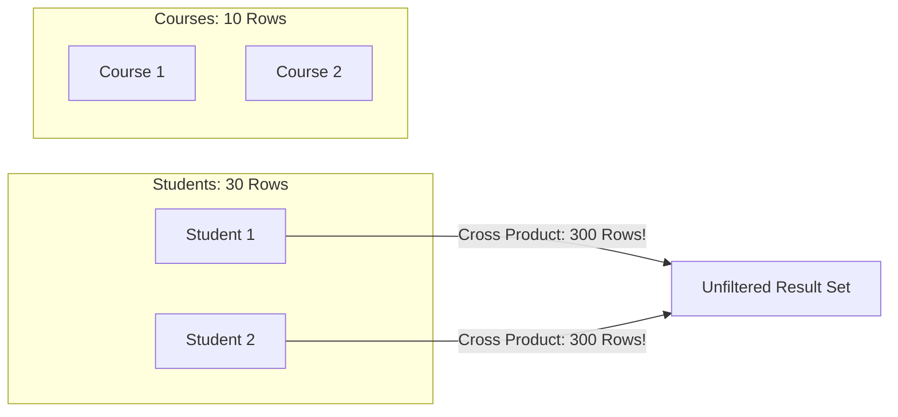
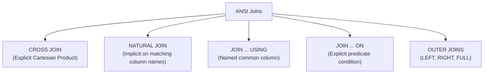
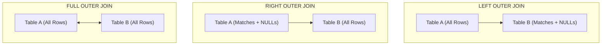

#SQL #Joins #MultiTableQueries #DataQueryLanguage #RelationalAlgebra #DatabaseDesign

> [!abstract] Brief Description
> This note explains the theory, mechanics, and syntax for querying multiple tables simultaneously. It covers the dangers and causes of Cartesian products, demonstrates classical Oracle/SQL:89 join syntax (equi-joins, non-equi joins, self-joins, and the `(+)` outer join operator), and details modern ANSI SQL:1999 standard joins (`CROSS JOIN`, `NATURAL JOIN`, `USING`, `ON`, `LEFT OUTER JOIN`, `RIGHT OUTER JOIN`, and `FULL OUTER JOIN`).

---

> [!note] 📖 The Core Analogy: The International Border & Passport Control
> Imagine two separate administrative departments: The Civil Registry (Citizens) and The National Tax Agency (Tax Filings):
> - **The Cartesian Product (The Unchecked Stampede):** Pairing every citizen with every single tax return ever filed in the country ($N \times M$ combinations). Chaos ensues because records are paired randomly without verification.
> - **The Inner Join (The Passport Checkpoint):** Citizens and tax filings are matched strictly by their National ID Number (`citizen.id = tax.citizen_id`). Only citizens who have filed a return, and only returns tied to a valid citizen, pass through.
> - **The Left Outer Join (Preserving All Citizens):** Every citizen is listed. If a student or retiree has never filed a tax return, their name still appears on the manifest, with tax filing fields marked blank (`NULL`).
> - **The Right Outer Join (Preserving All Filings):** Every tax filing is listed. If an anonymous or corporate filing has no matching citizen profile, it is still included with citizen personal details set to `NULL`.
> - **The Full Outer Join (The Complete Master Audit):** All citizens and all tax returns are presented. Any unmatched entry from either side is preserved with `NULL` fill.

---

## 💥 1. The Cartesian Product & The Need for Joins

In relational databases, normalization splits data across multiple focused tables. To synthesize meaningful answers, we must reconstruct associations between tables.

A **Cartesian Product** occurs whenever:
1. A join condition is completely omitted.
2. A join condition is syntactically invalid.

When this occurs, **every single row from Table 1 is paired with every single row from Table 2**:

$$\text{Total Result Rows} = \text{Cardinality}(T_1) \times \text{Cardinality}(T_2)$$



> [!danger] Production Warning: Memory Exhaustion
> Executing an unintended Cartesian product between a 100,000-row `users` table and a 500,000-row `orders` table attempts to generate 50 billion tuples in RAM, causing severe disk thrashing and database server lockups.

---

## 🔗 2. Classical SQL (SQL:89 / Oracle Traditional Syntax)

In traditional SQL syntax, all joined tables are listed in the `FROM` clause separated by commas, and the relationship conditions are placed directly inside the `WHERE` clause.

### The $N-1$ Join Condition Rule:
> [!important]
> To join **$N$** tables together without creating an unintended Cartesian product, you must provide a minimum of **$N - 1$** distinct join predicates.

---

### 1. Equi-Joins (Equality Joins)
Equi-joins match records when values in specified columns are identical (typically Primary Key $\leftrightarrow$ Foreign Key). Column names must be qualified with the table name or table alias to prevent ambiguity.

```sql
SELECT 
    student.student_id,
    student.last_name,
    formation.program_title
FROM student, formation
WHERE student.program_id = formation.program_id;
```

#### Using Table Aliases:
Table aliases improve query readability and performance:
```sql
SELECT 
    s.student_id,
    s.last_name,
    f.program_title
FROM student s, formation f
WHERE s.program_id = f.program_id;
```

---

### 2. Non-Equi Joins
A non-equi join establishes an association where the relationship does not rely on strict equality (`=`), but rather on inequality operators or ranges (`BETWEEN ... AND`, `>=`, `<=`).

```sql
-- Schema:
-- Employee (emp_id, last_name, salary)
-- SalaryGrade (grade_id, min_salary, max_salary)

SELECT 
    e.last_name,
    e.salary,
    g.grade_id
FROM employee e, salary_grade g
WHERE e.salary BETWEEN g.min_salary AND g.max_salary;
```

---

### 3. Self-Joins (Unary Joins)
A self-join connects a table to itself. This is used when a table contains a hierarchical or recursive foreign key referencing its own primary key (such as an employee referencing a manager).

```sql
-- Worker and Manager live in the same Employee table
SELECT 
    worker.last_name || ' reports to ' || manager.last_name AS hierarchy
FROM employee worker, employee manager
WHERE worker.manager_id = manager.employee_id;
```

---

### 4. Classical Oracle Outer Joins: The `(+)` Operator
In standard inner joins, records that do not find a matching counterpart in the opposite table are discarded. Outer joins preserve these unmatched rows by synthesizing `NULL` values.

In legacy Oracle SQL, outer joins are declared by placing the **`(+)`** symbol on the column of the table **that is missing information** (the table that receives synthetic `NULL`s):

```sql
-- Display all departments, even those with zero assigned employees:
SELECT 
    e.last_name,
    d.dept_id,
    d.dept_name
FROM employee e, department d
WHERE e.dept_id(+) = d.dept_id;
```

> [!warning] Restrictions on the Oracle `(+)` Operator
> - The `(+)` operator cannot be placed on both sides of a condition simultaneously (cannot produce a Full Outer Join).
> - A condition containing `(+)` cannot be combined with the `IN` operator.
> - A condition containing `(+)` cannot be chained using an `OR` operator with other predicates.

---

## 🌐 3. Modern ANSI SQL:1999 Standard Joins

The ANSI SQL:1999 standard introduced explicit join keywords in the `FROM` clause, strictly separating structural table relationships from data filtering (`WHERE`).



---

### 1. `CROSS JOIN`
Produces an explicit Cartesian product without triggering linter warnings:
```sql
SELECT e.last_name, d.dept_name
FROM employee e
CROSS JOIN department d;
```

---

### 2. `NATURAL JOIN`
Automatically joins tables based on **all columns that share identical names and compatible datatypes**:
```sql
SELECT e.last_name, d.dept_name
FROM employee e
NATURAL JOIN department d;
```
> [!warning] Danger of `NATURAL JOIN` in Production
> If a developer adds a column with a common name (like `last_updated_at` or `status`) to both tables, the `NATURAL JOIN` will silently add that column to the join predicate, breaking query logic without throwing syntax errors. Avoid `NATURAL JOIN` in production applications!

---

### 3. `JOIN ... USING (column)`
When columns share the same name across tables, the `USING` clause specifies which column to join on.
* **Rule:** Do **NOT** prefix the column in the `USING` clause or `SELECT` projection with a table name or alias!

```sql
SELECT 
    emp_id,
    last_name,
    dept_id,      -- Note: NO table alias prefix allowed on the USING column!
    dept_name
FROM employee
JOIN department USING (dept_id);
```

---

### 4. `JOIN ... ON (condition)`
The most robust, flexible, and universal join syntax. It allows joining tables on columns with different names and arbitrary expressions:

```sql
SELECT 
    e.emp_id,
    e.last_name,
    d.dept_name
FROM employee e
JOIN department d ON (e.department_id = d.id);
```

#### Joining Three or More Tables with `ON`:
```sql
SELECT 
    c.customer_name,
    o.order_id,
    p.product_name,
    oi.quantity
FROM customer c
JOIN orders o ON (c.customer_id = o.customer_id)
JOIN order_items oi ON (o.order_id = oi.order_id)
JOIN product p ON (oi.product_id = p.product_id);
```

---

## 🌓 4. ANSI Outer Joins: LEFT, RIGHT, and FULL



### 1. `LEFT OUTER JOIN`
Preserves **all rows from the left table** (first listed in `FROM`). Unmatched right table attributes return `NULL`.
```sql
-- All users, including those who have never placed an order:
SELECT 
    u.id,
    u.first_name,
    u.last_name,
    o.order_date,
    o.invoice_number
FROM users u
LEFT OUTER JOIN orders o ON (u.id = o.user_id);
```

### 2. `RIGHT OUTER JOIN`
Preserves **all rows from the right table**. Unmatched left table attributes return `NULL`.
```sql
-- All orders, including those with no user attached:
SELECT 
    u.first_name,
    u.last_name,
    o.order_date,
    o.invoice_number
FROM users u
RIGHT OUTER JOIN orders o ON (u.id = o.user_id);
```

### 3. `FULL OUTER JOIN`
Preserves **all rows from both tables**, pairing rows where the condition is met and synthesizing `NULL`s on either side when unmatched.
```sql
SELECT 
    u.id AS user_id,
    u.last_name,
    o.order_id,
    o.total_price
FROM users u
FULL OUTER JOIN orders o ON (u.id = o.user_id);
```

---

## ✏️ 5. Solved Academic Exercises (From Course Slides)

### Exercise: Multi-Table Purchase Queries
**Schema:**
* `Product (product_code, product_name, supplier, unit_price)`
* `Orders (order_id, product_code, unit_price, quantity, discount)`
* `Warehouse (depot_id, product_code, address, quantity)`

#### Question 1: Find all order numbers corresponding to the purchase of a 'Vase' (Traditional SQL:89 Syntax):
```sql
SELECT o.order_id
FROM orders o, product p
WHERE o.product_code = p.product_code
  AND p.product_name = 'Vase';
```

#### Question 2: Same query using explicit ANSI SQL:1999 `JOIN ... ON`:
```sql
SELECT o.order_id
FROM orders o
JOIN product p ON (o.product_code = p.product_code)
WHERE p.product_name = 'Vase';
```

---

> [!summary] Key Takeaways
> - **Core concept:** Joins reconstruct relationships between normalized tables. An inner join discards unmatched rows; outer joins (`LEFT`, `RIGHT`, `FULL`) preserve unmatched rows by supplying `NULL` placeholders.
> - **Key implementation detail:** The $N-1$ rule dictates that joining $N$ tables requires at least $N-1$ join conditions to prevent catastrophic Cartesian products ($N \times M$ rows).
> - **Best practice:** Always use ANSI SQL:1999 `JOIN ... ON` syntax in modern projects. It cleanly separates relational link logic from row-filtering business rules (`WHERE`) and avoids dialect lock-in.
