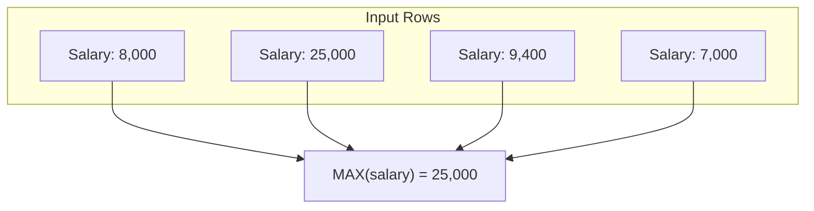
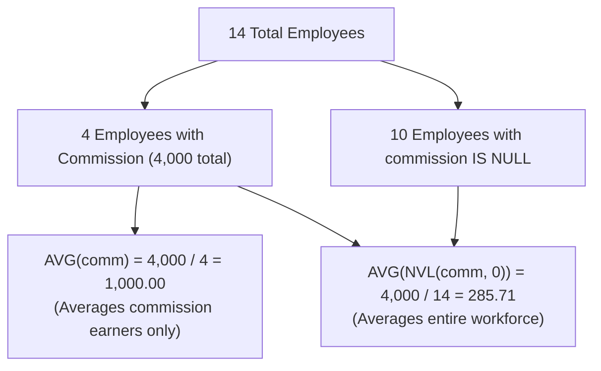
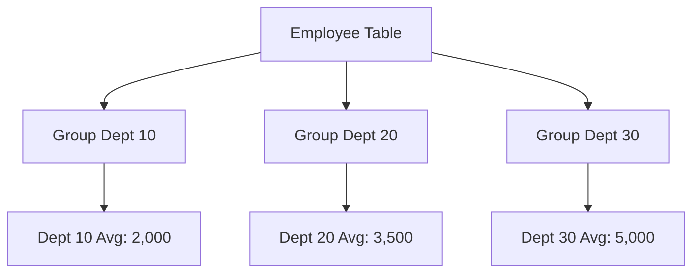

#SQL #Aggregations #GroupBy #Having #DataAnalytics #DataQueryLanguage #DatabaseOptimization

> [!abstract] Brief Description
> This note explores SQL group (aggregate) functions used to perform calculations across collections of rows. It covers the mathematical behavior of `SUM`, `AVG`, `MIN`, `MAX`, `COUNT`, `STDDEV`, and `VARIANCE`, explains the critical statistical impact of `NULL` handling and `NVL()` substitution, details hierarchical grouping with `GROUP BY`, clarifies the essential distinction between `WHERE` and `HAVING`, and demonstrates nested aggregate calculations.

---

> [!note] 📖 The Core Analogy: The Corporate Departmental Accounting Ledger
> Imagine a company's financial audit:
> - **Single-Row Functions (Line Item Conversions):** Taking individual receipts and converting Moroccan Dirhams to USD or formatting date stamps. One receipt goes in; one receipt comes out.
> - **Group Aggregate Functions (The End-of-Month Ledger Balance):** Taking a stack of 5,000 expense receipts and calculating the total expenditure (`SUM`), the average bill (`AVG`), the smallest receipt (`MIN`), and the single most expensive meal (`MAX`). 5,000 receipts are collapsed into a single summary row.
> - **The `GROUP BY` Clause (Sorting Receipts into Department Bins):** Sorting all 5,000 receipts into departmental folders (Engineering, Sales, Marketing). The ledger now computes the total and average expenses for each separate department folder.
> - **The `WHERE` vs. `HAVING` Clauses (The Two-Tier Filter):**
>   - **`WHERE` (The Pre-Audit Shredder):** Discarding fraudulent or personal receipts *before* placing them into departmental folders (e.g., `WHERE expense_date >= '2026-01-01'`).
>   - **`HAVING` (The Executive Board Review):** Examining the resulting department summaries and only flagging departments whose combined total spending exceeded \$50,000 (`HAVING SUM(amount) > 50000`).

---

## 📊 1. Concept of Group (Aggregate) Functions

Unlike single-row functions that operate on individual records independently, **group functions** operate on sets of tuples to return a single summarized result per group.



### Complete Query Syntax:
```sql
SELECT [column_list,] group_function(argument)
FROM table_name
[WHERE row_condition(s)]
[GROUP BY grouping_column(s)]
[HAVING group_condition(s)]
[ORDER BY sort_expression(s)];
```

> [!important] Syntactic Constraints on Group Functions
> Group functions **cannot** be written directly inside the `FROM`, `WHERE`, or `GROUP BY` clauses. Attempting to write `WHERE salary > AVG(salary)` will cause an immediate syntax error (use a subquery or `HAVING` instead).

---

## 🧮 2. The Core SQL Aggregate Functions

| Function | Signature | Allowed Datatypes | Description |
| :--- | :--- | :--- | :--- |
| **`SUM`** | `SUM([DISTINCT\|ALL] n)` | Numeric only | Computes the mathematical sum of values in the group. |
| **`AVG`** | `AVG([DISTINCT\|ALL] n)` | Numeric only | Computes the arithmetic mean of values in the group. |
| **`MIN`** | `MIN([DISTINCT\|ALL] expr)` | Numeric, Character, Date | Returns lowest value (smallest number, earliest date, first alphabetically). |
| **`MAX`** | `MAX([DISTINCT\|ALL] expr)` | Numeric, Character, Date | Returns highest value (largest number, latest date, last alphabetically). |
| **`COUNT(*)`** | `COUNT(*)` | Any | Returns total count of records, **including duplicates and `NULL`s**. |
| **`COUNT(col)`**| `COUNT([DISTINCT] col)` | Any | Returns count of **non-null** values for that column. |
| **`STDDEV`** | `STDDEV([DISTINCT] x)` | Numeric only | Returns the standard deviation ($\sigma$). |
| **`VARIANCE`**| `VARIANCE([DISTINCT] x)`| Numeric only | Returns the statistical variance ($\sigma^2$). |

```sql
-- Finding salary metrics for technicians
SELECT 
    AVG(salary) AS avg_sal,
    SUM(salary) AS total_payroll
FROM employee
WHERE job_title LIKE 'tech%';

-- Finding earliest and latest hire dates
SELECT 
    MIN(hire_date) AS earliest_hire,
    MAX(hire_date) AS latest_hire
FROM employee;
```

---

## ⚠️ 3. Group Functions & The `NULL` Handling Dilemma

A critical property of all SQL group functions is that **they automatically ignore `NULL` values** (with the sole exception of `COUNT(*)`).

### The Average Dilemma: `AVG(col)` vs. `AVG(NVL(col, 0))`
Consider an employee table with 14 employees, but only 4 employees receive a sales commission (`comm`), totaling \$4,000:



```sql
-- Ignores NULL rows (Denominator = 4):
SELECT AVG(comm) FROM employee; 
-- Result: 1000

-- Substitutes NULL with 0 before aggregation (Denominator = 14):
SELECT AVG(NVL(comm, 0)) FROM employee; 
-- Result: 285.71
```

> [!danger] Data Analysis Pitfall
> If business stakeholders ask: *"What is the average commission across our entire workforce?"*, using plain `AVG(comm)` will wildly inflate the number by silently discarding all non-commissioned staff. Always clarify whether missing values represent zero or should be excluded!

---

## 📂 4. Grouping Records with `GROUP BY`

The `GROUP BY` clause partitions table rows into distinct subgroups so that aggregate functions compute separate summaries for each subset.



```sql
SELECT deptno, AVG(sal) AS avg_sal
FROM employee
GROUP BY deptno;
```

### Critical Rules for `GROUP BY`:
1. **The Projection Rule:** Any column appearing in the `SELECT` projection that is **not** enclosed inside an aggregate function **MUST** be explicitly declared in the `GROUP BY` clause.
   ```sql
   -- INVALID! Triggers ORA-00937 (not a single-group group function)
   SELECT deptno, job_title, AVG(sal) 
   FROM employee 
   GROUP BY deptno;

   -- CORRECT:
   SELECT deptno, job_title, AVG(sal) 
   FROM employee 
   GROUP BY deptno, job_title;
   ```
2. **Column Omission:** A column listed in `GROUP BY` is **not** required to appear in the `SELECT` list.
3. **No Aliases:** Column aliases created in `SELECT` cannot be referenced in `GROUP BY` (because `GROUP BY` executes before `SELECT`).

---

## 🗂️ 5. Multi-Column Grouping (Sub-groups)

When multiple columns are specified in `GROUP BY`, SQL creates a hierarchical breakdown. Records are grouped by the first column, and each group is divided into sub-groups by subsequent columns:

```sql
SELECT 
    deptno, 
    job_title, 
    SUM(sal) AS total_payroll
FROM employee
GROUP BY deptno, job_title
ORDER BY deptno, total_payroll DESC;
```

---

## 🚦 6. Post-Aggregation Filtering with `HAVING`

Because `WHERE` filters rows *before* groups are created, it cannot evaluate aggregate values. The **`HAVING`** clause is evaluated *after* grouping to filter summary records.

| Clause | Processing Stage | Input | Can Contain Aggregates? |
| :--- | :--- | :--- | :---: |
| **`WHERE`** | Pre-filter (Before grouping) | Individual raw tuples | ❌ No |
| **`HAVING`** | Post-filter (After grouping) | Aggregated group summary tuples | ✅ Yes |

```sql
-- Find departments where the maximum salary exceeds $2,900:
SELECT deptno, MAX(sal) AS max_sal
FROM employee
GROUP BY deptno
HAVING MAX(sal) > 2900;
```

### Combining `WHERE`, `GROUP BY`, `HAVING`, and `ORDER BY`:
```sql
SELECT 
    job_title, 
    SUM(sal) AS payroll
FROM employee
WHERE job_title NOT LIKE 'TECH%'      -- 1. Discard tech roles before grouping
GROUP BY job_title                     -- 2. Group remaining rows by job
HAVING SUM(sal) > 5000                 -- 3. Filter out groups whose payroll <= 5000
ORDER BY SUM(sal) DESC;                -- 4. Sort resulting summaries descending
```

---

## 🪜 7. Nested Group Functions

In advanced SQL (particularly Oracle), group functions can be nested up to **two levels deep** when accompanied by a `GROUP BY` clause:

```sql
-- Find the highest departmental average salary across the company:
SELECT MAX(AVG(sal)) 
FROM employee 
GROUP BY deptno;
```

> [!warning] Nesting Rule
> When a group function is nested (e.g., `MAX(AVG(sal))`), individual column names (like `deptno`) **cannot** appear in the `SELECT` projection list because the query has collapsed all group results down to a single scalar value.

---

## ✏️ 8. Solved Academic Exercises (From Course Slides)

### Exercise 1: Basic Counts
1. *Count the number of department entries in the `employee` table (including duplicates):*
   ```sql
   SELECT COUNT(deptno) FROM employee;
   ```
2. *Count the number of unique departments currently staffed:*
   ```sql
   SELECT COUNT(DISTINCT deptno) FROM employee;
   ```
3. *Count how many employees belong to Department 30:*
   ```sql
   SELECT COUNT(*) 
   FROM employee 
   WHERE deptno = 30;
   ```

### Exercise 2: Department Payroll by Job Title
* *Calculate total salary expenditures for each job within each department:*
  ```sql
  SELECT deptno, job_title, SUM(sal) AS dept_job_payroll
  FROM employee
  GROUP BY deptno, job_title;
  ```

### Exercise 3: Filtered Summary with Sorting
* *Display total salaries by job title for non-tech functions whose total payroll exceeds \$5,000, ordered from highest to lowest expenditure:*
  ```sql
  SELECT job_title, SUM(sal) AS total_sal
  FROM employee
  WHERE job_title NOT LIKE 'TECH%'
  GROUP BY job_title
  HAVING SUM(sal) > 5000
  ORDER BY SUM(sal) DESC;
  ```

---

> [!summary] Key Takeaways
> - **Core concept:** Group functions collapse multiple rows into statistical summaries. Standard aggregates ignore `NULL` values; use `NVL()` to include null fields in group averages.
> - **Key implementation detail:** The `WHERE` clause filters individual tuples prior to grouping; the `HAVING` clause filters aggregated group summaries post-calculation.
> - **Best practice:** Always ensure every column in your `SELECT` clause that is not inside an aggregate function is declared in your `GROUP BY` clause to avoid runtime errors.
