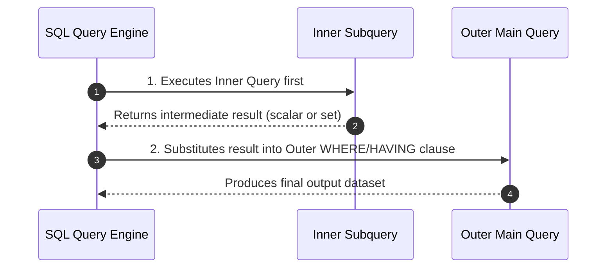
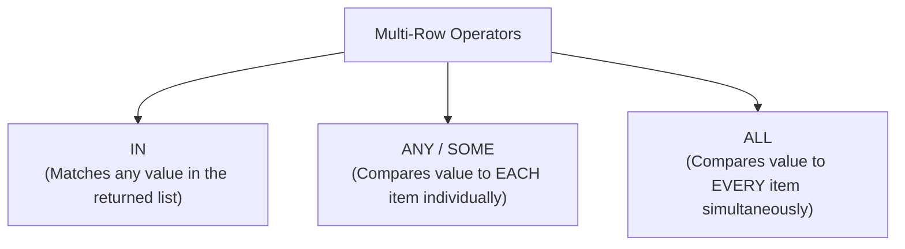

#SQL #Subqueries #NestedQueries #DataQueryLanguage #SQLOperators #QueryOptimization

> [!abstract] Brief Description
> This note explores SQL subqueries (nested queries), where an inner `SELECT` statement feeds dynamic data to an outer enclosing statement. It covers single-row subqueries with scalar comparison operators, multi-row subqueries using `IN`, `ANY`/`SOME`, and `ALL`, subqueries nested within `HAVING` clauses, the dangerous `NULL` trap in `NOT IN` evaluations, and correlated subqueries with `EXISTS`/`NOT EXISTS`.

---

> [!note] 📖 The Core Analogy: The Detective's Informant Network
> Imagine a lead detective investigating an embezzlement ring:
> - **Direct Query (Known Suspect):** *"Arrest John Doe"* (You know exactly who you're targeting: `WHERE employee_id = 1230`).
> - **Subquery (Investigation within an Investigation):** The detective doesn't know who makes more money than Hamid, because Hamid's salary is confidential.
>   - **Step 1 (The Inner Informant):** An informant slips into payroll and extracts Hamid's salary (`SELECT salary FROM employee WHERE name = 'Hamid'` $\rightarrow$ yields \$4,500).
>   - **Step 2 (The Outer Arrest Warrant):** The detective now executes the main warrant using the informant's result (`WHERE salary > 4500`).
> - **Multi-Row Subqueries (`ANY` vs. `ALL`):**
>   - **`< ANY` (Easier Standard):** *"Find any athlete who runs faster than at least one member of the Olympic team."* (You only have to beat the slowest Olympian: `< MAX(time)`).
>   - **`< ALL` (Elite Standard):** *"Find any athlete who runs faster than EVERY member of the Olympic team."* (You must beat the fastest Olympian: `< MIN(time)`).

---

## 🔍 1. Subquery Architecture & Execution Flow

A **subquery** (or nested query) is a `SELECT` statement embedded within the clause of another SQL statement (`SELECT`, `INSERT`, `UPDATE`, `DELETE`).



### General Syntax:
```sql
SELECT column_list
FROM table_name
WHERE expression operator (
    SELECT column_list
    FROM table_name
    [WHERE conditions]
);
```

### Universal Rules for Subqueries:
* Subqueries must always be enclosed in **parentheses `()`**.
* Subqueries are placed on the right-hand side of comparison operators.
* Standard subqueries cannot contain an `ORDER BY` clause (sorting is reserved for the outer presentation query, unless using top-$N$ row-limiting operations).

---

## 🎯 2. Single-Row Subqueries

A **single-row subquery** returns exactly **one row** (one scalar value) from the inner `SELECT` statement.

### Single-Row Comparison Operators:
| Operator | Meaning | Example |
| :---: | :--- | :--- |
| `=` | Equal to | `WHERE salary = (SELECT MIN(salary) FROM emp)` |
| `>` | Greater than | `WHERE salary > (SELECT AVG(salary) FROM emp)` |
| `>=` | Greater than or equal to | `WHERE hire_date >= (SELECT hire_date FROM emp WHERE empno = 100)` |
| `<` | Less than | `WHERE salary < (SELECT salary FROM emp WHERE empno = 1230)` |
| `<=` | Less than or equal to | `WHERE age <= (SELECT AVG(age) FROM student)` |
| `<>` / `!=` | Not equal to | `WHERE deptno <> (SELECT deptno FROM emp WHERE ename = 'KING')` |

```sql
-- Find employees sharing the same job title as employee #1230:
SELECT ename, job_title 
FROM employee 
WHERE job_title = (
    SELECT job_title 
    FROM employee 
    WHERE empno = 1230
);
```

### Multiple Single-Row Subqueries Chained with `AND`:
```sql
-- Find employees holding the same job as employee #1230 AND earning the minimum company salary:
SELECT ename, job_title, salary 
FROM employee 
WHERE job_title = (
    SELECT job_title 
    FROM employee 
    WHERE empno = 1230
) 
AND salary = (
    SELECT MIN(salary) 
    FROM employee
);
```

> [!danger] The Single-Row Runtime Exception (`ORA-01427`)
> If an inner query returns more than 1 row while evaluated against a scalar operator like `=`, the database will crash at runtime with `ORA-01427: single-row subquery returns more than one row`. Whenever the inner query could conceivably return multiple rows, you **must** use multi-row operators (`IN`, `ANY`, `ALL`).

---

## 📦 3. Multi-Row Subqueries (`IN`, `ANY`, `ALL`)

A **multi-row subquery** returns a list or set of values (multiple rows with one column). It requires multi-row comparison operators:



### Operator Semantics:

| Operator | Mathematical Interpretation | Plain English Meaning |
| :--- | :--- | :--- |
| **`IN`** | $= v_1 \text{ OR } = v_2 \text{ OR } \dots$ | Equal to any member in the set. |
| **`NOT IN`** | $\neq v_1 \text{ AND } \neq v_2 \text{ AND } \dots$ | Not equal to any member in the set. |
| **`< ANY`** | $< \max(\text{set})$ | Less than the **highest** value in the set. |
| **`> ANY`** | $> \min(\text{set})$ | Greater than the **lowest** value in the set. |
| **`= ANY`** | $\text{Equivalent to } \mathbf{IN}$ | Matches at least one item. |
| **`< ALL`** | $< \min(\text{set})$ | Less than the **lowest** value in the set. |
| **`> ALL`** | $> \max(\text{set})$ | Greater than the **highest** value in the set. |

---

### 1. The `IN` Operator
Find employees whose salary matches the lowest salary found in *any* department:
```sql
SELECT ename, empno, salary, deptno
FROM employee
WHERE salary IN (
    SELECT MIN(salary) 
    FROM employee 
    GROUP BY deptno
);
```

---

### 2. The `ALL` Operator
Find all non-engineers whose salary is lower than **every single engineer** in the company (meaning their salary is strictly lower than the *minimum* engineer salary):

```sql
SELECT ename, empno, salary, job_title
FROM employee
WHERE job_title <> 'ENGINEER'
  AND salary < ALL (
      SELECT salary 
      FROM employee 
      WHERE job_title = 'ENGINEER'
  );
```
*(If engineer salaries are \$10,000, \$12,000, and \$15,000, `< ALL` requires `salary < 10000`).*

---

### 3. The `ANY` / `SOME` Operator
Find all non-engineers who earn less than **at least one engineer** (meaning their salary is lower than the *maximum* engineer salary):

```sql
SELECT ename, empno, salary, job_title
FROM employee
WHERE job_title <> 'ENGINEER'
  AND salary < ANY (
      SELECT salary 
      FROM employee 
      WHERE job_title = 'ENGINEER'
  );
```
*(If engineer salaries are \$10,000, \$12,000, and \$15,000, `< ANY` requires `salary < 15000`).*

---

## 🕳️ 4. The Critical `NULL` Trap in `NOT IN` Subqueries

One of the most notorious traps in SQL involves `NULL` values returned by multi-row subqueries.

Because `NOT IN` expands to a chain of `AND (col <> val)` checks:
$$\text{col NOT IN }(10, 20, \text{NULL}) \iff (\text{col} \neq 10) \text{ AND } (\text{col} \neq 20) \text{ AND } (\text{col} \neq \text{NULL})$$

Because any comparison with `NULL` yields `UNKNOWN`, and `TRUE AND UNKNOWN` yields `UNKNOWN`, **the entire condition evaluates to false for EVERY row!**

> [!danger] Critical SQL Gotcha
> If a subquery used with `NOT IN` returns even a **single `NULL` value**, the outer query will return **zero records**!
> 
> **Defensive Rule:** Always filter out nulls in the subquery:
> ```sql
> SELECT ename FROM employee 
> WHERE empno NOT IN (
>     SELECT manager_id 
>     FROM employee 
>     WHERE manager_id IS NOT NULL  -- Mandatory protection!
> );
> ```

---

## 📈 5. Subqueries in the `HAVING` Clause

Subqueries can be placed inside the `HAVING` clause to compare aggregate metrics against dynamically calculated thresholds:

```sql
-- Find departments whose minimum salary is greater than Department 10's minimum salary:
SELECT deptno, MIN(salary) AS dept_min_sal
FROM employee
GROUP BY deptno
HAVING MIN(salary) > (
    SELECT MIN(salary)
    FROM employee
    WHERE deptno = 10
);
```

---

## 🔄 6. Correlated Subqueries & `EXISTS`

Unlike regular subqueries that execute once before the outer query runs, a **correlated subquery** references a column from the outer query table, executing **once for every candidate row** evaluated by the outer query.

```sql
-- Find employees earning more than their OWN department's average salary:
SELECT e.ename, e.salary, e.deptno
FROM employee e
WHERE e.salary > (
    SELECT AVG(sub.salary)
    FROM employee sub
    WHERE sub.deptno = e.deptno   -- Correlated reference to outer row!
);
```

### The `EXISTS` and `NOT EXISTS` Operators:
The `EXISTS` operator tests for the presence of rows in the subquery. It returns `TRUE` as soon as the inner query finds a single matching row, short-circuiting execution for maximum performance:

```sql
-- Find all departments that employ at least one clerk:
SELECT d.dept_name
FROM department d
WHERE EXISTS (
    SELECT 1 
    FROM employee e 
    WHERE e.deptno = d.deptno AND e.job_title = 'CLERK'
);
```

---

## ✏️ 7. Solved Academic Exercises (From Course Slides)

### Exercise 1: Single-Row Subquery
* *Find all employees holding the same job title as employee #1230:*
  ```sql
  SELECT ename, fonction 
  FROM employe 
  WHERE fonction = (
      SELECT fonction 
      FROM employe 
      WHERE empno = 1230
  );
  ```

### Exercise 2: Combined Single-Row Subqueries
* *Find employees with the same job as employee #1230 who also earn the company's minimum salary:*
  ```sql
  SELECT ename, fonction, sal 
  FROM employe 
  WHERE fonction = (
      SELECT fonction 
      FROM employe 
      WHERE empno = 1230
  ) 
  AND sal = (
      SELECT MIN(sal) 
      FROM employe
  );
  ```

### Exercise 3: Multi-Row with `IN`
* *Find all employees whose salary equals the minimum salary of any department:*
  ```sql
  SELECT ename, empno, sal 
  FROM employe 
  WHERE sal IN (
      SELECT MIN(sal) 
      FROM employe 
      GROUP BY deptno
  );
  ```

### Exercise 4: Multi-Row with `ALL`
* *Find non-engineers earning strictly less than all engineers:*
  ```sql
  SELECT ename, empno, sal 
  FROM employe 
  WHERE fonction <> 'ingénieur'
    AND sal < ALL (
        SELECT sal 
        FROM employe 
        WHERE fonction = 'ingénieur'
    );
  ```

### Exercise 5: Multi-Row with `ANY`
* *Find non-engineers earning strictly less than at least one engineer:*
  ```sql
  SELECT ename, empno, sal 
  FROM employe 
  WHERE fonction <> 'ingénieur'
    AND sal < ANY (
        SELECT sal 
        FROM employe 
        WHERE fonction = 'ingénieur'
    );
  ```

---

> [!summary] Key Takeaways
> - **Core concept:** Subqueries nest dynamic queries within outer SQL statements. Single-row subqueries return scalar values evaluated with `=`, `>`, `<`; multi-row subqueries return sets evaluated with `IN`, `ANY`, or `ALL`.
> - **Key implementation detail:** `< ALL` means strictly less than the *minimum* of the returned set; `< ANY` means strictly less than the *maximum* of the returned set.
> - **Best practice:** Guard all `NOT IN` subqueries with `WHERE column IS NOT NULL` to prevent three-valued logic from causing the query to return zero records.
