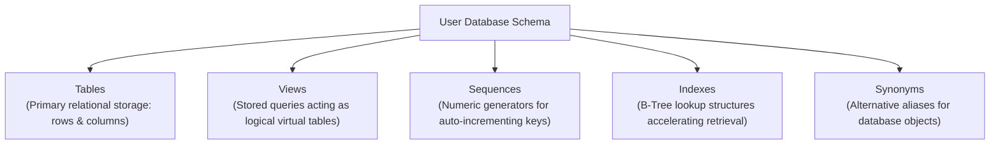
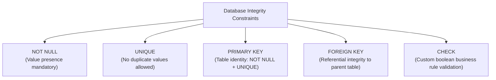

#SQL #DDL #DataDefinitionLanguage #DatabaseConstraints #SchemaDesign #DataTypes #DatabaseAdministration

> [!abstract] Brief Description
> This note provides a comprehensive guide to SQL Data Definition Language (DDL) and database schema architecture. It details schema objects (tables, views, sequences, indexes, synonyms), identifier naming conventions, foundational data types (`VARCHAR2`, `CHAR`, `NUMBER`, `DATE`, `CLOB`, `BLOB`), and the definition and management of the 5 core data integrity constraints (`NOT NULL`, `UNIQUE`, `PRIMARY KEY`, `FOREIGN KEY`, `CHECK`). It also covers schema alterations (`ALTER TABLE ADD`, `MODIFY`, `DROP COLUMN`), table lifecycle operations (`RENAME`, `TRUNCATE`, `DROP TABLE`), and constraint state transitions (`ENABLE`/`DISABLE CASCADE`).

---

> [!note] 📖 The Core Analogy: The Structural Blueprint & Municipal Building Codes
> Imagine constructing a high-rise office tower:
> - **The Database Objects (The Physical Infrastructure):**
>   - **Tables:** The physical office floors where workers and desks reside.
>   - **Views:** Glass observation decks providing filtered perspectives into specific offices without exposing the private utility closets.
>   - **Sequences:** The automatic ticketing machine at the reception lobby issuing sequential visitor badges (1, 2, 3...).
>   - **Indexes:** The high-speed express elevator directory that shoots you straight to the 42nd floor without stopping at every single intermediate room.
>   - **Synonyms:** A convenient nickname for a complex corporate department code.
> - **Data Integrity Constraints (The Municipal Safety & Building Codes):**
>   - **`NOT NULL`:** Every worker entering the building must possess an identity card.
>   - **`UNIQUE`:** No two employees may be assigned the exact same security badge serial number.
>   - **`PRIMARY KEY`:** The biometric fingerprint identifying each individual tenant.
>   - **`FOREIGN KEY` (Referential Integrity):** An office keycard that is only valid if linked to an active, licensed company registered on the master tenancy registry.
>   - **`CHECK`:** An environmental safety rule stating that room occupancy must never exceed 50 people (`occupancy <= 50`).

---

## 🏛️ 1. Database Objects Architecture

An RDBMS schema contains multiple specialized database objects:



| Object | Definition & Operational Purpose |
| :--- | :--- |
| **Table** | The foundational unit of relational storage. Composed of typed columns (fields) and rows (tuples). |
| **View** | A virtual table defined by a stored `SELECT` query. Exposes custom subsets of data without storing duplicate copies. |
| **Sequence** | An independent database object that generates sequential, gap-free integers (commonly used for surrogate primary keys). |
| **Index** | An auxiliary physical search structure (typically B-Tree or Bitmap) that speeds up data retrieval on indexed columns. |
| **Synonym** | An alias or alternative identifier assigned to a table, view, sequence, or procedure to simplify references. |

---

## 📏 2. Naming Rules & Nomenclature Standards

Identifiers (table names, column names, constraint names, indexes) must comply with standard database naming conventions:

1. **First Character:** Must begin with an alphabetical letter (`A-Z`, `a-z`).
2. **Length Limit:** In classical Oracle systems, identifiers cannot exceed **30 characters** (extended to 128 characters in Oracle 12cR2+; ANSI standard systems often support up to 63 or 128).
3. **Allowed Characters:** Uppercase/lowercase letters, digits (`0-9`), underscore (`_`), dollar sign (`$`), and hash symbol (`#`).
4. **Uniqueness:** Cannot collide with another object name in the same user schema.
5. **Reserved Keywords:** Cannot match SQL or engine reserved keywords (e.g., `SELECT`, `TABLE`, `KEY`, `CREATE`, `UNIQUE`, `WHERE`).
6. **Expressiveness:** Names should be semantic, clean, and representative of business domain entities.

---

## 💾 3. Core Relational Data Types

Before creating a table, appropriate data types must be chosen based on storage efficiency and domain rules:

| Data Type | Syntax | Maximum Size | Operational Behavior |
| :--- | :--- | :--- | :--- |
| **`VARCHAR2`** | `VARCHAR2(size)` | 4,000 bytes (standard) / 32 KB (extended) | Variable-length text. Stores only actual characters typed; releases unused space. |
| **`CHAR`** | `CHAR(size)` | 2,000 bytes | Fixed-length text. Right-pads strings with blank spaces up to specified length. |
| **`NUMBER`** | `NUMBER(p, s)` | Precision $p \le 38$, Scale $s \in [-84, 127]$ | Fixed/floating-point numeric data. $p$ is total digits; $s$ is decimal digits. |
| **`DATE`** | `DATE` | 7 bytes | Stores Century, Year, Month, Day, Hour, Minute, and Second. Default mask: `DD-MON-YY`. |
| **`LONG`** | `LONG` | 2 Gigabytes | Legacy variable-length character string (deprecated in favor of `CLOB`). |
| **`CLOB`** | `CLOB` | 4 Gigabytes | Character Large Object. Stores massive unstructured text documents, JSON, or XML. |
| **`BLOB`** | `BLOB` | 4 Gigabytes | Binary Large Object. Stores raw binary data (images, PDFs, audio, video). |

```sql
-- Syntax for NUMBER:
salary NUMBER(8, 2)   -- Up to 999,999.99 (6 digits before decimal, 2 after)
counter NUMBER(6)     -- Integer up to 999,999
ratio NUMBER          -- Floating point with maximum 38 digits precision
```

---

## 🛡️ 4. The 5 Data Integrity Constraints

Integrity constraints enforce business rules directly at the database engine level, guaranteeing that invalid data can never be committed regardless of which application sends the SQL query.



### Column-Level vs. Table-Level Definition:
* **Column-Level:** Declared immediately after the column datatype on the same line. Required for `NOT NULL`.
* **Table-Level:** Declared at the bottom of the column list separated by commas. Mandatory for **composite keys** (keys spanning 2 or more columns).

---

### 1. `NOT NULL` Constraint
Mandates that a column cannot contain a `NULL` state. Must be declared at column level:
```sql
last_name VARCHAR2(50) CONSTRAINT emp_last_name_nn NOT NULL
```

### 2. `UNIQUE` Constraint
Ensures that all values stored in the column (or column combination) are distinct across all rows.
* Unlike primary keys, `UNIQUE` allows `NULL` values (multiple rows can contain `NULL` because `NULL` does not equal `NULL`).
* The database engine **automatically creates a unique B-Tree index** on the unique column to accelerate duplicate checking.

```sql
email VARCHAR2(100) CONSTRAINT emp_email_uk UNIQUE
```

### 3. `PRIMARY KEY` Constraint
Uniquely identifies every tuple in the table. Combines `NOT NULL` and `UNIQUE` semantics.
* Only **one** primary key is allowed per table.
* Automatically generates a unique B-Tree index on the key columns.

```sql
-- Column-level:
id_emp NUMBER(6) CONSTRAINT emp_pk PRIMARY KEY

-- Table-level (Required for Composite Keys):
CONSTRAINT enrollment_pk PRIMARY KEY (student_id, course_id)
```

### 4. `FOREIGN KEY` (Referential Integrity)
Establishes a parent-child relationship between a column in the child table and the primary/unique key of the parent table.


#### Deletion Actions on Parent Records:
* **Default (Restrict / No Action):** Prevents deletion of a parent record if children reference it (`ORA-02292`).
* **`ON DELETE CASCADE`:** Automatically deletes all dependent child rows when the parent row is deleted.
* **`ON DELETE SET NULL`:** Automatically sets the child foreign key column to `NULL` when the parent row is deleted.

```sql
CONSTRAINT emp_dept_fk FOREIGN KEY (id_dep)
    REFERENCES departments (id_dep)
    ON DELETE CASCADE
```

### 5. `CHECK` Constraint
Validates that every row inserted or updated satisfies an explicit boolean condition.

```sql
salary NUMBER(8, 2) CONSTRAINT emp_salary_ck CHECK (salary > 0),
gender CHAR(1)      CONSTRAINT emp_gender_ck CHECK (gender IN ('M', 'F'))
```

> [!danger] Illegal Expressions in `CHECK` Constraints
> The following expressions are strictly forbidden inside a `CHECK` constraint:
> - Pseudo-columns: `ROWNUM`, `CURRVAL`, `NEXTVAL`.
> - Non-deterministic system functions: `SYSDATE`, `USER`, `UID`.
> - Subqueries or references to other tables/columns in other rows.

---

## 🏗️ 5. Complete Table Creation Example

```sql
CREATE TABLE employee (
    id_emp         NUMBER(6)       CONSTRAINT emp_id_pk PRIMARY KEY,
    last_name      VARCHAR2(50)    CONSTRAINT emp_last_name_nn NOT NULL,
    first_name     VARCHAR2(50)    CONSTRAINT emp_first_name_nn NOT NULL,
    email          VARCHAR2(100)   CONSTRAINT emp_email_nn NOT NULL
                                   CONSTRAINT emp_email_uk UNIQUE,
    phone          VARCHAR2(20),
    hire_date      DATE            DEFAULT SYSDATE CONSTRAINT emp_hire_date_nn NOT NULL,
    job_title      VARCHAR2(50)    CONSTRAINT emp_job_nn NOT NULL,
    salary         NUMBER(8, 2)    CONSTRAINT emp_salary_ck CHECK (salary > 0),
    commission_pct NUMBER(4, 2)    CONSTRAINT emp_comm_ck CHECK (commission_pct >= 0),
    id_dep         NUMBER(6),
    CONSTRAINT emp_dept_fk FOREIGN KEY (id_dep)
        REFERENCES departments (id_dep)
        ON DELETE SET NULL
);
```

---

## 🔧 6. Altering Schemas & Constraint Management (`ALTER TABLE`)

Production databases evolve constantly. The `ALTER TABLE` statement allows structural modifications without losing existing data.

### 1. Adding & Dropping Columns
```sql
-- Add new columns (appended to end of table; existing rows set to NULL):
ALTER TABLE employee 
ADD (department_name VARCHAR2(50), bonus_rate NUMBER(4, 2));

-- Drop a specific column:
ALTER TABLE employee 
DROP COLUMN bonus_rate;
```

### 2. Modifying Existing Columns
You can alter a column's data type, increase its size, or modify its default value:
```sql
ALTER TABLE employee 
MODIFY (email VARCHAR2(150), salary NUMBER(10, 2) DEFAULT 1000);
```

### 3. Adding, Dropping, Disabling & Enabling Constraints
```sql
-- Add a constraint after table creation:
ALTER TABLE employee
ADD CONSTRAINT emp_phone_uk UNIQUE (phone);

-- Drop a constraint:
ALTER TABLE employee
DROP CONSTRAINT emp_phone_uk;

-- Disabling a constraint (useful during bulk ETL data loads):
ALTER TABLE employee
DISABLE CONSTRAINT emp_dept_fk CASCADE;

-- Re-enabling a constraint:
ALTER TABLE employee
ENABLE CONSTRAINT emp_dept_fk;
```

> [!important] Re-enabling Dependency Rule
> You cannot enable a child foreign key constraint if the parent table's primary key constraint is currently disabled.

---

## 🗑️ 7. Dropping, Truncating & Renaming Tables

| Command | Category | Transaction Logged? | Rollback Possible? | High-Water Mark Reset? | Drops Indexes? |
| :--- | :---: | :---: | :---: | :---: | :---: |
| **`DROP TABLE`** | DDL | ❌ Minimal | ❌ No (Direct) | Yes (Deallocates extents) | ✅ Yes |
| **`TRUNCATE TABLE`**| DDL | ❌ Minimal | ❌ No | ✅ Yes (Instant) | Preserves structure |
| **`DELETE FROM`** | DML | ✅ Full (Undo/Redo) | ✅ Yes (`ROLLBACK`) | ❌ No | Preserves structure |

```sql
-- Rename an object:
RENAME employee TO emp_archive;

-- Drop a table with dependent foreign key links:
DROP TABLE departments CASCADE CONSTRAINTS;
```

---

> [!summary] Key Takeaways
> - **Core concept:** DDL commands (`CREATE`, `ALTER`, `DROP`, `TRUNCATE`, `RENAME`) manage the physical and logical architecture of the database and implicitly issue an un-rollbackable `COMMIT`.
> - **Key implementation detail:** Constraints guarantee data correctness. `PRIMARY KEY` enforces identity; `FOREIGN KEY` enforces relationship validity; `CHECK` enforces business rules without external procedural code.
> - **Best practice:** Always name your constraints explicitly (`CONSTRAINT pk_table_name PRIMARY KEY`) instead of letting the database generate random internal names (`SYS_C0012934`). This makes error logs immediately actionable during production incidents.
