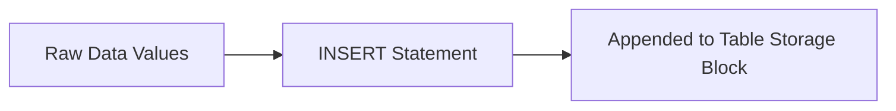
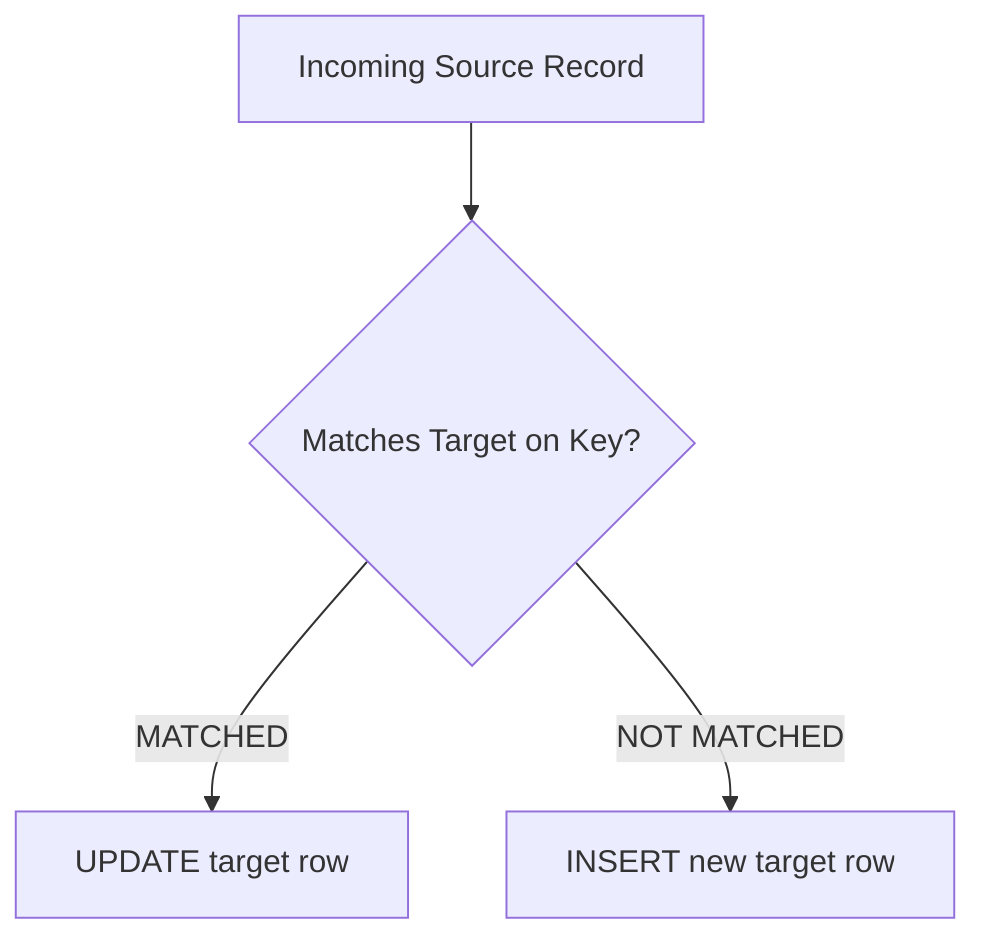
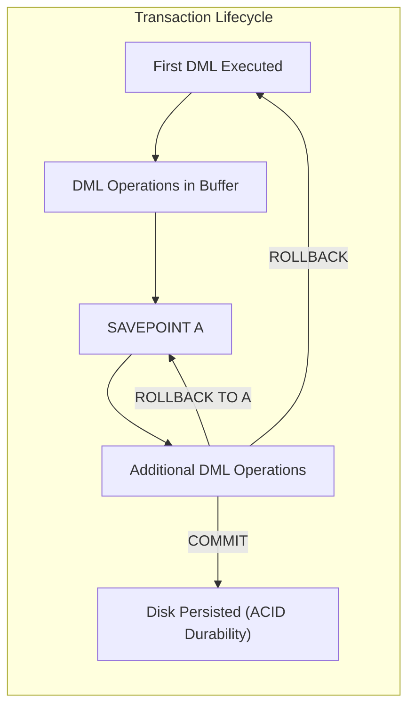

#SQL #DML #DataManipulation #Transactions #ACID #Views #DatabaseSecurity #TCL

> [!abstract] Brief Description
> This note covers data modification and transaction management in SQL. It details the mechanics of `INSERT` (explicit/implicit nulls, query-based insertion), `UPDATE` (including correlated subquery updates), `DELETE`, `TRUNCATE`, and atomic upserts using `MERGE INTO`. It explains transaction lifecycle control (`COMMIT`, `ROLLBACK`, `SAVEPOINT`), and explores database Views in depth: view architecture, updatable view criteria, security gating, `WITH CHECK OPTION`, and business rule enforcement.

---

> [!note] 📖 The Core Analogy: The Bank Teller & The Double-Entry Vault Ledger
> Imagine transferring money between bank accounts:
> - **The DML Operations (The Counter Transactions):**
>   - **`INSERT`:** Opening a brand-new customer savings account in the registry.
>   - **`UPDATE`:** Debiting \$500 from Account A and crediting \$500 to Account B.
>   - **`DELETE`:** Closing an expired credit card account.
> - **Transactions & TCL (The Vault Authorization Stamp):**
>   - **The Pending State:** While the teller debits Account A, the money has temporarily left Account A, but has not yet settled in Account B. If the power cuts out right here, the system would lose \$500.
>   - **`SAVEPOINT`:** A provisional bookmark midway through a multi-stage transaction.
>   - **`ROLLBACK`:** An emergency cancellation that restores the bank ledger back to its pristine state prior to the transaction.
>   - **`COMMIT`:** The final authorized managerial stamp that makes all debit and credit entries permanent and visible to all other branches.
> - **Views (The Teller Window Glass):** A privacy glass window displaying only the customer's balance and transaction history, while shielding secret internal credit scores, supervisor notes, and audit logs.

---

## ✍️ 1. Inserting Data (`INSERT INTO`)

The `INSERT` statement appends new tuples into a table.



### 1. Basic Column-List Syntax
Values must match the order and datatypes of the designated columns:
```sql
INSERT INTO department (id_dep, dept_name) 
VALUES (20, 'Sales');
```

### 2. Handling `NULL` Values: Explicit vs. Implicit
* **Explicit Method:** Explicitly pass the `NULL` keyword in the `VALUES` list:
  ```sql
  INSERT INTO department (id_dep, dept_name) 
  VALUES (20, NULL);
  ```
* **Implicit Method:** Omit the column entirely from the column list (the omitted column automatically defaults to its schema `DEFAULT` value or `NULL`):
  ```sql
  INSERT INTO department (id_dep) 
  VALUES (20);
  ```

### 3. Inserting Dynamic Expressions & Formatted Dates
```sql
INSERT INTO employee (id_emp, hire_date, salary) 
VALUES (
    31, 
    TO_DATE('2026-09-18 10:30', 'YYYY-MM-DD HH24:MI'), 
    5000 * 1.10
);
```

### 4. Inserting from Another Table (`INSERT INTO ... SELECT`)
Copies data directly from one table into another without using the `VALUES` keyword:
```sql
INSERT INTO department (id_dep, dept_name)
SELECT id, name 
FROM headquarters_dep 
WHERE id = 14;
```

---

## 🔄 2. Modifying Data (`UPDATE ... SET`)

The `UPDATE` statement modifies existing attribute values across one or more rows.

```sql
UPDATE table_name
SET column1 = value1, column2 = value2
WHERE condition;
```

> [!danger] The Unbounded `UPDATE` Disaster
> If you omit the `WHERE` clause, **every single row in the table will be updated!**
> ```sql
> -- DISASTROUS: Sets every employee's name in the company to 'Karimi'
> UPDATE employee SET last_name = 'Karimi';
> ```

### 1. Updating with `DEFAULT` Values
```sql
UPDATE employee 
SET hire_date = DEFAULT 
WHERE id_dep = 1;
```

### 2. Updating Multiple Columns with Correlated Subqueries
```sql
UPDATE employee
SET job_title = (SELECT job_title FROM employee WHERE id_emp = 1),
    salary    = (SELECT salary    FROM employee WHERE id_emp = 1)
WHERE last_name = 'Alaoui';
```

---

## 🗑️ 3. Deleting Data (`DELETE FROM`)

The `DELETE` statement removes designated rows from a table based on a predicate condition:

```sql
DELETE FROM employee 
WHERE id_emp = 1230;

-- Delete employees belonging to departments located in Fez
DELETE FROM employee
WHERE deptno IN (SELECT id_dep FROM department WHERE city = 'Fez');
```

### `DELETE` vs. `TRUNCATE TABLE`:
* `DELETE` is a **DML** command: it generates undo/rollback logs for every deleted row, fires database triggers, and can be undone with `ROLLBACK`.
* `TRUNCATE` is a **DDL** command: it bypasses row-by-row undo logging, instantly resets the table's High-Water Mark (HWM), does not fire delete triggers, and **cannot be rolled back**.

---

## 🔀 4. Conditional Upserts with `MERGE`

The `MERGE` statement (SQL:2003 standard) conditionally combines `INSERT` and `UPDATE` into a single atomic operation. It tests whether a record exists based on a join key:
* If the row **exists** (`MATCHED`) $\rightarrow$ executes an `UPDATE`.
* If the row **does not exist** (`NOT MATCHED`) $\rightarrow$ executes an `INSERT`.



```sql
MERGE INTO employee_backup b
USING employee e
ON (b.id_emp = e.id_emp)
WHEN MATCHED THEN
    UPDATE SET 
        b.last_name = e.last_name,
        b.salary    = e.salary
WHEN NOT MATCHED THEN
    INSERT (id_emp, last_name, salary)
    VALUES (e.id_emp, e.last_name, e.salary);
```

---

## 🔒 5. Database Transactions & ACID Properties

A **transaction** is a logical unit of work consisting of one or more DML statements that must succeed or fail as an indivisible whole.



### The ACID Guarantees:
1. **Atomicity (All or Nothing):** Either all operations within the transaction succeed, or the entire transaction is rolled back.
2. **Consistency:** A transaction transforms the database from one valid integrity state to another, never violating constraints.
3. **Isolation:** Concurrent transactions cannot see each other's uncommitted intermediate modifications.
4. **Durability:** Once committed, changes are permanently recorded on disk and survive system crashes.

### Transaction Control Language (TCL) Commands:
* **`COMMIT;`** : Permanently saves all pending changes made in the current session. Releases all table and row-level locks.
* **`ROLLBACK;`** : Completely discards all uncommitted modifications back to the beginning of the transaction.
* **`SAVEPOINT sp_name;`** : Establishes an intermediate milestone within a long transaction.
* **`ROLLBACK TO sp_name;`** : Reverts changes made *after* the specified savepoint while preserving prior operations.

> [!important] Implicit Commits
> In Oracle and standard RDBMSs, executing **any DDL statement** (`CREATE`, `ALTER`, `DROP`, `TRUNCATE`) or exiting an administrative session cleanly automatically executes an **implicit `COMMIT`**, permanently locking in any preceding uncommitted DML!

---

## 🪟 6. Database Views in Depth

A **view** is a logical virtual table defined by an underlying SQL query. Views store **no physical data**; their data is computed dynamically whenever queried.

### Why Use Views?
1. **Security & Data Confidentiality:** Restricts user access to specific columns (e.g., hiding employee salaries while exposing phone extensions).
2. **Query Simplification:** Pre-joins complex 5-table relationships so client developers can simply run `SELECT * FROM sales_summary`.
3. **External Schema Abstraction:** Insulates client applications against changes to underlying physical tables.
4. **Business Rule Enforcement:** Enforces validation constraints using the `WITH CHECK OPTION`.

---

### View Creation & Syntax:
```sql
CREATE [OR REPLACE] [FORCE | NO FORCE] VIEW view_name [(column_aliases)]
AS select_query
[WITH CHECK OPTION]
[WITH READ ONLY];
```

* `OR REPLACE`: Overwrites existing view definition without dropping granted permissions.
* `FORCE`: Creates the view even if underlying tables do not currently exist.
* `WITH READ ONLY`: Forbids all DML modifications against the view.
* `WITH CHECK OPTION`: Ensures all `INSERT` and `UPDATE` operations performed through the view satisfy the view's `WHERE` predicate condition.

```sql
-- View exposing only flights departing from Fez:
CREATE VIEW flights_from_fez AS
SELECT flight_id, arrival_city, departure_time, arrival_time
FROM flights
WHERE departure_city = 'Fez';

-- Querying the view:
SELECT * FROM flights_from_fez;

-- Dropping a view:
DROP VIEW flights_from_fez;
```

---

## ✏️ 7. Updatable Views & The `WITH CHECK OPTION`

A view can be used to execute `INSERT`, `UPDATE`, and `DELETE` operations on its underlying base table only if it is a **simple view**.

### Disqualifiers for Updatable Views:
A view is **NOT updatable** if its query definition contains any of the following:
* Aggregate functions (`SUM`, `AVG`, `COUNT`, `MAX`, `MIN`)
* The `DISTINCT` keyword
* A `GROUP BY` or `HAVING` clause
* Set operators (`UNION`, `INTERSECT`, `MINUS`)
* Certain types of joins (outer joins, Cartesian products)

### Enforcing Integrity with `WITH CHECK OPTION`:
Consider a view filtering valid flights:
```sql
CREATE VIEW verified_flights AS
SELECT flight_id, pilot_id, plane_id, departure_city
FROM flights
WHERE pilot_id > 0 
  AND plane_id > 0 
  AND departure_city IN ('Fez', 'Al-Hoceima', 'Casablanca')
WITH CHECK OPTION;
```
If a user tries to insert a flight departing from `'Marrakech'` via this view:
```sql
-- Fails with ORA-01402: view WITH CHECK OPTION where-clause violation
INSERT INTO verified_flights (flight_id, pilot_id, plane_id, departure_city)
VALUES ('V200', 4, 12, 'Marrakech');
```

---

## 🛡️ 8. Referential Integrity Validation via Views

In complex architectures without foreign key constraints defined at the physical layer, views can enforce referential validity using `WITH CHECK OPTION`:

```sql
-- Validating that pilot and plane exist before allowing a flight insertion:
CREATE VIEW valid_flight_entry AS
SELECT * 
FROM flights
WHERE plane_id > 0
  AND (pilot_id IS NULL OR pilot_id IN (SELECT pilot_id FROM pilots))
  AND (plane_name IS NULL OR plane_name IN (SELECT plane_name FROM planes))
WITH CHECK OPTION;

-- Safe deletion views: Prevent deleting planes currently assigned to active flights
CREATE VIEW safe_plane_deletion AS
SELECT * 
FROM planes p
WHERE NOT EXISTS (
    SELECT 1 
    FROM flights f 
    WHERE f.plane_id = p.plane_id
);
```

---

> [!summary] Key Takeaways
> - **Core concept:** DML statements (`INSERT`, `UPDATE`, `DELETE`, `MERGE`) mutate table data under the protection of ACID transactions.
> - **Key implementation detail:** The `MERGE` statement synchronizes data by performing updates on existing rows and insertions for new rows within a single atomic step.
> - **Best practice:** Use views with `WITH CHECK OPTION` to build secure external schemas, preventing invalid or unauthorized records from being submitted through client applications.
