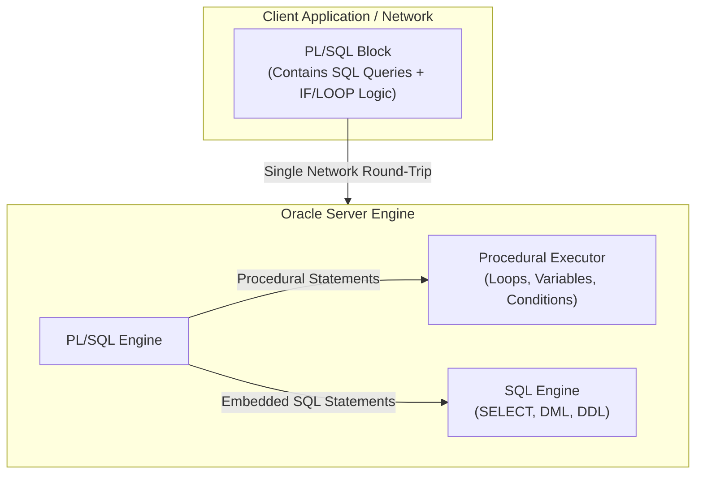
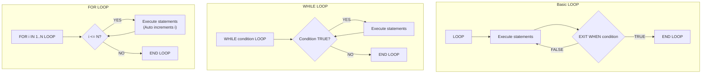
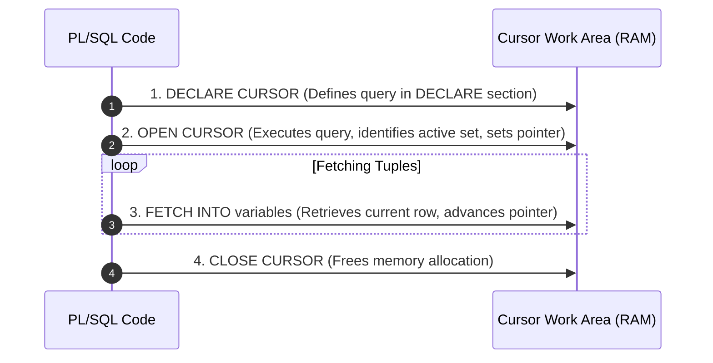

#SQL #PLSQL #ProceduralSQL #DatabaseProgramming #Cursors #ControlFlow #OracleSQL

> [!abstract] Brief Description
> This note covers the architectural foundations and procedural programming capabilities of Oracle PL/SQL. It details the structural block anatomy (`DECLARE`, `BEGIN`, `EXCEPTION`, `END;`), scalar and anchored data types (`%TYPE`, `%ROWTYPE`), custom record types, branching (`IF-THEN-ELSIF`, `CASE`), iterative loops (`WHILE`, `LOOP`, `FOR`), and database interactions via `SELECT ... INTO`. It provides an exhaustive treatment of cursors: implicit attributes (`SQL%ROWCOUNT`), explicit cursor lifecycles (`OPEN`, `FETCH`, `CLOSE`), cursor `FOR` loops, and updatable cursors utilizing `FOR UPDATE` and `WHERE CURRENT OF`.

---

> [!note] 📖 The Core Analogy: The Autonomous Factory Assembly Robot
> Imagine the difference between ordering factory actions manually vs. deploying an onboard programmable microprocessor:
> - **Plain SQL (The Remote Walkie-Talkie Commands):** A manager standing outside the factory floor uses a walkie-talkie to give single commands across the network: *"Fetch box 1"*, *"Check weight"*, *"Ship box 1"*. Each individual command incurs network latency, back-and-forth communication, and manual intervention.
> - **PL/SQL Block Execution (The Autonomous Onboard Controller):** The manager writes a complete program loaded directly into the robot's local memory on the factory floor. The robot evaluates conditions locally (`IF weight > 50`), executes iterative tasks (`FOR box IN 1..100`), handles component malfunctions gracefully (`EXCEPTION`), and reports back when the batch is finished—slashing network round trips to zero.
> - **The Cursor (The Assembly Line Index Finger):** When a query returns 10,000 inventory items, the robot cannot process all 10,000 at the exact same millisecond. The **cursor** is the robot's pointer finger that points to the active item on the conveyor belt, reads its barcode (`FETCH`), processes it, and steps to the next item until the belt is empty (`%NOTFOUND`).

---

## 🏗️ 1. Architecture & The Need for PL/SQL

SQL is a **declarative (non-procedural)** language: you specify *what* data is needed, not *how* to procedurally fetch or manipulate it. However, real-world enterprise applications require procedural logic: loops, variable storage, error handling, and complex multi-step branching.

**PL/SQL** (**Procedural Language/SQL**) is Oracle's procedural extension to SQL, combining the data retrieval power of SQL with the structured control flow of languages like Ada and Pascal.



### Advantages of PL/SQL:
1. **Network Latency Reduction:** An entire batch of statements is sent to the server as a single block rather than making dozens of separate client-server round-trips.
2. **High Performance & Shared Memory:** Compiled code is stored and executed in the database cache.
3. **Seamless SQL Integration:** Supports all SQL data types, functions, and relational queries natively without complex ORM layers.

---

## 🧱 2. Anatomy of a PL/SQL Block

The basic unit of execution in PL/SQL is the **block**. Blocks can be **anonymous** (executed on-the-fly and not saved in the database catalog) or **named** (stored procedures, functions, packages, triggers).

```sql
DECLARE       -- OPTIONAL: Declare variables, constants, cursors, custom types
    -- Declaration statements
BEGIN         -- MANDATORY: Procedural logic and SQL operations
    -- Executable statements
EXCEPTION     -- OPTIONAL: Error handling routines
    -- Exception handlers
END;          -- MANDATORY: Block terminator (followed by ;)
/
```

> [!tip] Executing in SQL Developer / SQL*Plus
> To view text emitted by `DBMS_OUTPUT.PUT_LINE`, always execute `SET SERVEROUTPUT ON;` in your session before running your block. The slash (`/`) on a new line instructs the environment to compile and execute the block.

---

## 📦 3. Variables, Constants & Anchored Types

### 1. Naming & Declaration Rules
* Must begin with a letter, max 30 characters, alphanumeric with `_`, `$`, and `#`.
* Case-insensitive.
* **Engineering Standard:** Prefix PL/SQL variables with `v_` (e.g., `v_salary`, `v_emp_id`) to prevent variable names from colliding with database column names!

```sql
SET SERVEROUTPUT ON;
DECLARE
    v_age       INTEGER := 25;
    v_name      VARCHAR2(50) := 'Karim';
    c_tax_rate  CONSTANT NUMBER(3, 2) := 0.20; -- Immutable constant
    v_is_active BOOLEAN := TRUE;
BEGIN
    DBMS_OUTPUT.PUT_LINE('Name: ' || v_name || ', Age: ' || v_age);
END;
/
```

---

### 2. Anchored Data Types: `%TYPE` and `%ROWTYPE`

Hardcoding variable datatypes in code creates severe technical debt: if the database schema alters `salary` from `NUMBER(6)` to `NUMBER(8, 2)`, hardcoded PL/SQL blocks will crash. Anchored types dynamically mirror the database catalog:

#### `%TYPE` (Column-Anchored Type):
Inherits the exact data type and precision of a designated column or existing variable:
```sql
DECLARE
    v_emp_name  employee.last_name%TYPE;  -- Mirrors column type
    v_salary    employee.salary%TYPE;
BEGIN
    SELECT last_name, salary 
    INTO v_emp_name, v_salary
    FROM employee 
    WHERE id_emp = 1230;
END;
/
```

#### `%ROWTYPE` (Record-Anchored Type):
Creates a composite record structure representing an **entire table row**:
```sql
DECLARE
    v_emp_record  employee%ROWTYPE;  -- Contains all columns of employee
BEGIN
    SELECT * 
    INTO v_emp_record
    FROM employee 
    WHERE id_emp = 1230;

    -- Access individual fields via dot notation:
    DBMS_OUTPUT.PUT_LINE('Employee Name: ' || v_emp_record.last_name);
    DBMS_OUTPUT.PUT_LINE('Salary: ' || v_emp_record.salary);
END;
/
```

---

### 3. User-Defined Composite Types (`RECORD`)
Equivalent to a `struct` in C/C++, allowing custom grouped data fields:
```sql
DECLARE
    TYPE t_emp_summary IS RECORD (
        emp_num   employee.id_emp%TYPE,
        full_name VARCHAR2(100),
        job_title employee.job_title%TYPE
    );
    v_summary t_emp_summary;
BEGIN
    v_summary.emp_num   := 1;
    v_summary.full_name := 'Idrissi Omar';
    v_summary.job_title := 'Lead Engineer';
END;
/
```

---

## 🔀 4. Control Structures: Branching & Iteration

### 1. Conditional Branching (`IF` & `CASE`)
```sql
-- IF-THEN-ELSIF Ladder:
IF v_score >= 90 THEN
    v_grade := 'A';
ELSIF v_score >= 80 THEN
    v_grade := 'B';
ELSIF v_score >= 70 THEN
    v_grade := 'C';
ELSE
    v_grade := 'F';
END IF;

-- CASE Statement:
CASE v_deptno
    WHEN 10 THEN v_location := 'Casablanca';
    WHEN 20 THEN v_location := 'Rabat';
    WHEN 30 THEN v_location := 'Fez';
    ELSE v_location := 'Other';
END CASE;
```

---

### 2. Iterative Loops
PL/SQL supports three distinct looping mechanisms:



#### Basic `LOOP` with `EXIT WHEN`:
```sql
DECLARE
    v_counter NUMBER := 1;
    v_sum     NUMBER := 0;
BEGIN
    LOOP
        v_sum := v_sum + v_counter;
        v_counter := v_counter + 1;
        EXIT WHEN v_counter > 10;
    END LOOP;
    DBMS_OUTPUT.PUT_LINE('Sum = ' || v_sum);
END;
/
```

#### `WHILE` Loop:
```sql
WHILE v_counter <= 10 LOOP
    v_sum := v_sum + v_counter;
    v_counter := v_counter + 1;
END LOOP;
```

#### Numeric `FOR` Loop:
Counter variable `i` is declared implicitly as an integer and increments automatically:
```sql
FOR i IN 1..100 LOOP
    v_sum := v_sum + i;
END LOOP;

-- Reverse order loop:
FOR i IN REVERSE 1..10 LOOP
    DBMS_OUTPUT.PUT_LINE('Countdown: ' || i);
END LOOP;
```

---

## 📥 5. SQL Operations in PL/SQL & `SELECT ... INTO`

When issuing a query in PL/SQL, you must direct the returned values into local variables using the **`INTO`** clause:

```sql
SELECT column1, column2 
INTO variable1, variable2 
FROM table_name 
WHERE condition;
```

> [!danger] The `SELECT ... INTO` Rule
> `SELECT ... INTO` **must return exactly one single row**:
> - If the query returns **0 rows**, the database throws exception `NO_DATA_FOUND` (`ORA-01403`).
> - If the query returns **2 or more rows**, the database throws exception `TOO_MANY_ROWS` (`ORA-01422`).
> 
> To process queries that return multiple rows, you **must use a Cursor**!

---

## 🎯 6. Cursors: Implicit vs. Explicit

A **cursor** is a private work area allocated in RAM by the Oracle server to parse, execute, and store rows returned by an SQL statement.

### 1. Implicit Cursors
Automatically managed by Oracle for all SQL statements executed directly in a block (`INSERT`, `UPDATE`, `DELETE`, single-row `SELECT`).
Accessed using the pseudo-cursor name **`SQL`**:

| Attribute | Meaning | Example / Purpose |
| :--- | :--- | :--- |
| **`SQL%FOUND`** | Boolean: `TRUE` if last DML affected $\ge 1$ row. | Check if an `UPDATE` modified anything. |
| **`SQL%NOTFOUND`** | Boolean: `TRUE` if last DML affected 0 rows. | Validate row existence. |
| **`SQL%ROWCOUNT`** | Integer: Number of rows affected by last DML. | Log deleted records count. |
| **`SQL%ISOPEN`** | Boolean: Always `FALSE` for implicit cursors. | N/A (Oracle closes implicit cursors instantly). |

```sql
BEGIN
    DELETE FROM employee WHERE last_name = 'Snoussi';
    DBMS_OUTPUT.PUT_LINE('Deleted ' || SQL%ROWCOUNT || ' employee(s).');
    COMMIT;
END;
/
```

---

### 2. Explicit Cursors: The 4-Stage Lifecycle

Explicit cursors are programmed by developers to retrieve, navigate, and process multi-row query result sets sequentially.



#### Classical Explicit Cursor Pattern:
```sql
DECLARE
    -- 1. Declare cursor
    CURSOR c_emp_rabat IS
        SELECT last_name, salary 
        FROM employee 
        WHERE city = 'Rabat';

    v_name   employee.last_name%TYPE;
    v_salary employee.salary%TYPE;
BEGIN
    -- 2. Open cursor
    OPEN c_emp_rabat;

    -- 3. Fetch rows
    FETCH c_emp_rabat INTO v_name, v_salary;
    WHILE c_emp_rabat%FOUND LOOP
        DBMS_OUTPUT.PUT_LINE(v_name || ' earns ' || v_salary);
        FETCH c_emp_rabat INTO v_name, v_salary;
    END LOOP;

    -- 4. Close cursor
    CLOSE c_emp_rabat;
END;
/
```

### Explicit Cursor Attributes:
* **`cursor_name%FOUND`** : `TRUE` if the most recent `FETCH` returned a valid row.
* **`cursor_name%NOTFOUND`** : `TRUE` if the most recent `FETCH` found no more rows.
* **`cursor_name%ROWCOUNT`** : Cumulative total number of rows fetched so far.
* **`cursor_name%ISOPEN`** : `TRUE` if cursor is currently open in RAM.

---

## 🚀 7. Simplified Cursors: The Cursor `FOR` Loop

The **Cursor `FOR` Loop** is the modern best practice for processing multi-row queries. It automates the entire lifecycle:
1. Implicitly declares a loop record variable matching cursor schema.
2. Automatically opens the cursor.
3. Automatically fetches rows on each loop iteration.
4. Automatically exits when `%NOTFOUND` evaluates to `TRUE`.
5. Automatically closes the cursor, guaranteeing no memory leaks!

```sql
DECLARE
    CURSOR c_rabat IS
        SELECT last_name, salary 
        FROM employee 
        WHERE city = 'Rabat';
BEGIN
    -- No OPEN, FETCH, or CLOSE required!
    FOR emp_rec IN c_rabat LOOP
        IF emp_rec.salary > 3000 THEN
            INSERT INTO high_earners (name, salary) 
            VALUES (emp_rec.last_name, emp_rec.salary);
        END IF;
    END LOOP;
END;
/
```

---

## 🔒 8. Updatable Cursors: `FOR UPDATE` & `CURRENT OF`

When iterating through a cursor to modify or delete the current row being inspected, you must lock the candidate rows to prevent concurrent user updates from corrupting data.

1. Add **`FOR UPDATE`** to the cursor declaration query (places row-level exclusive locks).
2. Use **`WHERE CURRENT OF cursor_name`** in your `UPDATE` or `DELETE` statement.

```sql
DECLARE
    CURSOR c_emp IS
        SELECT last_name, salary, city 
        FROM employee 
        FOR UPDATE; -- Locks rows in active set!
        
    v_rec c_emp%ROWTYPE;
BEGIN
    OPEN c_emp;
    LOOP
        FETCH c_emp INTO v_rec;
        EXIT WHEN c_emp%NOTFOUND;

        -- If city is missing, delete the current inspected record
        IF v_rec.city IS NULL THEN
            DELETE FROM employee 
            WHERE CURRENT OF c_emp; -- Exact row under cursor pointer!
        END IF;
    END LOOP;
    CLOSE c_emp;
    COMMIT; -- Releases locks
END;
/
```

> [!important] Constraints on `WHERE CURRENT OF`
> The cursor query must select from a **single table** and cannot contain `GROUP BY`, aggregate functions, or `DISTINCT`.

---

## ✏️ 9. Solved Academic Exercises (From Course Slides)

### Exercise: Cursor Partitioning
* *Write a PL/SQL block that iterates through all employees and partitions them into two tables: `Empl1` for those earning > \$1,500, and `Empl2` for all others. Display the total number of employees processed:*

```sql
DECLARE
    CURSOR c_all_emp IS
        SELECT empno, ename, sal, deptno 
        FROM emp;
    v_total NUMBER := 0;
BEGIN
    FOR r IN c_all_emp LOOP
        IF r.sal > 1500 THEN
            INSERT INTO Empl1 (empno, ename, sal, deptno)
            VALUES (r.empno, r.ename, r.sal, r.deptno);
        ELSE
            INSERT INTO Empl2 (empno, ename, sal, deptno)
            VALUES (r.empno, r.ename, r.sal, r.deptno);
        END IF;
    END LOOP;

    SELECT COUNT(*) INTO v_total FROM emp;
    DBMS_OUTPUT.PUT_LINE('Total employees processed: ' || v_total);
    COMMIT;
END;
/
```

---

> [!summary] Key Takeaways
> - **Core concept:** PL/SQL brings procedural execution (control flow, variables, loops, exception handling) directly into the database engine, dramatically reducing network traffic and latency.
> - **Key implementation detail:** Use `%TYPE` and `%ROWTYPE` to anchor variables to database schemas, ensuring programs adapt automatically to underlying table alterations.
> - **Best practice:** Prefer Cursor `FOR` loops over manual `OPEN/FETCH/CLOSE` sequences to eliminate resource leaks and improve code readability.
