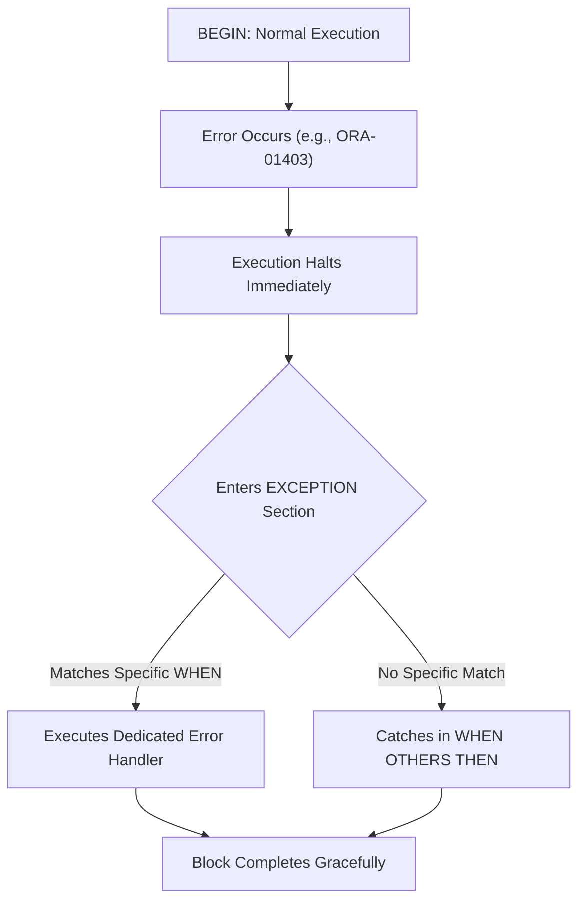
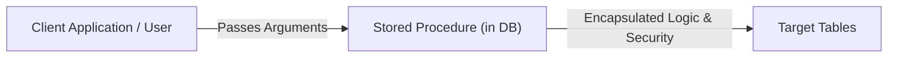
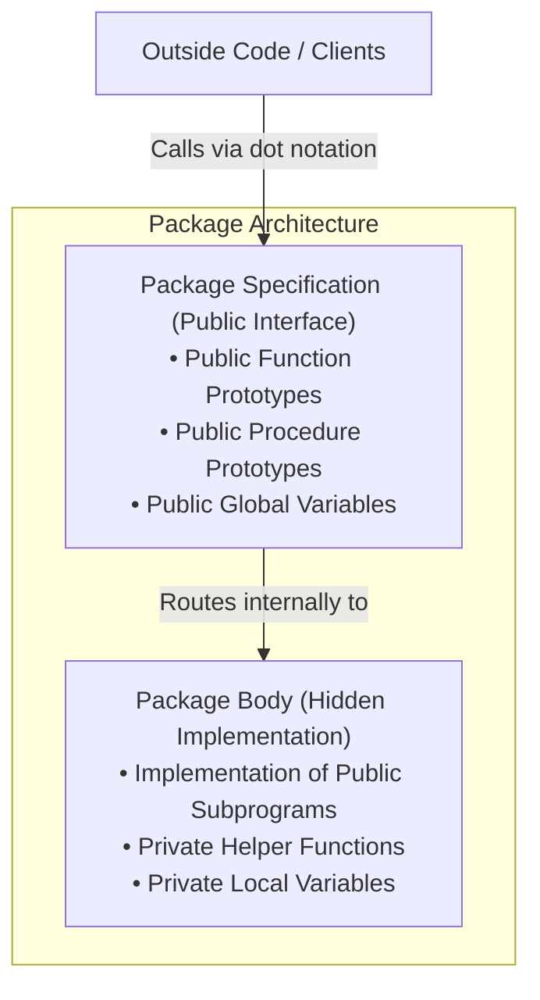
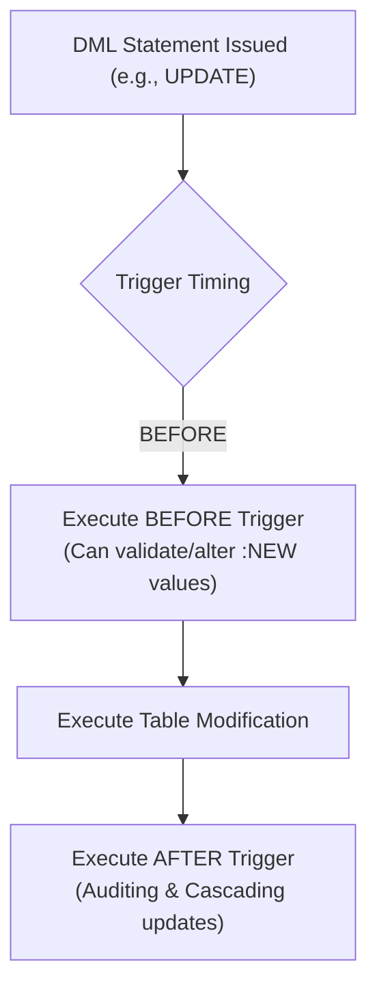

#SQL #PLSQL #StoredProcedures #DatabaseFunctions #Packages #Triggers #ExceptionHandling #DatabaseArchitecture

> [!abstract] Brief Description
> This note covers advanced enterprise programming in Oracle PL/SQL. It details comprehensive exception handling (predefined exceptions, `PRAGMA EXCEPTION_INIT`, user-defined exceptions, `SQLCODE`/`SQLERRM`, and `RAISE_APPLICATION_ERROR`), transactional control within procedural routines, modular architecture with Stored Procedures and Stored Functions (`IN`, `OUT`, `IN OUT` parameter modes), structural encapsulation using PL/SQL Packages (Specifications vs. Bodies), and Event-Condition-Action (ECA) programming via Database Triggers (`BEFORE`, `AFTER`, `INSTEAD OF`, row-level `:NEW`/`:OLD` qualifiers, and integrity enforcement).

---

> [!note] 📖 The Core Analogy: The Enterprise Automated Microservices & Security Guards
> Imagine a high-security automated fulfillment center:
> - **Exception Handling (The Fire Suppression & Emergency Brakes):** When an engine overheats or a machine jams (division by zero, duplicate IDs), rather than burning down the warehouse, automatic sensors trip immediately, halting the line safely and rerouting damaged products to the repair depot (`EXCEPTION`).
> - **Stored Procedures & Functions (The Automated Robotic Workstations):** Certified industrial machines installed directly on the factory floor:
>   - **Procedure:** A heavy conveyor machine that takes raw boxes, repacks them, modifies inventory, and stamps shipping labels (`UPDATE`, `INSERT`).
>   - **Function:** A laser weight-scale that measures a passing crate and immediately announces its exact postage cost back to the system (`RETURN cost`).
> - **Packages (The Clean Modular Toolbox):** Rather than scattering 50 random tools across the warehouse, tools are locked inside an organized cabinet with a clear instruction manual on the outside (**Specification**) and complex gears and wiring concealed safely on the inside (**Body**).
> - **Database Triggers (The Invisible Security Tripwires):** Motion sensors placed at every doorway:
>   - Whenever a pallet attempts to pass through the door (`BEFORE INSERT`), the sensor trips instantly. If the pallet is unauthorized or oversized, the sensor slams the steel gate shut (`RAISE_APPLICATION_ERROR`), cancelling the movement before any database record is touched.

---

## 🛡️ 1. Exception Handling Architecture

In PL/SQL, an **exception** is a runtime error condition that diverts execution away from the normal processing stream into an isolated `EXCEPTION` block.



### 1. Categories of Exceptions:
1. **Predefined Oracle Server Exceptions:** Automatically raised by the database kernel for common SQL violations (e.g., dividing by zero, missing rows).
2. **Non-Predefined Oracle Server Exceptions:** Standard Oracle internal errors that have a numeric error code (e.g., `ORA-02292` foreign key violation) but no predefined symbolic name. Named using `PRAGMA EXCEPTION_INIT`.
3. **User-Defined Exceptions:** Custom business errors declared explicitly by the developer and raised using `RAISE` or `RAISE_APPLICATION_ERROR`.

---

### 2. Predefined Oracle Exceptions Reference:
| Exception Name | Oracle Error Code | Triggering Event |
| :--- | :--- | :--- |
| **`NO_DATA_FOUND`** | `ORA-01403` | A `SELECT ... INTO` query returned 0 rows, or reading an uninitialized PL/SQL table entry. |
| **`TOO_MANY_ROWS`** | `ORA-01422` | A `SELECT ... INTO` query returned 2 or more rows. |
| **`ZERO_DIVIDE`** | `ORA-01476` | Attempted mathematical division by zero ($x / 0$). |
| **`INVALID_NUMBER`** | `ORA-01722` | Failure when converting a string literal into a numeric data type. |
| **`DUP_VAL_ON_INDEX`**| `ORA-00001` | Attempted insertion/update violating a `PRIMARY KEY` or `UNIQUE` constraint. |
| **`CURSOR_ALREADY_OPEN`**| `ORA-06511` | Attempted to `OPEN` an explicit cursor that is already active in memory. |
| **`INVALID_CURSOR`** | `ORA-01001` | Illegal cursor operation (e.g., attempting to `FETCH` or `CLOSE` an un-opened cursor). |
| **`LOGIN_DENIED`** | `ORA-01017` | Authentication failure (invalid username/password). |
| **`CASE_NOT_FOUND`** | `ORA-06592` | None of the `WHEN` clauses in a `CASE` statement match, and no `ELSE` was provided. |

```sql
SET SERVEROUTPUT ON;
DECLARE
    v_sal employee.salary%TYPE;
BEGIN
    SELECT salary INTO v_sal FROM employee WHERE city = 'Rabat';
EXCEPTION
    WHEN TOO_MANY_ROWS THEN
        DBMS_OUTPUT.PUT_LINE('Error: Multiple employees found in Rabat! Use a cursor.');
    WHEN NO_DATA_FOUND THEN
        DBMS_OUTPUT.PUT_LINE('Warning: No employees reside in Rabat.');
    WHEN OTHERS THEN
        DBMS_OUTPUT.PUT_LINE('System Code: ' || SQLCODE || ' | Message: ' || SQLERRM);
END;
/
```

---

### 3. Binding Non-Predefined Errors: `PRAGMA EXCEPTION_INIT`
Associates an arbitrary Oracle error number to an identifier declared as an `EXCEPTION`:
```sql
DECLARE
    e_fk_violation EXCEPTION;
    PRAGMA EXCEPTION_INIT(e_fk_violation, -2292); -- ORA-02292: Child record found
BEGIN
    DELETE FROM department WHERE id_dep = 10;
EXCEPTION
    WHEN e_fk_violation THEN
        DBMS_OUTPUT.PUT_LINE('Cannot delete department: Active employees still reference it!');
END;
/
```

---

### 4. Custom Exceptions & `RAISE_APPLICATION_ERROR`
To report business rule violations back to calling client applications (e.g., Java, Python, Node.js):
$$\text{Syntax: } \mathbf{RAISE\_APPLICATION\_ERROR}(\text{error\_number}, \text{message\_string})$$
* **`error_number`** : Must be within user-reserved range **`-20000` to `-20999`**.
* **`message_string`** : Custom descriptive message up to 2,048 bytes.

```sql
DECLARE
    v_salary employee.salary%TYPE := 0;
    e_invalid_salary EXCEPTION;
BEGIN
    IF v_salary <= 0 THEN
        RAISE_APPLICATION_ERROR(-20010, 'Business Rule Violation: Salary must be strictly positive.');
    END IF;
END;
/
```

---

## ⚙️ 2. Stored Procedures

A **Stored Procedure** is a named PL/SQL block compiled and stored permanently within the database catalog.

### Advantages:
* **Precompiled Execution:** Parsed, compiled, and optimized once; remains cached in the System Global Area (SGA) for rapid reuse by all connected users.
* **Granular Security:** Users can be granted `EXECUTE` rights to a procedure without granting direct `SELECT` or `UPDATE` privileges on the underlying sensitive tables.



### Parameter Modes:
| Mode | Direction | Can Read Inside? | Can Overwrite Inside? | Passed As |
| :--- | :--- | :---: | :---: | :--- |
| **`IN`** *(Default)* | Caller $\rightarrow$ Procedure | ✅ Yes | ❌ No (Read-only constant) | Literal, Expression, or Variable |
| **`OUT`** | Procedure $\rightarrow$ Caller | ❌ No (Starts `NULL`) | ✅ Yes (Assigned before exit) | Variable reference only |
| **`IN OUT`** | Caller $\leftrightarrow$ Procedure | ✅ Yes | ✅ Yes (Mutates caller value)| Variable reference only |

### Complete Procedure Syntax:
```sql
CREATE OR REPLACE PROCEDURE update_employee_salary (
    p_emp_id IN employee.id_emp%TYPE,
    p_raise_pct IN NUMBER
) IS
    -- Declaration area (NOTE: DECLARE keyword is omitted here!)
BEGIN
    UPDATE employee 
    SET salary = salary * (1 + p_raise_pct)
    WHERE id_emp = p_emp_id;

    IF SQL%NOTFOUND THEN
        RAISE_APPLICATION_ERROR(-20001, 'Employee ID ' || p_emp_id || ' does not exist.');
    END IF;
END update_employee_salary;
/
```

#### Invoking Procedures:
```sql
-- Inside another PL/SQL block:
BEGIN
    update_employee_salary(15, 0.10); -- Give 10% raise
END;
/

-- From SQL*Plus / Command prompt:
EXECUTE update_employee_salary(15, 0.10);
```

#### Recompilation & Dropping:
```sql
ALTER PROCEDURE update_employee_salary COMPILE;
DROP PROCEDURE update_employee_salary;
```

---

## 🧮 3. Stored Functions

A **Stored Function** is identical to a stored procedure with one crucial difference: **it must return a scalar value** to the caller via the `RETURN` statement.

```sql
CREATE OR REPLACE FUNCTION get_dept_avg_salary (
    p_dept_id IN employee.id_dep%TYPE
) RETURN NUMBER IS
    v_avg_sal NUMBER(10, 2);
BEGIN
    SELECT AVG(salary) INTO v_avg_sal
    FROM employee
    WHERE id_dep = p_dept_id;

    RETURN NVL(v_avg_sal, 0);
EXCEPTION
    WHEN NO_DATA_FOUND THEN
        RETURN 0;
END get_dept_avg_salary;
/
```

### Calling Functions inside SQL Statements:
Functions that do not perform DML (`INSERT`/`UPDATE`/`DELETE`) can be embedded directly into standard SQL queries:
```sql
SELECT 
    dept_name, 
    get_dept_avg_salary(id_dep) AS avg_payroll
FROM departments;
```

---

## 📦 4. Modular Encapsulation: PL/SQL Packages

A **Package** is an enterprise container grouping logically related procedures, functions, variables, constants, cursors, and exceptions into a single cohesive compilation unit.



### 1. Package Specification (Header)
Exposes the public contract. Items declared here are visible across the entire database:
```sql
CREATE OR REPLACE PACKAGE emp_management_pkg IS
    -- Public global variable
    g_company_bonus NUMBER := 500;

    -- Public subprogram prototypes
    FUNCTION calculate_bonus(p_emp_id IN NUMBER) RETURN NUMBER;
    PROCEDURE adjust_dept_payroll(p_dept_id IN NUMBER, p_percent IN NUMBER);
END emp_management_pkg;
/
```

### 2. Package Body
Implements the prototypes declared in the specification, plus private helper routines:
```sql
CREATE OR REPLACE PACKAGE BODY emp_management_pkg IS

    -- Private helper procedure (inaccessible from outside the package)
    PROCEDURE log_audit(p_msg VARCHAR2) IS
    BEGIN
        INSERT INTO audit_log (log_date, message) VALUES (SYSDATE, p_msg);
    END log_audit;

    -- Implementation of public function
    FUNCTION calculate_bonus(p_emp_id IN NUMBER) RETURN NUMBER IS
        v_sal NUMBER;
    BEGIN
        SELECT salary INTO v_sal FROM employee WHERE id_emp = p_emp_id;
        RETURN (v_sal * 0.05) + g_company_bonus;
    END calculate_bonus;

    -- Implementation of public procedure
    PROCEDURE adjust_dept_payroll(p_dept_id IN NUMBER, p_percent IN NUMBER) IS
    BEGIN
        UPDATE employee SET salary = salary * (1 + p_percent) WHERE id_dep = p_dept_id;
        log_audit('Adjusted payroll for dept ' || p_dept_id);
    END adjust_dept_payroll;

END emp_management_pkg;
/
```

### Accessing Package Members:
Package elements are accessed using standard dot notation: `package_name.element_name`:
```sql
DECLARE
    v_bonus NUMBER;
BEGIN
    v_bonus := emp_management_pkg.calculate_bonus(105);
    emp_management_pkg.adjust_dept_payroll(20, 0.05);
END;
/
```

---

## ⚡ 5. Database Triggers (Event-Condition-Action)

A **Database Trigger** is a compiled PL/SQL block executed **automatically** by the database engine whenever a specified event occurs.

### The ECA Architecture:
* **E (Event):** `INSERT`, `UPDATE [OF column]`, or `DELETE` on a table.
* **C (Condition):** Optional boolean filter evaluated in the `WHEN` clause.
* **A (Action):** The procedural PL/SQL block executed if the event and condition match.



### Trigger Types & Levels:
1. **Statement-Level Trigger:** Fires exactly **once** for the triggering SQL statement, regardless of how many rows are affected (even if 0 rows are modified).
2. **Row-Level Trigger (`FOR EACH ROW`):** Fires **once for every single row** affected by the triggering statement.

---

### Row Qualifiers: `:NEW` and `:OLD`
In row-level triggers (`FOR EACH ROW`), PL/SQL exposes two special pseudorecords:

| Operation | `:OLD.column` | `:NEW.column` |
| :--- | :--- | :--- |
| **`INSERT`** | Always `NULL` | Contains values being inserted (can be overwritten in `BEFORE` triggers!) |
| **`UPDATE`** | Values *before* the modification | Values *after* the modification |
| **`DELETE`** | Values of row about to be erased | Always `NULL` |

> [!important] Syntax Note for Qualifiers
> Inside the PL/SQL body, prefix with a colon: `:NEW.price`, `:OLD.price`. Inside the `WHEN` clause, omit the colon: `WHEN (NEW.price > OLD.price * 1.1)`.

---

## 🛠️ 6. Practical Production Trigger Implementations

### Implementation 1: Dynamic Integrity Rule (Capping Price Hikes to 10%)
```sql
CREATE OR REPLACE TRIGGER trg_cap_price_increase
BEFORE UPDATE OF price ON product
FOR EACH ROW
WHEN (NEW.price > OLD.price * 1.10)
BEGIN
    -- Automatically cap the new price at exactly 10% above old price
    :NEW.price := :OLD.price * 1.10;
END;
/
```

### Implementation 2: Business Rule Rejection with `RAISE_APPLICATION_ERROR`
```sql
CREATE OR REPLACE TRIGGER trg_check_stock_on_order
BEFORE INSERT ON order_items
FOR EACH ROW
DECLARE
    v_available_stock product.stock_qty%TYPE;
BEGIN
    SELECT stock_qty INTO v_available_stock 
    FROM product 
    WHERE product_id = :NEW.product_id;

    IF :NEW.order_qty > v_available_stock THEN
        RAISE_APPLICATION_ERROR(-20005, 'Order rejected: Requested quantity exceeds available inventory.');
    END IF;
END;
/
```

### Implementation 3: Multi-Event Audit & Inventory Synchronization Trigger
```sql
CREATE OR REPLACE TRIGGER trg_sync_flight_capacity
AFTER INSERT OR UPDATE OR DELETE ON order_line
FOR EACH ROW
BEGIN
    -- 1. If an order line was deleted: restore seat capacity
    IF DELETING THEN
        UPDATE flights 
        SET available_seats = available_seats + :OLD.qty_booked
        WHERE flight_id = :OLD.flight_id;
    END IF;

    -- 2. If a new order line was inserted: decrement seat capacity
    IF INSERTING THEN
        UPDATE flights 
        SET available_seats = available_seats - :NEW.qty_booked
        WHERE flight_id = :NEW.flight_id;
    END IF;

    -- 3. If quantity was altered: adjust differential
    IF UPDATING THEN
        UPDATE flights 
        SET available_seats = available_seats + (:OLD.qty_booked - :NEW.qty_booked)
        WHERE flight_id = :NEW.flight_id;
    END IF;
END;
/
```

> [!danger] Critical Trigger Constraints
> 1. **No Transaction Commands:** Never write `COMMIT`, `ROLLBACK`, or `SAVEPOINT` inside a database trigger. A trigger runs within the transaction context of the statement that fired it.
> 2. **Mutating Table Error (`ORA-04091`):** A row-level trigger cannot query (`SELECT`) or modify the exact same table that is currently being modified by the triggering statement!

---

> [!summary] Key Takeaways
> - **Core concept:** PL/SQL procedures, functions, packages, and triggers provide an enterprise-grade procedural layer directly inside the database, ensuring that critical business rules execute close to the physical data.
> - **Key implementation detail:** Packages provide modular software engineering practices (public specification vs. private body encapsulation) while keeping subprograms cached in shared memory.
> - **Best practice:** Use triggers exclusively for auditing, cascading synchronization, and non-declarative validations that cannot be enforced via standard `CHECK` constraints. Never write transaction control commands (`COMMIT`) inside a trigger.
