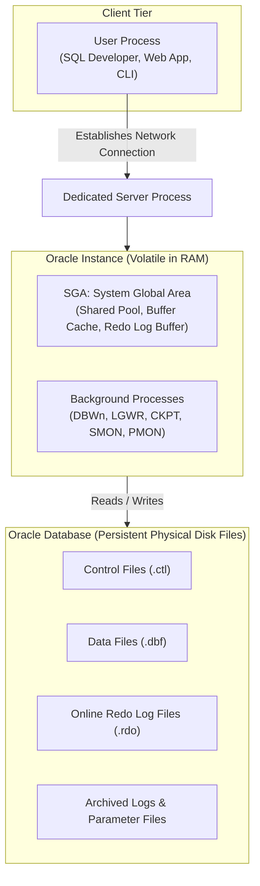
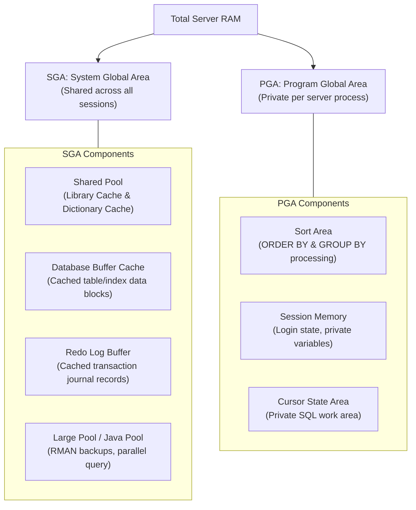
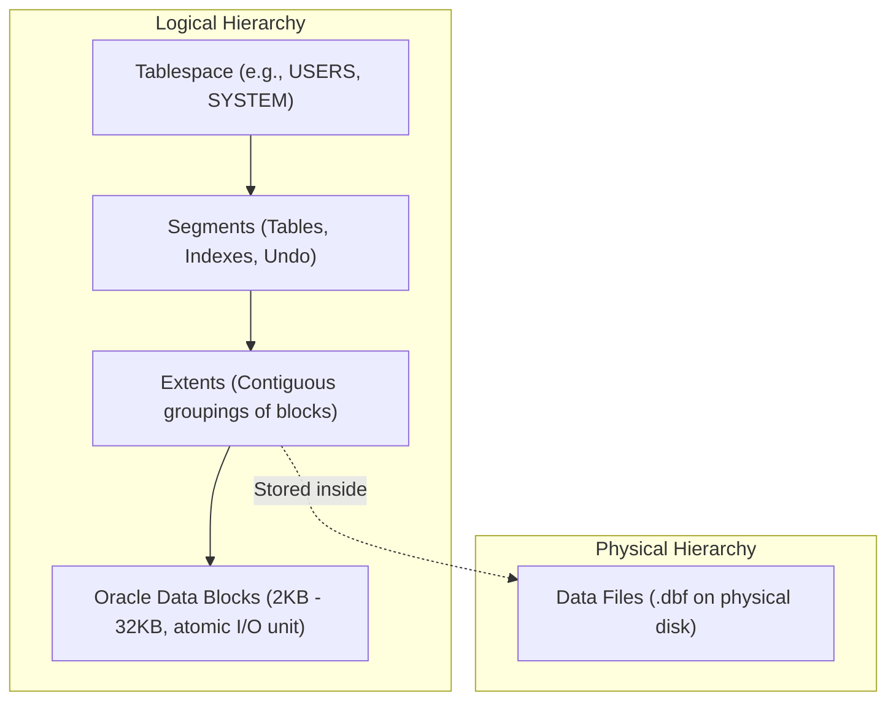
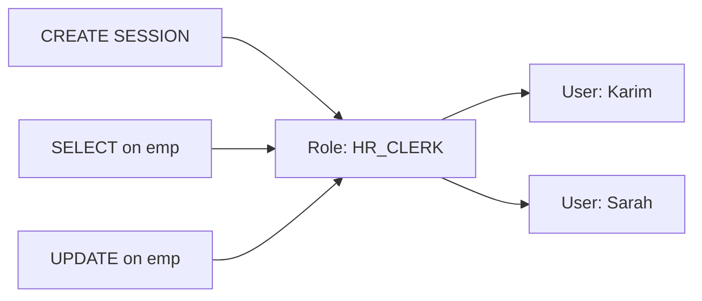

#DatabaseAdministration #DBA #OracleArchitecture #SGA #PGA #ProcessArchitecture #DatabaseSecurity #RBAC

> [!abstract] Brief Description
> This note covers the architectural internals and administrative management of enterprise relational database management systems (specifically Oracle Database Server). It details the fundamental distinction between an **Instance** and a **Database**, memory structures (**SGA** vs. **PGA**), background processes (`DBWn`, `LGWR`, `SMON`, `PMON`, `CKPT`, `ARCn`), physical storage files (Datafiles, Control files, Redo logs), user management (`CREATE USER`, `ALTER USER`), System vs. Object privileges, and Role-Based Access Control (RBAC) utilizing the Data Dictionary.

---

> [!note] 📖 The Core Analogy: The International Airport & Air Traffic Control Operations
> Imagine the operation of a major international airport:
> - **The Physical Database (The Concrete Runways & Hangars on Disk):** The permanent physical concrete, hangars, and jet fuel tanks on the ground. When the airport is closed at midnight, the runways still exist on disk.
> - **The Database Instance (The Airport Operations Crew in RAM):** The active staff, air traffic controllers, radar stations, and ground marshals running inside the control tower. If power goes out, the crew and active radar sweeps vanish from RAM, but the concrete runways on disk remain intact.
> - **The Memory Architecture (SGA vs. PGA):**
>   - **SGA (The Main Terminal Information Display):** A gigantic public display board in the central lobby visible to every passenger and airline crew member (`Shared Pool`, `Buffer Cache`).
>   - **PGA (The Pilot's Personal Flight Logbook):** A private clipboard carried by an individual pilot containing private flight notes and calculations. No other pilot can read it.
> - **The Background Processes (The Specialized Ground Teams):**
>   - **`DBWn` (The Luggage Transport):** Moving luggage from the indoor sorting bins out to the cargo holds.
>   - **`LGWR` (The Black Box Flight Recorder):** Writing continuous flight telemetry to indestructible black boxes at every critical event (`COMMIT`).
>   - **`PMON` (The Airport Security / Cleaners):** If a passenger faints or leaves luggage unattended, security cleans up the area, unlocks the gate, and resets operations.
>   - **`SMON` (The Crash Recovery Team):** If an outage occurs, SMON inspects the black boxes and recovers the airport back to exact synchronization.

---

## 🏛️ 1. Oracle Server Architecture: Instance vs. Database

A common misconception among junior engineers is confusing a **Database** with an **Instance**:

$$\mathbf{Oracle\ Server} = \mathbf{Oracle\ Instance\ (RAM\ +\ Processes)} + \mathbf{Oracle\ Database\ (Physical\ Disk\ Files)}$$



### Key Distinctions:
* **Oracle Database:** The persistent physical disk files holding actual tables, indexes, metadata, and recovery logs. It persists when the server is powered off.
* **Oracle Instance:** The set of background processes and allocated volatile RAM structures (SGA). An instance exists only while running.
* **Relationship:** In a standard single-instance setup, one instance opens and manages exactly one database. In high-availability clustering (**Oracle RAC**), multiple instances across different physical servers access a single shared database concurrently.

---

## 🧠 2. Memory Architecture: SGA vs. PGA



### 1. The SGA (System Global Area)
Allocated in shared memory upon instance startup (`STARTUP`).
* **Shared Pool:**
  * *Library Cache:* Caches parsed SQL execution plans and compiled PL/SQL packages. If two users run `SELECT * FROM emp`, the query is parsed only once (Soft Parse).
  * *Data Dictionary Cache:* Caches metadata definitions (table schemas, column types, user privileges).
* **Database Buffer Cache:** Holds copies of data blocks recently read from disk datafiles. Managed via a Least Recently Used (LRU) algorithm.
* **Redo Log Buffer:** Circular RAM buffer recording all DML modifications before they are flushed to disk redo logs.

### 2. The PGA (Program Global Area)
Allocated privately whenever a server process starts; deallocated when the user session disconnects.
* Stores sorting memory (for `ORDER BY`, `GROUP BY`, sort-merge joins), session state variables, and private cursor pointers.

---

## ⚙️ 3. Core Background Processes

Background processes coordinate data flow between volatile memory (SGA) and persistent physical disk files:

| Process | Name | Primary Responsibilities | Triggering Events |
| :--- | :--- | :--- | :--- |
| **`DBWn`** | Database Writer | Writes dirty (modified) buffers from the Buffer Cache to disk datafiles. | Buffer threshold exceeded, checkpoint occurs, tablespace offline, or timeout. |
| **`LGWR`** | Log Writer | Flushes the Redo Log Buffer to physical online redo log files. | **At `COMMIT`**, every 3 seconds, when buffer is $1/3$ full, or reaches 1 MB. |
| **`CKPT`** | Checkpoint | Synchronizes datafiles by signalling DBWn and updating datafile and control file headers. | Scheduled checkpoint intervals or log switches. |
| **`SMON`** | System Monitor | Performs crash/instance recovery on startup, rolls forward committed transactions from redo logs, cleans temporary extents. | Instance boot-up following unexpected failure. |
| **`PMON`** | Process Monitor | Cleans up aborted user processes: rolls back uncommitted DML, releases table/row locks, frees PGA memory. | Abnormal user disconnect or network failure. |
| **`ARCn`** | Archiver | Copies filled online redo logs to offline archive storage in `ARCHIVELOG` mode. | Log switch occurs. |

> [!important] Write-Ahead Logging (WAL) & ACID Durability
> `LGWR` always writes transaction redo entries to disk **before** `DBWn` flushes data blocks to disk. When you issue `COMMIT;`, the database does **not** wait for `DBWn` to write data blocks to the datafiles; it only waits for `LGWR` to write the small redo buffer to the redo log! This enables blistering transaction commit speeds while guaranteeing 100% crash durability.

---

## 📁 4. Physical & Logical Database Storage



### Physical Storage Files:
1. **Control Files (`.ctl`):** Small binary files containing database metadata, name, timestamps, and locations of datafiles and redo logs. Required to mount the database.
2. **Data Files (`.dbf`):** Physical disk containers storing actual table tuples, indexes, and dictionary tables.
3. **Online Redo Log Files (`.rdo`):** Minimum two multiplexed circular files recording all database changes.

---

## 👤 5. User Account Administration

A Database Administrator (DBA) manages accounts using DDL commands:

```sql
-- 1. Create a new user with password:
CREATE USER zrirak IDENTIFIED BY secure_password123;

-- 2. Modify password or lock/unlock account:
ALTER USER zrirak IDENTIFIED BY new_password456;
ALTER USER zrirak ACCOUNT LOCK;
ALTER USER zrirak ACCOUNT UNLOCK;

-- 3. Drop a user (CASCADE removes all objects owned by user):
DROP USER zrirak CASCADE;
```

---

## 🔑 6. System Privileges vs. Object Privileges

### 1. System Privileges
Authorize actions across the entire database instance:
* `CREATE SESSION` : Permission to connect and log into the database.
* `CREATE TABLE` : Permission to create tables in the user's schema.
* `CREATE VIEW` / `CREATE PROCEDURE` / `CREATE SEQUENCE`.
* `CREATE USER` / `DROP ANY TABLE` (DBA-level administrative privileges).

```sql
-- Granting system privileges:
GRANT CREATE SESSION, CREATE TABLE TO zrirak;

-- Granting with administrative delegation:
GRANT CREATE TABLE TO zrirak WITH ADMIN OPTION;
```

### 2. Object Privileges
Authorize operations on specific schema objects owned by a user:

| Privilege | Tables | Views | Sequences | Procedures/Packages |
| :--- | :---: | :---: | :---: | :---: |
| **`SELECT`** | ✅ | ✅ | ✅ (`.NEXTVAL`) | ❌ |
| **`INSERT`** | ✅ | ✅ | ❌ | ❌ |
| **`UPDATE`** | ✅ | ✅ | ❌ | ❌ |
| **`DELETE`** | ✅ | ✅ | ❌ | ❌ |
| **`EXECUTE`**| ❌ | ❌ | ❌ | ✅ |
| **`ALTER`** | ✅ | ❌ | ✅ | ❌ |
| **`INDEX`** | ✅ | ❌ | ❌ | ❌ |

```sql
-- Grant read and insert permissions on employee table:
GRANT SELECT, INSERT ON employee TO zrirak;

-- Grant column-level update permission:
GRANT UPDATE (salary, job_title) ON employee TO manager_role;

-- Grant with forwarding permissions:
GRANT SELECT ON employee TO zrirak WITH GRANT OPTION;

-- Revoking privileges:
REVOKE INSERT ON employee FROM zrirak;
```

---

## 👥 7. Role-Based Access Control (RBAC)

A **Role** is a named container grouping multiple privileges or roles. Instead of granting dozens of individual permissions to hundreds of individual users, permissions are assigned to a role, and the role is granted to users.



### Role Management Lifecycle:
```sql
-- 1. Create a role
CREATE ROLE hr_clerk;

-- 2. Assign privileges to the role
GRANT CREATE SESSION TO hr_clerk;
GRANT SELECT, INSERT, UPDATE ON hr.employee TO hr_clerk;

-- 3. Grant the role to users
GRANT hr_clerk TO amine, brahim;

-- 4. Enable or disable roles dynamically in a session
SET ROLE hr_clerk;
SET ROLE NONE; -- Temporarily strip all active roles

-- 5. Revoke role from user
REVOKE hr_clerk FROM brahim;
```

### Predefined Oracle Administrative Roles:
* **`CONNECT`:** Basic connection and session creation privileges.
* **`RESOURCE`:** Developer privileges (create tables, sequences, types, procedures).
* **`DBA`:** Full administrative control (all system privileges `WITH ADMIN OPTION`).

---

## 📖 8. Essential DBA Data Dictionary Views & Commands

The Data Dictionary is a read-only collection of tables and views maintained automatically by the Oracle server to provide metadata about the database.

| Prefix | Scope / Visibility |
| :--- | :--- |
| **`USER_`** | Shows objects and privileges owned by the currently logged-in user. |
| **`ALL_`** | Shows objects accessible to the current user (owned or granted). |
| **`DBA_`** | Shows **all** objects across the entire database (requires DBA privilege). |
| **`V$`** | Dynamic performance views inspecting real-time memory (SGA/PGA) and locks. |

### Critical Administrative Inspection Queries:
```sql
-- View all roles in the database:
SELECT * FROM dba_roles;

-- View system privileges granted to current user:
SELECT * FROM user_sys_privs;

-- View object privileges granted on current user's tables:
SELECT * FROM user_tab_privs_made;

-- View roles assigned to current user:
SELECT * FROM user_role_privs;

-- Connect as Superuser (SYSDBA):
CONNECT sys AS sysdba;

-- Unlock default demonstration schema:
ALTER USER scott ACCOUNT UNLOCK IDENTIFIED BY tiger;
```

---

> [!summary] Key Takeaways
> - **Core concept:** An Oracle Database consists of persistent disk files (`.dbf`, `.ctl`, `.rdo`), while an Oracle Instance is the set of volatile background processes and shared memory structures (SGA) in RAM.
> - **Key implementation detail:** `LGWR` writes changes to online redo logs synchronously on `COMMIT`, while `DBWn` writes cached data blocks to datafiles asynchronously, ensuring high throughput and ACID durability.
> - **Best practice:** Implement strict Role-Based Access Control (RBAC). Never grant direct object privileges or `DBA` roles to application service accounts; create least-privilege business roles (`hr_clerk`, `reporting_ro`).
