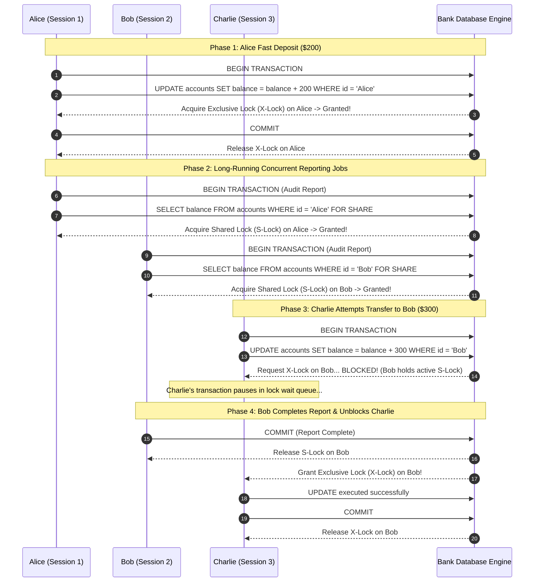

#Database #Transactions #ConcurrencyControl #Locks #SharedLock #ExclusiveLock #Banking #ACID #SystemDesign #PostgreSQL #CoreConcept

> [!abstract] Executive Summary
> In multi-user relational database management systems (RDBMS), concurrency control ensures data consistency when multiple transactions read and write to the same rows concurrently. 
> 
> The foundation of pessimistic concurrency control rests upon two fundamental lock modes:
> 1. **Shared Lock (S-Lock / Read Lock):** Acquired when reading data. Multiple transactions can hold shared locks on the same row concurrently, preventing any concurrent transaction from modifying the row.
> 2. **Exclusive Lock (X-Lock / Write Lock):** Acquired when modifying data (`INSERT`, `UPDATE`, `DELETE`) or performing exclusive reads. Only **one** transaction can hold an exclusive lock on a row at any given moment, locking out all other readers and writers.
> 
> This guide explores the **mechanics, lock compatibility matrix, the Alice-Bob-Charlie banking workflow, and the concurrency vs. consistency trade-off**.

---

## 1. Definitions & Conceptual Foundations

```
┌─────────────────────────────────────────────────────────────────────────────────────────────────┐
│                              SHARED LOCK vs. EXCLUSIVE LOCK                                     │
├───────────────────────────────┬─────────────────────────────────┬───────────────────────────────┤
│ Dimension                     │ Shared Lock (S-Lock)            │ Exclusive Lock (X-Lock)       │
├───────────────────────────────┼─────────────────────────────────┼───────────────────────────────┤
│ **Intent**                    │ Read / Protect from mutation    │ Write / Mutate or isolated read│
├───────────────────────────────┼─────────────────────────────────┼───────────────────────────────┤
│ **Concurrency Level**         │ **Multiple concurrent holders** │ **Single holder only**        │
├───────────────────────────────┼─────────────────────────────────┼───────────────────────────────┤
│ **Blocks Other Readers?**     │ ❌ No (Readers share freely)    │ ✅ Yes (Blocks all other reads│
│                               │                                 │    requesting S-Locks)        │
├───────────────────────────────┼─────────────────────────────────┼───────────────────────────────┤
│ **Blocks Other Writers?**     │ ✅ Yes (Blocks all X-Locks)     │ ✅ Yes (Blocks all X-Locks)   │
├───────────────────────────────┼─────────────────────────────────┼───────────────────────────────┤
│ **SQL Mechanism**             │ Implicit during reads or        │ Implicit on `UPDATE/DELETE`   │
│                               │ `SELECT ... FOR SHARE`          │ or `SELECT ... FOR UPDATE`    │
└───────────────────────────────┴───────────────────────────────┴───────────────────────────────┘
```

### 1. The Shared Lock (S-Lock)
When Transaction A acquires a Shared Lock on a row:
- It announces: *"I am reading this value for a report, audit, or calculation. No one is permitted to alter this data while I am working."*
- Transaction B can also acquire a Shared Lock on the exact same row.
- However, if Transaction C attempts to execute an `UPDATE` on that row, it must wait until both A and B release their Shared Locks.

### 2. The Exclusive Lock (X-Lock)
When Transaction A acquires an Exclusive Lock on a row:
- It announces: *"I am modifying this value (or performing a sensitive isolated read). No one else may read or write this record until I commit or roll back."*
- Any subsequent transaction attempting to acquire either an **S-Lock** or an **X-Lock** on that row is blocked until Transaction A terminates.

---

## 2. The Lock Compatibility Matrix

The core rule governing pessimistic locking engines:

| Existing Lock on Row | Incoming **Shared Lock (S)** Request | Incoming **Exclusive Lock (X)** Request |
| :--- | :--- | :--- |
| **None** | ✅ **Granted** | ✅ **Granted** |
| **Shared Lock (S)** | ✅ **Granted** (Shared Concurrently) | ❌ **BLOCKED** (Must wait for all S-Locks to release) |
| **Exclusive Lock (X)** | ❌ **BLOCKED** (Must wait for X-Lock to release) | ❌ **BLOCKED** (Must wait for X-Lock to release) |

$$\text{Compatibility}(S, S) = \text{TRUE}$$
$$\text{Compatibility}(S, X) = \text{FALSE}$$
$$\text{Compatibility}(X, X) = \text{FALSE}$$

---

## 3. Real-World Case Study: The Banking Timeline

To observe how Shared and Exclusive locks interact in production, consider three users interacting with a banking ledger:
- **Alice (Red):** Depositing funds, then running an account balance audit.
- **Bob (Blue):** Running an account balance audit report.
- **Charlie (Green):** Attempting to transfer funds to Bob.



### Detailed Event Walkthrough:

1. **Alice Deposits $200 (Exclusive Lock):**
   - Alice executes `UPDATE accounts SET balance = balance + 200 WHERE id = 'Alice'`.
   - The engine grants an **Exclusive Lock** on Alice's record because no other connections hold locks.
   - Alice's balance increments, transaction commits, and the X-Lock is immediately released.
2. **Alice and Bob Start Long Reporting Jobs (Shared Locks):**
   - Alice executes a long-running audit query on her account, acquiring an **S-Lock** on Alice.
   - Bob starts an audit query on his account, acquiring an **S-Lock** on Bob.
   - Both S-Locks succeed simultaneously because they target distinct rows, and S-Locks are read-compatible.
3. **Charlie's Transfer to Bob Blocks:**
   - Charlie initiates a $300 transfer to Bob (`UPDATE accounts SET balance = balance + 300 WHERE id = 'Bob'`).
   - To update Bob's balance, Charlie must acquire an **Exclusive Lock** on Bob's row.
   - **The Engine Intercepts:** Bob holds an active **Shared Lock** on his row. By the compatibility matrix, $\text{Compatibility}(S, X) = \text{FALSE}$.
   - Charlie's transaction is suspended into a wait state!
4. **Unblocking & Completion:**
   - Bob finishes his audit report and executes `COMMIT`.
   - Bob's S-Lock is released.
   - The database awakens Charlie, grants him the X-Lock, completes the update, and commits.

---

## 4. Key Enterprise Use Cases

### 1. Financial Banking & Ledger Consistency
- When generating financial balance sheets or calculating interest payments, a reporting query cannot afford to read balances that are actively mutating mid-calculation (preventing **Non-Repeatable Reads** and **Dirty Reads**).
- S-Locks ensure that bank auditors observe immutable account snapshots without closing the entire database.

### 2. Centralized Configuration Management
- In microservice ecosystems with centralized configuration stores (e.g., feature flags, tax rate tables):
  - When an administrator updates a critical global setting, an **Exclusive Lock** prevents microservices from reading stale or partially applied configuration fragments.
  - All client read requests pause briefly until the administrator's transaction commits, ensuring all services synchronously transition to the new configuration state.

---

## 5. The Concurrency Trade-Off: Lock Contention & Starvation

While locking guarantees ACID consistency, it introduces significant throughput penalties:

```
┌─────────────────────────────────────────────────────────────────────────────────────────────────┐
│                               THE CONCURRENCY TRADE-OFF                                         │
├─────────────────────────────────────────────────────────────────────────────────────────────────┤
│ 1. **Lock Contention:** Long-running read jobs (e.g., overnight business intelligence reports)  │
│    holding S-Locks will block operational OLTP writes for minutes or hours.                     │
│ 2. **The Midnight Banking Phenomenon:** Major financial institutions frequently disable customer │
│    transfers during midnight maintenance windows because heavy end-of-day reconciliation jobs   │
│    acquire extensive shared locks across customer accounts.                                     │
│ 3. **Writer Starvation:** If a continuous stream of overlapping read queries acquire S-Locks on │
│    a row, a pending write query requesting an X-Lock can be starved indefinitely!               │
└─────────────────────────────────────────────────────────────────────────────────────────────────┘
```

---

## 6. SQL Syntax in PostgreSQL & MySQL

### Explicit Shared Lock (Read Lock):
```sql
BEGIN;
-- Acquires an S-Lock on selected rows: other sessions can read, but cannot UPDATE/DELETE
SELECT * FROM accounts WHERE id = 'Bob' FOR SHARE;
-- Perform reporting calculations...
COMMIT;
```

### Explicit Exclusive Lock (Write Lock):
```sql
BEGIN;
-- Acquires an X-Lock on selected rows: blocks all other SELECT FOR SHARE and UPDATE queries
SELECT * FROM accounts WHERE id = 'Bob' FOR UPDATE;
-- Safely calculate new balance in application logic...
UPDATE accounts SET balance = 500 WHERE id = 'Bob';
COMMIT;
```

---

## 7. Senior Engineer Production Checklist

- [ ] **Keep lock holding times minimal:** Never perform network HTTP calls, email sending, or heavy external computations while holding an S-Lock or X-Lock.
- [ ] **Leverage MVCC where possible:** In modern engines like PostgreSQL and MySQL InnoDB, standard `SELECT` statements use **Multi-Version Concurrency Control (MVCC)** snapshots and do not acquire S-Locks, allowing non-blocking reads. Use explicit `FOR SHARE` only when strict pessimistic locking is required.
- [ ] **Set `lock_timeout`:** Prevent connection pool starvation by configuring a lock acquisition timeout:
  ```sql
  SET lock_timeout = '2s';
  ```
- [ ] **Guard against writer starvation:** Modern RDBMS engines prioritize pending exclusive locks over new incoming shared lock requests to prevent writers from waiting indefinitely.

---

## 8. Related Notes & Conceptual Navigation

- [[04_Database Deadlocks_ Detection, Resolution, and PostgreSQL Hands-On Demo|Database Deadlocks: Detection, Resolution, and PostgreSQL Hands-On Demo]]
- [[05_Two-Phase Locking (2PL)_ Growing, Shrinking, and The Double Booking Problem|Two-Phase Locking (2PL): Growing, Shrinking, and The Double Booking Problem]]
- [[02_Serializable vs. Repeatable Read Isolation Levels|Serializable vs. Repeatable Read Isolation Levels]]
- [[01_Read Phenomena & Phantom Reads|Read Phenomena & Phantom Reads]]

