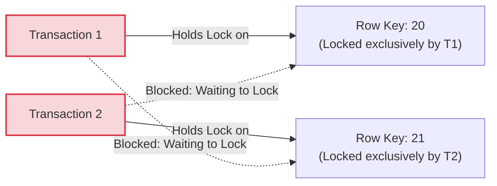
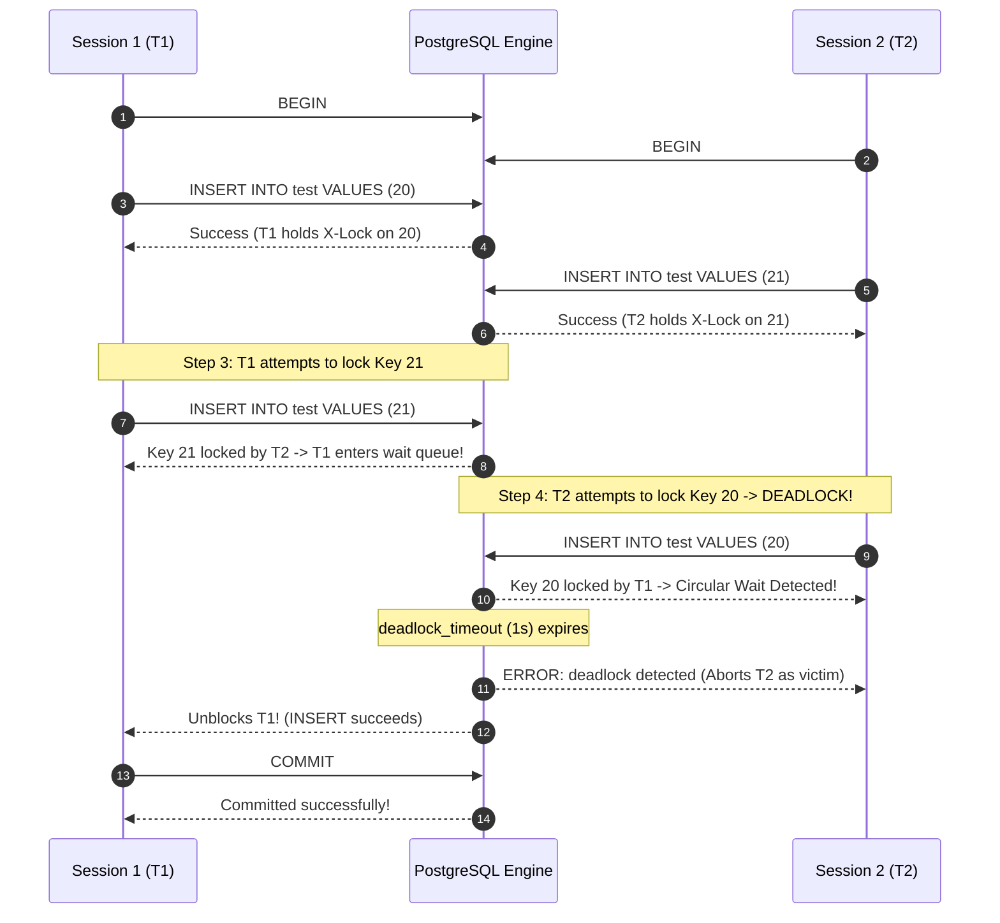

#Database #Deadlocks #Transactions #ConcurrencyControl #PostgreSQL #Locking #SystemDesign #DatabaseEngineering #CoreConcept

> [!abstract] Executive Summary
> In concurrent database systems, locks are necessary to preserve ACID isolation. However, pessimistic locking introduces a classic computer science failure state: the **Deadlock**.
> 
> A deadlock occurs when two or more concurrent transactions form a **circular wait state**, where each transaction holds an exclusive lock on a resource that another transaction requires to proceed. Neither transaction can advance, nor can either release its lock, resulting in an indefinite freeze.
> 
> This hands-on engineering reference explores:
> 1. The theoretical prerequisites of a deadlock (**The Coffman Conditions**).
> 2. The **Wait-For Graph (WFG)** and database cycle detection algorithms.
> 3. A reproducible, interactive **PostgreSQL hands-on deadlock demonstration** in Docker.
> 4. Lock contention resolution scenarios: **Rollback unblocking** vs. **Commit duplicate key errors**.
> 5. Production engineering patterns for eliminating deadlocks at the application tier.

---

## 1. What is a Deadlock? The Coffman Conditions

In computer science, a deadlock in a database engine requires four simultaneous conditions (The Coffman Conditions):

```
┌─────────────────────────────────────────────────────────────────────────────────────────────────┐
│                                   THE 4 COFFMAN CONDITIONS                                      │
├───────────────────────────────┬─────────────────────────────────────────────────────────────────┤
│ Condition                     │ Database Manifestation                                          │
├───────────────────────────────┼─────────────────────────────────────────────────────────────────┤
│ **1. Mutual Exclusion**       │ Rows are acquired with **Exclusive Locks (X-Locks)**; only      │
│                               │ one transaction can hold a row at a time.                       │
├───────────────────────────────┼─────────────────────────────────────────────────────────────────┤
│ **2. Hold and Wait**          │ Transaction 1 holds a lock on Row A while waiting to acquire a  │
│                               │ lock on Row B.                                                  │
├───────────────────────────────┼─────────────────────────────────────────────────────────────────┤
│ **3. No Preemption**          │ The database engine cannot forcibly steal a lock from an active │
│                               │ uncommitted transaction.                                        │
├───────────────────────────────┼─────────────────────────────────────────────────────────────────┤
│ **4. Circular Wait**          │ T1 waits for T2, while T2 simultaneously waits for T1!           │
└───────────────────────────────┴─────────────────────────────────────────────────────────────────┘
```



---

## 2. Deadlock Detection: The Wait-For Graph (WFG)

Relational database engines (such as PostgreSQL, MySQL InnoDB, and Oracle) do not attempt to prevent deadlocks upfront because static lock prediction in dynamic workloads is computationally intractable. Instead, they implement **Deadlock Detection**.

### The Wait-For Graph (WFG):
1. The database maintains an internal directed graph in shared memory where **nodes** represent active transactions, and **edges** represent wait dependencies ($T_1 \to T_2$ means $T_1$ is blocked waiting for a lock held by $T_2$).
2. A deadlock exists if and only if the directed graph contains a **directed cycle**:
   $$T_1 \longrightarrow T_2 \longrightarrow T_1$$
3. **The Detection Daemon:** When a transaction blocks on a lock, PostgreSQL starts a timer (`deadlock_timeout`, default `1000ms` / 1 second). If the transaction is still blocked when the timer expires, PostgreSQL triggers a cycle-detection search (using Tarjan's or Depth-First Search algorithms).
4. **Victim Selection:** Upon finding a cycle, the engine breaks the deadlock by forcibly aborting and rolling back one of the transactions (the "victim"):
   - The victim receives a fatal error: `ERROR: deadlock detected`.
   - The victim's locks are released, allowing the surviving transaction to proceed immediately.

---

## 3. Hands-On PostgreSQL Deadlock Demo

Let us reproduce an interactive deadlock step-by-step inside PostgreSQL using two parallel terminal sessions.

### Step 1: Lab Table Setup
```sql
CREATE TABLE test (
    id INT PRIMARY KEY
);
```

---

### Step 2: The Interleaved Deadlock Execution Sequence

Open two terminal windows connected to PostgreSQL (`Session 1` and `Session 2`):



#### Terminal Session 1 (T1):
```sql
BEGIN;
INSERT INTO test VALUES (20);
-- Holds lock on 20, uncommitted.
INSERT INTO test VALUES (21);
-- BLOCKED! Waiting for Session 2 to release lock on 21...
```

#### Terminal Session 2 (T2):
```sql
BEGIN;
INSERT INTO test VALUES (21);
-- Holds lock on 21, uncommitted.
INSERT INTO test VALUES (20);
-- BLOCKED! Waiting for Session 1 to release lock on 20...
```

#### The Engine's Error Output (Received in Session 2):
```text
ERROR:  deadlock detected
DETAIL:  Process 48210 waits for ExclusiveLock on transaction 89102; blocked by process 48209.
Process 48209 waits for ExclusiveLock on transaction 89103; blocked by process 48210.
HINT:  See server log for query details.
CONTEXT:  while inserting index tuple (0,2) in relation "test_pkey"
```

PostgreSQL identified that Session 2 entered the deadlock cycle last, aborted Session 2, and released its locks. Session 1 immediately unblocked, executed its insert, and committed!

---

## 4. Lock Contention without Deadlock: Two Resolution Scenarios

Not all lock waits result in deadlocks. Consider a simple linear wait where Session 1 locks a row, and Session 2 waits for it.

### Scenario A: Waiter Unblocked by Rollback
What happens when the lock holder rolls back its transaction?

```sql
-- Session 1
BEGIN;
INSERT INTO test VALUES (30);

-- Session 2 (Simultaneously)
BEGIN;
INSERT INTO test VALUES (30);
-- Enters Lock Wait state...

-- Session 1 decides to abort:
ROLLBACK;
```

**Result:**
The moment Session 1 executes `ROLLBACK;`, all of Session 1's pending locks evaporate. Session 2 **immediately unblocks and succeeds**, inserting value `30` without any error.

---

### Scenario B: Waiter Fails with Duplicate Key Error
What happens when the lock holder commits its transaction?

```sql
-- Session 1
BEGIN;
INSERT INTO test VALUES (30);

-- Session 2 (Simultaneously)
BEGIN;
INSERT INTO test VALUES (30);
-- Enters Lock Wait state...

-- Session 1 commits:
COMMIT;
```

**Result:**
The moment Session 1 executes `COMMIT;`, value `30` permanently becomes part of the primary key index. Session 2 unblocks, re-evaluates the unique constraint, and **immediately crashes with a duplicate key violation**:

```text
ERROR: duplicate key value violates unique constraint "test_pkey"
DETAIL: Key (id)=(30) already exists.
```

---

## 5. Deadlock Prevention Strategies for Backend Engineers

While database engines automatically detect and break deadlocks, relying on deadlock resolution in production degrades application throughput and causes user-facing 500 errors.

```
┌─────────────────────────────────────────────────────────────────────────────────────────────────┐
│                               DEADLOCK PREVENTION BLUEPRINT                                     │
├───────────────────────────────┬─────────────────────────────────────────────────────────────────┤
│ Strategy                      │ Implementation Rule                                             │
├───────────────────────────────┼─────────────────────────────────────────────────────────────────┤
│ **1. Resource Ordering**      │ **Always lock records in the exact same deterministic order.**  │
│                               │ If Transaction A updates rows (20, 21), and Transaction B       │
│                               │ updates rows (21, 20), sort them first: `ORDER BY id ASC`!     │
├───────────────────────────────┼─────────────────────────────────────────────────────────────────┤
│ **2. Short Transaction Span** │ Keep transactions as brief as possible. Never make HTTP API    │
│                               │ calls, send emails, or run heavy compute inside a transaction.  │
├───────────────────────────────┼─────────────────────────────────────────────────────────────────┤
│ **3. Configure Lock Timeout** │ Fail fast rather than hanging indefinitely:                     │
│                               │ `SET lock_timeout = '2s';`                                      │
├───────────────────────────────┼─────────────────────────────────────────────────────────────────┤
│ **4. Application Retry Loop** │ Wrap transactional database calls in an exponential backoff     │
│                               │ retry loop when catching SQLState `40P01` (deadlock_detected).  │
└───────────────────────────────┴─────────────────────────────────────────────────────────────────┘
```

### The Resource Ordering Pattern (Code Example):
```javascript
// DANGEROUS: Random update order causes deadlocks under concurrent load
async function transferFunds(fromUserId, toUserId, amount) {
    await db.query('BEGIN');
    await db.query('UPDATE accounts SET bal = bal - $1 WHERE id = $2', [amount, fromUserId]);
    await db.query('UPDATE accounts SET bal = bal + $1 WHERE id = $2', [amount, toUserId]);
    await db.query('COMMIT');
}

// SAFE: Enforcing deterministic ascending ID lock order eliminates circular wait!
async function transferFundsSafe(fromUserId, toUserId, amount) {
    const firstId = fromUserId < toUserId ? fromUserId : toUserId;
    const secondId = fromUserId < toUserId ? toUserId : fromUserId;

    await db.query('BEGIN');
    // Lock rows in strict primary key ascending order
    await db.query('SELECT * FROM accounts WHERE id IN ($1, $2) ORDER BY id ASC FOR UPDATE', [firstId, secondId]);
    
    await db.query('UPDATE accounts SET bal = bal - $1 WHERE id = $2', [amount, fromUserId]);
    await db.query('UPDATE accounts SET bal = bal + $1 WHERE id = $2', [amount, toUserId]);
    await db.query('COMMIT');
}
```

---

## 6. Senior Engineer Production Checklist

- [ ] **Tune `deadlock_timeout` appropriately:** The default 1s is ideal for standard OLTP workloads. Lowering it below 100ms burns CPU running unnecessary cycle searches; raising it above 5s leaves users hanging during deadlocks.
- [ ] **Catch and retry SQLState `40P01`:** All database client drivers should intercept PostgreSQL error code `40P01` (deadlock detected) and automatically retry the transaction with jittered exponential backoff.
- [ ] **Enforce strict lock ordering:** Ensure all services and stored procedures access multiple tables and rows in canonical lexicographical or numeric order.
- [ ] **Audit long-running idle transactions:** Monitor `pg_stat_activity` for connections in `idle in transaction` state holding locks.
- [ ] **Combine `lock_timeout` with `statement_timeout`:** Prevent connection pool starvation by terminating queries that exceed lock acquisition thresholds.

---

## 7. Related Notes & Conceptual Navigation

- [[03_Exclusive Locks vs. Shared Locks_ Concurrency, Compatibility, and Banking Workflows|Exclusive Locks vs. Shared Locks: Concurrency, Compatibility, and Banking Workflows]]
- [[05_Two-Phase Locking (2PL)_ Growing, Shrinking, and The Double Booking Problem|Two-Phase Locking (2PL): Growing, Shrinking, and The Double Booking Problem]]
- [[02_Serializable vs. Repeatable Read Isolation Levels|Serializable vs. Repeatable Read Isolation Levels]]
- [[01_Read Phenomena & Phantom Reads|Read Phenomena & Phantom Reads]]

