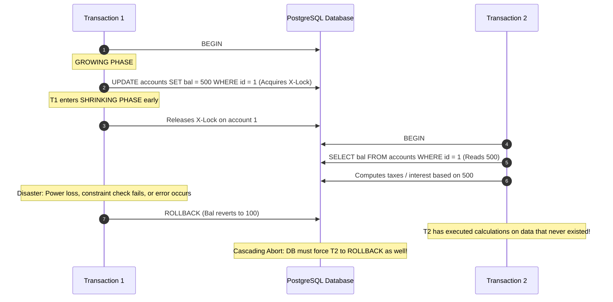
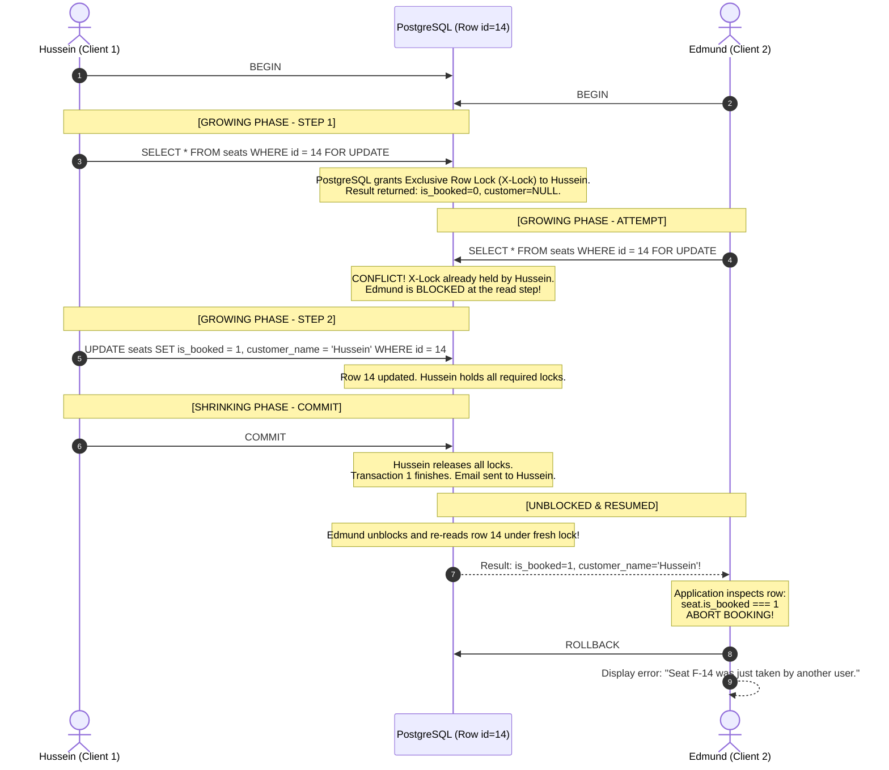
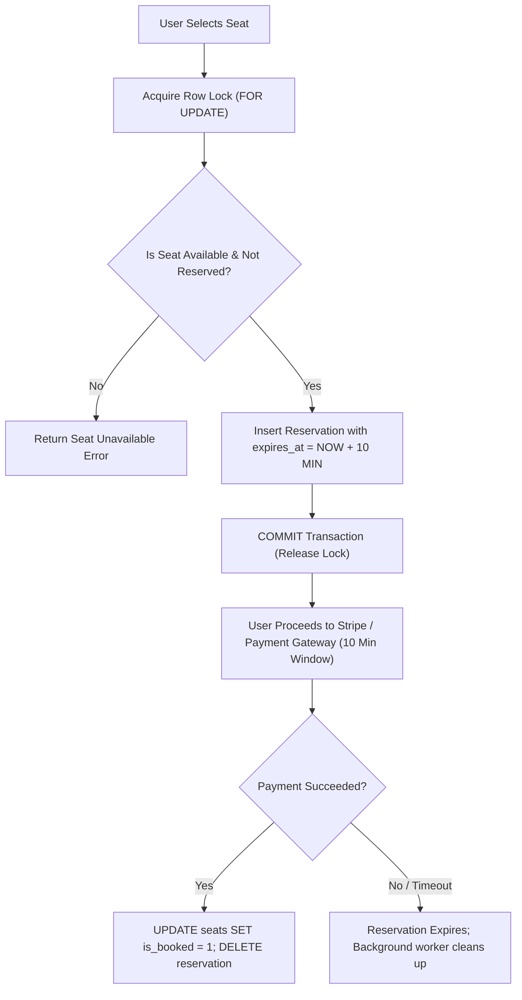

#Database #Transactions #ConcurrencyControl #TwoPhaseLocking #2PL #Strict2PL #PessimisticLocking #DoubleBooking #SelectForUpdate #PostgreSQL #SystemDesign #CoreConcept

> [!abstract] Executive Summary
> **Two-Phase Locking (2PL)** is the foundational pessimistic concurrency control protocol that mathematically guarantees **conflict serializability** in multi-transaction database management systems. 
> 
> The protocol partitions a transaction's lifecycle into two distinct, irreversible phases:
> 1. **Growing Phase (Expanding):** The transaction may acquire locks as needed, but is **strictly forbidden from releasing any lock**.
> 2. **Shrinking Phase (Contracting):** The transaction may release locks, but is **strictly forbidden from acquiring any new locks**.
> 
> The inviolable invariant is: **The moment a transaction releases even a single lock, the door to acquiring future locks is permanently sealed shut.**
> 
> In production systems, naive concurrent operations without 2PL produce catastrophic race conditions such as the **Double Booking Problem** (cinema seats, concert tickets, flight reservations), where multiple users simultaneously claim the same inventory and "last write wins" corrupts customer state. This master guide dissects the mechanics of 2PL, compares **Basic vs. Strict vs. Rigorous 2PL**, illustrates the cinema seat double-booking disaster, and demonstrates how PostgreSQL implements Strict 2PL via `SELECT ... FOR UPDATE`.

---

## 1. Theoretical Foundations of Two-Phase Locking (2PL)

Relational databases permit concurrent transactions to maximize hardware throughput. However, unrestricted concurrency leads to anomalies (Dirty Reads, Non-Repeatable Reads, Phantom Reads, and Lost Updates).

While basic lock acquisition prevents concurrent writes on the same record, **arbitrary locking and unlocking does not guarantee serializability**. 

```
Transaction Lifecycle under 2PL:
===================================================================================

       Number of Locks Held
              ▲
              │                 [ LOCK POINT ]
              │             (Max locks acquired)
              │                    ┌───┐
              │                   ┌┘   └┐
              │                  ┌┘     └┐
              │                 ┌┘       └┐
              │                ┌┘         └┐
              │               ┌┘           └┐
              │              ┌┘             └┐
              │             ┌┘               └┐
              │            ┌┘                 └┐
              │           ┌┘                   └┐
              │          ┌┘                     └┐
              │         ┌┘                       └┐
              │        ┌┘                         └┐
              └───────┴─────────────────────────────┴──────────► Time
                      ▲                             ▲
              [ GROWING PHASE ]             [ SHRINKING PHASE ]
              - Acquire locks only          - Release locks only
              - CANNOT release locks        - CANNOT acquire locks
===================================================================================
```

### The Two Phases Explained

1. **Growing (Expanding) Phase:**
   - The transaction may acquire shared locks (`S-Locks`) for reading and exclusive locks (`X-Locks`) for writing.
   - It **cannot release** any lock during this phase, regardless of whether it has finished querying or mutating that particular table or row.
   - The end of this phase represents the transaction's **Lock Point**—the single instant where the transaction holds every resource it will ever need.

2. **Shrinking (Contracting) Phase:**
   - The transaction begins releasing locks.
   - Once the first lock is released, the transaction is irrevocably locked into the shrinking phase.
   - It **cannot acquire any new locks** under any circumstances.

> [!IMPORTANT] The Serializability Theorem
> If every transaction in a concurrent schedule follows the Two-Phase Locking protocol, the resulting schedule is **conflict serializable**. The serialization order of transactions corresponds exactly to the order of their respective **Lock Points**.

---

## 2. The Three Flavors of 2PL: Basic, Strict, and Rigorous

While basic 2PL guarantees serializability, it introduces severe operational hazards in database engines. Modern enterprise engines (PostgreSQL, MySQL InnoDB, Oracle, Microsoft SQL Server) implement specialized variants to guarantee recoverability.

```
┌─────────────────────────────────────────────────────────────────────────────────────────────────┐
│                                 THE 2PL SPECTRUM AT A GLANCE                                    │
├───────────────────────────────┬───────────────────────────────┬─────────────────────────────────┤
│ Protocol Variant              │ Lock Release Rules            │ Failure Mode & Guarantees       │
├───────────────────────────────┼───────────────────────────────┼─────────────────────────────────┤
│ **Basic 2PL**                 │ Locks can be released         │ ❌ Vulnerable to **Cascading    │
│                               │ anytime during Shrinking      │    Abort** & dirty reads        │
│                               │ Phase.                        │ ✅ Guarantees Serializability   │
├───────────────────────────────┼───────────────────────────────┼─────────────────────────────────┤
│ **Strict 2PL (S2PL)**         │ **Exclusive (X) locks held    │ ✅ Prevents Cascading Aborts    │
│ *(Industry Standard)*         │ until COMMIT or ROLLBACK.**   │ ✅ Prevents Dirty Reads         │
│                               │ S-locks released in shrinking.│ ✅ Strict Recoverability        │
├───────────────────────────────┼───────────────────────────────┼─────────────────────────────────┤
│ **Rigorous 2PL (SS2PL)**      │ **ALL locks (X and S) held    │ ✅ Commit order = Serial order  │
│ *(Strong Strict 2PL)*         │ until COMMIT or ROLLBACK.**   │ ❌ Lower concurrency throughput │
│                               │ Shrinking is atomic at end.   │    due to long-held read locks  │
└───────────────────────────────┴───────────────────────────────┴─────────────────────────────────┘
```

### The Hazard of Basic 2PL: Cascading Aborts

Consider what happens in **Basic 2PL** if an exclusive lock is released early:



### Why Production RDBMS Use Strict 2PL (S2PL)

To eliminate cascading aborts entirely, commercial databases mandate **Strict 2PL**:
- **Rule:** A transaction never releases any Exclusive (`X`) lock until it reaches its terminal state—either `COMMIT` or `ROLLBACK`.
- **Result:** No other transaction can read uncommitted modifications made by an active transaction. If Transaction 1 aborts, no other transaction has witnessed its intermediate state, completely eliminating dirty reads and cascading rollbacks.

---

## 3. The Double Booking Problem (The Cinema Seat Dilemma)

To understand why 2PL is critical, let us examine the classic distributed systems and database race condition: **The Cinema Seat Double Booking**.

### The Setup

Imagine an online cinema ticketing system. The cinema has a table named `seats`:

```sql
CREATE TABLE seats (
    id INT PRIMARY KEY,
    seat_number VARCHAR(10) NOT NULL,
    is_booked INT NOT NULL DEFAULT 0,
    customer_name VARCHAR(100)
);

INSERT INTO seats (id, seat_number, is_booked, customer_name)
VALUES (13, 'F-13', 0, NULL);
```

### The Naive Application Workflow (Read-Modify-Write)

Two users, **Hussein** (Session 1) and **Edmund** (Session 2), browse the cinema seating chart. Both spot seat `13` (Seat `F-13`) open at the exact same millisecond and click **"Book Now"**.

```mermaid
sequenceDiagram
    autonumber
    actor H as Hussein (Client 1)
    participant App1 as Web App Instance 1
    participant DB as PostgreSQL (Single Row id=13)
    participant App2 as Web App Instance 2
    actor E as Edmund (Client 2)

    H->>App1: Click "Book Seat 13"
    E->>App2: Click "Book Seat 13"

    App1->>DB: BEGIN
    App2->>DB: BEGIN

    App1->>DB: SELECT * FROM seats WHERE id = 13;
    DB-->>App1: is_booked=0, customer=NULL (Available!)

    App2->>DB: SELECT * FROM seats WHERE id = 13;
    DB-->>App2: is_booked=0, customer=NULL (Available!)

    Note over App1: App logic: Seat is free. Proceed to charge credit card!
    Note over App2: App logic: Seat is free. Proceed to charge credit card!

    App1->>DB: UPDATE seats SET is_booked=1, customer_name='Hussein' WHERE id=13;
    Note over DB: Row id=13 updated to Hussein. Implicit X-Lock held by App1.

    App2->>DB: UPDATE seats SET is_booked=1, customer_name='Edmund' WHERE id=13;
    Note over DB: App2 blocked waiting for App1 to release row lock on id=13...

    App1->>DB: COMMIT;
    Note over DB: App1 commits. X-Lock released! Row shows Hussein.
    App1-->>H: Email: "Congratulations Hussein! Seat 13 is confirmed."

    Note over DB: App2 instantly unblocks and executes its waiting UPDATE!
    Note over DB: Row id=13 overwritten with customer_name='Edmund'!
    App2->>DB: COMMIT;
    App2-->>E: Email: "Congratulations Edmund! Seat 13 is confirmed."

    Note over DB: DISASTER: Both customers paid. Both received confirmation.<br/>Hussein arrives at cinema; Edmund is sitting in his seat!
```

### Why Did This Happen?

1. **Non-Locking Read (`SELECT`):** In standard MVCC (PostgreSQL's default `READ COMMITTED` isolation), a plain `SELECT` reads a snapshot without obtaining any lock. It does **not** enter a growing phase on the row.
2. **Blind Overwrite ("Last Write Wins"):** When Session 2's `UPDATE` unblocks after Session 1 commits, PostgreSQL evaluates the `WHERE id = 13` condition. Because the row still matches `id = 13`, Session 2 blindsides Session 1 and overwrites the record.
3. **Application State Desynchronization:** Both web application instances already made the decision to charge the customer based on the earlier stale read.

---

## 4. Solving Double Booking with 2PL & `SELECT ... FOR UPDATE`

To fix the double-booking flaw, we must enforce **Two-Phase Locking** from the very first interaction with the row. We cannot perform a naked read; we must acquire an exclusive lock during the reading phase.

In SQL, this is achieved using **`SELECT ... FOR UPDATE`**.

### The Pessimistic Locking Workflow

Let us run the exact same scenario on seat `14`:

```sql
INSERT INTO seats (id, seat_number, is_booked, customer_name)
VALUES (14, 'F-14', 0, NULL);
```



### PostgreSQL Hands-On Step-by-Step Walkthrough

Open two separate terminal windows connected to PostgreSQL:

#### Step 1: Initialize Both Transactions
```sql
-- Terminal 1 (Hussein)
BEGIN;

-- Terminal 2 (Edmund)
BEGIN;
```

#### Step 2: Terminal 1 Enters Growing Phase with `FOR UPDATE`
```sql
-- Terminal 1 (Hussein)
SELECT * FROM seats WHERE id = 14 FOR UPDATE;
```
**Output in Terminal 1:**
```text
 id | seat_number | is_booked | customer_name 
----+-------------+-----------+---------------
 14 | F-14        |         0 | NULL
(1 row)
```
*Hussein has successfully acquired an Exclusive Lock on row 14.*

#### Step 3: Terminal 2 Attempts to Read with `FOR UPDATE`
```sql
-- Terminal 2 (Edmund)
SELECT * FROM seats WHERE id = 14 FOR UPDATE;
```
**Behavior in Terminal 2:**
```text
-- Cursor hangs. The query does not return.
-- Edmund is blocked waiting for Hussein to complete his transaction.
```

#### Step 4: Terminal 1 Mutates and Commits (Enters Shrinking Phase)
```sql
-- Terminal 1 (Hussein)
UPDATE seats SET is_booked = 1, customer_name = 'Hussein' WHERE id = 14;
-- UPDATE 1

COMMIT;
```
*The moment `COMMIT` executes, Terminal 1 enters the shrinking phase, releasing its exclusive lock.*

#### Step 5: Terminal 2 Instantly Unblocks
The moment Terminal 1 commits, Terminal 2 resumes execution:
```text
 id | seat_number | is_booked | customer_name 
----+-------------+-----------+---------------
 14 | F-14        |         1 | Hussein
(1 row)
```

#### Step 6: Application Logic Prevents Double Booking
In the backend application (Node.js, Go, Python, Java):

```javascript
// Node.js Backend Handler
async function bookCinemaSeat(client, seatId, customerName) {
    try {
        await client.query('BEGIN');
        
        // 2PL Growing Phase: Acquire exclusive row lock
        const res = await client.query(
            'SELECT * FROM seats WHERE id = $1 FOR UPDATE', 
            [seatId]
        );
        
        const seat = res.rows[0];
        if (!seat) {
            throw new Error('Seat not found');
        }
        
        // Invariant Verification
        if (seat.is_booked === 1) {
            await client.query('ROLLBACK');
            return { success: false, message: 'Seat already booked by ' + seat.customer_name };
        }
        
        // Mutate
        await client.query(
            'UPDATE seats SET is_booked = 1, customer_name = $1 WHERE id = $2',
            [customerName, seatId]
        );
        
        // 2PL Shrinking Phase: Commit releases all locks
        await client.query('COMMIT');
        return { success: true, message: 'Seat booked successfully!' };
    } catch (err) {
        await client.query('ROLLBACK');
        throw err;
    }
}
```

Because Edmund's query re-evaluates the row after unblocking, it sees `is_booked = 1` and `customer_name = 'Hussein'`. The backend aborts the operation, rolls back, and informs Edmund that the seat is no longer available. **Zero lost updates. Zero double bookings.**

---

## 5. Advanced PostgreSQL Locking Primitives for Production

While standard `FOR UPDATE` prevents double booking, having hundreds of users block indefinitely waiting on locks during high-traffic sales (e.g., concert tickets, sneaker drops) will exhaust database connection pools and degrade API responsiveness.

PostgreSQL provides several locking modifiers to tailor 2PL behavior:

```
┌─────────────────────────────────────────────────────────────────────────────────────────────────┐
│                                 POSTGRESQL ROW LOCKING MODES                                    │
├───────────────────────────────┬─────────────────┬───────────────────────────────────────────────┤
│ Clause                        │ Waiting Action  │ Production Use Case                           │
├───────────────────────────────┼─────────────────┼───────────────────────────────────────────────┤
│ `FOR UPDATE`                  │ Blocks until    │ Critical updates where caller must wait       │
│                               │ lock released   │ for previous transaction to commit.           │
├───────────────────────────────┼─────────────────┼───────────────────────────────────────────────┤
│ `FOR UPDATE NOWAIT`           │ Immediately     │ Interactive web UI. Fail fast: "Someone is    │
│                               │ throws error    │ currently checking out this seat, try again." │
├───────────────────────────────┼─────────────────┼───────────────────────────────────────────────┤
│ `FOR UPDATE SKIP LOCKED`      │ Skips locked    │ Background job queues, worker dispatchers,    │
│                               │ rows entirely   │ and auto-allocating next available seat.      │
├───────────────────────────────┼─────────────────┼───────────────────────────────────────────────┤
│ `FOR SHARE`                   │ Acquires S-lock │ Guarantee row cannot be mutated or deleted    │
│                               │ (Readers share) │ while calculating a dependent balance.        │
├───────────────────────────────┼─────────────────┼───────────────────────────────────────────────┤
│ `FOR NO KEY UPDATE`           │ Weaker X-lock   │ Updating non-primary/unique fields without    │
│                               │                 │ blocking foreign key child table checks.      │
└───────────────────────────────┴─────────────────┴───────────────────────────────────────────────┘
```

### 1. Fail-Fast Pattern: `FOR UPDATE NOWAIT`
If Edmund attempts to lock seat 14 while Hussein is holding it:
```sql
SELECT * FROM seats WHERE id = 14 FOR UPDATE NOWAIT;
```
**PostgreSQL immediately terminates the query with:**
```text
ERROR: could not obtain lock on row in relation "seats"
SQLState: 55P03
```
*Benefits:* The web server does not consume a thread or database connection waiting. It instantly catches SQLState `55P03` and returns `409 Conflict` to the user.

### 2. Queue & Auto-Allocator Pattern: `FOR UPDATE SKIP LOCKED`
Imagine a system where users click "Assign me any available VIP seat":
```sql
BEGIN;
SELECT * FROM seats 
WHERE is_booked = 0 
ORDER BY id ASC 
LIMIT 1 
FOR UPDATE SKIP LOCKED;

-- Update the returned seat and COMMIT
```
*Benefits:* If 50 workers run this simultaneously, **none of them block**. Each worker seamlessly skips the seats currently being processed by other workers and grabs the next free seat in the queue without contention.

---

## 6. Two-Phase Locking (2PL) vs. Multi-Version Concurrency Control (MVCC)

A common point of confusion for backend engineers is why modern databases boast about MVCC ("Readers never block writers, and writers never block readers") while still relying heavily on 2PL.

```
┌─────────────────────────────────────────────────────────────────────────────────────────────────┐
│                                       2PL vs. MVCC COMPARISON                                   │
├───────────────────────────────┬─────────────────────────────────┬───────────────────────────────┤
│ Dimension                     │ Two-Phase Locking (2PL)         │ Multi-Version Concurrency Control (MVCC) │
├───────────────────────────────┼─────────────────────────────────┼───────────────────────────────┤
│ **Core Philosophy**           │ **Pessimistic:** Lock data      │ **Optimistic:** Maintain      │
│                               │ upfront to prevent conflict.    │ multiple immutable versions.  │
├───────────────────────────────┼─────────────────────────────────┼───────────────────────────────┤
│ **Read Mechanism**            │ Acquires Shared (S) locks.      │ Reads transaction snapshot    │
│                               │ Readers block writers!          │ via `xmin`/`xmax`. Never locks!│
├───────────────────────────────┼─────────────────────────────────┼───────────────────────────────┤
│ **Write Mechanism**           │ Exclusive (X) locks held under  │ Creates new tuple version on  │
│                               │ Strict 2PL rules.               │ disk; old version preserved.  │
├───────────────────────────────┼─────────────────────────────────┼───────────────────────────────┤
│ **Double Booking Risk**       │ **Zero.** Conflicts serialize   │ **High** if reads are unpinned│
│                               │ or fail deterministically.      │ ("Lost Update" under Read Committed). │
├───────────────────────────────┼─────────────────────────────────┼───────────────────────────────┤
│ **Overhead / Bottleneck**     │ Lock manager contention, lock   │ Table bloat (`VACUUM` required),│
│                               │ waiting, and deadlock risk.     │ write aborts under SSI.       │
└───────────────────────────────┴─────────────────────────────────┴───────────────────────────────┘
```

### The Hybrid Architecture of Modern Engines
Modern RDBMS do not use pure 2PL or pure MVCC in isolation—they merge both:
- **For Non-Locking Queries (`SELECT`):** The engine uses **MVCC**. Read transactions never block write transactions, and write transactions never block read transactions.
- **For Mutations (`UPDATE`, `DELETE`) and Explicit Locks (`FOR UPDATE`):** The engine switches to **Strict Two-Phase Locking (S2PL)**. It acquires row-level exclusive locks during the growing phase and retains them until commit/rollback to enforce ACID durability and isolation.

---

## 7. Production Architecture: The Complete Ticket Reservation Blueprint

In high-scale ticketing platforms (e.g., Ticketmaster, Airbnb, Airlines), pure database-level row locking alone can cause lock saturation when hundreds of thousands of users compete for thousands of tickets.

Enterprise architectures combine 2PL with application-level design patterns:

### Pattern A: Ephemeral Hold / Reservation with TTL
Do not immediately execute a permanent purchase. Instead, separate the booking lifecycle into a temporary reservation:

```sql
CREATE TABLE seat_reservations (
    seat_id INT PRIMARY KEY REFERENCES seats(id),
    user_id INT NOT NULL,
    reserved_at TIMESTAMPTZ NOT NULL DEFAULT NOW(),
    expires_at TIMESTAMPTZ NOT NULL
);
```



### Pattern B: Deterministic Multi-Seat Locking (Deadlock Prevention)
If a customer reserves multiple seats (e.g., seats `14, 15, 16`), acquiring locks in arbitrary order across concurrent transactions triggers **Deadlocks**:

```sql
-- DANGEROUS: Random ordering causes deadlocks
SELECT * FROM seats WHERE id IN (16, 14, 15) FOR UPDATE;

-- SAFE: Always enforce deterministic ascending lock order!
SELECT * FROM seats WHERE id IN (14, 15, 16) ORDER BY id ASC FOR UPDATE;
```

### Pattern C: Atomic Conditional Update (Optimistic Guardrail)
When an explicit `SELECT ... FOR UPDATE` is too heavyweight, an atomic conditional `UPDATE` combined with a `RETURNING` clause guarantees that only one transaction succeeds:

```sql
UPDATE seats 
SET is_booked = 1, customer_name = 'Hussein' 
WHERE id = 14 AND is_booked = 0 
RETURNING id;
```
- If the seat was free, exactly **1 row** is returned. The caller wins the seat.
- If another transaction committed first, **0 rows** are returned. The caller detects zero updated rows and rejects the second booking immediately.

---

## 8. Senior Engineer Production Checklist

- [ ] **Always pair read checks with `FOR UPDATE` in Read-Modify-Write flows:** If business logic reads a row to decide whether to update it, standard `SELECT` will cause lost updates. Use `SELECT ... FOR UPDATE`.
- [ ] **Keep the Growing Phase as short as possible:** Never make external HTTP calls (e.g., Stripe, SendGrid, Twilio), generate PDFs, or run heavy image processing while holding database row locks.
- [ ] **Prevent Lock Starvation with `NOWAIT` or `lock_timeout`:** Set `SET LOCAL lock_timeout = '3s';` before locking queries to prevent user requests from queuing infinitely during flash sales.
- [ ] **Sort multi-row locks lexicographically:** When locking multiple items in a batch (multiple tickets, multiple inventory SKUs), always sort by Primary Key (`ORDER BY id ASC`) to eliminate circular wait deadlocks.
- [ ] **Use `SKIP LOCKED` for queue consumers:** When implementing queue or job polling with PostgreSQL tables, use `FOR UPDATE SKIP LOCKED` to enable completely non-blocking parallel workers.
- [ ] **Implement idempotent booking APIs:** Combine database-level Strict 2PL with client-supplied idempotency keys (`Idempotency-Key: <UUID>`) to guard against network retries creating duplicate bookings.

---

## 9. Related Notes & Conceptual Navigation

- [[06_Preventing Double Booking in Production_ Node.js Implementation, Pessimistic Locking, and PostgreSQL EPQ Internals|Preventing Double Booking in Production: Node.js Implementation, Pessimistic Locking, and PostgreSQL EPQ Internals]]
- [[04_Database Deadlocks_ Detection, Resolution, and PostgreSQL Hands-On Demo|Database Deadlocks: Detection, Resolution, and PostgreSQL Hands-On Demo]]
- [[03_Exclusive Locks vs. Shared Locks_ Concurrency, Compatibility, and Banking Workflows|Exclusive Locks vs. Shared Locks: Concurrency, Compatibility, and Banking Workflows]]
- [[02_Serializable vs. Repeatable Read Isolation Levels|Serializable vs. Repeatable Read Isolation Levels]]
- [[01_Read Phenomena & Phantom Reads|Read Phenomena & Phantom Reads]]
- [[05_Isolation|ACID: Isolation Deep Dive]]

