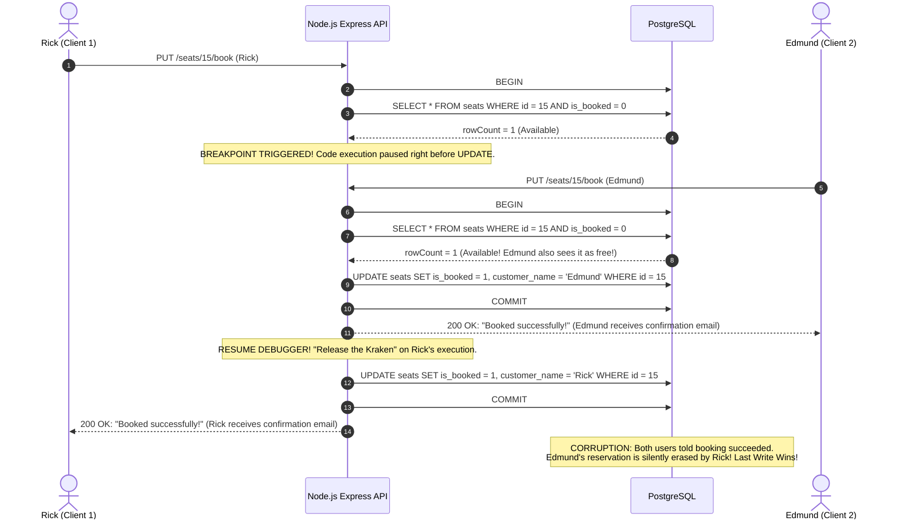
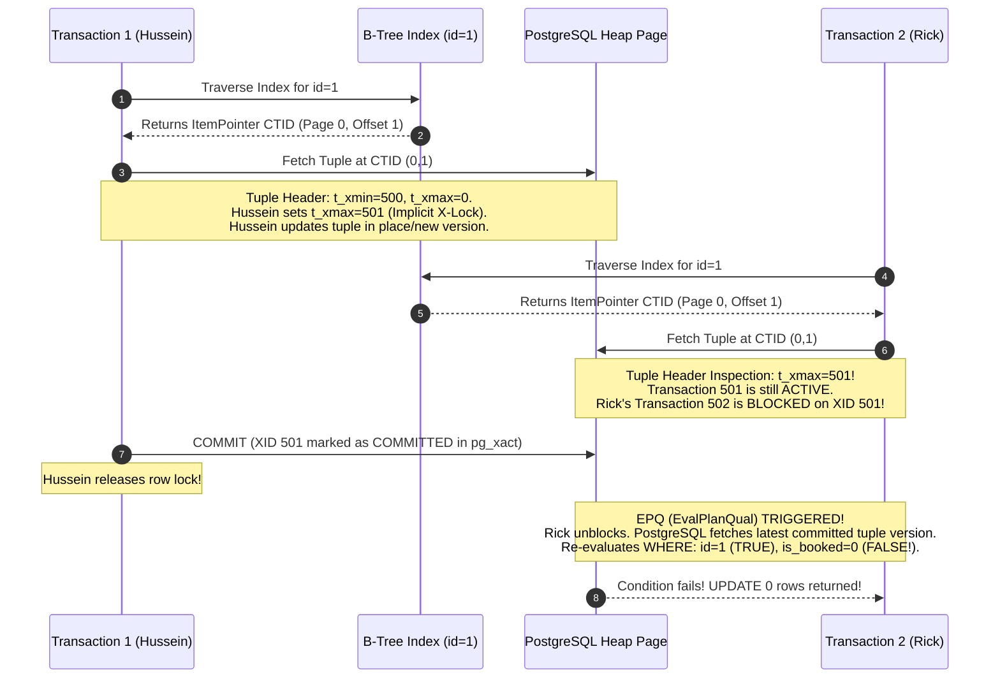

#Database #Transactions #ConcurrencyControl #PessimisticLocking #NodeJS #Express #PostgreSQL #Internals #EvalPlanQual #DoubleBooking #RaceCondition #SystemDesign

> [!abstract] Executive Summary
> In high-concurrency reservation systems (concert ticketing, airline seats, cinema booking, doctor appointments), concurrent users frequently attempt to claim the exact same inventory at the exact same millisecond. Naive implementations relying on standard **Read-Modify-Write** cycles (`SELECT` then `UPDATE`) suffer from devastating race conditions where multiple users receive booking confirmations but only the "last write wins" persists in the database.
> 
> This master guide bridges theoretical concurrency with production software engineering:
> 1. **Reproducing Race Conditions:** Using deterministic interactive debugging breakpoints in a Node.js/Express and PostgreSQL backend.
> 2. **Pessimistic Locking (`SELECT ... FOR UPDATE`):** Forcing Strict Two-Phase Locking (S2PL) at the row level, managing PostgreSQL lock timeouts, and fail-fast patterns.
> 3. **Atomic Conditional Updates (`UPDATE ... WHERE is_booked = 0`):** Single-statement atomic mutations checking `rowCount`.
> 4. **PostgreSQL Engine Internals Deep Dive:** Examining B-Tree index traversal, on-disk heap tuple header locks (`t_xmax` / `t_infomask`), and the **EvalPlanQual (EPQ)** tuple re-evaluation mechanism.

---

## 1. The Booking System Architecture & The Naive Implementation

Consider a standard web application: a frontend displaying a grid of cinema seats (green = available, red = booked), a Node.js/Express API server, and a PostgreSQL database.

```
┌─────────────────────────────────────────────────────────────────────────────────────────────────┐
│                                CINEMA SEAT BOOKING ARCHITECTURE                                 │
└─────────────────────────────────────────────────────────────────────────────────────────────────┘

   [ Client 1 (Rick) ]          [ Client 2 (Edmund) ]
           │                             │
           │  PUT /api/seats/15          │  PUT /api/seats/15
           ▼                             ▼
    ┌───────────────────────────────────────────┐
    │     Express.js API (pg Connection Pool)    │
    └─────────────────────┬─────────────────────┘
                          │ SQL Queries
                          ▼
    ┌───────────────────────────────────────────┐
    │          PostgreSQL Database Cluster       │
    │   TABLE: seats (id, seat_num, is_booked)   │
    └───────────────────────────────────────────┘
```

### The Database Schema
```sql
CREATE TABLE seats (
    id SERIAL PRIMARY KEY,
    seat_number VARCHAR(10) NOT NULL UNIQUE,
    is_booked INT NOT NULL DEFAULT 0,
    customer_name VARCHAR(100)
);

-- Seed Seat 15
INSERT INTO seats (id, seat_number, is_booked, customer_name)
VALUES (15, 'G-15', 0, NULL);
```

### The Naive Backend Handler (Vulnerable to Double Booking)

```javascript
// Express.js Route Handler - NAIVE IMPLEMENTATION
app.put('/api/seats/:id/book', async (req, res) => {
    const seatId = req.params.id;
    const { customerName } = req.body;
    
    // Acquire dedicated client from connection pool for transaction
    const client = await pool.connect();

    try {
        await client.query('BEGIN');

        // Step 1: Check availability (Read)
        const checkResult = await client.query(
            'SELECT * FROM seats WHERE id = $1 AND is_booked = 0',
            [seatId]
        );

        if (checkResult.rowCount === 0) {
            await client.query('ROLLBACK');
            return res.status(409).json({ error: 'Seat already booked!' });
        }

        // ==========================================================
        // VULNERABILITY WINDOW: If another request enters here, 
        // both see is_booked = 0!
        // ==========================================================

        // Step 2: Mutate row (Modify & Write)
        await client.query(
            'UPDATE seats SET is_booked = 1, customer_name = $1 WHERE id = $2',
            [customerName, seatId]
        );

        await client.query('COMMIT');
        return res.json({ success: true, message: 'Booked successfully!' });
    } catch (err) {
        await client.query('ROLLBACK');
        return res.status(500).json({ error: err.message });
    } finally {
        client.release(); // Return client to pool
    }
});
```

---

## 2. Reproducing the Double Booking Race Condition via Interactive Debugging

In production, race conditions occur non-deterministically under burst traffic (thousands of queries per second). However, you can reproduce this bug deterministically on a local development machine using an **interactive debugger breakpoint**.



### The Anatomy of the Failure
1. **Rick's transaction** reads the database snapshot under `READ COMMITTED` isolation. The seat is unbooked.
2. Rick's execution halts in the debugger between the `SELECT` and the `UPDATE`.
3. **Edmund's transaction** executes from start to finish. Because Rick has acquired **no locks** (standard `SELECT` under MVCC never locks rows), Edmund's transaction completes cleanly and commits.
4. Rick's debugger resumes. Rick executes `UPDATE seats SET customer_name = 'Rick' WHERE id = 15`. 
5. Because Rick's `UPDATE` query only filters on `WHERE id = 15`, it blindly overwrites Edmund's newly committed row.
6. **Result:** Both HTTP requests return `200 OK: Booked successfully`. Edmund arrives at the theater to discover Rick sitting in his seat.

---

## 3. The Pessimistic Fix: `SELECT ... FOR UPDATE` in Node.js

To eliminate the race condition, we enforce **Strict Two-Phase Locking (S2PL)** at the database level by acquiring an **Exclusive Row Lock** during the read query:

```javascript
// Express.js Route Handler - PESSIMISTIC LOCKING IMPLEMENTATION
app.put('/api/seats/:id/book', async (req, res) => {
    const seatId = req.params.id;
    const { customerName } = req.body;
    const client = await pool.connect();

    try {
        await client.query('BEGIN');

        // Optional: Prevent indefinite waiting by configuring lock_timeout
        await client.query('SET LOCAL lock_timeout = "3s"');

        // 2PL GROWING PHASE: Acquire Exclusive Row Lock (X-Lock)
        const checkResult = await client.query(
            'SELECT * FROM seats WHERE id = $1 AND is_booked = 0 FOR UPDATE',
            [seatId]
        );

        if (checkResult.rowCount === 0) {
            await client.query('ROLLBACK');
            return res.status(409).json({ error: 'Seat already booked!' });
        }

        // Mutate safely: No concurrent transaction can touch this row
        await client.query(
            'UPDATE seats SET is_booked = 1, customer_name = $1 WHERE id = $2',
            [customerName, seatId]
        );

        // 2PL SHRINKING PHASE: Commit releases the row lock
        await client.query('COMMIT');
        return res.json({ success: true, message: 'Booked successfully!' });
    } catch (err) {
        await client.query('ROLLBACK');
        
        // Handle lock timeout explicitly
        if (err.code === '55P03') { // lock_not_available
            return res.status(408).json({ error: 'System busy. Please try again.' });
        }
        return res.status(500).json({ error: err.message });
    } finally {
        client.release();
    }
});
```

### What Happens When Tested with the Debugger?
1. Rick pauses at the breakpoint right after `SELECT ... FOR UPDATE`. Rick holds the exclusive row lock on seat 15.
2. Edmund clicks "Book Seat 15". Edmund's request issues `SELECT ... FOR UPDATE`.
3. **Edmund's query instantly hangs and blocks!** The Node.js worker handling Edmund waits on the database socket.
4. When Rick's debugger resumes and commits, Rick's exclusive lock evaporates.
5. Edmund's query unblocks immediately. PostgreSQL delivers the latest committed state to Edmund.
6. Because `is_booked` is now `1`, Edmund's `SELECT ... WHERE is_booked = 0` returns **0 rows**.
7. Edmund's code enters `checkResult.rowCount === 0`, rolls back, and returns `409 Conflict: Seat already booked!`.

---

## 4. Addressing the Indefinite Wait: PostgreSQL vs. Oracle

In database engines like Oracle, the syntax supports a direct inline timeout:
```sql
-- Oracle Database Syntax:
SELECT * FROM seats WHERE id = 15 FOR UPDATE WAIT 5;
```

In standard PostgreSQL, `SELECT ... FOR UPDATE` will block **indefinitely** until the lock holder terminates or the client connection is severed. This presents a serious production hazard: a rogue slow transaction can exhaust the application's connection pool.

### The Two PostgreSQL Solutions:

#### 1. Session / Transaction-Level `lock_timeout`
You can configure a timeout before acquiring locks:
```sql
BEGIN;
SET LOCAL lock_timeout = '2000ms'; -- Times out after 2 seconds
SELECT * FROM seats WHERE id = 15 FOR UPDATE;
```
If the lock cannot be acquired within 2000ms, PostgreSQL aborts the query with:
`ERROR: canceling statement due to lock timeout (SQLState 55P03)`.

#### 2. The `NOWAIT` Fast-Fail Clause
```sql
SELECT * FROM seats WHERE id = 15 FOR UPDATE NOWAIT;
```
If another transaction holds the lock, PostgreSQL does not wait a single millisecond. It immediately raises:
`ERROR: could not obtain lock on row in relation "seats" (SQLState 55P03)`.

---

## 5. The Alternative Approach: Atomic Conditional `UPDATE`

A popular optimization proposed by software engineers is bypassing `SELECT ... FOR UPDATE` entirely in favor of an **Atomic Conditional Mutation**:

```javascript
// Express.js Route Handler - ATOMIC CONDITIONAL UPDATE
app.put('/api/seats/:id/book-atomic', async (req, res) => {
    const seatId = req.params.id;
    const { customerName } = req.body;

    try {
        // Direct single-statement atomic update:
        const result = await pool.query(
            `UPDATE seats 
             SET is_booked = 1, customer_name = $1 
             WHERE id = $2 AND is_booked = 0`,
            [customerName, seatId]
        );

        // Inspect rows affected:
        if (result.rowCount === 0) {
            // Either the seat doesn't exist, or it was already booked!
            return res.status(409).json({ error: 'Seat already booked!' });
        }

        return res.json({ success: true, message: 'Booked successfully!' });
    } catch (err) {
        return res.status(500).json({ error: err.message });
    }
});
```

### Why This Is Attractive:
- **Reduces Network Round-Trips:** Replaces `BEGIN` -> `SELECT` -> `UPDATE` -> `COMMIT` (4 round-trips) with a single query executed through connection pooling.
- **No Transaction Management Code:** The single SQL statement operates as its own autonomous atomic transaction.

**Crucial Engineering Question:** *Why does this actually work at the database engine level? What happens inside PostgreSQL when two concurrent `UPDATE` statements target the same row?*

---

## 6. Deep Dive into PostgreSQL Internals: What Really Happens Under the Hood?

To truly master database concurrency, an engineer must look beneath SQL abstractions and understand how PostgreSQL manages heap tuples, indexes, and locks.



### Step 1: B-Tree Index Traversal
When PostgreSQL receives `UPDATE seats ... WHERE id = 1 AND is_booked = 0`:
1. The query executor evaluates the `WHERE` clause. Because `id` has a primary key index, the executor performs a B-Tree search on `id = 1`.
2. The index returns an **ItemPointer** (also known as `CTID`—Tuple ID), which specifies the exact physical storage location on disk: `(block_number, tuple_offset)`.

### Step 2: On-Disk Tuple Header Locking (`t_xmax` and `t_infomask`)
Unlike MySQL InnoDB or Microsoft SQL Server (which maintain centralized lock tables predominantly in memory), **PostgreSQL stores row-level lock information directly within the tuple header on the heap page**:

```
┌────────────────────────────────────────────────────────────────────────┐
│                     POSTGRESQL HEAP TUPLE HEADER                       │
├───────────────┬────────────────────────────────────────────────────────┤
│ Field         │ Description & Role in Concurrency                      │
├───────────────┼────────────────────────────────────────────────────────┤
│ `t_xmin`      │ The Transaction ID (XID) that inserted this row.       │
├───────────────┼────────────────────────────────────────────────────────┤
│ `t_xmax`      │ The XID that updated, deleted, or locked this row.     │
├───────────────┼────────────────────────────────────────────────────────┤
│ `t_infomask`  │ Bit flags indicating row status:                       │
│               │ - `HEAP_XMAX_EXCL_LOCK`: Row is exclusively locked.    │
│               │ - `HEAP_XMAX_COMMITTED`: Updating XID has committed.   │
│               │ - `HEAP_XMAX_INVALID`: No active transaction locks it. │
├───────────────┼────────────────────────────────────────────────────────┤
│ `t_ctid`      │ Points to the newest version of this row.              │
└───────────────┴────────────────────────────────────────────────────────┘
```

When Transaction 1 (Hussein, XID 501) begins mutating row 1:
- It writes its own XID (`501`) into the tuple's `t_xmax` field.
- It sets the bit flag `HEAP_XMAX_EXCL_LOCK` in `t_infomask`.
- **The row is now locked implicitly.**

### Step 3: Transaction 2 (Rick) Hits the Lock
When Transaction 2 (Rick, XID 502) visits the same heap page:
1. It reads `t_xmax` and discovers XID `501`.
2. It queries `pg_xact` (the commit log in shared memory) to check the status of XID `501`.
3. `pg_xact` reports: **Transaction 501 is still in progress**.
4. Transaction 2 enters a lock wait state, suspending execution until Transaction 501 commits or aborts.

### Step 4: The Commit & The EvalPlanQual (EPQ) Mechanism
When Hussein executes `COMMIT;`:
1. XID 501 is marked as committed.
2. Rick's transaction unblocks.
3. **Now comes the magic of PostgreSQL:** Under default `READ COMMITTED` isolation, what should Rick do?
   - If PostgreSQL blindly executed the update, it would overwrite Hussein's data.
   - If PostgreSQL did nothing, it might fail valid updates.
   - Instead, PostgreSQL invokes its internal sub-system: **EvalPlanQual (EPQ)**.

> [!IMPORTANT] What is EvalPlanQual (EPQ)?
> In PostgreSQL, when an `UPDATE` or `DELETE` statement is blocked waiting for a concurrent transaction to finish updating the target row, once the blocking transaction commits, the executor **re-fetches the latest committed version of the row from the heap and re-evaluates the query's WHERE clause**.

Because Hussein's commit updated `is_booked` from `0` to `1`:
- EPQ checks: `id = 1` -> **TRUE**
- EPQ checks: `is_booked = 0` -> **FALSE** (`is_booked` is now `1`)
- The qualification **fails**. The executor skips the row.
- Rick's update statement completes, returning **`UPDATE 0`** (0 rows affected).

---

## 7. The Critical Catch: Behavior Across Isolation Levels

The atomic conditional `UPDATE` behaves fundamentally differently depending on your transaction's isolation level:

```
┌─────────────────────────────────────────────────────────────────────────────────────────────────┐
│                      ATOMIC CONDITIONAL UPDATE ACROSS ISOLATION LEVELS                          │
├───────────────────────────────┬─────────────────────────────────────────────────────────────────┤
│ Isolation Level               │ Engine Behavior upon Lock Release                               │
├───────────────────────────────┼─────────────────────────────────────────────────────────────────┤
│ **READ COMMITTED**            │ ✅ **EPQ Re-evaluates:** Re-fetches latest committed version.  │
│ *(PostgreSQL Default)*        │ `WHERE is_booked = 0` fails cleanly. Returns `UPDATE 0`.        │
├───────────────────────────────┼─────────────────────────────────────────────────────────────────┤
│ **REPEATABLE READ**           │ ❌ **Serialization Failure:** Re-evaluation is forbidden!       │
│                               │ Throws error: `could not serialize access due to concurrent     │
│                               │ update` (SQLState `40001`).                                     │
├───────────────────────────────┼─────────────────────────────────────────────────────────────────┤
│ **SERIALIZABLE**              │ ❌ **Serialization Failure:** Throws SQLState `40001`. Must be  │
│                               │ caught and retried in application code.                         │
└───────────────────────────────┴─────────────────────────────────────────────────────────────────┘
```

> [!WARNING] Production Portability Warning
> Relying on atomic conditional `UPDATE` depends heavily on database engine semantics:
> - In PostgreSQL `READ COMMITTED`, it succeeds silently with `rowCount = 0`.
> - In PostgreSQL `REPEATABLE READ`, it crashes with a serialization exception (`40001`).
> - In other database management systems without EPQ-like row re-evaluation, results can vary significantly depending on whether composite indexes or index-only scans are utilized.

---

## 8. Architectural Decision Matrix: Which Pattern Should You Use?

```
┌─────────────────────────────────────────────────────────────────────────────────────────────────┐
│                                 CONCURRENCY PATTERN SCORECARD                                   │
├─────────────────────────┬─────────────────────────┬─────────────────────────┬───────────────────┤
│ Dimension               │ `SELECT ... FOR UPDATE` │ Atomic Conditional      │ Redis Distributed │
│                         │ (Pessimistic Locking)   │ `UPDATE ... WHERE ...`  │ Lock (Redlock)    │
├─────────────────────────┼─────────────────────────┼─────────────────────────┼───────────────────┤
│ **Best Used For**       │ Multi-step workflows    │ Single-row, single-step │ Ephemeral seats   │
│                         │ (Calculate price, check │ status mutations with   │ cart hold (10 min │
│                         │ coupons, book seats).   │ no intermediate logic.  │ TTL checkout).    │
├─────────────────────────┼─────────────────────────┼─────────────────────────┼───────────────────┤
│ **Database Overhead**   │ Holds row locks during  │ Minimal. Single SQL     │ Zero DB locks.    │
│                         │ transaction lifespan.   │ statement round-trip.   │ DB hit only on pay│
├─────────────────────────┼─────────────────────────┼─────────────────────────┼───────────────────┤
│ **Lock Contention**     │ High under peak flash   │ Low. Locks held only for│ Low. Offloads     │
│                         │ sales (threads wait).   │ execution of one query. │ traffic to cache. │
├─────────────────────────┼─────────────────────────┼─────────────────────────┼───────────────────┤
│ **Application Code**    │ Requires `BEGIN`/`COMMIT`│ Extremely clean. Check  │ Requires lock     │
│                         │ and lock timeout config.│ `res.rowCount === 0`.   │ lease renewal logic│
└─────────────────────────┴─────────────────────────┴─────────────────────────┴───────────────────┘
```

---

## 9. Senior Engineer Production Checklist

- [ ] **Never perform naked Read-Modify-Write:** If your business logic reads a record to determine if it can update it, plain `SELECT` will cause lost updates. Use `SELECT ... FOR UPDATE` or conditional `UPDATE`.
- [ ] **Always inspect `rowCount` on conditional mutations:** When using `UPDATE ... WHERE is_booked = 0`, always check `result.rowCount === 0` to detect that another user claimed the seat.
- [ ] **Always configure `lock_timeout` for pessimistic locks:** Never issue `SELECT ... FOR UPDATE` in web request handlers without setting `SET LOCAL lock_timeout = '2s'` or using `NOWAIT`.
- [ ] **Catch SQLState `55P03` (Lock Not Available):** Gracefully return `409 Conflict` or `429 Too Many Requests` instead of letting requests crash with generic 500 errors.
- [ ] **Catch SQLState `40001` (Serialization Failure):** If running under `REPEATABLE READ` or `SERIALIZABLE`, wrap transactional queries in an exponential backoff retry loop.
- [ ] **Release connection pool clients in `finally` blocks:** Always ensure `client.release()` executes in a `finally` block to prevent connection pool leaks during errors or timeouts.

---

## 10. Related Notes & Conceptual Navigation

- [[05_Two-Phase Locking (2PL)_ Growing, Shrinking, and The Double Booking Problem|Two-Phase Locking (2PL): Growing, Shrinking, and The Double Booking Problem]]
- [[04_Database Deadlocks_ Detection, Resolution, and PostgreSQL Hands-On Demo|Database Deadlocks: Detection, Resolution, and PostgreSQL Hands-On Demo]]
- [[03_Exclusive Locks vs. Shared Locks_ Concurrency, Compatibility, and Banking Workflows|Exclusive Locks vs. Shared Locks: Concurrency, Compatibility, and Banking Workflows]]
- [[02_Serializable vs. Repeatable Read Isolation Levels|Serializable vs. Repeatable Read Isolation Levels]]
- [[01_Read Phenomena & Phantom Reads|Read Phenomena & Phantom Reads]]
