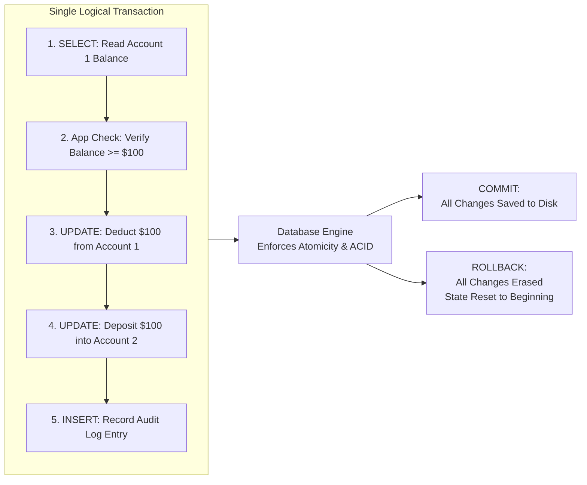
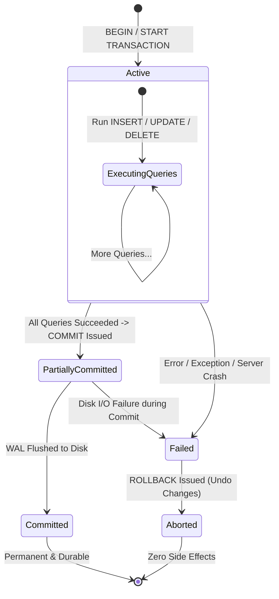

#Database #ACID #Transactions #ConcurrencyControl #SystemDesign #RelationalDatabase #PostgreSQL #CoreConcept

> [!abstract] Executive Summary
> In relational database engineering, data is normalized and decomposed across multiple related tables. Consequently, real-world business operations (such as processing an e-commerce checkout, transferring bank funds, or booking an airline reservation) can almost never be fulfilled by a single isolated SQL query.
> 
> A **Database Transaction** is a sequence of database operations executed as a **single, indivisible logical unit of work**. Either every operation in the transaction succeeds and persists permanently, or the entire operation is rolled back with zero residual side effects.
> 
> To guarantee reliability, database transactions adhere to the **ACID** framework:
> 1. **Atomicity:** All-or-nothing execution.
> 2. **Consistency:** Transitioning from one valid schema/business state to another.
> 3. **Isolation:** Defining what concurrent transactions can and cannot see of each other.
> 4. **Durability:** Guaranteeing committed changes survive crashes, power cuts, and restarts.

---

## 1. What is a Database Transaction?

A transaction is a collection of SQL queries that are treated as **one indivisible unit of work**.



### The Canonical Bank Transfer Problem:
Consider sending \$100 from Account 1 to Account 2:
1. `SELECT balance FROM accounts WHERE id = 1;` (Verify sufficient funds).
2. `UPDATE accounts SET balance = balance - 100 WHERE id = 1;` (Deduct funds).
3. `UPDATE accounts SET balance = balance + 100 WHERE id = 2;` (Deposit funds).

If the server crashes, loses power, or suffers a network partition after Step 2 but before Step 3:
- Without transactions: \$100 vanishes into thin air! Account 1 lost money, but Account 2 never received it.
- With transactions: The database recognizes the transaction was incomplete and executes an automatic **Rollback**, restoring Account 1's balance upon recovery.

---

## 2. The Transaction Lifecycle & State Machine



### 1. `BEGIN` (or `START TRANSACTION`)
Explicitly signals to the database engine that a new transaction block has started. The engine allocates a unique Transaction ID (XID), initializes transaction-local memory, and begins tracking all row modifications.

### 2. `COMMIT`
Notifies the database that all operations within the transaction completed successfully and instructs the engine to make all modifications permanent on disk.

```
┌─────────────────────────────────────────────────────────────────────────────────────────────────┐
│                           THE DATABASE BUILDER'S COMMIT DILEMMA                                 │
├─────────────────────────────────────────────────────────────────────────────────────────────────┤
│ As an engine architect, how do you handle a transaction containing 1,000 queries?               │
│                                                                                                 │
│ **Strategy A: Write to disk eagerly during the transaction**                                    │
│ - Every query writes its changes to disk pages immediately.                                     │
│ - *Advantage:* The final `COMMIT` is near-instantaneous.                                        │
│ - *Disadvantage:* If the transaction aborts, `ROLLBACK` is painfully slow because the engine   │
│   must perform reverse I/O to undo all written disk pages.                                      │
│                                                                                                 │
│ **Strategy B: Buffer in RAM, flush to disk on COMMIT**                                          │
│ - All query changes stay in volatile memory buffers.                                            │
│ - *Advantage:* `ROLLBACK` is instant (simply discard the memory buffer).                        │
│ - *Disadvantage:* `COMMIT` becomes a heavy I/O bottleneck as massive buffers flush to disk.    │
│                                                                                                 │
│ **The Production Compromise (Write-Ahead Logging / WAL):**                                      │
│ Modern RDBMS engines (PostgreSQL, MySQL InnoDB) write changes to in-memory pages, but append    │
│ compact sequential log records to an append-only **WAL log**. On `COMMIT`, only the small WAL  │
│ buffer must be flushed to disk (`fsync`), ensuring both fast commits and fast rollbacks!        │
└─────────────────────────────────────────────────────────────────────────────────────────────────┘
```

### 3. `ROLLBACK`
Instructs the database to abort the transaction and discard all changes. 
- If changes were buffered in memory, the memory is discarded.
- If changes modified disk pages, the engine reads **Undo Logs** (or PostgreSQL MVCC tuple headers) to invalidate the modified records and restore original values.

### 4. Unexpected Termination Scenarios
- **Crash Mid-Transaction:** If the database crashes 20,000 queries into a 50,000-query transaction, the restart recovery process inspects the WAL log, sees no `COMMIT` record, and automatically rolls back all intermediate changes.
- **Crash During Commit:** The most critical window in database durability. Did the transaction commit or not?
  - PostgreSQL is optimized for ultra-fast commits by streaming WAL records continuously, shrinking the commit vulnerability window to microseconds.
  - Engines with slower commit flushing have larger vulnerability windows during power outages.

---

## 3. Operational Modes: The Nature of Transactions

### 1. Read-Write vs. Read-Only Transactions
- **Read-Write Transactions:** The standard paradigm for inserting, updating, and deleting rows with ACID guarantees.
- **Read-Only Transactions (`BEGIN READ ONLY`):** Why start a transaction if you are only reading data?
  - **To Guarantee a Consistent Point-in-Time Snapshot!**
  - If a reporting job runs 10 complex analytical queries over 5 minutes without a transaction, subsequent queries will see data modified by concurrent writes that occurred between Query 1 and Query 10.
  - A Read-Only transaction freezes a **consistent MVCC snapshot** as of the transaction's start timestamp. Every query in the transaction sees identical, point-in-time data regardless of what other users are changing!

### 2. Implicit vs. Explicit Transactions
- **Explicit Transactions:** User-controlled blocks demarcated by explicit commands:
  ```sql
  BEGIN;
  UPDATE accounts SET balance = balance - 100 WHERE id = 1;
  UPDATE accounts SET balance = balance + 100 WHERE id = 2;
  COMMIT;
  ```
- **Implicit (Autocommit) Transactions:** Even if you do not type `BEGIN`, **you are always in a transaction**.
  - When you execute a standalone `UPDATE accounts SET balance = 500 WHERE id = 1;`, the database engine internally wraps that statement in an implicit `BEGIN` and `COMMIT`.
  - In relational databases, every single statement is transactional.

---

## 4. The Four Pillars of ACID: An Overview

```
┌─────────────────────────────────────────────────────────────────────────────────────────────────┐
│                                   THE ACID PROPERTIES                                           │
├─────────────────────┬─────────────────────────────────┬─────────────────────────────────────────┤
│ Property            │ Core Guarantee                  │ Failure Mode Prevented                  │
├─────────────────────┼─────────────────────────────────┼─────────────────────────────────────────┤
│ **Atomicity**       │ All or Nothing                  │ Partial updates, half-finished transfers│
├─────────────────────┼─────────────────────────────────┼─────────────────────────────────────────┤
│ **Isolation**       │ Concurrency Independence        │ Dirty reads, non-repeatable reads, skew │
├─────────────────────┼─────────────────────────────────┼─────────────────────────────────────────┤
│ **Consistency**     │ Preserving Valid States         │ Invariant violations, negative balances │
├─────────────────────┼─────────────────────────────────┼─────────────────────────────────────────┤
│ **Durability**      │ Permanent Disk Survival         │ Data loss after power failure / crash   │
└─────────────────────┴─────────────────────────────────┴─────────────────────────────────────────┘
```

> [!important] The Didactic Order of ACID
> In database theory, ACID is often taught in the sequence: **Atomicity $\to$ Isolation $\to$ Consistency $\to$ Durability**.
> 
> Why? Because **Consistency cannot be understood in isolation**. A database cannot remain consistent unless Atomicity guarantees operations never stop halfway, and Isolation guarantees concurrent transactions do not corrupt each other's working sets. Consistency is the *result* of proper Atomicity and Isolation!

### 1. Atomicity
Treats the transaction as an indivisible "atom" of work. If 99 queries succeed but query 100 encounters a divide-by-zero error, queries 1 through 99 are rolled back completely.

### 2. Isolation
Defines what concurrent transactions can and cannot observe about each other's intermediate work. Isolation levels (Read Uncommitted, Read Committed, Repeatable Read, Serializable) trade query throughput against concurrency anomalies (Dirty Reads, Phantom Reads, Write Skew).

### 3. Consistency
Ensures that a transaction moves the database from one valid state to another valid state, satisfying all declared schema constraints (`NOT NULL`, `CHECK`, `FOREIGN KEY`, `UNIQUE`) and application business invariants.

### 4. Durability
Guarantees that once a transaction commits, its modifications are permanently recorded on non-volatile storage (disk / SSD). Even if a catastrophic power failure occurs one millisecond after commit, the data will be present when power is restored.

> [!note] Durability Trade-Offs in NoSQL Engines
> Some high-throughput NoSQL engines (e.g., Redis, MongoDB with unacknowledged writes, Cassandra with delayed commitlogs) intentionally relax durability in exchange for extreme write speed. While acceptable for non-critical telemetry, relational financial engines never compromise on Durability.

---

## 5. Detailed Walkthrough: Bank Account Transfer with Constraints

Consider the following ledger schema:
```sql
CREATE TABLE account (
    account_id INT PRIMARY KEY,
    balance NUMERIC(12, 2) NOT NULL,
    CONSTRAINT check_positive_balance CHECK (balance >= 0)
);

INSERT INTO account VALUES (1, 1000.00), (2, 500.00);
```

```
Initial State:
┌────────────┬───────────┐
│ account_id │ balance   │
├────────────┼───────────┤
│ 1          │ $1,000.00 │
│ 2          │   $500.00 │
└────────────┴───────────┘
```

### The Transaction Execution Flow:
We transfer \$100 from Account 1 to Account 2:

```sql
BEGIN TRANSACTION;

-- Step 1: Read balance and lock row for update
SELECT balance FROM account WHERE account_id = 1 FOR UPDATE;
-- Application verifies: balance (1000) >= transfer_amount (100) -> OK!

-- Step 2: Deduct from sender
UPDATE account SET balance = balance - 100.00 WHERE account_id = 1;

-- Step 3: Credit recipient
UPDATE account SET balance = balance + 100.00 WHERE account_id = 2;

-- Step 4: Persist changes permanently
COMMIT;
```

```
┌─────────────────────────────────────────────────────────────────────────────────────────────────┐
│                         APPLICATION vs. DATABASE CONSTRAINTS                                    │
├─────────────────────────────────────────────────────────────────────────────────────────────────┤
│ 1. **Application-Level Checks:** The backend API checks `if (balance >= transferAmount)`.       │
│    However, relying *only* on application code is dangerous because concurrent race conditions  │
│    can cause double-spending.                                                                   │
│ 2. **Database-Level Invariants:** The schema declares `CHECK (balance >= 0)`.                   │
│    If a bug in application code attempts to deduct \$2,000 from Account 1, the database         │
│    engine aborts the update, triggers a constraint violation error, and aborts the transaction! │
│ True Consistency requires both application rules and database schema constraints.               │
└─────────────────────────────────────────────────────────────────────────────────────────────────┘
```

---

## 6. Senior Engineer Production Checklist

- [ ] **Keep transactions short:** Long-running transactions hold locks, prevent WAL truncation, and cause vacuuming delays in PostgreSQL.
- [ ] **Use read-only transactions for analytical reports:** Wrap multi-query read jobs in `BEGIN TRANSACTION READ ONLY;` to guarantee consistent snapshot views without acquiring table locks.
- [ ] **Never run external network calls inside a transaction:** Never call third-party APIs (Stripe, Twilio) or send emails between `BEGIN` and `COMMIT`; if the third party hangs, database locks remain held indefinitely.
- [ ] **Enforce database-level invariants:** Back up application validation with database `CHECK` constraints, foreign keys, and unique indexes to guarantee physical consistency.
- [ ] **Handle unexpected termination gracefully:** Ensure client connection pools detect broken connections and verify transaction commit states before retrying.
