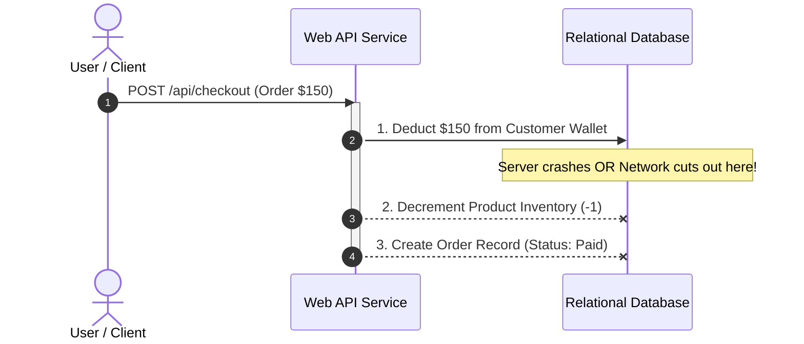
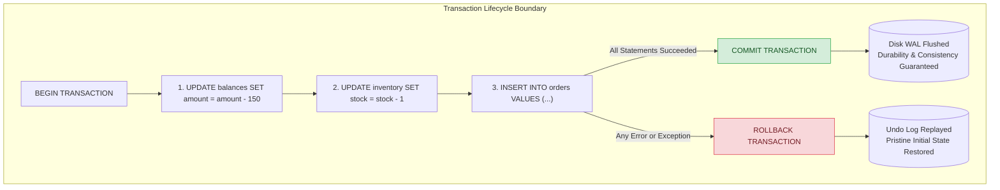
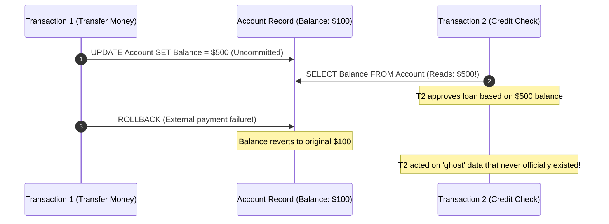
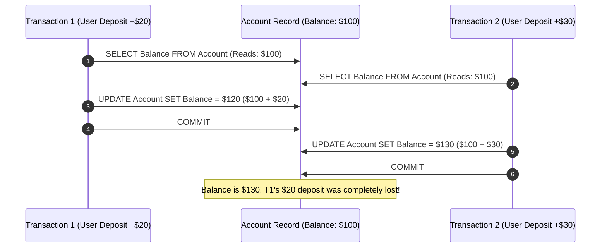
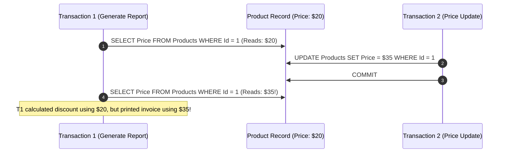
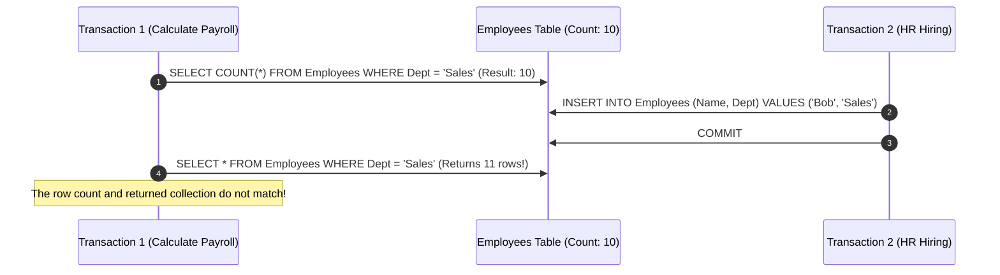
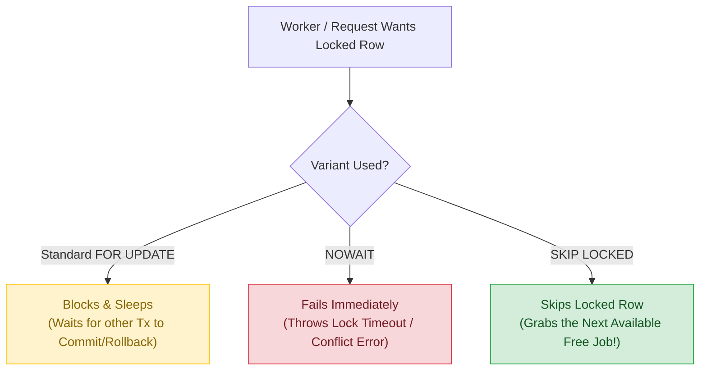
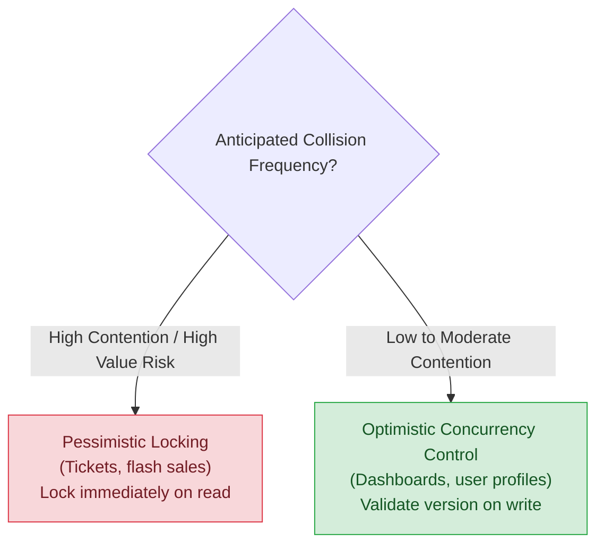
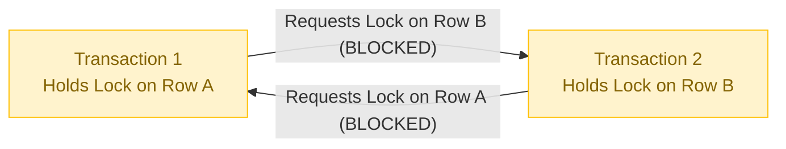

#Database #Transactions #ACID #Concurrency #MVCC #DotNet #EFCore #PostgreSQL #SQLServer #SystemDesign #InterviewPreparation

> [!abstract] Executive Summary
> A database transaction is an all-or-nothing execution boundary. When multiple users, background workers, or API threads read and modify identical records simultaneously, transaction isolation and concurrency control are the only mechanisms preventing financial loss, double bookings, and silent data corruption.
> 
> This guide covers the **ACID guarantees**, the **5 classic concurrency anomalies** (including Lost Update and Write Skew), the engine-specific realities of **MVCC vs. Two-Phase Locking (PostgreSQL vs. SQL Server vs. MySQL)**, **Pessimistic `FOR UPDATE SKIP LOCKED`**, **Optimistic Concurrency with EF Core**, and critical production traps like **Lock Escalation** and **EF Core Retry Execution Strategies**.

---

## 0. Master Isolation & Anomaly Matrix

| Concurrency Anomaly | Read Uncommitted | Read Committed *(Default SQL Server & PG)* | Repeatable Read *(Default MySQL InnoDB)* | Snapshot Isolation | Serializable |
| :--- | :---: | :---: | :---: | :---: | :---: |
| **Dirty Read ($G_1$)** | ❌ Allowed | ✅ Prevented | ✅ Prevented | ✅ Prevented | ✅ Prevented |
| **Lost Update ($P_4$)** | ❌ Allowed | ❌ Allowed | ✅ Prevented *(Postgres / MySQL)* | ✅ Prevented | ✅ Prevented |
| **Non-Repeatable Read ($P_2$)** | ❌ Allowed | ❌ Allowed | ✅ Prevented | ✅ Prevented | ✅ Prevented |
| **Phantom Read ($A3$)** | ❌ Allowed | ❌ Allowed | ⚠️ Allowed in ANSI *(Prevented in InnoDB / Postgres)* | ✅ Prevented | ✅ Prevented |
| **Write Skew ($A5B$)** | ❌ Allowed | ❌ Allowed | ❌ Allowed | ❌ Allowed | ✅ Prevented *(SSI / Range Locks)* |

> *(✅ = Prevented by engine, ❌ = Vulnerable to anomaly, ⚠️ = Engine-dependent)*

---

## 1. Why Transactions Exist: The Business Reality

In real-world applications, business operations are rarely single SQL statements. They are **multi-step business workflows**:



### What Happens Without a Transaction?
If the server crashes, power cuts out, or an unhandled exception throws between Step 1 and Step 2:
- The customer's wallet balance is deducted by **$150**.
- The product inventory is **not reserved**.
- The order record is **never created**.
- **Result:** The user was charged, but received no goods. Data integrity is permanently corrupted, requiring manual engineering database scripts to reconcile.

A **Transaction** wraps steps 1, 2, and 3 inside a strict boundary: **either every statement commits permanently to disk, or every intermediate modification rolls back completely**.

---

## 2. The ACID Guarantees Demystified

Relational databases guarantee transactional safety via the **ACID** contract:

| Pillar | Plain English Guarantee | How the Engine Enforces It Under the Hood |
| :--- | :--- | :--- |
| **Atomicity** | *"All or nothing."* If any statement fails, the entire transaction rolls back to the initial pristine state. | **Undo Log / Write-Ahead Logging (WAL)**: The database records pre-image states to disk before executing changes. On rollback or crash recovery, it replays undo logs in reverse. |
| **Consistency** | *"Data never violates system invariants."* Primary keys, foreign keys, and check constraints remain valid before and after. | **Schema Constraints & Invariant Validation**: The database engine rejects any transaction attempting to write duplicate keys, orphan foreign keys, or negative values (`CHECK`). |
| **Isolation** | *"Independent execution."* Concurrent transactions do not observe half-baked or intermediate states of one another. | **Locking Mechanisms & MVCC**: Shared locks, exclusive locks, or row-version snapshots isolate concurrent transactions. |
| **Durability** | *"Once committed, it is permanent."* Even if the database loses physical power 1 millisecond after `COMMIT`, the data survives reboot. | **Redo Log / WAL Flush (`fsync`)**: Changes are flushed to non-volatile disk in sequential write-ahead logs before the database acknowledges `COMMIT` to the application. |



---

## 3. The 5 Concurrency Anomalies (ANSI + The Ones ANSI Forgot)

When transactions execute concurrently, performance demands running them in parallel. However, unconstrained parallel execution creates five distinct anomalies:

### 1. Dirty Read ($G_1$)
> **A transaction reads uncommitted modifications made by another active transaction that later rolls back.**



---

### 2. Lost Update ($P_4$)
> **Two transactions read the same initial value concurrently and then update it based on the read value. The second write completely overwrites the first write, silently losing its modification.**


* **Solution:** Optimistic Concurrency Control (RowVersion / Version counter) or atomic SQL updates (`UPDATE Account SET Balance = Balance + 20`).

---

### 3. Non-Repeatable Read (Fuzzy Read, $P_2$)
> **A transaction reads a single row twice within its boundary, but gets different column values because another transaction updated and committed that row in between.**



---

### 4. Phantom Read ($A3$)
> **A transaction queries a range of rows matching a criteria twice, but gets a different set of rows because another transaction inserted or deleted records matching that range.**



---

### 5. Write Skew ($A5B$)
> **Two transactions concurrently read overlapping data, verify a shared business invariant, and make disjoint updates that together violate the invariant.**

#### The Classic Scenario: "At least one doctor must remain on call"
- Hospital rule: There must always be $\ge 1$ doctor on call.
- Doctors Alice and Bob are currently on call (Count = 2).
- **Transaction 1 (Alice requests off):** Checks count $\rightarrow$ sees 2 $\rightarrow$ removes Alice.
- **Transaction 2 (Bob requests off):** Checks count $\rightarrow$ sees 2 $\rightarrow$ removes Bob.
- **Both Commit:** Alice modified Alice's row; Bob modified Bob's row. **Neither modified the same row**, so Repeatable Read / Snapshot Isolation detects **zero conflict**!
- **Result:** **0 doctors on call.** The invariant is violated.
- **Solution:** Only **`SERIALIZABLE`** isolation or explicit pessimistic row/table locking prevents Write Skew.

---

## 4. ANSI Isolation Levels & MVCC Internals

### The Engine Divide: Locking vs. MVCC

The ANSI SQL standard was written in 1992 assuming databases use **Two-Phase Locking (2PL)**. Modern engines handle isolation very differently:

```
┌────────────────────────────────────────────────────────────────────────────────────────┐
│                        HOW MAJOR ENGINES IMPLEMENT ISOLATION                           │
├──────────────────┬─────────────────────────────────────────────────────────────────────┤
│ Engine           │ Primary Mechanism                                                   │
├──────────────────┼─────────────────────────────────────────────────────────────────────┤
│ **PostgreSQL**   │ Pure MVCC. Reads never take shared locks at any isolation level.    │
│ **MySQL InnoDB** │ MVCC for plain reads; Next-Key locking for Repeatable Read writes.  │
│ **SQL Server**   │ Pessimistic 2PL by default (reads take Shared locks).               │
│                  │ MVCC when `READ_COMMITTED_SNAPSHOT` or `SNAPSHOT` is enabled.       │
└──────────────────┴─────────────────────────────────────────────────────────────────────┘
```

> [!IMPORTANT] The "Golden Rule" Caveat
> The famous maxim: *"Readers do not block writers, and writers do not block readers"* is **only true in MVCC engines** (PostgreSQL, Oracle, MySQL InnoDB, and SQL Server with RCSI/Snapshot enabled).
> In **default on-premises SQL Server**, reads acquire Shared (S) locks that **actively block writers** holding Exclusive (X) locks, and writers block readers!

---

### Where Old Row Versions Live in MVCC
When a writer updates a row under MVCC, old versions are preserved for active readers. Where those versions are stored determines engine performance characteristics:

| Engine | Storage Location of Old Row Versions | Performance Consequence |
| :--- | :--- | :--- |
| **PostgreSQL** | In the **same table heap** (new tuple appended; old tuple flagged). | Requires **`VACUUM`** to clean dead tuples. Can cause table and index bloat. |
| **MySQL (InnoDB)** | In the **Undo Log** (rollback segments). | Long-running transactions cause massive undo log bloat and slow down history lookups. |
| **SQL Server** | In the **`tempdb` Version Store** (when RCSI is ON). | Heavy write concurrency can cause high disk I/O and page contention on `tempdb`. |

---

### PostgreSQL SSI vs. SQL Server 2PL Serializable
Both engines provide `SERIALIZABLE`, but through radically different mechanisms:
* **SQL Server `SERIALIZABLE`:** Uses pessimistic **Key-Range Locks** (`RangeS-S`, `RangeI-N`). Readers block writers, writers block readers, and inserts into searched ranges are physically locked out. Lowest throughput.
* **PostgreSQL `SERIALIZABLE`:** Uses **Serializable Snapshot Isolation (SSI)**. It is completely **non-locking** for reads! It tracks read-write dependencies (`SIREAD` locks) in memory. If a dangerous dependency cycle (like Write Skew) is detected, PostgreSQL terminates the transaction with:
  `ERROR: 40001: could not serialize access due to read/write dependencies among transactions`.
  Applications running on PostgreSQL Serializable **must have automatic retry logic** for error `40001`.

---

## 5. Pessimistic Locking: `FOR UPDATE`, `NOWAIT`, and `SKIP LOCKED`

When you choose pessimistic locking (`SELECT ... FOR UPDATE`), you instruct the database to lock the row immediately upon reading.

```sql
-- Standard: Blocks and queues until the existing lock is released
SELECT * FROM Tickets WHERE Id = 42 FOR UPDATE;
-- (SQL Server equivalent: SELECT * FROM Tickets WITH (UPDLOCK, ROWLOCK) WHERE Id = 42;)
```

### The Two Critical Variants: `NOWAIT` and `SKIP LOCKED`



1. **`FOR UPDATE NOWAIT`**:
   - Instead of hanging the user's HTTP request, the database aborts immediately if the row is locked.
   - Useful for fast-failing user actions where waiting would cause frontend timeouts.
2. **`FOR UPDATE SKIP LOCKED` (The Queue Workhorse):**
   - **PostgreSQL / MySQL:** `SELECT * FROM OutboxMessages WHERE Status = 'Pending' LIMIT 1 FOR UPDATE SKIP LOCKED;`
   - **SQL Server:** `SELECT TOP(1) * FROM OutboxMessages WITH (UPDLOCK, READPAST, ROWLOCK) WHERE Status = 'Pending';`
   - **Why this is essential:** Multiple background workers (e.g., Hangfire, MassTransit, Outbox dispatchers) can query the exact same table concurrently without blocking each other! Each worker grabs the next available unlocked row and processes it.

---

## 6. SQL Server Lock Escalation

In SQL Server, locks are managed in memory (consuming ~96 bytes per lock).
* When a single transaction acquires **~5,000 row-level locks** on a single table, SQL Server's lock manager automatically executes **Lock Escalation**.
* It converts all 5,000 individual row locks into a single **exclusive Table Lock (`TABLOCK`)**.
* **The Production Outage:** A batch script updating 6,000 rows inadvertently locks the entire table, blocking all customer reads and writes across the entire system.

**Mitigation:**
1. Batch bulk updates/deletes in chunks of 500 to 1,000 rows.
2. Disable escalation for specific tables: `ALTER TABLE Orders SET (LOCK_ESCALATION = DISABLE);`.

---

## 7. Optimistic vs. Pessimistic Concurrency Control



### Approach 1: Pessimistic Locking
- **Philosophy:** *"Assume conflict is probable. Lock the row immediately upon reading."*
- **Best for:** High-contention, low-latency critical resources (e.g., seat reservations, stock trades).

---

### Approach 2: Optimistic Concurrency Control (OCC)
- **Philosophy:** *"Assume conflict is rare. Allow reads without locks. Detect conflicts at save time."*
- **How It Works:** Every record maintains a version token:
  - **SQL Server:** `[Timestamp]` attribute maps to the native **`rowversion`** type (an 8-byte monotonically increasing binary counter, not a date/time).
  - **PostgreSQL:** Can use an integer version column or PostgreSQL's hidden system column **`xmin`**.

```sql
UPDATE Products 
SET Price = @newPrice, Version = Version + 1 
WHERE Id = @id AND Version = @originalVersion;
-- If Rows Affected == 0: Conflict detected!
```

---

## 8. Real-World .NET & EF Core Implementation

### 1. Model Configuration

```csharp
public class Product
{
    public int Id { get; set; }
    public string Name { get; set; } = string.Empty;
    public decimal Price { get; set; }

    // In SQL Server: [Timestamp] maps to native 'rowversion' (8-byte binary counter)
    [Timestamp]
    public byte[] RowVersion { get; set; } = null!;
}

// Or in PostgreSQL using Npgsql's hidden system column xmin:
// modelBuilder.Entity<Product>().UseXminAsConcurrencyToken();
```

---

### 2. Handling `DbUpdateConcurrencyException` Gracefully

```csharp
public async Task<bool> UpdateProductPriceAsync(int productId, decimal newPrice, CancellationToken ct)
{
    // Common Tracked-Entity Pattern:
    var product = await _dbContext.Products.FindAsync([productId], ct);
    if (product is null) throw new KeyNotFoundException("Product not found.");

    product.Price = newPrice;

    try
    {
        await _dbContext.SaveChangesAsync(ct);
        return true;
    }
    catch (DbUpdateConcurrencyException ex)
    {
        var entry = ex.Entries.Single();
        var databaseValues = await entry.GetDatabaseValuesAsync(ct);

        if (databaseValues is null)
        {
            throw new KeyNotFoundException("Product was deleted by another user.");
        }

        var currentDbPrice = (decimal)databaseValues[nameof(Product.Price)]!;
        throw new ConcurrencyConflictException(
            $"Conflict! Current DB price is {currentDbPrice:C}. Please refresh.");
    }
}
```

---

### 3. The Execution Strategy Trap with Retries in EF Core

When `EnableRetryOnFailure()` is configured in EF Core (recommended for Azure SQL / AWS RDS), invoking `BeginTransactionAsync()` directly **throws an exception at runtime**:
> *"The configured execution strategy 'SqlServerRetryingExecutionStrategy' does not support user-initiated transactions."*

**The Correct Production Pattern:**
Wrap user-initiated transactions in `strategy.ExecuteAsync`:

```csharp
public async Task TransferFundsAsync(int sourceId, int targetId, decimal amount, CancellationToken ct)
{
    var strategy = _dbContext.Database.CreateExecutionStrategy();

    await strategy.ExecuteAsync(async () =>
    {
        // await using automatically rolls back on disposal if CommitAsync is not called!
        await using var transaction = await _dbContext.Database.BeginTransactionAsync(
            IsolationLevel.ReadCommitted, ct);

        var source = await _dbContext.Accounts.FindAsync([sourceId], ct);
        var target = await _dbContext.Accounts.FindAsync([targetId], ct);

        if (source is null || target is null) throw new InvalidOperationException("Account missing.");
        if (source.Balance < amount) throw new InvalidOperationException("Insufficient funds.");

        source.Balance -= amount;
        target.Balance += amount;

        await _dbContext.SaveChangesAsync(ct);
        await transaction.CommitAsync(ct);
    });
}
```

> [!NOTE] Available `.NET` IsolationLevel Enum Values
> `IsolationLevel.ReadUncommitted`, `IsolationLevel.ReadCommitted`, `IsolationLevel.RepeatableRead`, `IsolationLevel.Serializable`, `IsolationLevel.Snapshot`.

---

## 9. Deadlocks: Detection, Causes, and Prevention

### What is a Deadlock?
A deadlock occurs when two or more transactions create a circular dependency of locks where neither can proceed:



1. **Transaction 1** locks `Row A` and waits for `Row B`.
2. **Transaction 2** locks `Row B` and waits for `Row A`.
3. The database engine's **Deadlock Detector** background thread detects the cycle, selects one transaction as the **Deadlock Victim** (e.g., SQL Server Error `1205`), and terminates/rolls it back.

### The 3 Production Rules to Eliminate Deadlocks:
1. **Acquire Locks in Identical Order Everywhere:** If Service 1 updates Table A then Table B, Service 2 must **never** update Table B then Table A. Always sort items by primary key before writing.
2. **Keep Transactions Razor-Short:** Never perform HTTP calls, PDF generation, password hashing, or user I/O inside an open database transaction.
3. **Handle Transient Faults with Retries:** Deadlocks in distributed cloud systems cannot be 100% prevented; configure Polly or EF Core retries to automatically re-execute victimized transactions.

---

## 10. The Bridge: Why ACID Doesn't Scale to Microservices

Single-database ACID transactions are bounded by a single physical engine. 
- In distributed microservice architectures, trying to maintain ACID across independent databases using **Two-Phase Commit (2PC / XA transactions)** creates a distributed bottleneck: if any microservice node is slow or disconnected, locks are held across all services, crashing availability (violating CAP).
- **The Modern Solution:** Systems use **Eventual Consistency**, the **Transactional Outbox Pattern**, and the **Saga Pattern** (orchestrated compensation transactions) — topics covered in depth in *06_Distributed_Systems*.

---

## 11. Production Anti-Patterns Table

| Anti-Pattern | Why It Breaks Systems in Production | How to Detect in Production | The Correct Solution |
| :--- | :--- | :--- | :--- |
| **"Long-Living Transactions"** | Transaction holds a database connection from the pool and open locks while awaiting external HTTP calls. | Connection pool starvation metrics; `pg_stat_activity` / `sp_who2` showing sleeping transactions. | Fetch external data *before* opening the transaction. Keep DB write transactions strictly sub-50ms. |
| **"Blind Serializable"** | Setting all transactions to `Serializable` out of caution. Degrades concurrency; spikes serialization aborts (`40001`) and timeouts. | High abort rates; excessive deadlock graphs in SQL Server Profiler / Extended Events. | Default to `Read Committed` with MVCC enabled. Use Optimistic Concurrency Control for conflict safety. |
| **"Unbatched Bulk Mutations"** | Deleting 20,000 rows in a single query triggers SQL Server Lock Escalation to a full table lock. | Extended Events `lock_escalation` event; massive blocking chains in `sp_WhoIsActive`. | Delete or update in batches of 500–1,000 rows within a loop. |
| **"Ignoring CancellationTokens"** | When an HTTP client aborts a request, long-running database queries continue running on the server, wasting IOPS. | Orphan queries running in DB long after API returned timeout or 499. | Always thread `cancellationToken` down through `SaveChangesAsync(ct)` and queries. |

---

## 12. The 30-Second "Senior Interview" Script

> [!TIP] 30-Second Interview Pitch: Transactions & Concurrency
> *"A transaction guarantees ACID execution across multi-step workflows. While ANSI defined three anomalies—Dirty, Non-Repeatable, and Phantom reads—modern systems must also guard against Lost Updates and Write Skew.*
> 
> *Isolation mechanics depend heavily on the storage engine: PostgreSQL uses pure MVCC where readers never block writers, while default SQL Server uses 2-Phase Locking where shared locks can block writers unless RCSI is enabled. Furthermore, Postgres SSI implements optimistic dependency tracking rather than heavy range locks.*
> 
> *For application concurrency, I default to Optimistic Concurrency Control with EF Core's `RowVersion` / `[Timestamp]` for low-contention web endpoints, reserving pessimistic `FOR UPDATE SKIP LOCKED` for background queue dispatchers to prevent lock contention, while ensuring transactions are kept razor-short to prevent lock escalation and connection pool exhaustion."*

---

## 🔗 Related Notes in this Vault

- [[0_Database Fundamentals_Choosing the Right Filing System|01. Database Fundamentals: SQL vs. NoSQL & Engine Taxonomy]]
- [[1_Indexing_and_Query_Tuning|01. Indexing, B+Trees, and Query Optimization]]
- [[04_Modern_DotNet_Data_Access_EF_Core_and_Performance|04. Modern .NET Data Access: EF Core vs. Dapper]]
- [[05_Practical_Caching_Strategies_with_Redis|05. Practical Caching Strategies with Redis]]
- [[02_Modern Web Communication Paradigms_ Beyond Request-Response|02. Modern Web Communication Paradigms]]
