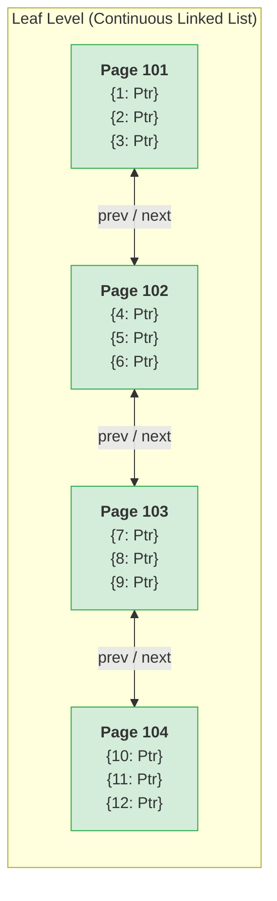
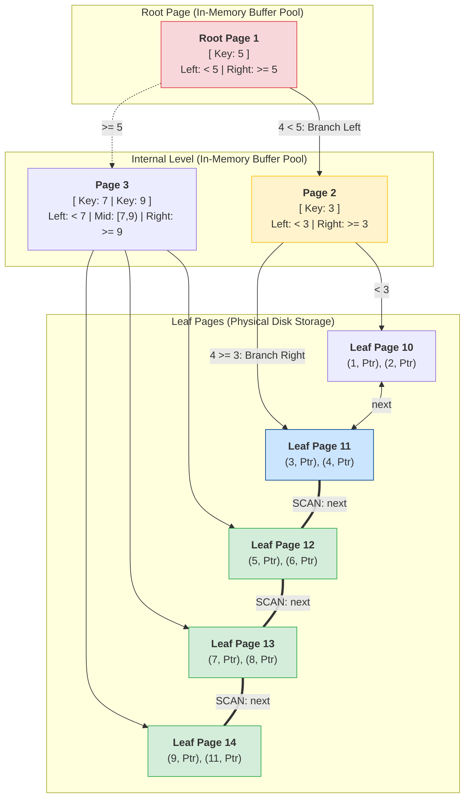

# B+ Trees: The Superior Database Indexing Structure

#Database #DataStructure #Indexing #BTree #BPlusTree #Performance #StorageEngine #SystemDesign #CoreConcept

> [!abstract] Executive Summary
> The **B+ Tree** is the undisputed gold standard data structure powering relational database storage engines (PostgreSQL, MySQL InnoDB, SQL Server, Oracle). While closely related to the classic B-Tree, it introduces two revolutionary architectural optimizations:
> 1. **Slim Internal Nodes (Keys Only):** Root and internal nodes store *only* routing keys and child page pointers. All actual records and data pointers are pushed exclusively to the **leaf nodes**.
> 2. **Horizontally Linked Leaf Nodes:** All leaf pages are chained together in a sequential (doubly-linked) list, transforming fragmented tree traversals into high-speed sequential range scans.
> 
> This guide breaks down why B+ Trees dominate database engineering, how disk page size dictates fanout, the reality of key duplication, and a step-by-step trace of how range queries (`BETWEEN 4 AND 9`) are executed with minimal disk I/O.

---

## 1. The Core Architectural Evolution: B-Tree vs. B+ Tree

In a classic B-Tree, **every node** (root, internal branches, and leaves) stores both the key and the actual data value (or tuple pointer). In a **B+ Tree**, the responsibilities are strictly bifurcated:

```
┌─────────────────────────────────────────────────────────────────────────────────────────────────┐
│                                    B-TREE vs. B+ TREE ARCHITECTURE                              │
├───────────────────────────────┬─────────────────────────────────┬───────────────────────────────┤
│ Architectural Element         │ Classic B-Tree                  │ Modern B+ Tree                │
├───────────────────────────────┼─────────────────────────────────┼───────────────────────────────┤
│ **Internal / Root Nodes**     │ "Fat" Nodes: Store Keys + Values│ **"Slim" Nodes: Store Keys ONLY│
│                               │ (Data pointers waste space).    │ + Child Page Pointers.        │
├───────────────────────────────┼─────────────────────────────────┼───────────────────────────────┤
│ **Leaf Nodes**                │ Contain remaining keys & values;│ **Contain ALL data records/TIDs;│
│                               │ isolated from one another.      │ linked horizontally in a chain│
├───────────────────────────────┼─────────────────────────────────┼───────────────────────────────┤
│ **Key Duplication**           │ Keys appear exactly once.       │ Routing keys duplicated in    │
│                               │                                 │ internal nodes & leaf nodes.  │
├───────────────────────────────┼─────────────────────────────────┼───────────────────────────────┤
│ **Range Query Execution**     │ In-order traversal going up/down│ **Single seek to start key,    │
│                               │ the tree repeatedly (Slow I/O). │ then walk leaf pointers (Fast)│
└───────────────────────────────┴─────────────────────────────────┴───────────────────────────────┘
```

---

## 2. Why "Slim" Internal Nodes Matter: The Physics of Disk I/O

When an engine traverses an index, it reads data in fixed-size blocks called **Pages** (typically 4 KB, 8 KB, or 16 KB depending on the DBMS and OS).

```
┌──────────────────────────────────────────────────────────────────────────────────────────────────┐
│                                  INSIDE A SINGLE DISK PAGE (8 KB)                                │
├─────────────────────────────────────────────────────────────────┬────────────────────────────────┤
│ Classic B-Tree Page (FAT)                                       │ B+ Tree Internal Page (SLIM)   │
├─────────────────────────────────────────────────────────────────┼────────────────────────────────┤
│ [Key 1][Data Ptr 1][Child Ptr 1]                                │ [Key 1][Child Page Ptr 1]      │
│ [Key 2][Data Ptr 2][Child Ptr 2]                                │ [Key 2][Child Page Ptr 2]      │
│ ...                                                             │ ...                            │
│ ❌ Fits ~50 to 100 entries per page                             │ ✅ Fits ~500 to 1,000+ entries!│
└─────────────────────────────────────────────────────────────────┴────────────────────────────────┘
```

### The Waste of "Fat" Nodes
During a tree traversal, the database engine only needs the **key** to decide whether to branch left or right. The data pointer (pointing to the row on disk) stored inside an internal node is **completely useless during navigation**—it is ignored and tossed aside until the destination is reached.
Carrying data pointers in internal nodes is dead weight.

### The Power of Slim Nodes: Massive Fanout
By stripping data pointers out of internal nodes:
- **Maximum Keys Per Page:** Because each routing entry is small (e.g., 4-byte integer key + 8-byte page pointer = 12 bytes), an 8 KB page can hold over **680 routing keys**!
- **Flatter Trees:** A higher **fanout** (branching factor) means the tree stays remarkably short. A 3-level B+ Tree can easily index over **100,000,000 rows**:
  $$\text{Capacity} \approx \text{Fanout}^{\text{Height}} = 1000^3 = 1,000,000,000 \text{ rows}$$
- **1 I/O Yields Maximum Navigation:** Reading a single internal page into the buffer pool gives the optimizer hundreds of routing boundaries at the cost of just **one physical disk read**.
- **Buffer Pool Residency:** Because internal nodes are tiny and dense, the DBMS can easily pin the entire non-leaf portion of the index permanently in RAM. Point lookups often require **exactly 1 physical disk read** (to fetch the final leaf page).

### The Key Data Type Penalty: Why Key Size Matters
Fanout is fundamentally constrained by key size:
$$\text{Fanout} = \frac{\text{Page Size}}{\text{Key Size} + \text{Page Pointer (8B)}}$$

- **4-Byte Integer (`INT`):** $8192 / (4 + 8) \approx 682$ keys/page $\to$ Super-flat tree (Height 2–3).
- **16-Byte UUID / GUID:** $8192 / (16 + 8) \approx 341$ keys/page $\to$ Height increases, doubling buffer pool memory consumption.
- **Large Strings / Blobs:** Crushes fanout, bloats the index, forces the tree to grow tall, and explodes random disk I/O.

---

## 3. The Duplication Nuance: Are Keys Wasted?

A common question is: *"If keys in the internal nodes also appear in the leaf nodes, isn't that a waste of storage?"*

Yes, some keys are **duplicated**. For example, a key like `5` acts as a routing separator in an internal node and also exists in a leaf node storing the actual row data:
- Intermediate values (e.g., `11`) exist *only* in the leaf nodes.
- Boundary values (e.g., `5`, `7`, `9`) appear both in internal nodes and leaf nodes.

```
Internal Node:   [ ... | 5 | ... | 7 | ... ]  <-- Routing Signposts
                         ↓         ↓
Leaf Level:     ... [4, Ptr] [5, Ptr] [6, Ptr] [7, Ptr] ...  <-- Actual Data
```

**Why this trade-off is brilliant:**
The storage overhead of storing small routing keys in internal nodes accounts for less than **1% to 2%** of the total index footprint. In return, you achieve maximum fanout, flat tree depth, and cache efficiency. It is one of the most profitable trade-offs in computer science.

---

## 4. Linked Leaf Nodes: The "Express Lane" for Range Queries

In a classic B-Tree, performing a range query like `WHERE id BETWEEN 4 AND 9` requires traversing up and down the tree for each individual value (or performing a complex in-order traversal across disk blocks).

In a B+ Tree, **all leaf nodes are linked together in a continuous chain (typically a doubly-linked list)**.



### The "Find Once, Scan Linearly" Principle
Once you find the starting key (`4`), **you never visit the tree again**. You simply follow the horizontal `next` pointer to read every adjacent key in sorted order. You have instantly found everything after it and everything before it.

---

## 5. Textbook Diagrams vs. Real-World Database Scale

Most textbooks illustrate B+ Trees with **Degree 3 or 4** (one or two keys per node):

```
       [ 5 ]           <-- Looks like a normal binary-style tree!
      /     \
   [ 3 ]   [ 7 | 9 ]
```

> [!WARNING] The Textbook Diagram Illusion
> In a drawing, storing one element per node looks like a terrible waste of space. 
> But in a real database, **a single node is an entire physical disk page (e.g., 8 KB or 16 KB)**. Real B+ Trees do not have 2 children; they have **Degree 500 to 1,000+**.
> 
> A single leaf page doesn't just hold key `4`; it holds keys `4, 5, 6, 7, ... 500` along with their record pointers!

---

## 6. Step-by-Step Execution Trace: Range Query `BETWEEN 4 AND 9`

Let's trace how the database executes:
```sql
SELECT * FROM Users WHERE id BETWEEN 4 AND 9;
```



### Phase 1: Point Seek to the Lower Bound (`id = 4`)
1. **Read Root (Page 1):** Inspect key `5`. Since target $4 < 5$, follow the left page pointer to **Page 2**. We just eliminated $> 50\%$ of the entire tree in a single step!
2. **Read Internal Node (Page 2):** Inspect key `3`. Since $4 > 3$, branch to the right child pointer.
3. **Boundary Condition ($\ge$ Rule):** If an internal node has routing key `4`, the engine rule directs $key \ge 4$ to the right. 
4. **Arrive at Leaf (Page 11):** We locate key `4` and its tuple pointer.

### Phase 2: Sequential Leaf Traversal (The Range Scan)
Once `4` is found, the engine **never touches the root or internal branches again**:
1. It reads `4` on Page 11.
2. It follows the horizontal `next` pointer to **Page 12** $\to$ reads `5` and `6`.
3. It follows the `next` pointer to **Page 13** $\to$ reads `7` and `8`.
4. It follows the `next` pointer to **Page 14** $\to$ reads `9`.
5. The next key is `11` ($11 > 9$), which exceeds the upper bound. **Scan immediately terminates.**

### The Production Reality: Single I/O Range Scans
In our simplified diagram, elements 4 through 9 spanned across pages 11, 12, 13, and 14.
**In a real database with 8 KB pages:**
Because 400 to 500 rows fit on a single leaf page, keys `4, 5, 6, 7, 8, 9` typically reside on the **exact same physical disk page**! 
The entire range query is satisfied with **one seek + one page read**.

---

## 7. DBMS Implementation Considerations & Buffer Pool Architecture

In database engineering, indexes do not operate in a vacuum—they live inside the constraints of RAM, the operating system cache, and the DBMS **Buffer Pool**.

### 1. Memory Tiering: Can Your Index Fit in RAM?
A B+ Tree works best when as much of it as possible resides in memory:
- **Checking Index Sizes:** You can inspect exact index footprints using `pg_relation_size('index_name')` in PostgreSQL or querying `information_schema.INNODB_BUFFER_PAGE` in MySQL.
- **The Buffer Pool Reality:** If a table has 5 indexes on 100M rows, the combined index footprint can easily exceed 50 GB. If your server only has 32 GB of RAM, the entire index tree *cannot* fit in memory.
- **How Engines Adapt (Internal Nodes in RAM, Leaves on Disk):**
  Because internal nodes are slim and dense (accounting for less than 1–2% of the index's total size), the database engine keeps the **entire upper routing structure (root and internal levels) pinned in the buffer pool**.
  - Internal node traversal happens at memory speed ($\approx 0\text{ ms}$).
  - Only the target leaf page is fetched from disk if it is cold.
  - This guarantees that point lookups rarely exceed **1 physical disk I/O**, even when the overall index is vastly larger than available RAM.

### 2. The Leaf Pointer Trade-Off: PostgreSQL / MySQL vs. MongoDB (WiredTiger)
Adding horizontal leaf pointers introduces an additional storage and maintenance cost on every page split:
- **MySQL (InnoDB), PostgreSQL (`nbtree`), and SQL Server:** All implement horizontal leaf pointers because relational workloads heavily rely on range queries (`BETWEEN`, `>`, `<`, `ORDER BY ... LIMIT`).
- **MongoDB (WiredTiger Engine):** WiredTiger is a B+ Tree based storage engine (with LSM-tree variants). In specific design configurations, WiredTiger intentionally **omits horizontal leaf pointers**.
  - *The Rationale:* Document databases prioritize high-concurrency single-document CRUD operations. If workloads do not require relational range crawling, omitting leaf pointers eliminates pointer maintenance overhead during splits and saves precious page bytes. Intelligent database architects only pay for features when the workload demands it.

---

## 8. Storage Engine Implementations Overview

| Database / Engine | Implementation Details |
| :--- | :--- |
| **PostgreSQL (`nbtree`)** | High-concurrency B+ Tree using the Lehman & Yao algorithm (concurrent page splits without parent node write locks). Leaf nodes are doubly-linked. |
| **MySQL (InnoDB)** | Clustered index is a strict B+ Tree. The primary key leaves contain the **entire row data** (Index Organized Table). Secondary indexes store the primary key as the data pointer. |
| **SQL Server** | Clustered and nonclustered indexes are B+ Trees. Leaves of clustered indexes contain the table data pages; nonclustered leaves contain clustering keys or RID row pointers. |
| **MongoDB (WiredTiger)** | B+ Tree and LSM variants; strategically omits leaf pointers in non-range specialized profiles to maximize raw throughput. |

---

## 9. Summary Checklist for Senior Engineers

- [ ] **Slim internal nodes:** Contain only routing keys and child page pointers. No wasted data pointers during traversal.
- [ ] **Leaf-only storage:** All data rows / heap pointers reside exclusively in leaf nodes.
- [ ] **Sequential leaf chaining:** Doubly-linked leaf pointers make range queries an $O(\log N + K)$ sequential crawl.
- [ ] **Memory tiering:** Pin compact internal nodes in the Buffer Pool; fetch leaf pages on-demand to keep I/O bounded to $\le 1$ seek.
- [ ] **High fanout & flat depth:** 500–1000+ children per page keeps tree depth to 3–4 levels even across hundreds of millions of records.
- [ ] **Key size matters:** Compact keys (e.g. 4-byte integers) maximize fanout; bloated keys (UUIDs, long strings) degrade performance and blow out the buffer pool.
- [ ] **Acceptable key duplication:** Repeating routing keys between internal nodes and leaves is negligible in space (<2%), but revolutionary for performance.