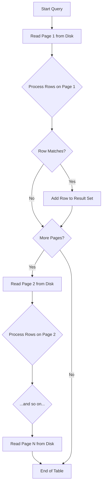

#Database #Performance #CoreConcept #Indexing #Internals

>  A full table scan (or sequential scan) is the database's default strategy for finding data when it cannot use an index. It involves reading **every single page** of a table from disk, making it one of the most I/O-intensive and potentially slowest operations.

---

## 🤔 The Problem: Finding a Needle in a Haystack

Imagine you have a massive table with millions or billions of rows and you need to find a specific person, for example, `WHERE id = 5`. Without a map (an index), the database has no choice but to start at the beginning of the "haystack" (the table) and look at every single piece of straw (every row) until it finds the one it's looking for.

## ⚙️ The Mechanics of a Full Table Scan

To understand the cost of a table scan, you have to understand what a table physically is.

> [!info] A Table is a File (or Files) on Disk
> At its core, a table is just one or more data files on a storage device (HDD or SSD). The database doesn't read this file byte by byte; it reads it in chunks called **pages**.

-   **Pages:** A page is the fundamental unit of I/O in a database. It's a fixed-size block of data (e.g., 8KB in PostgreSQL, 16KB in MySQL).
-   **The Process:** A full table scan is a simple, brute-force loop:
    1.  The database requests a page from the disk.
    2.  The operating system reads that page from the physical disk (sectors, blocks) into the database's memory (the buffer pool).
    3.  The database iterates through every row ("tuple") on that page in memory.
    4.  For each row, it checks if it matches the `WHERE` clause of the query.
    5.  It then repeats this process for the **next page**, and the next, until every single page in the table has been read and processed.

---

## 💸 The High Cost of Table Scans

The primary goal of query optimization is often to avoid full table scans, because they are expensive in two main ways:

1.  **Massive Disk I/O:** Reading data from disk is the slowest operation a database performs. A full table scan on a large table requires reading gigabytes or even terabytes of data, leading to a huge number of I/O operations.
2.  **High CPU Usage:** Once the data is in memory, the CPU still has to do the work of iterating through every single row and evaluating it against the filter conditions.

The worst-case scenario is when the row you're looking for is on the very last page of the table, forcing the database to do the maximum amount of work.

---

## ✨ When Are Table Scans Unavoidable (or even Smart)?

Modern database management systems (DBMS) are not dumb. They won't always choose an index even if one is available. Sometimes, a full table scan is the most efficient option.

-   **No Suitable Index:** The most obvious case. If there's no index on the column(s) in your `WHERE` clause, the database has no other choice.
-   **Low Selectivity:** If the query is not very "selective" and is expected to return a large percentage of the table's rows (e.g., `WHERE status = 'ACTIVE'` and 99% of your rows are active), a full table scan is often *faster*. The sequential I/O of reading the whole table is more efficient than the "random I/O" of bouncing back and forth between an index and the table data for millions of rows.

> [!tip] Modern Optimizations
> Even when a full table scan is necessary, modern databases use clever tricks to speed it up, most notably **parallelism**. The database can spawn multiple "worker" threads that each scan a different portion of the table simultaneously, dramatically reducing the total time required.

---

## The Solution: Reduce the Search Space

The primary way to avoid a full table scan is to give the database a better option: an **[[B-Tree Index|index]]**. An index provides a pre-sorted, direct path to the data, allowing the database to skip the vast majority of the table's pages and go directly to the ones that contain the data it needs.