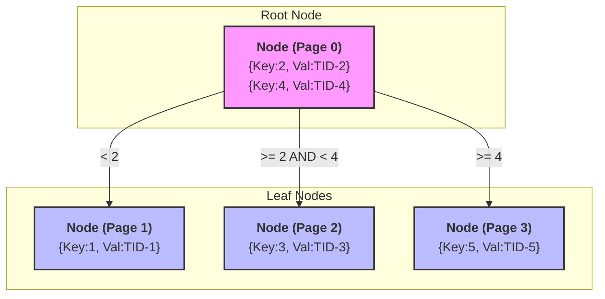

#Database #DataStructure #Indexing #CoreConcept #BTree #PostgreSQL

>  A [[Meet Beatrice: Understanding B-Tree Indexes|B-Tree]] search is a highly efficient, top-down traversal. Starting at the root node, the database compares the search value against the sorted keys in the node to determine which child pointer to follow. It repeats this process at each level, drastically narrowing the search space until it finds the value (or proves it doesn't exist) in a leaf node, all in just a few disk reads.

---

Let's move beyond the high-level theory and look at a practical example of how a B-Tree traversal works, using an index on an `id` column.

### Our Sample Data
Imagine a simple table with user data. Critically, we need to distinguish between the logical `id` (the value we are indexing) and the physical `TID` (Tuple ID), which is the internal, physical address of the row on disk.

| TID (Physical Address) | id (Logical Key) | name |
|---|---|---|
| TID-1 | 1 | Alice |
| TID-2 | 2 | Bob |
| TID-3 | 3 | Charlie |
| TID-4 | 4 | David |
| TID-5 | 5 | Eve |

### The B-Tree Structure
Let's build a simple B-Tree index on the `id` column.
-   **Degree (M):** Our tree will have a degree of 3, meaning each node can have up to 3 child pointers and up to 2 elements.
-   **Element:** Each element is a **Key-Value pair**. The **Key** is the `id` we're indexing, and the **Value** is the `TID` that points to the physical row.

> [!warning] The Hidden Value (Data Pointer)
> Many theoretical diagrams and even the original B-Tree paper only show the *keys* inside the nodes and omit the *values* (the data pointers). This is a major source of confusion. **In a real database index, the key and the value (pointer) exist together in every node.** This is critical to understand.

### Visualizing the Search

Let's search for the user with `id = 3`.

**The Search for `id = 3`:**

1.  **Read the Root Node (1 Disk I/O):**
    -   The database reads the root node (Page 0) from disk.
    -   It asks: Where does `3` fit among the keys `[2, 4]`?
    -   Answer: `3` is greater than or equal to `2` AND less than `4`.
    -   Therefore, it follows the child pointer between keys `2` and `4`. This immediately eliminates the left and right sub-trees from the search.

2.  **Read the Leaf Node (1 Disk I/O):**
    -   The database follows the pointer and reads the middle leaf node (Page 2) from disk.
    -   It asks: Does the key `3` exist in this node?
    -   Answer: Yes! The database has found the element `{Key:3, Val:TID-3}`.

3.  **Fetch the Data (1 Disk I/O):**
    -   The database now uses the found value, `TID-3`, to go directly to the physical location of the full row in the main table heap and fetches the data (`id=3, name='Charlie'`).

> [!success] The Power of Elimination
> In just **3 disk I/O operations**, the database found the exact row it needed out of the entire table, without performing a costly [[Full Table Scans|full table scan]]. On a real-world B-Tree with thousands of elements per node, you can search billions of rows with only 3-4 disk reads.

---

## The Cost of Inserts: Page Splits

The efficiency of B-Tree reads comes at a cost during writes. Because nodes must always be kept sorted, inserting a new value into a full node forces a **page split**.

-   **What is a Page Split?** The database must allocate a new page, move half the elements from the full page to the new one, and then update the parent node to point to both pages.
-   **Why is it Expensive?** It involves multiple I/O operations and can cascade up the tree.
-   **Random vs. Sequential Inserts:**
    -   **Random Inserts** (like with `UUIDv4`) are the worst-case scenario. They cause constant page splits all over the tree, leading to high I/O and poor cache performance.
    -   **Sequential Inserts** (like with an auto-incrementing `BIGINT` or a `ULID`) are the best-case scenario. Inserts always happen at the "hot" page at the very end of the index, which requires far fewer splits. This is why [[The Performance Impact of Random UUIDs on Database Indexes|sequential keys are critical for write performance]].

---

> [!summary] Key Takeaway
> A B-Tree is a masterful trade-off. It incurs a slight overhead on writes (especially random ones) to maintain its sorted structure. In return, it provides incredibly fast, logarithmic-time lookups, which is essential for the read performance of almost any modern database application.