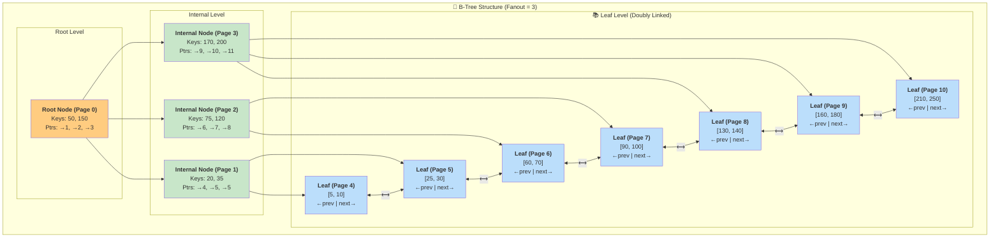

#Database #DataStructure #Indexing #CoreConcept #Performance #BTree

>  A B-Tree (Balanced Tree) is the fundamental data structure used for most database indexes. Its goal is to minimize disk I/O and "reduce the search space" by organizing data in a hierarchical, multi-level tree of nodes that can be traversed very quickly.

---

## 🤔 The Problem: The Slow Brute-Force Scan

As we saw with [[Full Table Scans]], reading an entire table from disk to find a few rows is incredibly inefficient. It requires a huge number of I/O operations. The core problem is that we need a way to avoid reading unnecessary data.

> "I don't want to do all these I/Os to find my rows."

This is the exact problem B-Trees were invented to solve.

---

## 🏛️ The Anatomy of a B-Tree

A B-Tree is a self-balancing tree data structure that keeps data sorted and allows for searches, insertions, and deletions in logarithmic time. Let's break down its components.

### 1. Nodes
The entire tree is composed of **nodes**.
-   **Hierarchy:** Nodes are organized into a hierarchy: a single **Root Node** at the top, one or more levels of **Internal Nodes**, and the **Leaf Nodes** at the very bottom.
-   **Degree (M):** Each node can have up to a certain number of child nodes, defined by the tree's "degree." A higher degree means a wider, flatter tree, which is crucial for performance.

### 2. Elements (Key-Value Pairs)
Inside each node are **elements** (up to M-1 of them). Each element is a **key-value pair**.
-   **The Key:** This is the actual data value you are indexing (e.g., a `user_id`, a `username`, a `timestamp`). The keys within a node are always kept in sorted order.
-   **The Value (The Data Pointer):** This is the crucial "where." It's a pointer that tells the database where to find the full data row on disk.

### The Most Important Concept: `Node == Disk Page`

> [!tip] Bridging Theory and Practice
> In theoretical computer science examples, a B-Tree node might hold 3 or 5 elements. In a real database, this is impractical.
>
> A **Node** is designed to correspond directly to a **Disk Page**. If your database uses 8KB pages (like PostgreSQL), each node in the B-Tree will be 8KB in size. The database's goal is to pack as many key-value elements as possible into that single 8KB page.

This is the key to performance. A search operation that reads one node from the tree corresponds to a single, efficient disk I/O operation to read one page. A wider, flatter tree (higher degree) means fewer levels to traverse, and therefore, fewer disk I/Os to find your data.

---

### 📖 The Data Pointer: How Databases "Shine"

The "value" part of the key-value element is a pointer to the actual data row, but different databases implement this differently.

-   **PostgreSQL:** All secondary indexes contain a direct physical pointer (a **Tuple ID** or `TID`) to the row's location in the main table heap. This is a very fast, direct lookup.
-   **MySQL (InnoDB) & Oracle:** Secondary indexes do **not** point directly to the row. Instead, they store the **Primary Key** of the row. A search on a secondary index first finds the primary key, and then performs a *second* lookup on the primary key index to find the actual data.

> [!info] The Uber Migration
> This difference in pointer implementation was one of the many reasons Uber cited for their famous migration from PostgreSQL to MySQL. You can find many articles and videos discussing the trade-offs of these two approaches.

---

## Visualizing the B-Tree Structure

To find the key `95`, the database would:
1.  Read the **Root Node** (1 disk read). `95` is between `50` and `150`, so it follows the pointer to the middle internal node.
2.  Read the **Internal Node (Page 2)** (1 disk read). `95` is between `75` and `120`, so it follows the pointer to the appropriate leaf node.
3.  Read the **Leaf Node (Page 7)** (1 disk read). It scans the sorted keys, finds `90`, and determines that `95` does not exist.

In just **3 disk reads**, it definitively proved the item doesn't exist, without ever touching the millions of rows in the main table.