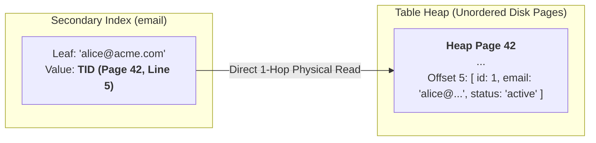
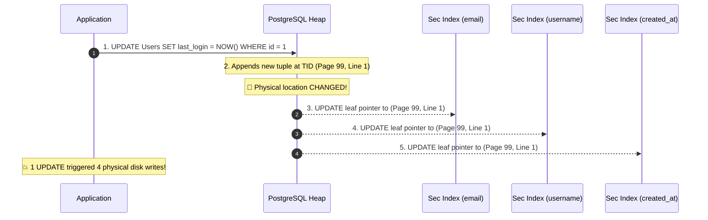
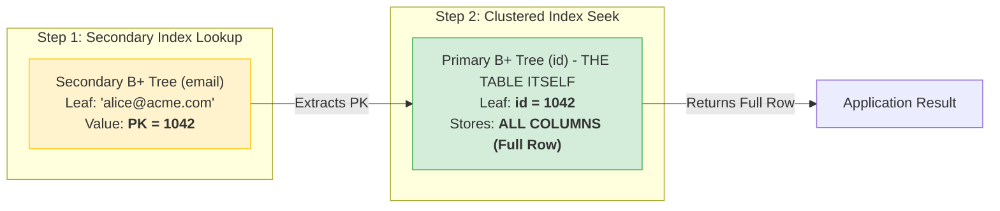

# PostgreSQL vs. MySQL (InnoDB): The Critical Difference in Secondary Indexes

#Database #Architecture #PostgreSQL #MySQL #InnoDB #Indexing #SystemDesign #Performance #UberArchitecture #CoreConcept

> [!abstract] Executive Summary
> How a database engine links **Secondary Indexes** to actual table rows is one of the most consequential architectural decisions in storage engine design.
> - **PostgreSQL** uses **Direct Physical Pointers (Tuple IDs - `TID`)**: Secondary index leaves point directly to the physical disk location `(page, offset)` of the row in the table heap.
> - **MySQL (InnoDB)** uses **Indirect Logical Pointers (Primary Keys)**: The table itself is a **Clustered Index (Index-Organized Table)**, and all secondary index leaves store a copy of the **Primary Key value**.
> 
> This single divergence explains the famous **Uber migration from PostgreSQL to MySQL**, governs **Write Amplification**, and dictates why using a **random UUID as a Primary Key in MySQL InnoDB is an architectural catastrophe**.

---

## 1. Architectural Blueprint: Physical vs. Logical Indexing

```
┌─────────────────────────────────────────────────────────────────────────────────────────────────┐
│                                 THE TWO SECONDARY INDEX PARADIGMS                               │
├───────────────────────────────┬─────────────────────────────────┬───────────────────────────────┤
│ Dimension                     │ PostgreSQL (Heap + TIDs)        │ MySQL InnoDB (Clustered + PK) │
├───────────────────────────────┼─────────────────────────────────┼───────────────────────────────┤
│ **Table Storage Model**       │ Unordered Heap File             │ **Clustered Index (IOT)**     │
│ **Secondary Index Leaf Value**│ **Physical `TID` (6 bytes)**    │ **Copy of Primary Key Value** │
│ **Read Hop Count**            │ **1 Hop:** Index $\to$ Heap Row │ **2 Hops:** Sec. Index $\to$  │
│                               │                                 │ PK Clustered Index $\to$ Row  │
│ **Write Amplification**       │ **High:** Row moves/updates can │ **Zero:** Updating non-PK     │
│ (On non-indexed column updates│ force updates to ALL sec indexes│ columns never touches sec. idx│
│ **Primary Key Bloat Cascade** │ **None:** Secondary index size  │ **Extreme:** PK is duplicated │
│                               │ is independent of PK type.      │ across EVERY secondary index! │
└───────────────────────────────┴─────────────────────────────────┴───────────────────────────────┘
```

---

## 2. PostgreSQL: Direct Physical Pointers (`TID`)

In PostgreSQL, table data is stored in an unordered, append-only disk structure called the **Heap**.



### The Mechanism
1. Every row in the heap has a 6-byte **Tuple Identifier (`TID`)** consisting of a 4-byte block/page number and a 2-byte item offset: `(block_number, offset_number)`.
2. All indexes—whether a secondary index on `email` or the primary key index on `id`—are treated identically: they are secondary B+ trees whose leaves store `(key, TID)`.

### ✔️ The Advantages
* **Single-Hop Reads:** Reading a row via a secondary index requires only 1 index traversal + 1 heap page read. It never navigates a second index tree.
* **Lean Secondary Indexes:** The pointer is always fixed at 6 bytes. Whether your primary key is an `INT`, a `BIGINT`, or a 64-character text string, secondary indexes remain compact.

### ❌ The Fatal Flaw: Write Amplification & Heap Bloat
Because PostgreSQL uses append-only MVCC, an `UPDATE` does not overwrite data in place; it writes a **brand new tuple version** to the heap with a **brand new physical `TID`**.
- If a table has 6 secondary indexes, updating a single non-indexed column (e.g., `last_login_at`) creates a new row version at a new `TID`.
- **All 6 secondary indexes must now be updated with the new `TID`!**



> [!NOTE] What About HOT (Heap-Only Tuples)?
> PostgreSQL engineers introduced **HOT** to mitigate this. If an update fits inside the *exact same heap page* and touches no indexed columns, PostgreSQL chains the old tuple to the new tuple locally without updating secondary indexes.
> However, if the page is full (no free space) or if an indexed column is modified, **HOT breaks completely**, unleashing massive write amplification and WAL flooding.

---

## 3. MySQL (InnoDB): Indirect Logical Pointers (Primary Key)

MySQL's InnoDB storage engine structures the table itself as a **Clustered Index** (also known as an **Index-Organized Table - IOT**).



### The Mechanism
1. The primary key index *is* the physical table. The leaf pages of the primary key B+ tree contain the entire row and all of its columns.
2. A secondary index does **not** store a disk address. Instead, its leaf node stores a **copy of the Primary Key value**.
3. Point queries on secondary indexes require a **Two-Step Hop (Clustered Index Lookup)**:
   - Traverse the secondary index to find the primary key.
   - Traverse the primary clustered index using that primary key to retrieve the actual row columns.

### ✔️ The Advantage: Zero Write Amplification on Updates
When a row updates non-indexed columns, its primary key remains unchanged:
- The data is modified inside the clustered index page.
- **Zero secondary indexes need to be touched!**
- The secondary index pointers remain 100% valid because they reference the logical primary key, not physical byte offsets.

---

## 4. The Famous Case Study: Why Uber Migrated from PostgreSQL to MySQL

In 2016, Uber published their landmark engineering post: *"Why Uber Engineering Switched from Postgres to MySQL"*. 

```
┌─────────────────────────────────────────────────────────────────────────────────────────────────┐
│                                   THE UBER BOTTLENECK IN POSTGRES                               │
├─────────────────────────────────────────────────────────────────────────────────────────────────┤
│ Uber's core workload: Massive continuous telemetry updates (driver GPS coordinates, ride status)│
│ A trip row had 10+ secondary indexes for querying by driver, rider, city, time, status.         │
├─────────────────────────────────────────────────────────────────────────────────────────────────┤
│ 1. Every GPS coordinate update changed the row's physical TID.                                  │
│ 2. HOT optimization failed constantly due to rapid updates filling 8KB heap pages.              │
│ 3. Every GPS ping forced updates across ALL 10 secondary indexes!                               │
│ 4. Secondary index writes generated massive Write-Ahead Log (WAL) traffic.                      │
│ 5. Cross-datacenter replication saturated network links replaying WAL updates for indexes.      │
│ 6. Postgres autovacuum could not keep up with dead tuple cleanup, leading to catastrophic bloat.│
├─────────────────────────────────────────────────────────────────────────────────────────────────┤
│ THE MYSQL SOLUTION:                                                                             │
│ In InnoDB, updating GPS coordinates modified ONLY the clustered index row.                      │
│ All 10 secondary indexes were completely untouched! Write volume plummeted by orders of        │
│ magnitude, and replication bandwidth stabilized.                                                │
└─────────────────────────────────────────────────────────────────────────────────────────────────┘
```

---

## 5. The Other Side of the Coin: The UUID Primary Key Disaster in MySQL

While MySQL eliminates write amplification on updates, it introduces a dangerous vulnerability: **The Primary Key Bloat Cascade**.

Because every secondary index leaf stores a copy of the primary key, **the data type of your primary key is multiplied across your entire database schema**.

### Mathematical Proof of Secondary Index Bloat
Consider a table with **100,000,000 rows** and **5 secondary indexes**:

```
┌───────────────────┬──────────────┬───────────────────────────────┬──────────────────────────────┐
│ Primary Key Type  │ PK Size      │ Calculation (100M rows × 5)   │ Storage Consumed by PK Copies│
├───────────────────┼──────────────┼───────────────────────────────┼──────────────────────────────┤
│ `BIGINT`          │ 8 Bytes      │ $8\text{ B} \times 100\text{M}\times 5$  │ **4.0 GB**                   │
│ `BINARY(16)` UUID │ 16 Bytes     │ $16\text{ B} \times 100\text{M}\times 5$ │ **8.0 GB**                   │
│ `VARCHAR(36)` UUID│ 36 Bytes     │ $36\text{ B} \times 100\text{M}\times 5$ │ **18.0 GB** (🚨 +350% Bloat!)│
└───────────────────┴──────────────┴───────────────────────────────┴──────────────────────────────┘
```

> [!DANGER] Why String UUIDs in MySQL Crush Performance
> 1. **Index Bloat:** 18 GB of memory is wasted *just storing repeated primary key strings* across secondary indexes.
> 2. **Buffer Pool Eviction:** That wasted 18 GB pushes hot data pages out of the MySQL `innodb_buffer_pool_size`, forcing the database to read from slow disk storage.
> 3. **The Random Insert Fragmentation Tax:**
>    Because UUIDv4 is completely random, inserts do not append to the end of the clustered index. They hit random leaf pages throughout the tree.
>    - Every random insert forces an existing 16 KB page to undergo an expensive **50-50 Page Split**.
>    - Page splits leave leaf pages half-empty ($50\%$ fill factor), **doubling the table's total physical disk footprint**.

### The "Memory is Precious" Rule
Engineers often think: *"RAM is cheap, we'll just upgrade our cloud instance to 1 TB of RAM."*
In high-throughput distributed systems, memory is your most constrained resource. Wasting memory on bloated index pointers means lower cache hit ratios, higher AWS/Azure cloud bills, and severe garbage collection / buffer pool thrashing.

---

## 6. Clustered Index Comparison: MySQL / SQL Server vs. PostgreSQL

```
┌─────────────────────────────────┬─────────────────────────────────┬─────────────────────────────┐
│ Feature                         │ MySQL InnoDB / SQL Server       │ PostgreSQL                  │
├─────────────────────────────────┼─────────────────────────────────┼─────────────────────────────┤
│ **Clustered Index / IOT**       │ **Native & Mandatory**          │ ❌ Not continuously maintained│
│                                 │ (Primary key is the table)      │ (All tables are heaps)      │
├─────────────────────────────────┼─────────────────────────────────┼─────────────────────────────┤
│ **The `CLUSTER` Command**       │ Automatic / Inherent            │ One-time table rewrite.     │
│                                 │                                 │ New inserts immediately     │
│                                 │                                 │ desynchronize the order!    │
├─────────────────────────────────┼─────────────────────────────────┼─────────────────────────────┤
│ **Secondary Index Lookup Cost** │ 2 traversals (Sec Idx + PK Idx) │ 1 traversal + 1 heap read   │
├─────────────────────────────────┼─────────────────────────────────┼─────────────────────────────┤
│ **Ideal Primary Key Choice**    │ **Strictly Sequential**         │ Any data type (UUID, text)  │
│                                 │ (`BIGINT`, `ULID`, `UUIDv7`)    │ is safe for secondary index │
│                                 │                                 │ storage footprint.          │
└─────────────────────────────────┴─────────────────────────────────┴─────────────────────────────┘
```

---

## 7. Senior Staff Architectural Decision Matrix

```
                        ┌──────────────────────────────────────────┐
                        │ What is your workload's dominant pattern?│
                        └────────────────────┬─────────────────────┘
                                             │
             ┌───────────────────────────────┴───────────────────────────────┐
             ▼                                                               ▼
[ Heavy Updates to Non-Indexed Columns ]                      [ Heavy Read-Intensive / Complex Queries ]
  High Telemetry / Driver Coordinates                           Wide Tables / Multi-Index Joins
             │                                                               │
             ▼                                                               ▼
      **MySQL InnoDB**                                              **PostgreSQL**
  (Zero Write Amplification on Sec Idx)                         (1-Hop Reads; Independent Sec Idx Size)
  *Constraint:* Primary Key MUST be                             *Constraint:* Tune Autovacuum &
  compact & sequential (`BIGINT`/`UUIDv7`)                      monitor table bloat / HOT efficiency
```

### Summary Rules for Senior Database Engineers:
1. **In MySQL (InnoDB): Never use a random `VARCHAR(36)` UUID as a Primary Key.** Always use `BIGINT AUTO_INCREMENT` or time-ordered `UUIDv7` / `ULID`.
2. **In PostgreSQL: Beware of tables with many secondary indexes undergoing high update rates.** If columns update frequently, monitor `n_dead_tup` and ensure updates qualify for Heap-Only Tuples (HOT).
3. **Understand your engine's physical reality:** Database performance is not abstract math—it is the physical movement of bytes between NVMe disks and the RAM Buffer Pool.