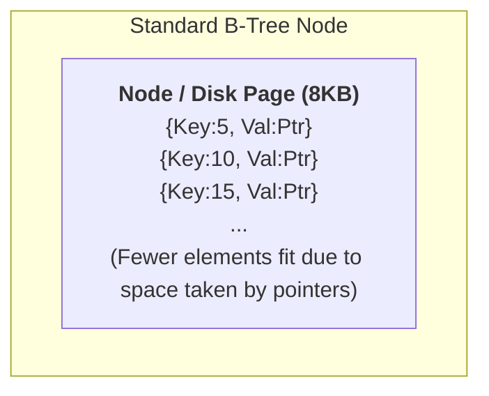
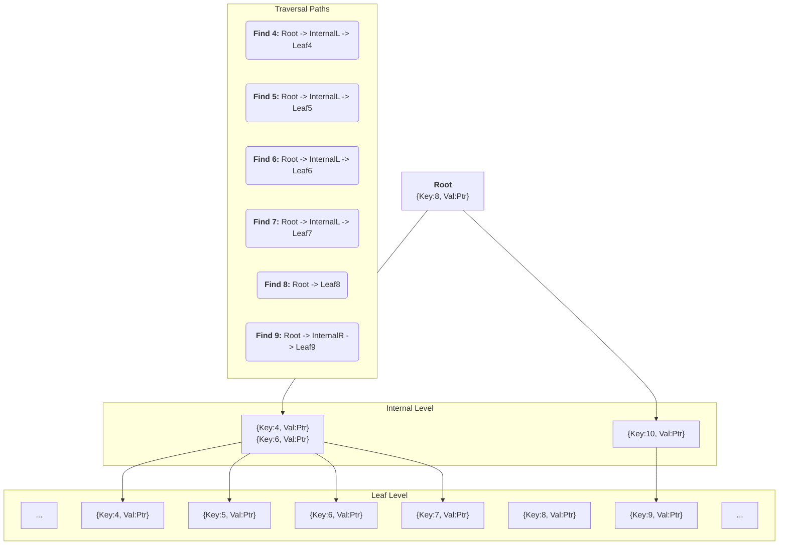

#Database #DataStructure #Indexing #BTree #Performance #CoreConcept

>  While the standard [[Meet Beatrice: Understanding B-Tree Indexes|B-Tree]] is excellent for single-item lookups, it has two major weaknesses: its internal nodes are "fat" with unnecessary data pointers, leading to more I/O, and it is very inefficient for performing range queries.

---

B-Trees are not perfect. Their architecture has inherent inefficiencies that led to the development of improved variations, most notably the B+ Tree. Let's explore these limitations.

## 😫 Problem 1: "Fat" Nodes & Wasted Space

The most significant architectural flaw of a standard B-Tree is that **every node stores both keys and their corresponding data pointers.**

> [!danger] The Problem with Fat Nodes
> During a tree traversal, the database only needs the **keys** in the root and internal nodes to navigate down the tree. The data pointers (`TID`s, row pointers) stored in these upper-level nodes are completely ignored until the final leaf node is reached. They are essentially wasted space.

### The Performance Cascade
This "wasted space" has a direct and negative impact on performance:
1.  **Less Keys Per Page:** Data pointers take up valuable space. If keys and pointers are large (e.g., UUIDs or long strings), you can fit fewer elements into a single node (disk page).
2.  **Taller Trees:** Fewer elements per node means the tree needs more nodes and more levels to store the same amount of data. The tree becomes "taller."
3.  **More Disk I/O:** Every additional level in the tree requires an extra disk read to traverse. A taller tree directly translates to slower lookups.
4.  **Poor Cache Efficiency:** The "fat" upper-level nodes are harder to fit and keep in the database's memory cache (buffer pool). This increases the likelihood of expensive disk reads even for frequently accessed parts of the index.

---

## 😫 Problem 2: Inefficient Range Queries

B-Trees are optimized for "point queries" (finding a single value), but they are very slow for "range queries" (e.g., `WHERE id BETWEEN 4 AND 9`).

> [!danger] The Problem with Range Scans
> To perform a range query, a standard B-Tree has no choice but to treat it as a series of separate point queries. It must traverse the entire tree from the root down for **each value** in the range, leading to a huge number of redundant disk reads. This is often described as "thrashing the index."

### Visualizing the Inefficiency
Let's find all rows with an `id` between `4` and `9`. The database has to perform a separate, chaotic search for each value.

Even though the keys `4, 5, 6, 7, 8, 9` are logically sequential, the database has to jump all over the tree to find their corresponding pointers, potentially re-reading the root and internal nodes many times.

---

> [!success] The B+ Tree Solution
> These specific limitations are exactly what the **B+ Tree** was designed to solve. It introduces two game-changing architectural improvements:
> 1.  **Slimmer Internal Nodes:** The root and internal nodes store **only keys**, not data pointers. This allows for a much higher "fanout" (more keys per node), resulting in flatter, wider trees that require less I/O to traverse.
> 2.  **Linked Leaf Nodes:** All data pointers are stored **only** at the leaf level. Critically, all leaf nodes are linked together in a **doubly-linked list**. This allows the database to perform a range scan by seeking to the first value (`4`) and then simply walking along the fast, sequential linked list to get `5, 6, 7, 8, 9` without ever having to traverse the tree again.