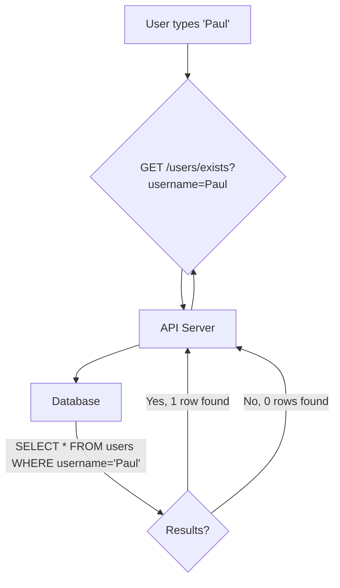

#ComputerScience #DataStructure #Algorithm #Performance #Backend

>  A Bloom filter is a super-fast, memory-efficient data structure that can tell you if an item **might be in a set** or **is definitely not in a set**. It's used to avoid expensive lookups (like a database query) for items that don't exist.

---

## 🤔 The Problem: The Expensive "Does this exist?" Check

Forget about Bloom filters for a moment. Let's look at a common problem. You're building a service where users can sign up, and you need to check if a username is already taken.

This feature will be extremely popular, with users constantly checking for available names.

-   **The Slow Way (Disk):** A query to your primary database (e.g., PostgreSQL). This involves disk I/O and can be slow under heavy load.
-   **The Faster, Expensive Way (Cache):** You could cache all usernames in an in-memory database like Redis. This is much faster but has a significant downside: you've now doubled your memory footprint, storing the same data in two places just for this one feature.

There has to be a better way. This is the exact problem Bloom filters were designed to solve.

---

## ✨ The Solution: The Bloom Filter

A Bloom filter is a **probabilistic data structure**. It's a bit array (a simple string of 0s and 1s) of a predetermined size (e.g., 64 bits) that acts as a highly compact "summary" of a dataset.

### The "Read" Workflow: Checking if an item exists
Let's see how it works when a user checks if "Paul" exists.

1.  **Request:** The server receives the request: `GET /users/exists?username=Paul`.
2.  **Hash:** The server takes the string "Paul", runs it through a hash function, and then uses a modulo operation to map it to one of the bits in our array (e.g., `hash("Paul") % 64` results in `3`).
3.  **Check the Bit:** The server checks the bit at position `3` in the Bloom filter.
    -   **If the bit is `0`:** It can say with **100% certainty** that "Paul" **is definitely not** in the database. It returns "available" immediately, without ever touching the database. **This is the big win.**
    -   **If the bit is `1`:** It means "Paul" **might be** in the database. The server must then perform the expensive query against the real database to get a definitive answer.

```mermaid
graph TD
    subgraph "Check Username 'Jack'"
        A1["Input: 'Jack'"] --> A2["hash('Jack') % 64"]
        A2 --> A3["Result: 63"]
        A3 --> A4["Check bit 63 in filter"]
        A4 --> A5["Bit = 1"]
        A5 --> A6["<b>May exist</b><br/>Query database to confirm"]
    end
    
    subgraph "Check Username 'Paul'"
        B1["Input: 'Paul'"] --> B2["hash('Paul') % 64"]
        B2 --> B3["Result: 3"]
        B3 --> B4["Check bit 3 in filter"]
        B4 --> B5["Bit = 0"]
        B5 --> B6["<b>Definitely doesn't exist</b><br/>Return 'available' immediately"]
    end
    
    style A6 fill:#f9f,stroke:#333,stroke-width:2px
    style B6 fill:#9f9,stroke:#333,stroke-width:2px
```

### Why "Maybe"? The False Positive
The "maybe" is the key probabilistic part of a Bloom filter. Because multiple different strings can hash to the same bit position (this is called a collision), a `1` at a certain position doesn't guarantee that *your specific item* set that bit. It just means *something* did. This is known as a **false positive**.

A Bloom filter can have false positives, but it **can never have a false negative**. If it says an item isn't there, it's definitely not there.

---

## 🛠️ The "Write" Workflow: How a Bloom Filter is Built

The filter is built as you add items to your main dataset.

1.  **New User "Jack":** A user signs up with the name "Jack".
2.  **Hash & Set:** Before writing to the database, the server calculates `hash("Jack") % 64`, which results in `63`. It then **sets the bit at position 63** in the Bloom filter to `1`.
3.  **Write to DB:** The server then proceeds to write the user "Jack" to the main database.

Now, imagine another user, "Tim," signs up.
1.  **New User "Tim":** The server gets the request to create "Tim".
2.  **Hash & Set:** The server calculates `hash("Tim") % 64`, which *also* results in `63` (a collision). The bit at position 63 is already `1`, so no change is needed.
3.  **Write to DB:** The server writes "Tim" to the database.

Now, if someone checks for "Tim", the filter will correctly say "maybe exists" and query the database. If someone checks for "Jack", it will also correctly say "maybe exists."

---

## ⚖️ Limitations & Trade-Offs

-   **Cannot Delete Items:** You cannot remove an item from a standard Bloom filter. If you were to set a bit back to `0`, you might be invalidating it for another item that also hashes to that same position (like setting bit 63 to `0` would break the filter for both "Jack" and "Tim").
-   **Filter Saturation:** If you add too many items, the filter can become "saturated" (all bits become `1`). At this point, it's useless, as it will always return "maybe," forcing a database query every time. It's no longer harmful, but its benefit is gone.
-   **Tuning is Required:** The effectiveness of a Bloom filter depends on tuning its size and the number of hash functions used.
    -   A **larger bit array** reduces the chance of collisions and false positives but uses more memory.
    -   Using **multiple hash functions** (e.g., checking 3 different bit positions for each item) also dramatically reduces the false positive rate. Real-world implementations often use this technique.

> [!tip] Where are they used?
> Bloom filters are used extensively in distributed systems and databases to avoid expensive network or disk lookups for non-existent data. Cassandra uses them to check if a piece of data might exist in an SSTable on disk before attempting a costly read.