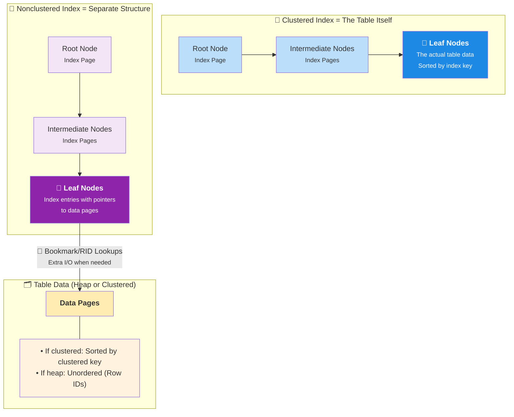

#Database #SQLServer #Indexing #Architecture #CoreConcept #BTree

>  A **clustered index** *is* the table, physically sorting the data rows on disk according to the index key. A table can only have one. A **nonclustered index** is a separate, smaller structure that contains "bookmarks" (row locators) pointing back to the data rows, which can be stored in an unsorted heap.

---

In SQL Server, all indexes are organized as **B-Trees**. Understanding the architectural differences between clustered and nonclustered indexes is critical for performance tuning.

### The B-Tree Structure
A B-Tree consists of several levels of "pages" or "nodes":
-   **Root Node:** The single top-level entry point for any search.
-   **Intermediate Nodes:** One or more levels between the root and the leaves, which guide the search.
-   **Leaf Nodes:** The bottom level of the tree. **What these nodes contain is the fundamental difference between the two index types.**

---

## 🏛️ Clustered Index Architecture

A clustered index determines the physical order of data in a table. It's not just an index; it's the table itself, sorted.

> [!info] Core Concept
> In a clustered index, the **leaf nodes are the actual data pages** of the table. This means the rows of data are physically stored on disk in the order of the clustered index key.

-   **Structure:** The root and intermediate nodes contain index rows with a key value and a pointer to the next level down. The bottom (leaf) level is a doubly-linked list of the actual data pages, sorted by the key.
-   **Inserts:** All `INSERT` operations must place the new row in its correct physical position within the ordered sequence. This can lead to **page splits** if a page is full, which is a performance consideration. This is why using a random key (like `UUIDv4`) for a clustered index is a major performance anti-pattern.
-   **Number Per Table:** Because the data can only be physically sorted in one way, a table can have **only one clustered index**.
-   **SQL Server Specifics:**
    -   Has an `index_id = 1` in the `sys.partitions` system view.
    -   Each partition of the index has its own B-Tree structure.
    -   Uses different allocation units (`IN_ROW_DATA`, `LOB_DATA`, `ROW_OVERFLOW_DATA`) to manage different types of data within the structure.

---

## 📖 Nonclustered Index Architecture

A nonclustered index is a separate structure that is decoupled from the physical order of the data rows. It's like the index at the back of a book.

> [!info] Core Concept
> In a nonclustered index, the **leaf nodes are index pages, not data pages**. These index pages contain the index key values and a "row locator" or "bookmark" that points to the physical location of the actual data row.

-   **Structure:** The B-Tree looks similar to a clustered index, but the leaf nodes do not contain the full data row. The underlying table data is not sorted according to this index's key.
-   **Number Per Table:** You can have many nonclustered indexes on a single table (up to 999 in SQL Server).
-   **Row Locators (The "Bookmark"):** The way a nonclustered index points back to the data depends on the underlying table structure:
    1.  **If the table is a Heap (no clustered index):** The locator is a **Row ID (RID)**. This is a physical pointer consisting of the File ID, Page Number, and Row Number. This is the fastest way to look up a row.
    2.  **If the table has a clustered index:** The locator is the **clustered index key** for that row. This is a logical pointer. To find the data, SQL Server must first search the nonclustered index to get the clustered key, and then search the clustered index to find the actual data page. This is called a **"Key Lookup"** and can be a source of performance issues if it happens too often.
-   **SQL Server Specifics:**
    -   Has an `index_id > 1` in the `sys.partitions` system view.

### Summary Comparison

| Feature | Clustered Index | Nonclustered Index |
|---|---|---|
| **Physical Data Order** | ✅ Sorts the data rows physically on disk. | ❌ Does not affect the physical order of data. |
| **Number Per Table** | **Only one.** | **Many** (up to 999). |
| **Leaf Nodes Contain** | The **actual data rows** of the table. | **Pointers (row locators)** to the data rows. |
| **Row Locator Type** | Not applicable (it *is* the data). | **Row ID (RID)** for a heap, or the **Clustered Key** for a clustered table. |
| **Size** | The size of the table itself. | Generally much smaller than the table. |