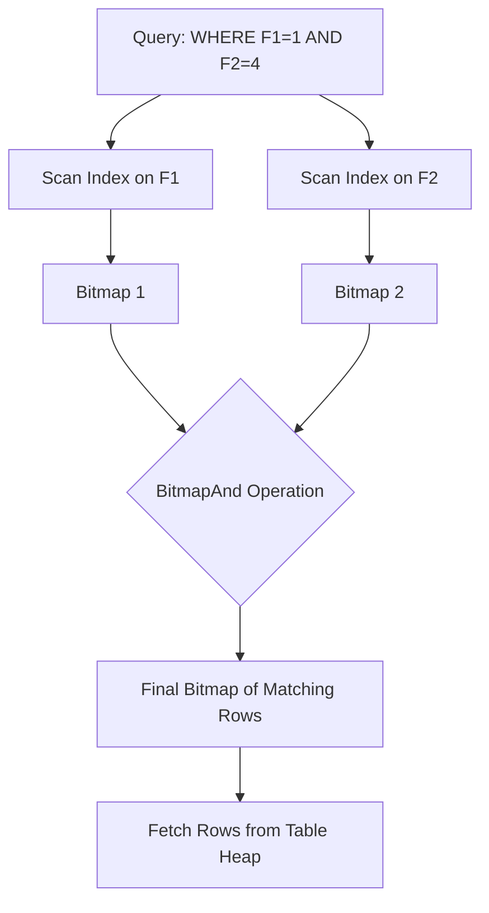

#Database #PostgreSQL #Performance #Indexing #CoreConcept #Advanced

 When a query could use multiple indexes, the database optimizer uses internal **statistics** about your data to estimate the cost of different execution plans. It might use both indexes, only the most selective one, or decide to skip the indexes entirely and perform a full table scan if it thinks that's the fastest path.

---

## 🤔 The Problem: Too Many Choices

Imagine you have a table with two separate indexes: one on column `F1` and one on `F2`. What happens when you run a query like this?

```sql
SELECT * FROM my_table WHERE F1 = 1 AND F2 = 4;
```
The database has to make a strategic decision. How does it choose the most efficient way to find the requested rows? It generally considers one of three primary strategies.

---

## 🏛️ Case 1: Use Both Indexes (The "Bitmap Scan")

In this strategy, the optimizer decides that using both indexes and combining their results is the most efficient path.

**How it works:**
1.  It scans the first index (`F1_idx`) to find all row IDs where `F1 = 1`, and builds an in-memory "bitmap" of their locations.
2.  It scans the second index (`F2_idx`) to find all row IDs where `F2 = 4`, building a second bitmap.
3.  It performs a very fast, low-level operation on these bitmaps:
    -   For an `AND` clause, it performs a **BitmapAnd** (intersection).
    -   For an `OR` clause, it performs a **BitmapOr** (union).
4.  It uses the final, combined bitmap to visit the main table (the heap) in an efficient, sequential manner to fetch the required rows.


**When is this used?**
This is often chosen when both conditions are moderately selective—neither returns too few rows nor too many.

---

## 🏛️ Case 2: Use One "Best" Index + Filter

In this strategy, the optimizer determines that one index is significantly "better" (more selective) than the other and that using both would be wasted effort.

**How it works:**
1.  It uses the most selective index (e.g., `F1_idx`) to find the small set of candidate rows.
2.  It goes directly to the table heap to fetch those candidate rows.
3.  It then applies the second condition (`WHERE F2 = 4`) as a **re-filter** on that small set of rows, discarding any that don't match.

**When is this used?**
This is very common with `AND` clauses where one condition is highly selective and the other is not. For example, if `F1` is a primary key (guaranteed to return 1 row), the optimizer will *always* choose the primary key index and then simply re-filter.

> [!tip] The Role of Selectivity & Cardinality
> How does the database know one index is "better"? It uses **statistics** to estimate a column's **cardinality** (how many distinct values it has).
> - **High Cardinality (Good for Indexes):** A column with many unique values, like `email` or `user_id`. A query on this column is highly selective and will return very few rows.
> - **Low Cardinality (Bad for Indexes):** A column with very few distinct values, like `gender` or `country`. An index on this is often useless. If 99% of your customers are from 'California', searching `WHERE state = 'California'` will return almost the entire table, making a full table scan faster.

---

## 🏛️ Case 3: Use No Index (The "Table Scan")

Sometimes, the smartest move is to ignore the indexes entirely.

**How it works:**
The optimizer estimates that the query will return a very large percentage of the table (e.g., 25% or more). In this case, the "random I/O" of hopping between the index and the table for every row is actually *slower* than just reading the entire table from start to finish. This is called a **Sequential Scan** (or Table Scan).

**When is this used?**
-   When filtering on low-cardinality columns.
-   When the query conditions are not selective and will return a large portion of the table.
-   PostgreSQL can even parallelize this scan, using multiple CPU cores to read the table even faster.

---

## ✨ The Secret Sauce: Database Statistics

How does the optimizer make these complex decisions? It relies on **internal statistics** that it keeps about your data.

> [!info] Database Statistics Include:
> - Approximate number of rows in the table.
> - Histograms of the most common values in each column.
> - The number of distinct values in each column (cardinality).
> - And much more...

These stats are an *estimate*, but they are usually good enough for the optimizer to make an intelligent choice.

> [!danger] The Stale Statistics Trap
> A common performance pitfall occurs when statistics are out of date.
> 1. You have an empty table. The database statistics say "0 rows".
> 2. You perform a bulk `INSERT` of **300 million rows**.
> 3. You immediately run a selective query.
>
> If you don't update the stats, the optimizer will look at its outdated information and think, "This table has 0 rows, a full table scan is basically free!" It will then choose a terribly slow table scan instead of using your perfect index, because it's operating on bad information.
>
> **The Solution:** After any major data change, manually update the statistics.
> - **PostgreSQL:** `ANALYZE my_table;` (or `VACUUM ANALYZE;`)
> - **Oracle:** `GATHER_SCHEMA_STATS`

---

## 🚀 Advanced: Taking Control with Hints

For experts who know more about their data than the optimizer, most databases provide a way to "hint" or force a specific execution plan.

```sql
-- This is an Oracle example, syntax varies by database
SELECT /*+ INDEX(my_table F1_idx) */ *
FROM my_table
WHERE F1 = 1 AND F2 = 4;
```
This tells the optimizer, "You're dumb. Ignore your statistics and use the `F1_idx` index." This is a powerful tool but should be used with extreme caution, as it can easily make performance worse if you're wrong.