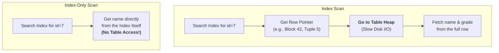

#Database #PostgreSQL #Indexing #Performance #CoreConcept

 An **Index Scan** finds a row's location in an index and then makes a second trip to the main table to fetch the data you requested. An **Index-Only Scan** is a huge performance win where the database finds and retrieves *all* the requested data directly from the index, completely avoiding the slow trip back to the main table.

---

## The Three Levels of Scans

When fetching data, PostgreSQL has a hierarchy of scan methods, from slowest to fastest.

1.  **🐢 Sequential Scan (Table Scan):** The slowest method. The database reads the entire table from disk, row by row, and filters out the data it doesn't need. This is the default when no suitable index exists.
2.  **🏃 Index Scan:** A good optimization. The database uses an index to quickly find the *locations* of the rows you need. However, it still must perform a second step: visiting the main table (the "heap") to fetch the actual data for the columns you selected.
3.  **🚀 Index-Only Scan:** The jackpot. The database can answer your entire query—both finding the rows and retrieving all the selected columns—by only looking at the index. This avoids the expensive "hop" back to the table, dramatically reducing I/O.

### Visualizing the Difference



---

## 🛠️ Hands-On Demo: From Slow to Fast

Let's walk through the process with a `students` table containing 10 million rows.

### The Setup
-   **Table:** `students` (`id`, `grade`, `name`).
-   **Goal:** Fetch the `name` of the student with `id = 7`.

### Scenario 1: No Index (The Slow Baseline)
First, we run the query without any indexes.
```sql
EXPLAIN ANALYZE SELECT name FROM students WHERE id = 7;
```
-   **Plan:** `Parallel sequential scan`.
-   **Time:** **~400ms**.
-   **Analysis:** The database had to read the entire, huge table from disk just to find one row. This is incredibly inefficient.

### Scenario 2: Standard Index (The "Index Scan")
Now, let's create a standard B-Tree index on the `id` column.
```sql
CREATE INDEX id_idx ON students (id);
```
We run the exact same query again:
```sql
EXPLAIN ANALYZE SELECT name FROM students WHERE id = 7;
```
-   **Plan:** `Index Scan using id_idx`.
-   **Time:** **~1ms**. A massive improvement!
-   **Analysis:** The database used the index to instantly find the location of the row for `id = 7`. However, the `name` column is not stored in our index. So, Git had to perform a two-step "hop":
    1.  Find the entry in the index.
    2.  Use the row pointer from the index entry to jump back to the main table and fetch the `name`.
    This is an **Index Scan**.

### Scenario 3: The "Index-Only Scan"
What if we ask for data that *is* in the index?
```sql
EXPLAIN ANALYZE SELECT id FROM students WHERE id = 7;
```
-   **Plan:** `Index Only Scan using id_idx`.
-   **Time:** **<1ms**. Even faster.
-   **Analysis:** Because the `id` column is the key of our index, the database didn't need to go back to the table at all. It found the `id` in the index and returned it directly. This is a true **Index-Only Scan**. While this specific query is a bit silly, it proves the concept.

---

## Making Index-Only Scans Practical: The `INCLUDE` Keyword

How can we get the speed of an Index-Only Scan for a useful query, like fetching a student's `name`? We can create a **covering index** by *including* the `name` column as a non-key part of the index.

#### Step 1: Create the `INCLUDE` Index
We'll create a new index that is searchable by `id` but also stores the `name`.

```sql
-- First, drop the old index
DROP INDEX id_idx;

-- Create the new, covering index
CREATE INDEX id_idx ON students (id) INCLUDE (name);
```
-   `(id)`: This is the **key column**. It's part of the B-Tree and is used for searching.
-   `INCLUDE (name)`: `name` is a **non-key column**. It's not searchable, but its data is stored at the leaf level of the index alongside the key.

#### Step 2: Run the Query Again
Now, let's re-run our original query to fetch the student's name.
```sql
EXPLAIN ANALYZE SELECT name FROM students WHERE id = 7;
```
-   **Plan:** `Index Only Scan using id_idx`.
-   **Time:** **<1ms**.
-   **Analysis:** Success! The database used the index to find `id=7`. Because the `name` was included directly in the index, it was able to retrieve and return it without ever visiting the "huge, scary 10 million row table."

What if we ask for a column that is *not* included, like `grade`?
```sql
EXPLAIN ANALYZE SELECT grade FROM students WHERE id = 7;
```
-   **Plan:** `Index Scan using id_idx`.
-   **Analysis:** The plan falls back to a standard **Index Scan**. The database still uses the index to find the row quickly, but because `grade` is not in the index, it still has to make that expensive trip back to the main table to fetch it.

---

## ⚖️ The Trade-Offs: The Cost of `INCLUDE`

`INCLUDE` indexes are a powerful tool, but they are not free.

-   **❌ Larger Index Size:** Including extra columns increases the size of the index on disk and in memory.
-   **❌ Slower Writes:** Every `INSERT` or `UPDATE` to the table now requires more work to update the larger index.
-   **❌ Memory Pressure:** If an index grows too large to fit in RAM, even an Index-Only Scan will require disk I/O to read the index itself, reducing the performance benefit.

> [!best-practice] The Backend Engineer's Mindset
> As a backend engineer, you must analyze your application's most common query patterns. If you have a frequent, performance-critical query that filters by certain columns (`WHERE`) but retrieves others (`SELECT`), creating a covering index with `INCLUDE` is a powerful optimization to keep in your toolkit.