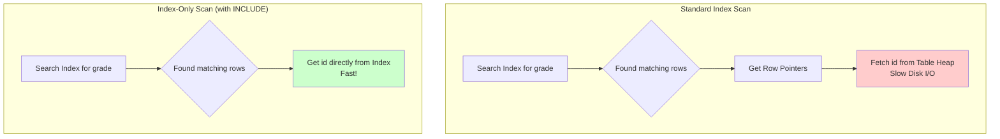

#Database #PostgreSQL #Indexing #Performance #CoreConcept

 A standard index helps you *find* rows quickly but still requires a trip back to the main table to fetch additional data. An `INCLUDE` index stores that extra data *inside* the index itself, allowing for a much faster **"Index-Only Scan"** by avoiding the expensive trip back to the table.

---

## The Core Concept: Key vs. Non-Key Columns

When creating an index, you must understand the difference between a key column and an included (non-key) column.

-   **🔑 Key Column:** The column(s) that are part of the B-Tree structure. These are the columns you can use for fast searching, filtering (`WHERE`), and ordering (`ORDER BY`).

-   **📦 Non-Key (Included) Column:** Additional columns that are "tacked on" to the leaf nodes of the index. These columns are **not** part of the searchable B-Tree structure, but their data is stored directly in the index.

### The Performance Goal: The Index-Only Scan

The primary reason to use an `INCLUDE` index is to achieve an **Index-Only Scan**.


An Index-Only Scan means the database can answer the entire query just by looking at the index, without ever having to visit the main table (the "heap"). This dramatically reduces disk I/O and can result in massive performance gains.

---

## 🛠️ Hands-On Demo: The 50-Million Row Challenge

Let's demonstrate the performance difference with a practical example.

### The Setup
-   **Table:** `students` with 50 million rows and many columns (to make table access expensive).
-   **Goal:** Select the `id` and `grade` for students with a grade between 80 and 95, ordered by grade descending.

> [!warning] Important Prerequisite: `VACUUM`
> For PostgreSQL to make optimal use of indexes (especially for Index-Only Scans), its internal statistics and visibility map must be up-to-date. After a large data load, always run `VACUUM ANALYZE students;` to ensure the query planner has the best information.

### The Query
This is the query we will be testing in all scenarios:
```sql
EXPLAIN (ANALYZE, BUFFERS)
SELECT id, grade 
FROM students 
WHERE grade > 80 AND grade < 95
ORDER BY grade DESC;
```

---

### 🐢 Scenario 1: No Index (The Baseline)
Without any indexes, PostgreSQL has no choice but to read the entire table from disk.

-   **Plan:** `Parallel Sequential Scan` followed by a `Sort`.
-   **Execution Time:** **~22 seconds**.
-   **Analysis:** This is the worst-case scenario. The database had to read all 50 million rows from disk, filter out over 49 million of them ("Rows Removed by Filter"), and then perform a very expensive sort operation on the remaining results.

### 🏃 Scenario 2: Standard B-Tree Index
Now, let's create a standard index on the `grade` column.

```sql
CREATE INDEX ON students (grade);
```

-   **Plan:** `Index Scan Backward` (backward because of `ORDER BY DESC`).
-   **Execution Time:** **~11-16 seconds**.
-   **Analysis:** This is better, but still slow. The query planner used the index to efficiently find the rows matching the `WHERE` clause. However, because our `SELECT` statement asks for the `id` column (which is not in the index), for every matching row found in the index, PostgreSQL had to make a separate trip back to the main table to fetch the `id`. This "heap fetch" process is the primary bottleneck.

> [!tip] A Note on Caching
> Repeatedly running the same query will often appear much faster on the second run. This is because the operating system caches data pages in memory. `EXPLAIN (ANALYZE, BUFFERS)` will show this as `shared hit` instead of `shared read`. Always test performance on "cold" data for the most accurate results.

### 🚀 Scenario 3: Index with `INCLUDE` (Index-Only Scan)
This is where the magic happens. We'll drop the old index and create a new one that *includes* the `id` column as a non-key field.

```sql
DROP INDEX students_grade_idx;
CREATE INDEX ON students (grade) INCLUDE (id);
```

-   **Plan:** `Index Only Scan Backward`.
-   **Execution Time:** **~1-4 seconds**. A massive improvement!
-   **Analysis:** Success! The query planner was able to use an **Index-Only Scan**. Because the `id` was stored directly in the index leaf nodes alongside the `grade`, the database never had to touch the main table. The `EXPLAIN` output confirms this with **`Heap Fetches: 0`**. This is the key metric for a successful Index-Only Scan.

---

## ⚖️ The Trade-Offs: When to Use `INCLUDE`

`INCLUDE` indexes are a powerful tool, not a silver bullet. You must be aware of the costs.

-   **✅ Pro: Blazing Fast Queries:** Can dramatically speed up queries that would otherwise require heap fetches.
-   **❌ Con: Larger Index Size:** Including extra columns makes the index larger on disk.
-   **❌ Con: Slower Writes/Builds:** A larger index takes longer to create and maintain (on `INSERT`, `UPDATE`, `DELETE`).
-   **❌ Con: Memory Pressure:** A larger index is less likely to fit entirely in memory. If the index itself doesn't fit in RAM, even an Index-Only Scan will still require significant disk I/O to read from the index files.

> [!best-practice] Final Recommendation
> Use `INCLUDE` indexes surgically. Identify your most frequent and performance-critical read queries. If a query consistently filters/orders by one set of columns but selects another small set of columns, it is a perfect candidate for an `INCLUDE` index. It's a tool to be kept in your back pocket for when you need it.