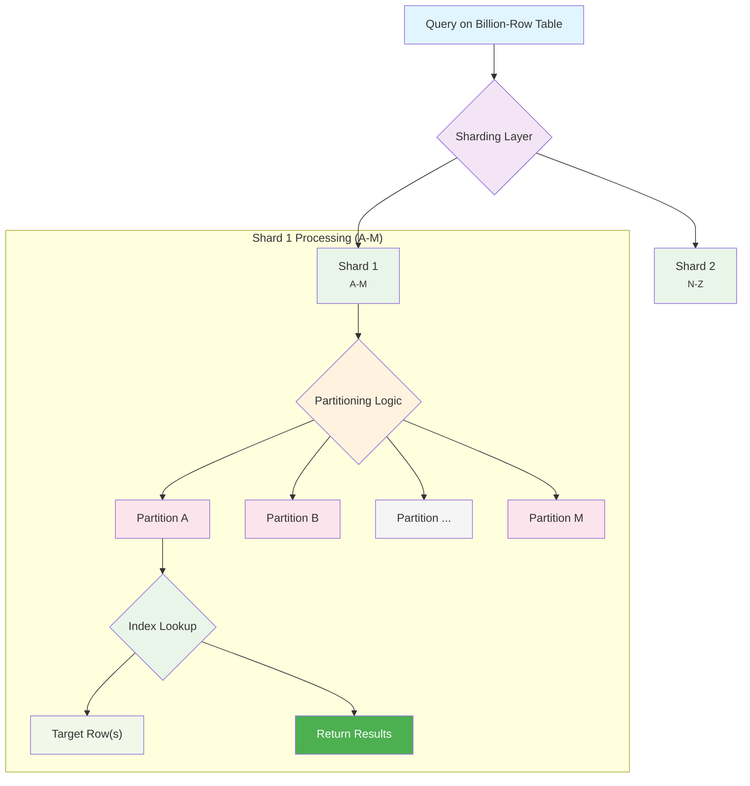

#SystemDesign #Database #Scalability #Architecture #BigData

>  Dealing with billion-row tables requires a strategic approach. Instead of treating the table as a single monolith, you must either **redesign** your data model to avoid the large table, **narrow the search space** using techniques like indexing and partitioning, or **parallelize the work** across many machines.

---

As a system you design grows, a critical question emerges: *Will this table eventually contain billions of rows?* If the answer is yes, you need a plan. Let's explore three core strategies for tackling this massive scale, inspired by a design discussion around a Twitter-like "followers" table.

## Strategy 1 (The Last Resort): Brute-Force Parallel Processing

This strategy accepts the massive table as a given and throws raw computing power at the problem.

> [!info] The Brute-Force Approach
> The core idea is to **divide and conquer**. Break the massive table into smaller "chunks" and process those chunks concurrently across a large cluster of machines.

-   **How it Works:** This is the foundational concept behind Big Data frameworks like Hadoop and MapReduce. You spin up hundreds of machines, each one responsible for searching or processing a small segment of the billion-row table. The results are then aggregated back together.
-   **When it's Used:** Often for analytical workloads where you truly need to process every row.
-   **Downsides:**
    -   Requires a massive infrastructure (a "massive army of machines").
    -   Can be complex to implement.
    -   Less effective for transactional, real-time lookups where data is constantly changing.

## Strategy 2 (The Scalpel): Narrow the Search Space

This is the most common and effective strategy for transactional databases. Instead of processing the whole table, you use intelligent data structures to drastically reduce the amount of data you need to look at for any given query.

> [!tip] The "Don't Read What You Don't Need" Philosophy
> The goal is to avoid a full table scan at all costs by creating pathways that lead the database directly to the data it needs. This is a multi-layered approach.

### Layer 1: Indexing
-   **What it is:** Creating a separate, sorted data structure (like a [[B-Tree Index]]) on one or more columns.
-   **Analogy:** It's like the index at the back of a textbook. Instead of reading the whole book to find a term, you go to the index, find the term, and get a pointer directly to the right page.
-   **Effect:** Reduces the search from a billion rows to a much smaller subset within the index.

### Layer 2: Partitioning
-   **What it is:** Physically splitting a single large table into multiple smaller, more manageable sub-tables on disk, based on a "partition key" (e.g., partitioning a `sales` table by month or by customer region).
-   **Analogy:** It's like splitting a massive dictionary into 26 separate volumes, one for each letter. If you're looking for the word "Zebra," you can ignore the first 25 volumes and go straight to the "Z" book.
-   **Effect:** The query planner can use the partition key to completely ignore most of the sub-tables, focusing its search on only one or a few relevant partitions.

### Layer 3: Sharding
-   **What it is:** The next level of partitioning. Instead of splitting the table on a single machine, you split it across **multiple, independent database servers (shards)**.
-   **Analogy:** You're still splitting the dictionary into volumes, but now the "A-M" volumes are in one library, and the "N-Z" volumes are in a completely different library across town.
-   **Effect:** Massively reduces the data on any single machine and allows for horizontal scaling. However, it introduces significant complexity at the application layer, which must now be "shard-aware" to know which server to query.

### The Full "Scalpel" Stack

By combining these techniques, a query that would have scanned a billion rows can be narrowed down to just a few hundred or thousand, resulting in millisecond response times.

---

## Strategy 3 (The Redesign): Avoid the Problem Entirely

This is often the most powerful strategy. Before optimizing a billion-row table, ask the fundamental question: **"Does this table *need* to have a billion rows?"**

> [!best-practice] Question Your Data Model
> Sometimes, a different data model can eliminate the need for a massive relational table altogether.

### Example: The Twitter "Followers" Problem
-   **Initial Design (leads to a billion-row table):** A `followers` table with `(follower_id, following_id)`. This table will grow enormous very quickly.
-   **Alternative Design (avoids the large table):**
    1.  On the `users` profile table, add two new fields: `followers_count` (an integer) and `followers_list` (a JSON array or list type).
    2.  When someone follows a user, you update that user's single row: increment the count and add the new follower's ID to the list.

**Trade-Offs of the Redesign:**
-   **✅ Reads are simple and fast:** To get a user's followers, you fetch a single row from the `users` table.
-   **❌ Writes become more complex:** A single "follow" action now requires a row-level lock and an update, which can be a bottleneck under heavy write load. This can be mitigated with techniques like asynchronous updates using a message queue.
-   **❌ Data Duplication:** You might store the "following" relationship in two places (on both users' profiles).

---

### Final Recommended Order of Operations
1.  **Redesign:** Can you change your data model to avoid the giant table in the first place?
2.  **Narrow the Search:** If you must have the table, apply layers of optimization: [[Indexing Best Practices: Separate vs. Composite|Indexing]], [[Partitioning]], and if necessary, [[Sharding]].
3.  **Brute Force:** If your use case is analytical and requires processing the full dataset, consider a parallel processing approach.