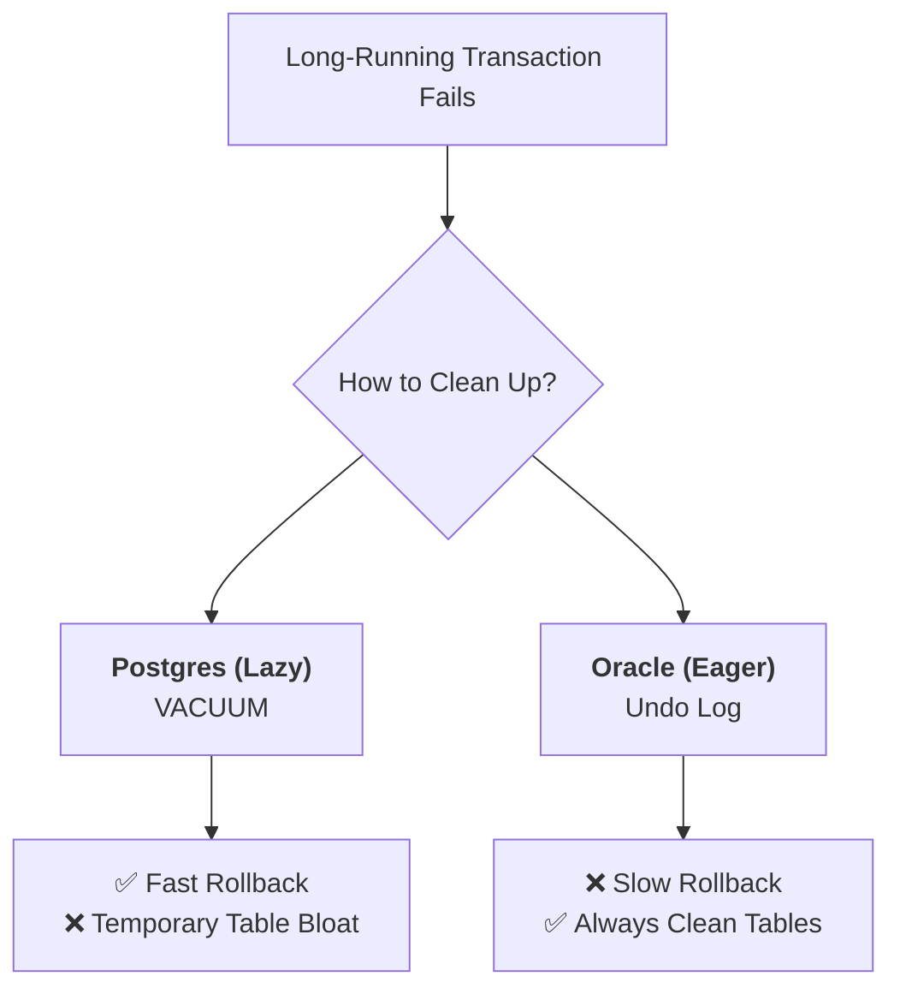

#Database #PostgreSQL #Transactions #Performance #MVCC #Architecture

>  A long-running transaction that modifies millions of rows and then fails (`ROLLBACK`) is a performance time bomb. It doesn't just disappear; it leaves behind millions of "dead rows" (or "dead tuples"). These dead rows are not immediately cleaned up and can severely degrade database performance by causing bloated tables and inefficient queries until the `VACUUM` process can remove them.

---

## How PostgreSQL Handles an `UPDATE` (MVCC)

To understand why a failed transaction is so costly, we first need to understand how PostgreSQL's **Multi-Version Concurrency Control (MVCC)** system works.

When you perform a DML operation (like `UPDATE` or `DELETE`) on a row, PostgreSQL **does not** modify the row in-place. Instead:
1.  It creates a **new version** of the row (a new "tuple") elsewhere in the table's data pages.
2.  It marks the old version of the row as "expired" for future transactions.
3.  It updates any relevant [[B-Tree Index|indexes]] to point to the new row version's physical location.

> [!tip] The HOT Optimization
> There is an optimization called **Heap-Only Tuples (HOT)** where, if there's enough space on the same data page, PostgreSQL can create the new row version on that page without needing to update the indexes. This is much more efficient but not always possible.

## 😫 The Problem: What Happens When a Transaction Fails?

Imagine a transaction that runs for an hour, updating millions of rows. This process creates millions of new row versions. If that transaction then fails and issues a `ROLLBACK`, what happens to all that new data?

> [!danger] The Birth of "Dead Rows"
> The new row versions are now invalid and should never be seen by any other transaction. However, PostgreSQL **does not** immediately delete them. These lingering, invalid row versions are known as **"dead rows" or "dead tuples."** They remain on disk, taking up space.

---

## ⚖️ The Performance Penalty of Dead Rows

Leaving these dead rows in the table has a significant, negative impact on database performance. While it doesn't cause correctness issues (new transactions know to ignore them), it creates two major bottlenecks:

### 1. Expensive Visibility Checks
For every row version a query encounters, the database must perform an expensive check to determine its visibility. It has to look up the status of the transaction that created that row version to see if it was committed or rolled back. When your tables are littered with millions of dead rows, every query has to do this extra work over and over again.

### 2. Inefficient I/O & Table Bloat
This is the most intuitive performance hit. The dead rows continue to occupy physical space on disk pages alongside live, valid rows.

> [!warning] The 99% Dead Page Problem
> Imagine a data page that could hold 1,000 rows. After a failed transaction, it might now contain only **1 live row and 999 dead rows**.
>
> To get that single live row, the database must still perform a full disk I/O operation to read the entire page into memory, only to then filter out and discard 99.9% of the data it just read. Repeat this across thousands of bloated pages, and your query performance plummets. **More I/O = Slower Performance.**

---

## The Cleanup Strategy: Lazy vs. Eager

Databases handle this rollback cleanup in two main ways. This is a fundamental architectural decision.

### PostgreSQL's Lazy Approach: `VACUUM`
PostgreSQL prioritizes a very fast `ROLLBACK`. The transaction can be aborted almost instantly because it doesn't have to do the cleanup work right away.

-   **The `VACUUM` Process:** The responsibility of cleaning up dead rows is delegated to a background process called `VACUUM` (and its automated counterpart, `autovacuum`). This process periodically scans tables to find and remove dead rows, freeing up space for reuse.
-   **The Trade-Off:** The database remains performant for writes and quick rollbacks, but it can suffer from table bloat and degraded read performance in the period between `VACUUM` runs.

### Other Databases' Eager Approach: Undo Logs
Other databases (like Oracle) prioritize keeping tables clean at all times.

-   **The Undo Log:** They use an "undo log" to record the "before" state of any changes.
-   **The `ROLLBACK` Process:** When a transaction fails, the database actively reads the undo log and performs the work to immediately revert all the changes, deleting the invalid row versions.
-   **The Trade-Off:** A `ROLLBACK` on a large transaction can take a very long time to complete, potentially holding locks and blocking other processes. However, once it's done, the table is left in a clean, non-bloated state.

### Visualizing the Trade-Off

---

> [!summary] Conclusion: It's All About Trade-Offs
> As the author states, "Nothing is wrong or right, it's all decisions that we engineers make." There is no single "best" architecture.
> - PostgreSQL's design prioritizes fast rollbacks and write throughput, accepting temporary table bloat as a manageable consequence.
> - The eager approach prioritizes table cleanliness and consistent read performance, accepting that a large rollback is a slow, blocking operation.
>
> The key as a backend engineer is to understand the fundamental behavior of the system you are using, so you know its strengths, weaknesses, and how to work with them effectively.