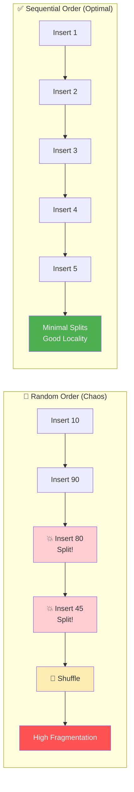

#Database #Indexing #Performance #SystemDesign #UUID #CoreConcept

>  Using random UUIDs (like UUIDv4) as a primary or indexed key in a database is a performance anti-pattern for write-heavy workloads. The randomness causes constant **page splits** in the B-Tree index, leading to high I/O, index fragmentation, and poor cache efficiency. Sequential IDs (like ULIDs or UUIDv7) are vastly superior for write performance.

---

## 🤔 The Problem: The Hidden Cost of Randomness

Random UUIDs (specifically UUIDv4) are popular because they are globally unique and can be generated anywhere without coordination. However, their very nature—complete randomness—is poison for a B-Tree index.

To understand why, we must remember the golden rule of indexes:

> [!info] The Golden Rule of Indexes
> The leaf pages of a B-Tree index **must be ordered** by the indexed key. This is what makes them searchable and efficient. Inserting random, unordered values into an ordered structure causes chaos.

## 🏛️ The Mechanics of an Index Insert

Let's visualize what happens when we insert values into a B-Tree index. For simplicity, assume each leaf page can only hold two entries.

### The "Bad" Scenario: Inserting Random UUIDs (represented as numbers)
Let's insert these random numbers in order: `10`, `90`, `80`, `45`, `70`, `60`, `5`.

1.  **Insert 10, 90:** Easy. They fit in the first page, in order.
    `[Page 0: 10, 90]`
2.  **Insert 80:** Problem! `80` needs to go between `10` and `90`, but Page 0 is full. This forces a **page split**—the most expensive operation for an index. The database must create a new page, move `90` to it, and insert `80`.
    `[Page 0: 10, 80] -> [Page 1: 90]`
3.  **Insert 45:** Another problem! `45` needs to go between `10` and `80`. Page 0 is full again. Another page split.
    `[Page 0: 10, 45] -> [Page 2: 80] -> [Page 1: 90]`
4.  **Insert 70:** Chaos! `70` needs to go between `45` and `80`. This requires shuffling data across pages.
5.  **Insert 5:** Another split! `5` needs to go before `10`.

> [!danger] The Consequences of Random Inserts
> - **High I/O:** Every insert requires locating a random page somewhere in the index, fetching it from disk into memory, modifying it, and potentially writing multiple pages back to disk due to splits.
> - **Page Splits:** This is the performance killer. It's a costly operation that involves allocating new pages, re-linking the doubly-linked list of leaf pages, and updating parent nodes in the tree.
> - **Cache Inefficiency ("Thrashing"):** Because you're touching random pages all over the index, you're constantly bringing new pages into the database's memory buffer pool. This evicts other potentially useful pages. The next "random" insert might need a page you just evicted, forcing another expensive disk read. This is called **"I/O thrashing."**

---

### The "Good" Scenario: Inserting Sequential IDs (e.g., ULIDs, UUIDv7)
Now let's see what happens when we insert ordered, monotonically increasing values: `10`, `20`, `30`, `50`, `70`, `80`.

1.  **Insert 10, 20:** Easy. They fill the first page.
    `[Page 0: 10, 20]`
2.  **Insert 30:** Page 0 is full, but `30` is the new highest value. The database simply allocates a **new page at the end** and inserts `30`. No split required.
    `[Page 0: 10, 20] -> [Page 1: 30]`
3.  **Insert 50:** Easy. Page 1 has space, and `50` is the new highest value.
    `[Page 0: 10, 20] -> [Page 1: 30, 50]`
4.  **Insert 70, 80:** Easy. Both are new highest values, so they just get appended to the end, filling up pages sequentially.

> [!success] The Benefits of Sequential Inserts
> - **Low I/O:** Every new insert goes to the same place: the **"hot" page at the end of the index**. This page is almost always already in the memory buffer pool.
> - **No Page Splits:** You are simply filling up one page and then moving on to the next. The expensive splitting and reordering work is eliminated.
> - **Excellent Cache Efficiency:** You're constantly working on a small, localized set of pages at the end of the index, which is extremely cache-friendly for both the database and the CPU.

---

## ⚖️ The Impact on Reads: It Depends on Your Workload

The choice between random and sequential IDs also affects read performance, but the "best" choice depends on your application's access patterns.

-   **Shopify's Use Case (Time-based reads):** Shopify switched from UUIDv4 to ULIDs for their order IDs. This was a jackpot for them.
    -   **Writes:** Became much faster due to sequential inserts.
    -   **Reads:** Also became faster because their most common read pattern is time-based. When a customer has an issue with a recent purchase, the query is for a recent, time-ordered ID. With sequential IDs, all recent orders are physically co-located on the same few "hot" pages at the end of the index, making these reads incredibly fast.

-   **URL Shortener Use Case (Random reads):** A URL shortener generates sequential short links, but the *reads* are completely random. The most popular link might be the first one ever created.
    -   In this case, the randomness of reads means there's no "hot" spot in the index to keep in the cache. The performance benefit of sequential IDs on reads is diminished, though it's still a huge win for writes.

---

> [!best-practice] Final Recommendation
> For any indexed column that will serve as a primary key or experience a high volume of writes, **strongly prefer a sequential ID generator** over a random one.
> - **Good Choices:** `BIGSERIAL`, `UUIDv7`, `UUIDv8`, `ULID`.
> - **Bad Choice (for indexed keys):** `UUIDv4`.
>
> The performance degradation caused by random inserts on a B-Tree index is a fundamental and well-understood problem. While random UUIDs are fine for non-indexed columns, using them as an indexed primary key is a recipe for performance issues at scale.