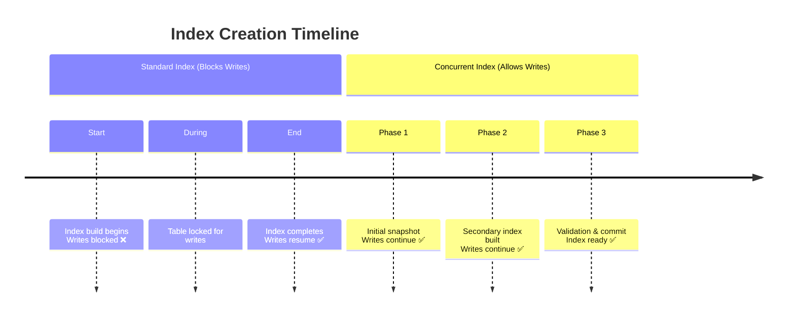

#Database #PostgreSQL #Indexing #Performance #Production #DevOps

>  A standard `CREATE INDEX` command acquires a heavy lock on your table, blocking all writes (`INSERT`, `UPDATE`, `DELETE`) until it finishes. `CREATE INDEX CONCURRENTLY` builds the index without this long-running lock, allowing your application to remain fully operational, but it takes much longer and uses more resources.

---

## 😫 The Problem: The Production Database Lock-Up

Creating an index on a large table in a live, production environment is a high-stakes operation. The standard `CREATE INDEX` command is often not a viable option.

> [!danger] The `CREATE INDEX` Write Lock
> When you run `CREATE INDEX`, PostgreSQL places a `SHARE UPDATE EXCLUSIVE` lock on the table. This lock prevents any concurrent `INSERT`, `UPDATE`, or `DELETE` operations.
>
> On a large table, the index build can take minutes or even hours. During this entire time, your application's write operations will be blocked, effectively causing downtime for parts of your service. While reads (`SELECT`) can continue, a blocked application is unacceptable.

## ✨ The Solution: Building Concurrently

PostgreSQL provides a powerful solution to this problem with the `CONCURRENTLY` keyword.

> [!success] The `CONCURRENTLY` Keyword
> The `CREATE INDEX CONCURRENTLY` command allows you to build an index without preventing concurrent write operations on the table. Your application remains fully available while the index is being built in the background.

### The Syntax
You simply add the `CONCURRENTLY` keyword to your standard `CREATE INDEX` statement.

```sql
CREATE INDEX CONCURRENTLY my_index_name ON my_table (my_column);
```

### How It Works (High-Level)
Instead of a single, locking operation, a concurrent index build is a more complex, multi-pass process:

1.  **First Pass:** It takes a snapshot of the table and starts building the index based on that data, without taking a heavy lock. Writes can continue during this time.
2.  **Second Pass:** After the initial build is complete, it performs a second scan to "catch up" on all the changes (inserts, updates, deletes) that happened while the first pass was running.
3.  **Finalization:** It waits for any in-progress write transactions to complete, finalizes the index, and makes it visible and ready for use.

### Visualizing the Difference



---

## ⚖️ The Trade-Offs: The Cost of Concurrency

While `CONCURRENTLY` is invaluable for production environments, it's important to understand its costs. It is not a "free" operation.

-   **❌ Slower Execution Time:** Because of its multi-pass approach and the need to wait for other transactions, a concurrent build will take **significantly longer** than a standard `CREATE INDEX`.
-   **❌ Higher Resource Consumption:** The build process consumes more CPU and memory, which can impact the performance of other queries running on the database.
-   **❌ It Can Fail:** A standard `CREATE INDEX` is transactional; if it fails, it rolls back cleanly. A concurrent build is not. If it fails (e.g., due to a unique constraint violation from a concurrent `INSERT`), it will leave behind an **"invalid" index**. You must then manually `DROP` this invalid index and try the creation again.

---

> [!best-practice] The Production Standard
> For any non-trivial table in a live production environment, `CREATE INDEX CONCURRENTLY` should be your default choice. The trade-offs of a longer build time and higher resource usage are almost always preferable to blocking application writes and causing user-facing downtime.
>
> The fact that the PostgreSQL community is considering making `CONCURRENTLY` the default behavior in future versions highlights its importance and status as a best practice.