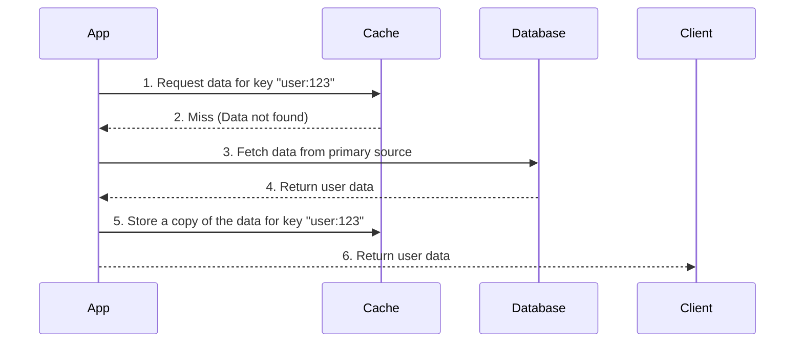

#CoreConcept #SystemDesign #Performance #Caching #Scalability 

>  Caching is the process of storing copies of frequently accessed data in a temporary, high-speed storage layer. It is the most effective way to improve application performance by reducing the need to access slower, primary data sources like a database.

---

> [!note] The Core Analogy: The Librarian's Desk
> Think of a librarian who keeps the most popular, frequently requested books on their personal desk instead of running back to the main shelves every time someone asks for one.
> -   **The Librarian's Desk** is the **Cache** (fast, in-memory, but small).
> -   **The Main Shelves** are the **Database** (slower, on-disk, but holds everything).

---

## Caching Patterns

### 1. Cache-Aside (Lazy Loading)
> This is the most common and intuitive caching strategy. The application logic is responsible for managing the cache.

**The Flow:**
1.  Your application receives a request for some data (e.g., `findUserById(123)`).
2.  It first checks the librarian's desk (**Cache**) for that data.
3.  **Cache Hit:** If the data is found, it is returned immediately. The process stops here.
4.  **Cache Miss:** If the data is not found, the application goes to the main shelves (**Database**) to retrieve it.
5.  After retrieving the data, the application places a copy on the librarian's desk (**writes it to the Cache**) for the next time it's needed.
6.  The data is returned to the user.

### 2. Write-Through

> This strategy ensures the cache is always consistent with the database by writing to both simultaneously.

**The Flow:**
1.  Your application receives a request to update or create data.
2.  It writes the data directly to the **Cache**.
3.  The cache itself is then responsible for synchronously writing that same data to the **Database**.
4.  The operation is only considered complete after the data is written to both the cache and the database.

> [!note] The Analogy
> When you update a book, you give the new version to the librarian. The librarian updates both the copy on their desk (**cache**) and the one on the main shelves (**database**) at the exact same time before telling you the job is done.

-   **Pros:** High data consistency. The cache is never stale.
-   **Cons:** Higher write latency, as you have to wait for two write operations to complete.

---

## The Hardest Problem: Cache Invalidation

> **Cache Invalidation** is the process of removing or updating an entry in the cache when the original data in the database changes. If you fail to do this, your application will serve stale, incorrect data.

> [!note] The Analogy
> What happens when a book on the main shelves is updated by another librarian? How does your librarian know their desk copy is now out of date and needs to be thrown away or replaced? This is the core challenge.

**Common Invalidation Strategies:**
-   **Time-To-Live (TTL):** The simplest strategy. Each item in the cache is given an expiration time (e.g., 5 minutes). After that time, it's automatically removed. This is good for data that can tolerate being slightly out of date.
-   **Explicit Invalidation:** When you update data in the database, your application code also explicitly sends a command to delete that specific entry from the cache.

---

## Why This Matters to a Developer

Caching is not just an optional performance tweak; it is a fundamental technique for building modern, scalable, and cost-effective applications.

-   **✔️ Speed and User Experience:** Caching is the **single most effective way to make your application faster.** Reading data from an in-memory cache (like Redis) is orders of magnitude faster than reading it from a database on a disk. A faster application provides a better user experience and can directly impact user engagement and revenue.

-   **✔️ Reducing Costs and Database Load:** By serving a high percentage of read requests directly from the cache, you drastically reduce the load on your primary databases. This allows your database to handle essential write operations more efficiently and can save a huge amount of money on expensive database hardware and licenses as your application scales. You can serve massive traffic with a smaller, cheaper database.