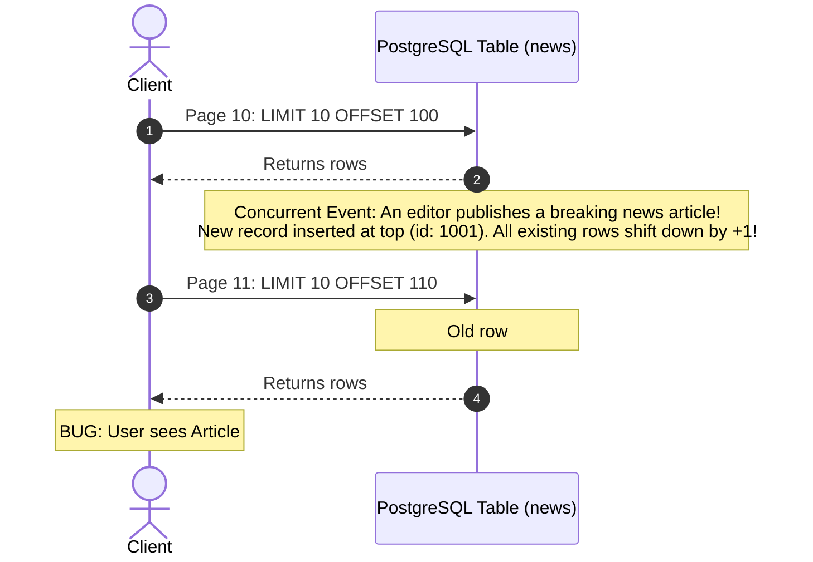
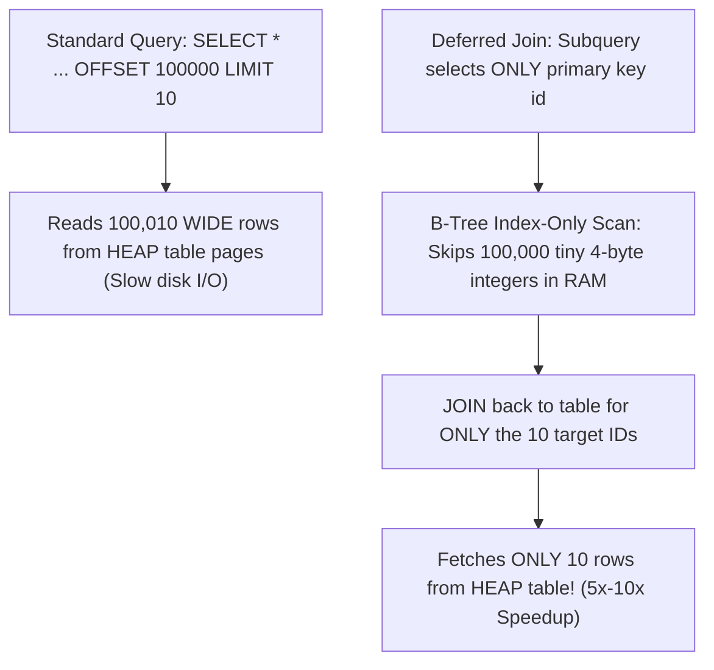

#Database #SQL #Performance #Pagination #KeysetPagination #CursorPagination #Offset #PostgreSQL #Indexing #SystemDesign #CoreConcept

> [!abstract] Executive Summary
> Implementing pagination in web applications and public APIs is standard practice. The ubiquitous SQL pattern taught in beginner tutorials is **Offset-Based Pagination** using `LIMIT M OFFSET N` (e.g., `LIMIT 10 OFFSET 100`).
> 
> As highlighted by Markus Winand (*Use The Index, Luke!*), **`OFFSET` is an anti-pattern for large datasets**. By definition, `OFFSET N` tells the database to **fetch $N + M$ records and physically drop the first $N$ rows in memory**. As the offset grows, query execution time scales linearly ($O(N)$), consuming massive CPU, memory, and disk I/O, while exposing the application to **data drift and phantom duplicate reads**.
> 
> The production solution is **Keyset Pagination** (also known as the **Seek Method** or **Cursor-Based Pagination**), which replaces arbitrary row counters with indexed column filters (`WHERE id < :last_seen_id ORDER BY id DESC LIMIT 10`), achieving constant-time $O(1)$ page traversal regardless of data depth.

---

## 1. The Anatomy of Offset-Based Pagination: "Fetch and Drop"

When a client queries a paginated API (e.g., `GET /api/news?page=10&page_size=10`), the backend server translates this request into SQL:

```sql
SELECT title FROM news 
ORDER BY id DESC 
LIMIT 10 OFFSET 100;
```

```
┌─────────────────────────────────────────────────────────────────────────────────────────────────┐
│                                 THE "FETCH AND DROP" ANOMALY                                    │
└─────────────────────────────────────────────────────────────────────────────────────────────────┘

 Query: LIMIT 10 OFFSET 100

 [1] [2] [3] ... [98] [99] [100]       [101] [102] [103] [104] [105] [106] [107] [108] [109] [110]
 ├─────────────────────────────┤       ├──────────────────────────────────────────────────────────┤
   100 Rows Fetched from Index                   10 Target Rows Sent to User
   & PHYSICALLY DISCARDED!
   (Pure Wasteful CPU & Disk I/O)
```

### How the Database Executes `OFFSET`:
1. The database traverses the index on `id`.
2. It reads **110 rows** (`OFFSET 100 + LIMIT 10`).
3. For each of the first 100 rows, it performs visibility checks and memory allocation, only to **throw them in the garbage**.
4. It retains the remaining 10 rows and delivers them across the network socket.

As the user scrolls deeper (e.g., Page 10,000 with `OFFSET 100,000`), the database must scan, evaluate, and discard **100,010 rows** just to deliver 10 rows.

---

## 2. The Two Fatal Flaws of SQL `OFFSET`

### Flaw 1: Linear Degradation ($O(N)$ Performance Collapse)
The work performed by the database engine is directly proportional to page depth:

$$\text{Work} = \mathcal{O}(\text{Offset} + \text{Limit})$$

In high-concurrency production systems, deep offset queries cause:
- **Buffer Cache Thrashing:** Evicting hot cached pages from PostgreSQL's shared buffers or MySQL InnoDB buffer pool to read dead tuples.
- **Lock Escalation Risk:** In database engines like Microsoft SQL Server, scanning hundreds of thousands of rows under concurrency triggers automatic lock escalation from row locks to table locks, freezing concurrent writers.

### Flaw 2: Data Drift, Duplicate Reads, and Skipped Records
`OFFSET` relies on absolute row position. When records are concurrently inserted or deleted while a user navigates between pages, the entire dataset shifts:



---

## 3. Hands-On PostgreSQL Benchmark: `OFFSET` Performance Scaling

Consider a news portal database with an indexed primary key `id`:

```sql
CREATE TABLE news (
    id SERIAL PRIMARY KEY,
    title VARCHAR(255) NOT NULL,
    content TEXT,
    created_at TIMESTAMPTZ DEFAULT NOW()
);

-- Table seeded with 10,000,000 rows
```

Let us observe the PostgreSQL query planner and execution metrics using `EXPLAIN ANALYZE`:

### Benchmark 1: Page 1 (`OFFSET 0`)
```sql
EXPLAIN ANALYZE 
SELECT title FROM news 
ORDER BY id DESC 
LIMIT 10 OFFSET 0;
```
```text
Limit (cost=0.43..0.85 rows=10 width=36) (actual time=0.035..0.048 rows=10 loops=1)
  -> Index Scan Backward using news_pkey on news (actual time=0.034..0.045 rows=10 loops=1)
Planning Time: 0.082 ms
Execution Time: 0.065 ms
```
*Result:* Reads exactly 10 rows from the index. Lightning fast (~0.06ms).

### Benchmark 2: Page 100 (`OFFSET 1,000`)
```sql
EXPLAIN ANALYZE 
SELECT title FROM news 
ORDER BY id DESC 
LIMIT 10 OFFSET 1000;
```
```text
Limit (cost=42.15..42.57 rows=10 width=36) (actual time=0.980..0.992 rows=10 loops=1)
  -> Index Scan Backward using news_pkey on news (actual time=0.035..0.930 rows=1010 loops=1)
Execution Time: 1.012 ms
```
*Result:* Reads **1,010 rows** from the index. Execution time increased by $15\times$.

### Benchmark 3: Page 10,000 (`OFFSET 100,000`)
```sql
EXPLAIN ANALYZE 
SELECT title FROM news 
ORDER BY id DESC 
LIMIT 10 OFFSET 100000;
```
```text
Limit (cost=4215.00..4215.42 rows=10 width=36) (actual time=78.450..78.462 rows=10 loops=1)
  -> Index Scan Backward using news_pkey on news (actual time=0.035..74.200 rows=100010 loops=1)
Execution Time: 78.510 ms
```
*Result:* Reads **100,010 rows**. Even with cached buffer pages, takes ~79ms.

### Benchmark 4: Page 100,000 (`OFFSET 1,000,000`)
```sql
EXPLAIN ANALYZE 
SELECT title FROM news 
ORDER BY id DESC 
LIMIT 10 OFFSET 1000000;
```
```text
Limit (cost=42150.00..42150.42 rows=10 width=36) (actual time=618.120..618.135 rows=10 loops=1)
  -> Index Scan Backward using news_pkey on news (actual time=0.035..595.400 rows=1000010 loops=1)
Execution Time: 620.250 ms
```
*Result:* The database scans **1,000,010 rows** to deliver 10 rows. Cold cache runs exceed **6 seconds**, causing database CPU spikes and API gateway timeouts (`504 Gateway Timeout`).

---

## 4. The Production Fix: Keyset Pagination (The Seek Method)

Instead of telling the database *how many rows to skip*, **Keyset Pagination** tells the database *where to start searching* by anchoring the query to the last record seen on the previous page.

```
┌─────────────────────────────────────────────────────────────────────────────────────────────────┐
│                                KEYSET (CURSOR) PAGINATION CONCEPT                                │
└─────────────────────────────────────────────────────────────────────────────────────────────────┘

 B-Tree Index on `id`
                     [Root: 500,000]
                     /             \
         [Branch: 250,000]       [Branch: 750,000]
            /         \             /         \
         [...]       [...]        [...]      [...]

 Query: WHERE id < 990 ORDER BY id DESC LIMIT 10

 1. B-Tree traverses root-to-leaf in O(log N) directly to Key = 990.
 2. Scans exactly 10 adjacent leaf entries backwards.
 3. ZERO tuples are discarded!
```

### The SQL Implementation

#### Page 1: Initial Query
```sql
SELECT id, title FROM news 
ORDER BY id DESC 
LIMIT 10;
```
*Application extracts the `id` of the last record in the result set (e.g., `id = 990`).*

#### Page 2: Fetch Next Page via Keyset Filter
The client sends the cursor back to the server (`GET /api/news?cursor=990`):
```sql
SELECT id, title FROM news 
WHERE id < 990 
ORDER BY id DESC 
LIMIT 10;
```

### PostgreSQL Execution Metrics (`EXPLAIN ANALYZE`)
```text
Limit (cost=0.43..0.85 rows=10 width=36) (actual time=0.040..0.052 rows=10 loops=1)
  -> Index Scan Backward using news_pkey on news (actual time=0.038..0.049 rows=10 loops=1)
       Index Cond: (id < 990)
Execution Time: 0.071 ms
```

### Why Keyset Pagination Outperforms Offset:
1. **Constant Time Complexity ($O(1)$ with respect to page depth):** Whether fetching Page 2 or Page 100,000, the database performs a single $O(\log N)$ B-Tree probe and reads exactly **10 leaf rows**. Execution time remains steady at **< 0.1ms**.
2. **Zero Row Discarding:** Zero tuples fetched and dropped. Buffer pool cache churn drops to near zero.
3. **Immune to Data Drift:** If rows are inserted or deleted above or below the cursor, the boundary condition `id < 990` remains absolute. No duplicates, no skipped items.

---

## 5. Compound Keysets: Sorting by Non-Unique Columns

In real-world applications, sorting is rarely performed purely on primary keys. Users want feeds sorted by `created_at`, `view_count`, or `price`.

Because non-unique columns have duplicate values (e.g., thousands of articles created at the exact same second), filtering by `WHERE created_at < :last_date` will skip records that share that timestamp!

### The Solution: Compound Keyset with Tie-Breaker
Always pair the sort column with the unique primary key as a deterministic tie-breaker:

```sql
-- Create composite index matching order by:
CREATE INDEX idx_news_created_id ON news (created_at DESC, id DESC);
```

#### SQL Implementation using Row Value Constructors:
```sql
SELECT id, title, created_at 
FROM news 
WHERE (created_at, id) < ('2026-10-18 10:00:00+00', 45012)
ORDER BY created_at DESC, id DESC 
LIMIT 10;
```

#### Equivalent SQL for Databases without Tuple Comparison:
```sql
SELECT id, title, created_at 
FROM news 
WHERE created_at < '2026-10-18 10:00:00+00' 
   OR (created_at = '2026-10-18 10:00:00+00' AND id < 45012)
ORDER BY created_at DESC, id DESC 
LIMIT 10;
```
*The database leverages the composite index `idx_news_created_id` to seek directly to the exact point in the index tree and read the next 10 items.*

---

## 6. The Deferred Join Trick: What If You MUST Use Offset?

Sometimes business requirements mandate numbered page jumping (e.g., an admin dashboard where users want to jump directly to "Page 450"). 

If you must support `OFFSET`, use the **Deferred Join (Late Row Lookup)** pattern:



### The Slow Way:
```sql
-- DANGEROUS: Fetches full table row (title, content, author) for all 100,010 records!
SELECT * FROM news 
ORDER BY id DESC 
LIMIT 10 OFFSET 100000;
```

### The Optimized Deferred Join:
```sql
-- OPTIMIZED: Discards IDs in index-only space; reads HEAP only for the final 10 rows!
SELECT n.id, n.title, n.content, n.created_at
FROM news n
JOIN (
    SELECT id FROM news 
    ORDER BY id DESC 
    LIMIT 10 OFFSET 100000
) AS page ON n.id = page.id
ORDER BY n.id DESC;
```
*Performance Gain:* Because the inner query performs an **Index-Only Scan** on `id`, it skips rows in compact index pages without ever touching the heap table pages on disk, resulting in a **$5\times \text{ to } 10\times$ speedup** over naive `OFFSET`.

---

## 7. Offset vs. Keyset vs. Deferred Join: Comparison Matrix

```
┌─────────────────────────────────────────────────────────────────────────────────────────────────┐
│                                 PAGINATION PATTERN SCORECARD                                    │
├─────────────────────────┬─────────────────────────┬─────────────────────────┬───────────────────┤
│ Dimension               │ Offset Pagination       │ Keyset (Cursor)         │ Deferred Join     │
│                         │ `LIMIT M OFFSET N`      │ `WHERE id < :cursor`    │ `JOIN (SELECT id)`│
├─────────────────────────┼─────────────────────────┼─────────────────────────┼───────────────────┤
│ **Time Complexity**     │ $\mathcal{O}(N + M)$    │ $\mathcal{O}(M)$ [O(1)] │ $\mathcal{O}(N_{index} + M)$│
├─────────────────────────┼─────────────────────────┼─────────────────────────┼───────────────────┤
│ **Deep Page Speed**     │ ❌ Terrible (Seconds)   │ ✅ Instant (<1ms)       │ 🟡 Moderate (5x-10x)|
├─────────────────────────┼─────────────────────────┼─────────────────────────┼───────────────────┤
│ **Data Drift / Dupes**  │ ❌ High Risk            │ ✅ Completely Immune    │ ❌ High Risk      │
├─────────────────────────┼─────────────────────────┼─────────────────────────┼───────────────────┤
│ **Random Page Jumping** │ ✅ Supported (Page 45)  │ ❌ Linear scroll only   │ ✅ Supported      │
├─────────────────────────┼─────────────────────────┼─────────────────────────┼───────────────────┤
│ **Infinite Scroll / UI**│ 🟡 Sluggish             │ ✅ Ideal for Feeds      │ 🟡 Acceptable     │
├─────────────────────────┼─────────────────────────┼─────────────────────────┼───────────────────┤
│ **Index Requirement**   │ Helpful                 │ **Mandatory**           │ **Mandatory**     │
└─────────────────────────┴─────────────────────────┴─────────────────────────┴───────────────────┘
```

---

## 8. Senior Engineer Production Checklist

- [ ] **Default to Keyset / Cursor Pagination for User Feeds:** Use cursor-based pagination for infinite scroll, timeline feeds, message streams, and public REST/GraphQL APIs.
- [ ] **Encode Cursors as Opaque Tokens:** Do not expose raw database IDs in API URLs. Base64-encode the cursor value (e.g., `cursor=ZXlKaGJDMWtZWFJsT2pFeE1q...`) to decouple client contracts from internal schema columns.
- [ ] **Always Include a Deterministic Tie-Breaker:** When sorting by non-unique fields (e.g., `created_at`, `rank`, `price`), always append the primary key: `ORDER BY created_at DESC, id DESC`.
- [ ] **Cap Maximum `LIMIT`:** Always enforce a hard server-side limit on requested page sizes (e.g., `Math.min(requestedLimit, 100)`) to guard against DoS attacks.
- [ ] **Disallow Deep Offset on Public APIs:** If offset pagination is required for legacy clients, set a maximum allowed offset (e.g., reject requests with `offset > 1000`).
- [ ] **Verify Index Alignment:** Ensure an index exists that matches the exact column order and sort direction: `CREATE INDEX idx_col_order ON table (col1 DESC, col2 DESC)`.

---

## 9. Related Notes & Conceptual Navigation

- [[01_ORM & JPA _ Bridging Objects and Databases|ORM & JPA: Bridging Objects and Databases]]
- [[02_Caching Strategies_Making Your Application Faster|Caching Strategies: Making Your Application Faster]]
- [[01_Database Partitioning Fundamentals_ Horizontal vs. Vertical Partitioning|Database Partitioning Fundamentals]]
- [[01_Read Phenomena & Phantom Reads|Read Phenomena & Phantom Reads]]
- [[05_Database Connection Pooling_ Mechanics, Node.js Benchmark, and Sizing Strategies|Database Connection Pooling: Mechanics, Node.js Benchmark, and Sizing Strategies]]
