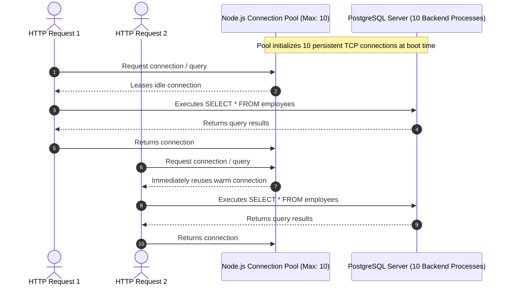
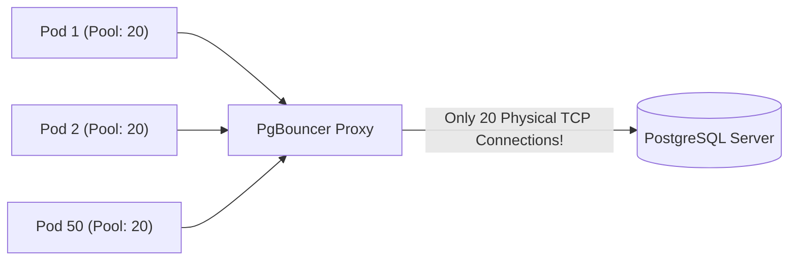

#Database #ConnectionPooling #Performance #NodeJS #PostgreSQL #PgBouncer #SystemDesign #BackendArchitecture #Networking #CoreConcept

> [!abstract] Executive Summary
> Establishing a database connection is not a lightweight memory pointer assignment; it is a heavyweight, multi-step network and operating system operation involving **TCP 3-way handshakes, TLS negotiation, authentication handshakes, and database-level process/thread allocation**. 
> 
> Under high-throughput web traffic, opening and closing a database connection for every incoming HTTP request (the **Connect-Per-Request Anti-Pattern**) severely degrades latency, thrashes database CPU, and exhausts OS sockets.
> 
> **Database Connection Pooling** solves this by maintaining a warm cache of persistent, reusable database connections. Clients lease connections from the pool to execute queries and return them immediately upon completion. This guide examines the physical cost of connection creation, benchmarks Node.js/Express with PostgreSQL (`pg.Pool`), explains the mathematical formula for **optimal pool sizing**, and explores external poolers like **PgBouncer**.

---

## 1. The Anatomy & Physical Cost of a Database Connection

When an application server requests a connection from a relational database like PostgreSQL, the following physical steps occur across the network and OS:

```
┌─────────────────────────────────────────────────────────────────────────────────────────────────┐
│                           THE ANATOMY OF A DATABASE CONNECTION                                  │
└─────────────────────────────────────────────────────────────────────────────────────────────────┘

 App Server (Client)                                          PostgreSQL Server (Backend)
         │                                                               │
         ├─────────── 1. TCP 3-Way Handshake (SYN, SYN-ACK, ACK) ────────┤  (1 Network RTT)
         │                                                               │
         ├─────────── 2. TLS / SSL Handshake (Certificates & Keys) ──────┤  (1-2 Network RTTs)
         │                                                               │
         ├─────────── 3. Protocol Auth Handshake (SCRAM-SHA-256 / MD5) ──┤  (1-2 Network RTTs)
         │                                                               │
         │                                               ┌───────────────┴──────────────┐
         │                                               │ 4. OS Process Fork:          │
         │                                               │ - Allocates 2MB - 10MB RAM   │
         │                                               │ - Initializes backend worker │
         │                                               │ - Opens file descriptors     │
         │                                               └───────────────┬──────────────┘
         │                                                               │
         ├─────────── 5. Connection Ready for SQL Queries ───────────────┤
```

### Why Connection Establishment is Expensive:
1. **Network Round-Trips (RTT):** Establishing a secure TLS connection with authentication requires **3 to 5 network round-trips** before the first byte of SQL can even be sent. If network latency between app and database is 20ms, opening a connection incurs an unavoidable **60ms to 100ms tax**.
2. **PostgreSQL Process Architecture:** PostgreSQL uses a process-based concurrency model (not lightweight OS threads). Every incoming client connection spawns a new OS backend process via `fork()`, consuming **2MB to 10MB of memory** per connection for local buffer state, sort memory (`work_mem`), and query planning caches.
3. **Socket Teardown Overheads:** Closing a TCP connection leaves sockets lingering in the kernel's `TIME_WAIT` state for 60 to 120 seconds, risking ephemeral port exhaustion (`EADDRNOTAVAIL`).

---

## 2. The Anti-Pattern: Connect-Per-Request (Stateless Disaster)

In naive web architectures, developers instantiate, open, and close a database client inside every HTTP request handler:

```javascript
// Express.js - CONNECT-PER-REQUEST ANTI-PATTERN
const { Client } = require('pg');

app.get('/api/employees-slow', async (req, res) => {
    // ❌ ANTI-PATTERN: New client instantiated on EVERY request
    const client = new Client({
        host: 'localhost',
        database: 'company_db',
        user: 'postgres',
        password: 'password',
        port: 5432
    });

    try {
        await client.connect(); // Heavyweight TCP + TLS + Auth handshake!
        
        const result = await client.query('SELECT * FROM employees');
        
        return res.json(result.rows);
    } catch (err) {
        return res.status(500).json({ error: err.message });
    } finally {
        await client.end(); // Socket teardown & process termination
    }
});
```

### The Three Failure Modes of this Pattern:
1. **Latency Penalty:** Up to 80% of total HTTP request duration is wasted creating and destroying the connection rather than executing SQL.
2. **Database Crash (`max_connections` Exhaustion):** PostgreSQL defaults to `max_connections = 100`. A burst of 150 concurrent HTTP requests immediately crashes the API with:
   `FATAL: sorry, too many clients already`.
3. **CPU Thrashing:** The database server spends its compute cycles forking processes and tearing down sockets instead of executing queries and managing indexes.

---

## 3. The Connection Pooling Pattern (`pg.Pool`)

A **Connection Pool** pre-establishes a configured number of persistent connections when the application boots and keeps them warm in memory.



### Key Pool Configuration Parameters in `pg.Pool`

```javascript
const { Pool } = require('pg');

const pool = new Pool({
    host: 'localhost',
    database: 'company_db',
    user: 'postgres',
    password: 'password',
    port: 5432,
    
    // Core Sizing & Timeout Options:
    max: 20,                       // Maximum simultaneous connections in pool (Default: 10)
    connectionTimeoutMillis: 2000, // Maximum time to wait for a free connection before throwing error (Default: 0 = infinite)
    idleTimeoutMillis: 10000       // Close idle connections after 10s of inactivity (Default: 10000ms)
});
```

### The Two Query Execution Models in Connection Pools

#### Model 1: Stateless Auto-Checkout (`pool.query`)
For single, standalone queries that do not require multi-statement transactions:
```javascript
app.get('/api/employees', async (req, res) => {
    try {
        // Automatically leases a free connection from the pool, 
        // executes the query, and instantly returns the connection back to the pool!
        const result = await pool.query('SELECT * FROM employees');
        return res.json(result.rows);
    } catch (err) {
        return res.status(500).json({ error: err.message });
    }
});
```

#### Model 2: Transactional Pinned Client (`pool.connect`)
When executing a multi-statement ACID transaction (`BEGIN` -> `COMMIT`), all queries **must execute on the exact same physical TCP connection**:
```javascript
app.post('/api/transfer', async (req, res) => {
    // Manually checkout a dedicated client:
    const client = await pool.connect();
    
    try {
        await client.query('BEGIN');
        await client.query('UPDATE accounts SET bal = bal - 100 WHERE id = 1');
        await client.query('UPDATE accounts SET bal = bal + 100 WHERE id = 2');
        await client.query('COMMIT');
        return res.json({ success: true });
    } catch (err) {
        await client.query('ROLLBACK');
        return res.status(500).json({ error: err.message });
    } finally {
        // CRITICAL: Always release the client back to the pool!
        client.release();
    }
});
```

---

## 4. Hands-On Benchmark: Connect-Per-Request vs. Connection Pooling

In a controlled experiment executing **1,000 requests** against a local PostgreSQL database with a table of employees:

```
┌─────────────────────────────────────────────────────────────────────────────────────────────────┐
│                               1,000 REQUESTS BENCHMARK RESULTS                                  │
├───────────────────────────────┬─────────────────────────────────┬───────────────────────────────┤
│ Metric                        │ Connect-Per-Request (`/old`)    │ Connection Pooling (`/pool`)  │
├───────────────────────────────┼─────────────────────────────────┼───────────────────────────────┤
│ **TCP Connections Spawned**   │ 1,000 sockets created & killed  │ 10 persistent warm sockets    │
├───────────────────────────────┼─────────────────────────────────┼───────────────────────────────┤
│ **Average Response Time**     │ **40.2 ms**                     │ **19.1 ms** (>50% faster!)    │
├───────────────────────────────┼─────────────────────────────────┼───────────────────────────────┤
│ **Database Process Churn**    │ 1,000 process forks             │ 0 process forks               │
├───────────────────────────────┼─────────────────────────────────┼───────────────────────────────┤
│ **Remote Cloud DB Projected** │ **180 ms - 250 ms**             │ **22 ms - 28 ms** (10x gain!) │
└───────────────────────────────┴─────────────────────────────────┴───────────────────────────────┘
```

> [!TIP] The Remote Cloud Multiplier
> While connection pooling demonstrated a **$2\times$ speedup on localhost**, in production environments where the database runs on a separate VM or managed cloud service (AWS RDS, Google Cloud SQL, Supabase), each handshake crosses a physical network link with TLS encryption. Under remote networking, connection pooling regularly delivers **$5\times \text{ to } 10\times$ latency reductions**.

---

## 5. The Science of Pool Sizing: The PostgreSQL / HikariCP Formula

A pervasive myth among junior engineers is: *"If 10 connections give us good throughput, 500 connections will make our database 50 times faster!"*

### Why More Connections Degrade Performance
A database server has a finite number of physical CPU cores and disk I/O channels. 
- If a server has **8 CPU cores** and **1,000 concurrent database connections**, the operating system kernel spends almost all of its time performing **CPU context switching** between the 1,000 competing processes.
- Memory caches get thrashed, disk read heads queue endlessly, and overall query throughput collapses into a state known as **Thrashing**.

```
Throughput
    ▲
    │             [ OPTIMAL POOL SIZE ]
    │                      ┌───┐
    │                    ┌─┘   └─┐
    │                  ┌─┘       └──┐
    │                ┌─┘            └──┐
    │              ┌─┘                 └────┐
    │            ┌─┘                        └──────┐   [ PERFORMANCE DEGRADATION ]
    │          ┌─┘                                 └─────────► Context switching &
    │        ┌─┘                                               resource contention
    └────────┴───────────────────────────────────────────────────────► Number of Connections
             4       8       16       32       64      128      512
```

### The Golden Sizing Formula
Originating from the PostgreSQL community and proven by the **HikariCP** team:

$$\text{Optimal Pool Size} = (2 \times \text{CPU Cores}) + \text{Effective Spindle Count}$$

- **`CPU Cores`:** Number of physical CPU cores on the database server.
- **`Effective Spindle Count`:** Number of disks handling I/O (for modern NVMe SSDs, this is typically estimated between 1 and 4).

#### Example Calculation:
For a database server with an **8-core CPU** and high-speed NVMe storage:
$$\text{Pool Size} = (2 \times 8) + 1 = 17 \text{ connections}$$

> [!IMPORTANT] The Power of Non-Blocking Event Loops
> A pool of merely **15 to 20 connections** can easily handle **10,000+ web requests per second** when fronted by an asynchronous, non-blocking application server (Node.js event loop, Go goroutines, Netty). A query takes only 1-2 milliseconds; a connection can be reused thousands of times every second!

---

## 6. External Connection Poolers: When Application Pools Aren't Enough (PgBouncer)

In modern microservices and serverless architectures (Kubernetes, AWS Lambda), application-level pooling alone creates a critical scaling bottleneck:

### The Microservice Multiplier Problem
```
[ 50 Kubernetes Pods ]  ×  [ Pool Size: 20 ]  =  1,000 Database Connections!
```
The database crashes under process exhaustion even though individual pods are idle.

### The Solution: PgBouncer
**PgBouncer** is a lightweight, high-performance connection pooler that sits between application servers and PostgreSQL. It converts thousands of client connections into a tiny handful of physical database connections.



### PgBouncer Pooling Modes:
1. **Session Pooling:** A server connection is tied to the client for the entire duration of the client connection. (Least aggressive; identical to standard pooling).
2. **Transaction Pooling (Recommended Standard):** A server connection is leased to a client **only for the duration of a transaction block** (`BEGIN` to `COMMIT`). The moment the transaction ends, the connection is instantly handed to a completely different web server!
3. **Statement Pooling:** The connection is returned after every single SQL statement. (Breaks multi-statement transactions; rarely used).

---

## 7. Senior Engineer Production Checklist

- [ ] **Always release checked-out clients in a `finally` block:** 
  ```javascript
  const client = await pool.connect();
  try { /* ... */ } finally { client.release(); }
  ```
  Failing to call `client.release()` causes **Connection Leaks**, eventually freezing the entire application.
- [ ] **Configure `connectionTimeoutMillis`:** Never leave connection acquisition timeouts at 0 (infinite wait). Set it to 2-3 seconds so user requests fail fast rather than hanging indefinitely when the pool is exhausted.
- [ ] **Enforce `statement_timeout` on PostgreSQL:** Prevent slow or stuck queries from holding pool connections forever:
  ```sql
  ALTER DATABASE company_db SET statement_timeout = '5000ms';
  ```
- [ ] **Set `idle_in_transaction_session_timeout`:** Automatically terminate connections where a client executed `BEGIN` but forgot to `COMMIT` or `ROLLBACK`:
  ```sql
  ALTER DATABASE company_db SET idle_in_transaction_session_timeout = '10000ms';
  ```
- [ ] **Monitor Connection Saturation via `pg_stat_activity`:**
  ```sql
  SELECT state, count(*) FROM pg_stat_activity GROUP BY state;
  ```
- [ ] **Deploy PgBouncer in Transaction Mode for Serverless / Kubernetes:** If total application instances $\times$ pool size exceeds database core thresholds, deploy PgBouncer to protect the database engine.

---

## 8. Related Notes & Conceptual Navigation

- [[04_SQL Pagination at Scale_ Why OFFSET Kills Performance and How Keyset (Seek) Pagination Solves It|SQL Pagination at Scale: Why OFFSET Kills Performance and How Keyset (Seek) Pagination Solves It]]
- [[01_ORM & JPA _ Bridging Objects and Databases|ORM & JPA: Bridging Objects and Databases]]
- [[02_Caching Strategies_Making Your Application Faster|Caching Strategies: Making Your Application Faster]]
- [[06_Preventing Double Booking in Production_ Node.js Implementation, Pessimistic Locking, and PostgreSQL EPQ Internals|Preventing Double Booking in Production: Node.js Implementation, Pessimistic Locking, and PostgreSQL EPQ Internals]]
- [[01_Database Partitioning Fundamentals_ Horizontal vs. Vertical Partitioning|Database Partitioning Fundamentals]]
