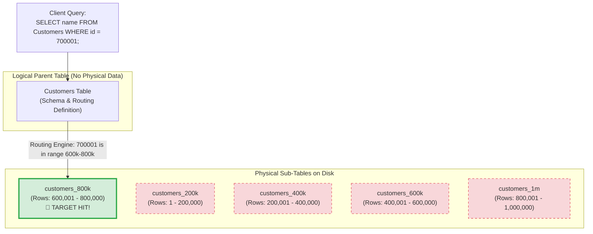

#Database #Partitioning #HorizontalPartitioning #VerticalPartitioning #SystemDesign #Performance #PostgreSQL #SQLServer #CoreConcept

> [!abstract] Executive Summary
> **Database Partitioning** is an optimization technique where a single, massive logical table is decomposed into multiple smaller, independent physical tables (partitions) while preserving a unified query interface. The database engine intelligently inspects the query's `WHERE` clause to determine which specific partition to access, completely bypassing the rest.
> 
> As the senior engineering axiom states:
> > *"The quickest way to query a table with a billion rows is to avoid querying a table with a billion rows."*
> 
> This guide covers the foundational mechanics of database partitioning, the architectural distinction between **Horizontal Partitioning** (splitting by rows) and **Vertical Partitioning** (splitting by columns), how **Partition Pruning** eliminates massive disk I/O, and the fundamental differences between single-node partitioning and distributed database sharding.

---

## 1. Why Does Partitioning Exist? The Monolithic Table Problem

As a relational table grows beyond millions or billions of rows, database performance degrades across multiple physical dimensions:

```
┌─────────────────────────────────────────────────────────────────────────────────────────────────┐
│                                 THE BREAKDOWN OF A MONOLITHIC TABLE                             │
├─────────────────────────┬───────────────────────────────────────────────────────────────────────┤
│ Bottleneck              │ Physical Consequence                                                  │
├─────────────────────────┼───────────────────────────────────────────────────────────────────────┤
│ **B+ Tree Index Bloat** │ Indexes exceed available Buffer Pool RAM; traversals require cold     │
│                         │ disk reads instead of in-memory pointer chases.                       │
├─────────────────────────┼───────────────────────────────────────────────────────────────────────┤
│ **Catastrophic Scans**  │ Any unplanned full table scan (`Seq Scan`) reads gigabytes of cold    │
│                         │ data, completely thrashing the database's memory cache.               │
├─────────────────────────┼───────────────────────────────────────────────────────────────────────┤
│ **Maintenance Locks**   │ Rebuilding an index, running `VACUUM`, or adding columns on a 100M-row│
│                         │ table can lock the table for hours, degrading production SLA.         │
├─────────────────────────┼───────────────────────────────────────────────────────────────────────┤
│ **Data Deletion Pain**  │ Deleting expired rows (`DELETE FROM logs WHERE created_at < ...`)      │
│                         │ floods the Write-Ahead Log (WAL) and leaves massive heap bloat.       │
└─────────────────────────┴───────────────────────────────────────────────────────────────────────┘
```

**The Solution:** Decompose the monolithic table into smaller physical units so that the database engine works only with a manageable subset of data at any given moment.

---

## 2. Partitioning vs. Sharding: The Crucial Boundary

A frequent point of confusion in system design interviews is treating partitioning and sharding as interchangeable. They are not:

```
┌─────────────────────────────────────────────────────────────────────────────────────────────────┐
│                              DATABASE PARTITIONING vs. DATABASE SHARDING                        │
├───────────────────────────────┬─────────────────────────────────┬───────────────────────────────┤
│ Dimension                     │ Database Partitioning           │ Database Sharding             │
├───────────────────────────────┼─────────────────────────────────┼───────────────────────────────┤
│ **Physical Location**         │ **Single Database Instance**    │ **Multiple Database Instances**│
│                               │ (One OS process / one machine)  │ (Shared-nothing cluster)      │
├───────────────────────────────┼─────────────────────────────────┼───────────────────────────────┤
│ **Network Overhead**          │ Zero network hops (Local disk)  │ High network hops (RPC/TCP)   │
├───────────────────────────────┼─────────────────────────────────┼───────────────────────────────┤
│ **Transaction Support**       │ Full ACID transactions across   │ Complex Distributed 2PC       │
│                               │ partitions natively supported.  │ (Two-Phase Commit) or Saga.   │
├───────────────────────────────┼─────────────────────────────────┼───────────────────────────────┤
│ **Architectural Purpose**     │ Local query optimization,       │ Horizontal write scalability  │
│                               │ fast data purging, cache sizing.│ when 1 machine runs out of IOPS│
└───────────────────────────────┴─────────────────────────────────┴───────────────────────────────┘
```

---

## 3. Horizontal Partitioning: Slicing by Rows

In modern database discussions, when engineers say "partitioning" without qualification, they almost always mean **Horizontal Partitioning**.



### How Horizontal Partitioning Works
Imagine slicing a large rectangular loaf of bread horizontally across its length:
1. **The Parent Table (Master):** Acts as a structural umbrella. It defines columns, constraints, and partition keys. In modern engines (like PostgreSQL declarative partitioning), the parent table contains **zero physical data**.
2. **Child Partition Tables:** Separate physical tables on disk (e.g., `customers_200k`, `customers_400k`, `customers_800k`). Each child holds a specific contiguous slice of rows governed by a partition boundary rule.
3. **Partition Metadata:** The engine maintains metadata tracking the exact value boundaries of each child table.

### The Magic of Partition Pruning
Consider the query:
```sql
SELECT name FROM customers WHERE id = 700001;
```

Without partitioning, the database must evaluate an index spanning all 1,000,000 rows.
With horizontal partitioning:
1. The query optimizer intercepts the `WHERE id = 700001` clause.
2. It evaluates the partition boundary metadata:
   - `id < 200000` $\to$ False.
   - `id BETWEEN 200001 AND 400000` $\to$ False.
   - `id BETWEEN 400001 AND 600000` $\to$ False.
   - `id BETWEEN 600001 AND 800000` $\to$ **True!**
3. **Partition Pruning:** The query planner completely discards Partitions 1, 2, 3, and 5. It opens **only `customers_800k`**.
4. Instead of working against 1,000,000 rows, the query scans an index containing **only 200,000 rows**.

---

## 4. Types of Horizontal Partitioning

Databases provide three primary strategies for splitting rows:

```
┌─────────────────────────────────────────────────────────────────────────────────────────────────┐
│                                   HORIZONTAL PARTITIONING STRATEGIES                            │
├─────────────────────┬─────────────────────────────────┬─────────────────────────────────────────┤
│ Strategy            │ How Data is Distributed         │ Ideal Use Case                          │
├─────────────────────┼─────────────────────────────────┼─────────────────────────────────────────┤
│ **1. By Range**     │ Contiguous ranges of values     │ Time-series logs, audit records,        │
│                     │ (Dates, incrementing IDs).      │ transactional dates (`created_at`).     │
├─────────────────────┼─────────────────────────────────┼─────────────────────────────────────────┤
│ **2. By List**      │ Explicit, discrete categorical  │ Geographic domains (Country code:       │
│                     │ values (Enums, country codes).  │ `US`, `EU`, `APAC`), postal zip codes.  │
├─────────────────────┼─────────────────────────────────┼─────────────────────────────────────────┤
│ **3. By Hash**      │ Modulo arithmetic on a hash     │ Uniform distribution when no natural    │
│                     │ of the partition key.           │ ranges exist; prevents write hotspots.  │
└─────────────────────┴─────────────────────────────────┴─────────────────────────────────────────┘
```

### Examples:
* **Range Partitioning:**
  ```sql
  -- Splitting by calendar quarters
  PARTITION BY RANGE (created_at);
  -- Partition 1: '2026-01-01' to '2026-04-01'
  -- Partition 2: '2026-04-01' to '2026-07-01'
  ```
* **List Partitioning:**
  ```sql
  -- Splitting by postal code / region
  PARTITION BY LIST (region_code);
  -- Partition 'customers_west': VALUES IN ('90210', '91111')
  -- Partition 'customers_east': VALUES IN ('10001', '10002')
  ```

---

## 5. Vertical Partitioning: Slicing by Columns

While horizontal partitioning slices rows, **Vertical Partitioning** slices the table vertically down the columns.

```
┌────────────────────────────────────────────────────────────────────────────────────────┐
│                              UNPARTITIONED MONOLITHIC ROW                              │
├─────────┬──────────────┬──────────────┬──────────────┬─────────────────────────────────┤
│ id (4B) │ name (30B)   │ email (50B)  │ status (4B)  │ raw_pdf_contract_blob (5 MB)    │
└─────────┴──────────────┴──────────────┴──────────────┴─────────────────────────────────┘
                                       │
                     [ VERTICAL SLICE WITH A KNIFE ]
                                       ▼
┌───────────────────────────────────────────────┐     ┌──────────────────────────────────┐
│ TABLE A: HOT / COMPACT COLUMNS (FAST SSD)     │     │ TABLE B: COLD / HEAVY BLOB DATA  │
├─────────┬──────────────┬──────────────┬───────┤     ├─────────┬────────────────────────┤
│ id (4B) │ name (30B)   │ email (50B)  │ status│     │ id (4B) │ raw_pdf_contract_blob  │
└─────────┴──────────────┴──────────────┴───────┘     └─────────┴────────────────────────┘
```

### The Mechanism
Vertical partitioning separates frequently accessed ("hot") lightweight columns from rarely accessed ("cold") heavyweight columns:
- **Relationship to Normalization:** Vertical partitioning is practically identical to database normalization principles, but is implemented specifically for **hardware, I/O, and storage-tier optimization**.
- **The Core Problem it Solves:** 
  In a relational database, rows are stored in 8 KB disk pages. If a single row contains a 2 MB PDF or a massive JSON text blob, that page can fit very few rows. A query selecting just `id` and `name` must read all those massive pages off disk!
- **The Implementation:**
  1. **Hot Table (`users`):** Stores `id, name, email, status`. Fits hundreds of rows per 8 KB page. Pinned to high-speed NVMe storage.
  2. **Cold Table (`user_documents`):** Stores `id, contract_blob`. Only accessed when a user explicitly downloads their document. Can be mapped to cheaper, high-density magnetic storage or separate tablespaces.

---

## 6. Comprehensive Comparison: Horizontal vs. Vertical Partitioning

| Dimension | Horizontal Partitioning | Vertical Partitioning |
| :--- | :--- | :--- |
| **Split Axis** | **By Rows** (records partitioned across tables). | **By Columns** (attributes partitioned across tables). |
| **Schema Uniformity** | All child partitions share the **exact same columns**. | Each partition has **different columns** + common Primary Key. |
| **Primary Goal** | Accelerate queries via **Partition Pruning**; fast deletion. | Maximize **Buffer Pool density** by removing bulky blobs. |
| **Query Routing** | Automatic by DBMS optimizer via `WHERE` clause. | Often requires explicit SQL `JOIN` or application logic. |
| **Storage Optimization** | Rolling old ranges to cold disk tablespaces. | Isolating huge BLOB columns on high-capacity storage. |
| **Common Analogy** | Slicing a bread loaf horizontally into slices. | Separating the bread crust from the bread crumb. |

---

## 7. The Operational Superpower: $O(1)$ Data Purging

One of the greatest production benefits of horizontal partitioning is lifecycle management:

```
┌─────────────────────────────────────────────────────────────────────────────────────────────────┐
│                                 DELETING 100,000,000 EXPIRED LOG ROWS                           │
├─────────────────────────────────────────────────┬───────────────────────────────────────────────┤
│ Traditional Unpartitioned Table                 │ Range-Partitioned Table                       │
├─────────────────────────────────────────────────┼───────────────────────────────────────────────┤
│ `DELETE FROM logs WHERE created_at < '2025-01';`│ `ALTER TABLE logs DROP PARTITION logs_2024;`  │
│ ❌ Scans 100M rows row-by-row.                  │ ✅ Instantaneous filesystem unlink ($O(1)$).  │
│ ❌ Generates gigabytes of WAL logs.             │ ✅ Generates zero WAL row logs.               │
│ ❌ Triggers massive Autovacuum bloat.           │ ✅ Instantly frees disk space to OS.          │
│ ❌ Holds row/table locks for hours.             │ ✅ Zero transaction locks on active data.     │
└─────────────────────────────────────────────────┴───────────────────────────────────────────────┘
```

---

## 8. Summary Checklist for Senior Engineers

- [ ] **The Golden Rule:** The quickest way to query a billion rows is to avoid querying a billion rows.
- [ ] **Horizontal = Slicing by Rows:** Child tables have identical schemas; query planner prunes partitions via `WHERE` clause.
- [ ] **Vertical = Slicing by Columns:** Separates hot metadata from cold, bulky BLOBs to maximize page row density in the Buffer Pool.
- [ ] **Partitioning is local:** Runs on a single database server with full ACID transactions; does not introduce distributed network complexity like sharding.
- [ ] **Pruning requires the Partition Key:** If a query omits the partition key in its `WHERE` clause, the database must scan **every single partition**, completely defeating the optimization!
