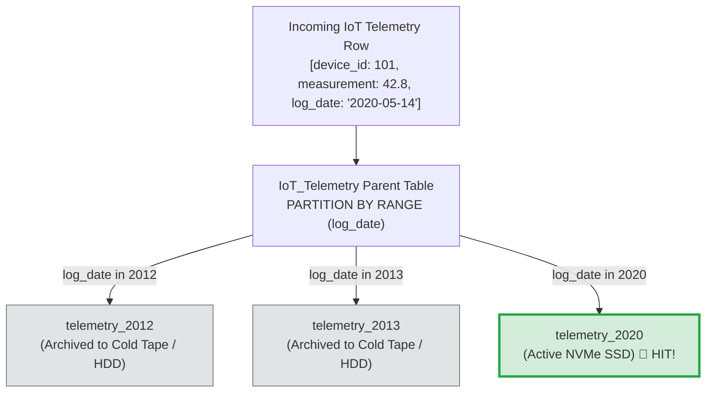
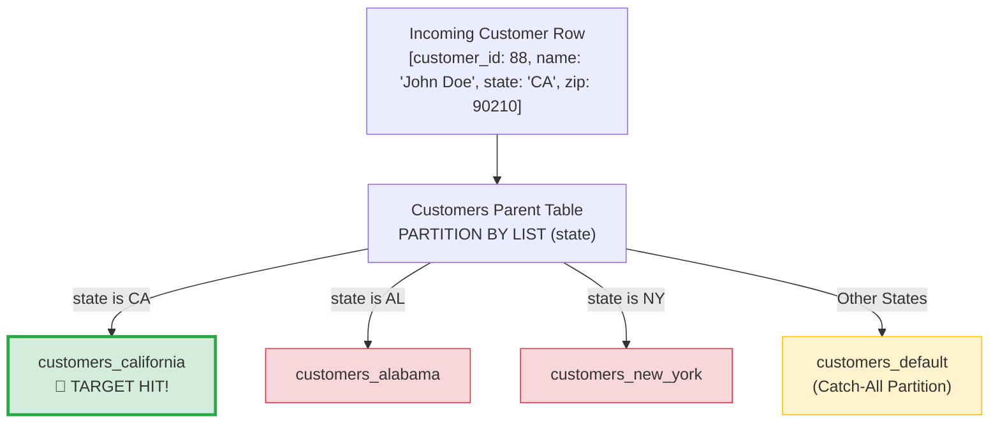
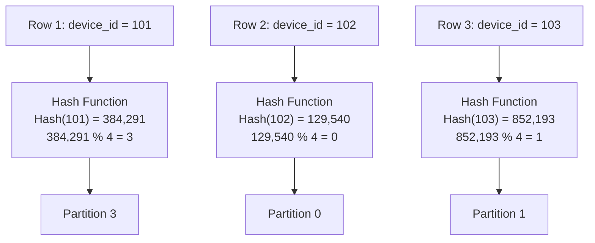
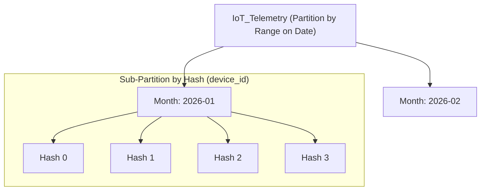

#Database #Partitioning #RangePartitioning #ListPartitioning #HashPartitioning #SystemDesign #Performance #PostgreSQL #IoT #Archival #CoreConcept

> [!abstract] Executive Summary
> Horizontal partitioning decomposes a large table by rows, but the fundamental architectural question is: **How do we decide which row belongs in which partition?**
> 
> Relational databases provide three primary partitioning strategies, each optimized for distinct data access profiles:
> 1. **Range Partitioning:** Slices data across continuous, ordered spectrums (timestamps, chronological logs, sequential IDs). Ideal for time-series, IoT telemetry, and **tiered cold storage archiving**.
> 2. **List Partitioning:** Slices data across explicit, discrete, non-contiguous values (states, zip codes, countries, multi-tenant IDs). Ideal for geographic routing and tenant isolation.
> 3. **Hash Partitioning:** Distributes rows pseudo-randomly using a mathematical hash function modulo the partition count. Ideal for **eliminating write hotspots** when no natural range or list exists.

---

## 1. Range Partitioning: Continuous Ordered Domains

Range partitioning maps rows to partitions based on whether the partition key falls within a specified contiguous interval:
$$\text{Lower Bound} \le \text{Partition Key} < \text{Upper Bound}$$



### 1. The Core Enterprise Use Case: IoT & Event Logs
In modern data engineering, IoT devices, telemetry agents, and audit logs emit a continuous stream of timestamped rows:
- Data is naturally partitioned by **Year, Quarter, or Month** (`log_date`).
- Current queries (`WHERE log_date >= '2026-01-01'`) automatically prune all historical years, scanning only the current active month.

### 2. Tiered Storage & Cold Archival (The 1995 Principle)
> [!tip] The "Who Queries 1995 Data?" Principle
> In production, data access frequency follows a power-law distribution. 99% of user queries target data generated in the last 30 to 90 days. Almost nobody queries log data from 10 or 20 years ago with millisecond latency requirements.
> 
> Range partitioning enables **Hardware Tiering (Tablespaces)**:
> - **Active / Hot Partitions (`2025`, `2026`):** Stored in memory-pinned tablespaces on ultra-fast PCIe NVMe SSDs.
> - **Historical / Cold Partitions (`2012`, `2013`):** Detached or mapped to slow, high-density magnetic disks, network-attached storage (NFS/EBS cold), or tape archives.
> - Even if queries on historical data take 30 seconds, it does not impact production SLAs for active workloads!

### 3. PostgreSQL Declarative Range Implementation
```sql
-- 1. Create the partitioned master table
CREATE TABLE iot_measurements (
    device_id INT NOT NULL,
    measurement NUMERIC(8,2) NOT NULL,
    log_date DATE NOT NULL
) PARTITION BY RANGE (log_date);

-- 2. Define historical cold partitions (mapped to cheaper tablespace)
CREATE TABLE measurements_2012 PARTITION OF iot_measurements
    FOR VALUES FROM ('2012-01-01') TO ('2013-01-01')
    TABLESPACE cold_archive_storage;

CREATE TABLE measurements_2013 PARTITION OF iot_measurements
    FOR VALUES FROM ('2013-01-01') TO ('2014-01-01')
    TABLESPACE cold_archive_storage;

-- 3. Define active hot partition (mapped to high-speed NVMe tablespace)
CREATE TABLE measurements_2026 PARTITION OF iot_measurements
    FOR VALUES FROM ('2026-01-01') TO ('2027-01-01')
    TABLESPACE fast_nvme_storage;
```

---

## 2. List Partitioning: Discrete Categorical Values

List partitioning assigns rows based on explicit, enumerated, non-contiguous values. Unlike range partitioning, there is no arithmetic order—rows are routed based on **membership in an explicit list**.



### 1. Real-World Use Cases
- **Geographic Segmentation:** Slicing by state (`CA`, `AL`, `NY`), country code (`US`, `DE`, `JP`), or postal zip codes (`90205`, `91111`).
- **Multi-Tenant SaaS:** Housing massive enterprise tier-1 clients in dedicated partitions while routing smaller clients to a shared pool.
- **Business Status:** Partitioning orders by state enum (`PLACED`, `PROCESSING`, `COMPLETED`, `ARCHIVED`).

### 2. The Critical Importance of the `DEFAULT` Partition
If an incoming row has a state code (e.g., `NV` for Nevada) that does not match any defined list partition:
- Without a `DEFAULT` partition, the database **throws a runtime error and aborts the entire transaction**!
- Always define a `DEFAULT` partition to act as a safety catch-all.

### 3. PostgreSQL Declarative List Implementation
```sql
-- 1. Create parent table partitioned by state
CREATE TABLE customers (
    id SERIAL,
    name VARCHAR(100) NOT NULL,
    state VARCHAR(2) NOT NULL,
    zip_code VARCHAR(10) NOT NULL
) PARTITION BY LIST (state);

-- 2. Define specific discrete partitions
CREATE TABLE customers_california PARTITION OF customers
    FOR VALUES IN ('CA');

CREATE TABLE customers_alabama PARTITION OF customers
    FOR VALUES IN ('AL');

CREATE TABLE customers_east_coast PARTITION OF customers
    FOR VALUES IN ('NY', 'NJ', 'MA');

-- 3. Safety Catch-All Partition
CREATE TABLE customers_default PARTITION OF customers
    DEFAULT;
```

---

## 3. Hash Partitioning: Uniform Anti-Hotspot Distribution

Hash partitioning uses a mathematical hash function to deterministically scatter rows across a fixed number of partitions:
$$\text{Partition Index} = \text{Hash}(\text{Partition Key}) \pmod N$$



### 1. The Core Purpose: Preventing Write Hotspots
In Range partitioning by date or ID, **100% of new writes hit the latest partition** (the "hot head" problem). The current month's partition absorbs all disk I/O while older partitions sit idle.
- **Hash partitioning completely neutralizes write hotspots.**
- New writes are scattered uniformly across all $N$ physical partitions, balancing disk I/O evenly across storage controllers.

### 2. Distributed Parallels in Engineering
- **Apache Cassandra & DynamoDB:** Use **Consistent Hashing Token Rings** (Murmur3Partitioner) to distribute rows evenly across distributed cluster nodes.
- **Reverse Proxies & Load Balancers (Nginx / HAProxy):** Implement **IP Hashing (`ip_hash`)** to deterministically map incoming client IP addresses to specific backend servers.

### 3. The Trade-Off: Inability to Prune Range Queries
> [!CAUTION] The Fatal Flaw of Hash Partitioning
> Hash functions destroy natural ordering. Adjacent keys (`id = 101` and `id = 102`) hash to completely different partitions!
> - **Point Queries:** `WHERE id = 101` $\to$ Prunes down to Partition 3 instantly ($O(1)$).
> - **Range Queries:** `WHERE id BETWEEN 100 AND 200` $\to$ **CANNOT BE PRUNED!** The database must scan **every single hash partition**, completely negating the benefits of partitioning for range queries.

### 4. PostgreSQL Declarative Hash Implementation
```sql
-- 1. Create parent table with 4 hash partitions
CREATE TABLE orders (
    order_id INT NOT NULL,
    customer_id INT NOT NULL,
    total_amount NUMERIC(10,2) NOT NULL
) PARTITION BY HASH (order_id);

-- 2. Define modulo buckets (Modulus 4, Remainder 0 to 3)
CREATE TABLE orders_p0 PARTITION OF orders FOR VALUES WITH (MODULUS 4, REMAINDER 0);
CREATE TABLE orders_p1 PARTITION OF orders FOR VALUES WITH (MODULUS 4, REMAINDER 1);
CREATE TABLE orders_p2 PARTITION OF orders FOR VALUES WITH (MODULUS 4, REMAINDER 2);
CREATE TABLE orders_p3 PARTITION OF orders FOR VALUES WITH (MODULUS 4, REMAINDER 3);
```

---

## 4. Architectural Comparison & Decision Matrix

| Dimension | Range Partitioning | List Partitioning | Hash Partitioning |
| :--- | :--- | :--- | :--- |
| **Data Nature** | Continuous, ordered scales (time, IDs). | Discrete, categorical sets (states, enums). | Arbitrary keys with no natural groups. |
| **Write Distribution** | ❌ Highly skewed (Hot head on latest date). | ⚠️ Can be skewed (e.g. 70% in California). | ✅ **Uniformly balanced** across all disks. |
| **Point Query Pruning**| ✅ Excellent (`WHERE date = ...`). | ✅ Excellent (`WHERE state = ...`). | ✅ Excellent (`WHERE id = ...`). |
| **Range Query Pruning**| 🏆 **Maximum Efficiency** (`BETWEEN`). | ❌ Poor (No concept of range). | ❌ **Impossible** (Scans all partitions). |
| **Tiered Archiving**   | 🏆 **Native & Simple** (Drop/detach old years).| ⚠️ Difficult (Requires tenant deletion). | ❌ Impossible (Data evenly mixed). |
| **Ideal Scenario**     | IoT, Financial Audits, Event Telemetry. | Geographic routing, Multi-Tenant SaaS. | High-concurrency primary key writes. |

---

## 5. Composite Partitioning (Sub-Partitioning)

When a dataset suffers from both high volume and high concurrency, advanced architectures implement **Composite Partitioning**:
1. **Primary Partitioning by Range:** Slices data by `log_date` (Month/Year) to enable **fast range queries and cold storage tiering**.
2. **Secondary Sub-Partitioning by Hash:** Slices each monthly partition into 4 or 8 hash buckets by `device_id` to **parallelize concurrent writes and eliminate lock contention**.



---

## 6. Summary Checklist for Senior Engineers

- [ ] **Choose Range for Time & Archiving:** Use Range partitioning when queries filter on dates and when older data must be dropped or archived to cheap storage.
- [ ] **Choose List for Discrete Geographies/Tenants:** Use List partitioning for finite categories, and **always define a `DEFAULT` partition** to prevent transaction aborts.
- [ ] **Choose Hash for Write Concurrency:** Use Hash partitioning to eliminate hot-spotting on write-heavy tables, but remember that **range query pruning is lost**.
- [ ] **Never over-partition:** Creating thousands of tiny partitions degrades the query optimizer's planning time (`Planning Time > Execution Time`). Target partitions between **10 GB and 50 GB** each.
