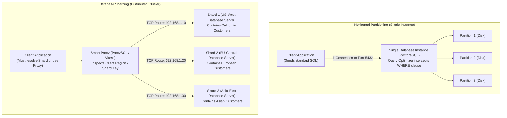

#Database #Partitioning #Sharding #DistributedSystems #SystemDesign #ProxySQL #Vitess #Architecture #Scale #CoreConcept

> [!abstract] Executive Summary
> Both **Partitioning** and **Sharding** break massive datasets into smaller, manageable subsets. However, they operate at fundamentally different tiers of the infrastructure stack:
> - **Horizontal Partitioning:** Splits a table into multiple sub-tables **within the same database instance**. The database engine manages routing natively, and the client application is **completely agnostic**.
> - **Database Sharding:** Splits a table across **completely independent database servers**. Routing requires a shard-aware client or proxy layer (e.g., ProxySQL, Vitess), introducing network latency, distributed consensus, and operational complexity.
> 
> As backend engineers, understanding the exact boundary between single-node partitioning and multi-node sharding determines whether your architecture remains simple and ACID-compliant or requires a multi-million-dollar distributed systems investment.

---

## 1. The Core Architectural Divide

```
┌─────────────────────────────────────────────────────────────────────────────────────────────────┐
│                                 PARTITIONING vs. SHARDING ARCHITECTURE                          │
├───────────────────────────────┬─────────────────────────────────┬───────────────────────────────┤
│ Dimension                     │ Horizontal Partitioning         │ Database Sharding             │
├───────────────────────────────┼─────────────────────────────────┼───────────────────────────────┤
│ **Physical Boundary**         │ **Single Database Server**      │ **Multiple Database Servers** │
│                               │ (Same CPU, RAM, and OS engine)  │ (Shared-nothing cluster)      │
├───────────────────────────────┼─────────────────────────────────┼───────────────────────────────┤
│ **Client Awareness**          │ **Client-Agnostic**             │ **Shard-Aware / Proxy-Driven** │
│                               │ Client has zero idea partitions │ Client or proxy must resolve  │
│                               │ exist; query is standard SQL.   │ target server IP address.     │
├───────────────────────────────┼─────────────────────────────────┼───────────────────────────────┤
│ **Table Naming Reality**      │ **Backend Table Names Change**  │ **Table Names Stay Identical**│
│                               │ (`customers_800k`), but query   │ (`customers` on all nodes),   │
│                               │ targets parent (`customers`).   │ but **Server IP Changes**!    │
├───────────────────────────────┼─────────────────────────────────┼───────────────────────────────┤
│ **Cross-Table Queries**       │ Native, fast in-memory joins    │ **Scatter-Gather over Network**│
│                               │ and full ACID transactions.     │ (Latency penalty; breaks ACID)│
├───────────────────────────────┼─────────────────────────────────┼───────────────────────────────┤
│ **Operational Complexity**    │ Low (Native DBMS feature)       │ **Massive Investment**        │
│                               │                                 │ (Vitess, ProxySQL, Rebalancers│
└───────────────────────────────┴─────────────────────────────────┴───────────────────────────────┘
```

---

## 2. Client Awareness: The Agnostic Client vs. The Shard Router



### 1. Partitioning: The Client is Completely Agnostic
When using single-node partitioning:
- The backend engineer writes simple SQL:
  ```sql
  SELECT name FROM customers WHERE id = 700001;
  ```
- The client application connects to a single database endpoint (e.g., `db.internal:5432`).
- The database engine parses the query, reads partition metadata, prunes unnecessary partitions, and returns the result. **The application code has zero awareness that partitioning exists.**

### 2. Sharding: The Client / Proxy Must Be Shard-Aware
In a sharded architecture:
- Data is spread across distinct physical servers, often distributed globally for **geo-locality and latency reduction** (e.g., California users routed to US-West; Tokyo users routed to Asia-East).
- Before a query can even be sent, the system must answer: **Which server IP holds this user's data?**
- This routing is resolved either by:
  1. **Application-Level Routing:** Application code maintains connection pools to Shard 1, Shard 2, and Shard 3, resolving target nodes using hashing algorithms.
  2. **Proxy-Level Routing:** An intermediary database proxy (such as **ProxySQL** or **Vitess**) intercepts incoming SQL, evaluates the sharding key or client IP, and establishes a TCP connection to the appropriate database shard.

---

## 3. The Table Naming Paradox

A fascinating architectural detail highlighted in database design is how table names and network targets invert between the two approaches:

```
┌─────────────────────────────────────────────────────────────────────────────────────────────────┐
│                                   THE TABLE NAMING PARADOX                                      │
├───────────────────────────────┬─────────────────────────────────┬───────────────────────────────┤
│ Feature                       │ Horizontal Partitioning         │ Database Sharding             │
├───────────────────────────────┼─────────────────────────────────┼───────────────────────────────┤
│ **Physical Table Names**      │ **Names Change on Disk:**       │ **Names Stay Identical:**     │
│                               │ `customers_200k`                │ Shard 1: `customers`          │
│                               │ `customers_400k`                │ Shard 2: `customers`          │
│                               │ `customers_800k`                │ Shard 3: `customers`          │
├───────────────────────────────┼─────────────────────────────────┼───────────────────────────────┤
│ **Target Server IP**          │ **Stays Exactly the Same**      │ **Changes Constantly**        │
│                               │ `10.0.0.1:5432`                 │ `10.0.1.5` vs. `10.0.2.8`     │
└───────────────────────────────┴─────────────────────────────────┴───────────────────────────────┘
```

* **In Partitioning:** You query the logical abstraction `customers`, while underneath the hood, the engine redirects the I/O to physical sub-tables with distinct names (`customers_2020`, `customers_2021`).
* **In Sharding:** Every physical database instance runs the exact same schema with the exact same table name (`customers`), but your network layer must dynamically switch the **destination IP address**.

---

## 4. The Engineering Investment: Why Sharding is Painful

> [!CAUTION] The High Cost of Sharding
> Moving from single-node partitioning to distributed sharding is not a minor feature upgrade—it is a **fundamental paradigm shift** that permanently alters how you write application software.

```
┌─────────────────────────────────────────────────────────────────────────────────────────────────┐
│                                  THE ARCHITECTURAL COMPLEXITY GAP                               │
├───────────────────────────────┬─────────────────────────────────┬───────────────────────────────┤
│ Challenge                     │ In Partitioning (Single Instance│ In Sharding (Multi-Server)    │
├───────────────────────────────┼─────────────────────────────────┼───────────────────────────────┤
│ **Cross-Table Joins**         │ Trivially fast in RAM.          │ **Scatter-Gather Nightmare:** │
│                               │                                 │ Must query 10 servers over    │
│                               │                                 │ network, merge in app memory. │
├───────────────────────────────┼─────────────────────────────────┼───────────────────────────────┤
│ **Distributed Transactions**  │ Full ACID transactions native.  │ Requires **Two-Phase Commit** │
│                               │ Zero coordinator overhead.      │ (2PC) or Saga; destroys speed.│
├───────────────────────────────┼─────────────────────────────────┼───────────────────────────────┤
│ **Foreign Key Constraints**   │ Enforced across partitions.     │ **Impossible** across shards. │
├───────────────────────────────┼─────────────────────────────────┼───────────────────────────────┤
│ **Cluster Resharding**        │ Simple `ALTER TABLE` partition. │ Moving terabytes across nodes │
│                               │                                 │ without downtime (Extremely   │
│                               │                                 │ complex consistent hashing).  │
└───────────────────────────────┴─────────────────────────────────┴───────────────────────────────┘
```

---

## 5. Technology Ecosystem: Where Tools Fit

### 1. Native Partitioning Engines (Single-Node)
- **PostgreSQL Declarative Partitioning:** Native syntax (`PARTITION BY RANGE/LIST/HASH`) introduced in PostgreSQL 10+.
- **MySQL InnoDB Partitioning:** Built-in table partitioning engine.
- **SQL Server Partitioning:** Partition Functions and Partition Schemes mapping ranges to separate filegroups.

### 2. Sharding Abstraction Layers & Distributed SQL
- **Vitess:** Originally developed by YouTube to scale MySQL horizontally. Vitess acts as a smart clustering proxy, making a cluster of hundreds of MySQL shards look like a single monolithic database to application code.
- **ProxySQL:** A high-performance, protocol-aware MySQL reverse proxy capable of routing read/write traffic and sharding queries based on regex rules and user IPs.
- **Citus (PostgreSQL Extension):** Transforms PostgreSQL into a distributed database, distributing tables across worker nodes using hash sharding while maintaining SQL support.
- **CockroachDB / Google Cloud Spanner:** Modern Distributed SQL engines with native, automatic distributed range sharding (Ranges) and Raft consensus.

---

## 6. Senior Architect Decision Framework

```
                          ┌─────────────────────────────────────┐
                          │  Is your table growing past 100M+   │
                          │        rows or slowing down?        │
                          └──────────────────┬──────────────────┘
                                             │
             ┌───────────────────────────────┴───────────────────────────────┐
             ▼                                                               ▼
   Can 1 large server handle                                       Has single-node vertical
   your write volume and IOPS?                                     scaling hit physical limits?
             │                                                     (RAM/CPU/Storage IOPS saturated)
             ▼                                                               │
   [ Stay on Single Instance ]                                               ▼
             │                                                     [ Move to Sharding ]
             ▼                                                               │
   Implement **Partitioning**                                                ▼
   - Range by date/logs                                            Deploy **Vitess / Citus / Spanner**
   - Retain full ACID & Joins                                      - Plan sharding keys carefully
   - Archive cold data to cheap disk                               - Accept distributed query cost
```

---

## 7. Summary Checklist for Senior Engineers

- [ ] **Partitioning is local:** Operates within a single database instance; the client remains 100% agnostic.
- [ ] **Sharding is distributed:** Distributes data across independent servers; requires shard-aware clients, proxies (ProxySQL, Vitess), or distributed SQL engines.
- [ ] **Remember the naming paradox:** Partitioning changes physical table names on disk; sharding keeps table names identical while changing destination server IPs.
- [ ] **Exhaust partitioning before sharding:** Always implement table partitioning, index tuning, and read replicas *first*. Sharding should be your last resort due to the loss of cross-node foreign keys, distributed join penalties, and 2PC transaction overhead.
