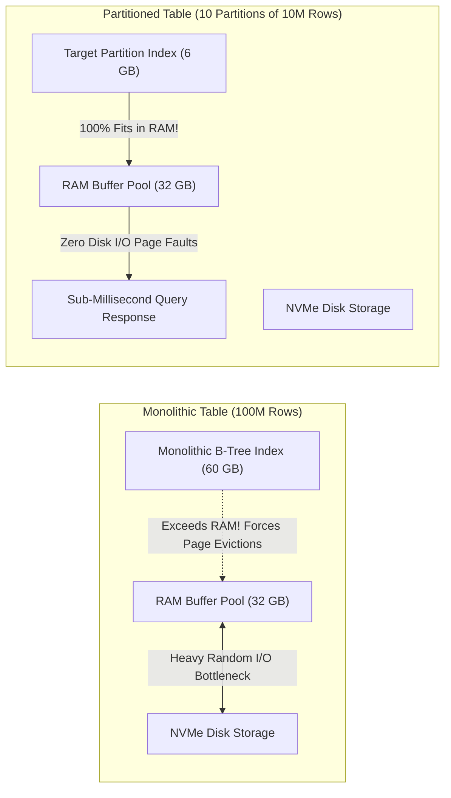
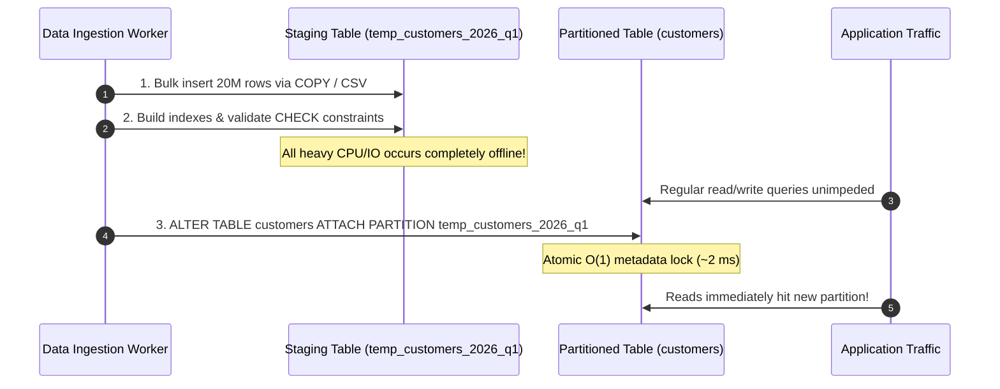
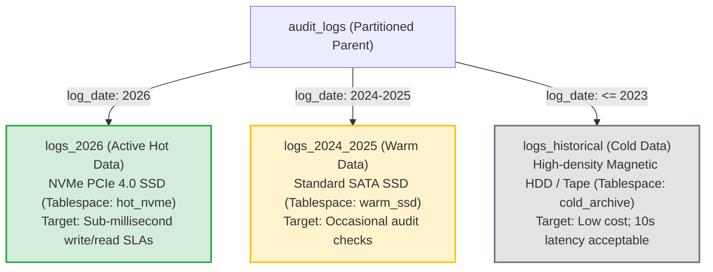
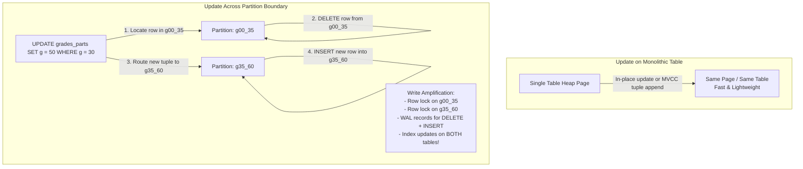

#Database #Partitioning #Performance #SystemDesign #DatabaseEngineering #QueryPlanner #StorageTiering #WriteAmplification #ProductionGotchas #CoreConcept

> [!abstract] Executive Summary
> In backend engineering, no architectural pattern is a silver bullet. Every architectural design decision is a double-edged sword that trades one set of constraints for another.
> 
> Horizontal partitioning offers dramatic advantages for query performance, memory management, and data lifecycle operations when tables expand into tens or hundreds of millions of rows. However, when poorly designed—such as partitioning on mutable keys or executing unpruned scatter-gather queries—it can degrade database performance below that of a standard monolithic table.
> 
> This guide details the **pros, cons, internal mechanics, and production pitfalls** of database partitioning to equip senior engineers with the decision framework needed before introducing partitioning to a production system.

---

## 1. Architectural Trade-Off Overview

```
┌─────────────────────────────────────────────────────────────────────────────────────────────────┐
│                                 THE PARTITIONING TRADE-OFF MATRIX                               │
├─────────────────────────────────────────────────────────────────┬───────────────────────────────┤
│ Advantages (The Pros)                                           │ Disadvantages (The Cons)      │
├─────────────────────────────────────────────────────────────────┼───────────────────────────────┤
│ **1. Memory & Cache Residency:** Working sets fit in RAM;      │ **1. Cross-Partition Updates:** Row migrations│
│    avoids disk I/O page thrashing and buffer eviction.          │    turn into expensive `DELETE` + `INSERT`.   │
├─────────────────────────────────────────────────────────────────┼───────────────────────────────┤
│ **2. Query Planner Predictability:** Eliminates scattered       │ **2. Multi-Partition Scatter Penalty:**       │
│    index scans in favor of fast sequential scans.               │    Queries missing partition keys hit all tabs│
├─────────────────────────────────────────────────────────────────┼───────────────────────────────┤
│ **3. Rapid Zero-Downtime Bulk Loading:** Load data into         │ **3. Schema Migration Friction:** Heavy DDL   │
│    staging tables and attach in $O(1)$ metadata time.           │    locks cascading across dozens of tables.   │
├─────────────────────────────────────────────────────────────────┼───────────────────────────────┤
│ **4. Hardware Storage Tiering:** Move historical partitions to  │ **4. Secondary Index Complexity:** Global     │
│    cheap HDD/tape; keep hot partitions on PCIe NVMe SSDs.       │    uniqueness constraints are restricted.     │
└─────────────────────────────────────────────────────────────────┴───────────────────────────────┘
```

---

## 2. The Pros of Partitioning (In-Depth Analysis)

### 1. Memory & Cache Residency: Escaping the I/O-Bound Bottleneck
When an unpartitioned table grows to hundreds of millions or billions of rows:
- The monolithic table and its B-tree indexes grow to tens or hundreds of gigabytes.
- Once the index working set exceeds the database buffer pool (`shared_buffers` in PostgreSQL, `innodb_buffer_pool_size` in MySQL), the database becomes **I/O-bound**.
- Every index traversal incurs physical disk reads, causing OS page cache evictions and latency spikes.



By partitioning the dataset, the active working set for any given query is confined to a single child table whose index is a fraction of the monolithic size (~6 GB vs. ~60 GB). The entire index remains pinned in RAM, resulting in **100% cache hits**.

---

### 2. Query Planner Intelligence: Sequential Scan vs. Scattered Index Scan

A fundamental responsibility of the relational query planner is deciding between a **B-tree Index Scan** and a **Sequential Table Scan**:

```
┌─────────────────────────────────────────────────────────────────────────────────────────────────┐
│                               THE SCATTERED INDEX SCAN PENALTY                                  │
├─────────────────────────────────────────────────────────────────────────────────────────────────┤
│ Junior engineers often assume that using an index is *always* faster. This is false!           │
│ When a query selects a substantial percentage of rows (e.g., 20% to 40% of the table):          │
│ 1. The database reads a pointer from the index leaf node.                                       │
│ 2. It jumps to a random disk page in the heap table to fetch the row data.                      │
│ 3. It jumps back to the index to read the next pointer.                                         │
│ 4. It jumps to another completely random page in the heap.                                      │
│                                                                                                 │
│ This back-and-forth "scattered index scan" produces massive random disk I/O, which is          │
│ orders of magnitude slower than sequentially reading contiguous blocks from disk!               │
└─────────────────────────────────────────────────────────────────────────────────────────────────┘
```

#### How Partitioning Solves This:
On a monolithic 100-million row table, the query planner often struggles with fuzzy cardinality estimations, mistakenly choosing a scattered index scan that thrashes disk.

In a partitioned table:
- The child partition contains only a small, contiguous slice of data.
- The query planner can confidently determine that a **sequential scan over a compact 200 MB partition** is faster than an index traversal.
- The planner's decision-making becomes simpler, more deterministic, and less prone to performance regressions.

---

### 3. Rapid Zero-Downtime Bulk Loading via Table Attachment

In high-throughput enterprise pipelines, inserting millions of rows into an active production table causes severe row-locking, WAL contention, and application latency.

Partitioning enables a **Staging and Attachment Pattern**:



1. **Offline Preparation:** You load 50 million rows into a completely separate, unattached table (`temp_orders_2026_03`).
2. **Offline Indexing:** Build B-trees and add `CHECK` constraints on the staging table without impacting production users.
3. **Instant Attachment:** Execute a single DDL command:
   ```sql
   ALTER TABLE orders ATTACH PARTITION temp_orders_2026_03
       FOR VALUES FROM ('2026-03-01') TO ('2026-04-01');
   ```
4. This command is an **atomic $O(1)$ catalog update** requiring near-zero lock duration.

#### The MySQL CSV Storage Engine Pattern:
In MySQL and MariaDB, you can create a table backed directly by the `CSV` storage engine pointing to flat files:
- If an analytics system outputs a 300-million-row CSV dump, you can mount it directly as a database table.
- Copy or convert it into an InnoDB partition, validate constraints, and attach it to the parent table seamlessly.

---

### 4. Storage Tiering & Cold Data Archiving

Data access frequency follows a steep power-law curve: **95% of queries target data generated in the last 30 to 90 days**.



With range partitioning, database administrators map partitions to distinct **Tablespaces**:
```sql
-- Hot partition on ultra-fast NVMe storage
CREATE TABLE logs_2026 PARTITION OF audit_logs
    FOR VALUES FROM ('2026-01-01') TO ('2027-01-01')
    TABLESPACE hot_nvme_storage;

-- Cold partition on cheap, dense spinning magnetic disks
CREATE TABLE logs_2020 PARTITION OF audit_logs
    FOR VALUES FROM ('2020-01-01') TO ('2021-01-01')
    TABLESPACE cold_archive_storage;
```
Even if queries against year 2020 data take 15 seconds, production SLAs for current operational workloads remain unaffected, slashing enterprise infrastructure costs by up to 70%.

---

## 3. The Cons & Production Pitfalls of Partitioning

### 1. Cross-Partition Row Migrations on `UPDATE`

> [!caution] The Most Dangerous Partitioning Anti-Pattern: Partition Key Updates
> Never choose a column as your partition key if that column is frequently updated!

#### The Mechanics of Cross-Partition Updates:
Consider our student grades example where the table is partitioned by grade:
- Partition `g00_35`: Grades $0 \le g < 35$
- Partition `g35_60`: Grades $35 \le g < 60$

What happens when a teacher regrades a student, raising their mark from `30` to `50`?
```sql
UPDATE grades_parts SET g = 50 WHERE student_id = 49210 AND g = 30;
```



#### Why This Degrades Performance:
1. **The Hidden `DELETE` + `INSERT`:** The database cannot simply modify the record. It must perform a physical `DELETE` on the source partition (`g00_35`) and an `INSERT` into the target partition (`g35_60`).
2. **Distributed Locking Overhead:** The database engine must acquire locks on **two separate physical tables** within the same transaction.
3. **Index & WAL Write Amplification:** B-tree entries must be unlinked in the old partition's index and inserted into the new partition's index, producing double the Write-Ahead Logging (WAL) volume.
4. **Hardware Wear:** Executing millions of cross-partition updates burns through SSD write endurance and accelerates table bloat, requiring frequent vacuums.

---

### 2. The Multi-Partition Scatter Scan Penalty

Partitioning is only fast when the query optimizer can perform **Partition Pruning**.

If your query:
- Does not specify the partition key in the `WHERE` clause.
- Uses an expression on the partition key that prevents static pruning (e.g., `WHERE abs(g) = 30`).
- Specifies a wide range that matches all partitions (e.g., `WHERE id > 1`).

The query planner is forced to execute a **multi-table scatter scan**:

```text
Gather  (cost=1000.00..50000.00 rows=100000 width=16)
  ->  Append
        ->  Seq Scan on partition_1  (cost=0.00..12000.00 ...)
        ->  Seq Scan on partition_2  (cost=0.00..11500.00 ...)
        ->  Seq Scan on partition_3  (cost=0.00..11200.00 ...)
        ->  Seq Scan on partition_4  (cost=0.00..11800.00 ...)
```

```
┌─────────────────────────────────────────────────────────────────────────────────────────────────┐
│                           WHY SCATTER SCANS ARE SLOWER THAN MONOLITHIC                          │
├─────────────────────────────────────────────────────────────────────────────────────────────────┤
│ Scanning 100 child partitions sequentially is noticeably SLOWER than scanning a single          │
│ 100-million-row monolithic table. Why?                                                          │
│ 1. **File Descriptor Churn:** The OS kernel must open, lock, and manage 100 distinct files.     │
│ 2. **Planner Overhead:** Generating an execution plan for 100 Append nodes consumes CPU & RAM.  │
│ 3. **Disrupted Sequential Read-Ahead:** Modern disks and OS kernels excel at contiguous,        │
│    sequential read-ahead on a single file. Scattering across 100 separate table files breaks    │
│    sequential read-ahead optimizations, converting reads into fragmented seek operations.       │
└─────────────────────────────────────────────────────────────────────────────────────────────────┘
```

---

### 3. Schema Migration & Maintenance Complexity

Altering database schemas is significantly more complex in partitioned architectures:
- **DDL Cascades:** Adding a column (`ALTER TABLE ... ADD COLUMN ...`) or altering datatypes must propagate across every child partition, acquiring exclusive metadata locks (`ACCESS EXCLUSIVE`) on all tables simultaneously.
- **Global Uniqueness Constraints:** Most relational engines (PostgreSQL, MySQL) do **not** support global unique indexes on partitioned tables unless the **partition key is included in the unique constraint**:
  ```sql
  -- FAILS in PostgreSQL if table is partitioned by (log_date):
  ALTER TABLE users ADD CONSTRAINT users_email_key UNIQUE (email);
  -- ERROR: unique constraint on partitioned table must include all partitioning columns
  
  -- REQUIRED WORKAROUND:
  ALTER TABLE users ADD CONSTRAINT users_email_key UNIQUE (email, log_date);
  ```
  This means you cannot enforce application-wide unique emails across users if you partition by date or region!

---

## 4. The Production Decision Framework: When to Partition?

```
                                  ┌─────────────────────────────────┐
                                  │   Should You Partition Table?   │
                                  └────────────────┬────────────────┘
                                                   │
                  ┌────────────────────────────────┴────────────────────────────────┐
                  ▼                                                                 ▼
      Table is < 10 Million rows                                        Table is > 50-100 Million rows
      Index fits in RAM Buffer Cache                                    Working set exceeds Buffer Pool
                  │                                                                 │
                  ▼                                                                 ▼
      [ DO NOT PARTITION ]                                              Does queries filter on a
      Standard B-Tree index is                                          natural immutable key?
      faster, simpler, and safer.                                       (e.g., created_at, tenant_id)
                                                                                    │
                                                    ┌───────────────────────────────┴───────────────────────────────┐
                                                    ▼                                                               ▼
                                                  [ YES ]                                                         [ NO ]
                                                    │                                                               │
                                                    ▼                                                               ▼
                                        [ IMPLEMENT PARTITIONING ]                                      [ DO NOT PARTITION ]
                                        - Range by date/logs                                            Partitioning will cause
                                        - List by tenant/region                                         scatter scans and degrade
                                        - Detach old tables for archive                                 system performance!
```

---

## 5. Senior Engineer Production Checklist

- [ ] **Choose immutable partition keys:** The column chosen for partitioning should never be updated during standard application workflows.
- [ ] **Verify query patterns:** Confirm that $>90\%$ of incoming queries include the partition key in the `WHERE` clause to guarantee partition pruning.
- [ ] **Enforce global uniqueness workarounds:** If your table requires global unique constraints (e.g., `user_uuid`, `email`), ensure the partition key is either part of the business key or handle uniqueness at the application/Redis tier.
- [ ] **Monitor unpruned queries:** Set up database alerting for queries containing multi-table `Append` nodes in their execution plans.
- [ ] **Leverage table detachment for purging:** Never run massive `DELETE` statements on partitioned tables; always use `ALTER TABLE ... DETACH PARTITION` followed by `DROP TABLE`.
