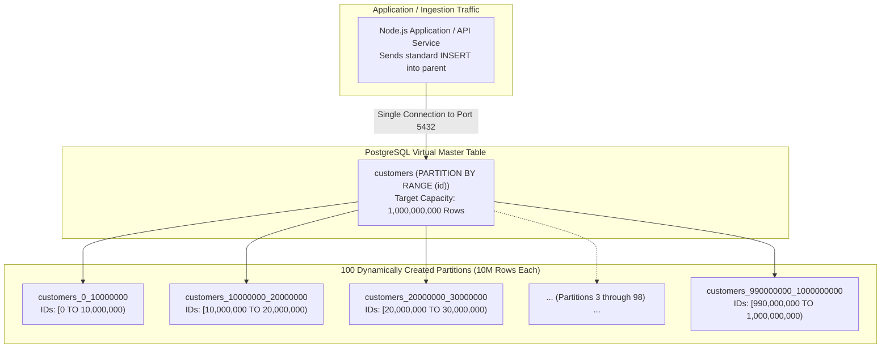

#Database #PostgreSQL #Partitioning #Automation #NodeJS #SystemDesign #DatabaseEngineering #Scale #DevOps #Docker #ProductionGrade #CoreConcept

> [!abstract] Executive Summary
> In production environments handling hundreds of millions or billions of rows, manually writing DDL statements (`CREATE TABLE ...`, `ALTER TABLE ... ATTACH PARTITION`) is completely unviable and error-prone. 
> 
> When scaling a table to **1 Billion rows**, partitioning requires mathematical domain modeling and programmatic automation. This engineering guide demonstrates:
> 1. Modeling a 1-billion-row domain into **100 partitions of 10 million rows each**.
> 2. Developing an automated **Node.js dynamic partition generator** using the `pg` client library.
> 3. Generating, attaching, and verifying 100 range partitions dynamically in under 2 seconds.
> 4. Developing a batch data ingestion script that targets the master partition table and relies on internal engine routing.
> 5. Auditing the 100 partitions inside PostgreSQL via `\d+ customers` and performance inspection.
> 6. Production extensions: Evaluating programmatic scripting vs. native background extensions like `pg_partman`.

---

## 1. Domain Modeling: The 1 Billion Row Architecture



### The Mathematical Sizing Formula:
$$\text{Total Target Capacity} = 1,000,000,000 \text{ Users}$$
$$\text{Partition Capacity} = 10,000,000 \text{ Rows per Table}$$
$$\text{Number of Partitions} = \frac{1,000,000,000}{10,000,000} = 100 \text{ Partitions}$$

### Data Type Capacity Check:
- Standard signed 32-bit integer (`INT` / `INTEGER` in PostgreSQL):
  $$-2,147,483,648 \le \text{INT} \le +2,147,483,647$$
- Since $1,000,000,000 < 2,147,483,647$, a standard 4-byte `INT` comfortably supports 1 billion customers.
- If growth exceeds 2.14 billion, we migrate the column definition to an 8-byte `BIGINT` ($9.22 \times 10^{18}$).

---

## 2. Environment Setup: PostgreSQL via Docker

We launch a dedicated PostgreSQL container exposing port `5432` to allow external Node.js scripts to establish TCP connections:

```bash
docker run --name pkg -e POSTGRES_PASSWORD=password -p 5432:5432 -d postgres
```

Verify that the container is actively listening:
```bash
docker ps
```

---

## 3. Dynamic Partition Generator Script (`create_partitions.js`)

Instead of writing 200 lines of manual SQL commands, we implement a robust automation script in Node.js using the `pg` client library.

### Dependencies
Initialize the project and install the PostgreSQL driver:
```bash
npm init -y
npm install pg
```

### The Automation Script: `create_partitions.js`

```javascript
/**
 * create_partitions.js
 * Automated Dynamic Partition Provisioner for PostgreSQL
 * Target: 1 Billion Customers -> 100 Partitions of 10M rows each
 */

const { Client } = require('pg');

const DB_CONFIG = {
    host: 'localhost',
    port: 5432,
    user: 'postgres',
    password: 'password'
};

const TOTAL_PARTITIONS = 100;
const PARTITION_SIZE = 10000000; // 10 Million rows per partition

async function run() {
    // Phase 1: Connect to the default 'postgres' database to initialize target DB
    const adminClient = new Client({ ...DB_CONFIG, database: 'postgres' });
    await adminClient.connect();
    console.log('Connected to admin database.');

    try {
        // Optional safeguard: Drop if re-running in test labs
        // await adminClient.query('DROP DATABASE IF EXISTS customers;');
        
        const dbCheck = await adminClient.query(
            "SELECT 1 FROM pg_database WHERE datname = 'customers';"
        );
        if (dbCheck.rowCount === 0) {
            await adminClient.query('CREATE DATABASE customers;');
            console.log("Database 'customers' created successfully.");
        }
    } finally {
        await adminClient.end();
    }

    // Phase 2: Connect directly to the 'customers' database
    const client = new Client({ ...DB_CONFIG, database: 'customers' });
    await client.connect();
    console.log("Connected to 'customers' database. Provisioning schema...");

    try {
        // 1. Create the virtual partitioned parent table
        await client.query(`
            CREATE TABLE IF NOT EXISTS customers (
                id INT NOT NULL,
                name TEXT NOT NULL
            ) PARTITION BY RANGE (id);
        `);
        console.log("Parent table 'customers' initialized (PARTITION BY RANGE).");

        // 2. Programmatically generate and attach 100 child partitions
        console.time('Partition Provisioning Time');
        for (let i = 0; i < TOTAL_PARTITIONS; i++) {
            const idFrom = i * PARTITION_SIZE;
            const idTo = (i + 1) * PARTITION_SIZE;
            const partitionName = `customers_${idFrom}_${idTo}`;

            // Method A: In-place declarative partition creation (PostgreSQL 10+)
            const createPartitionSQL = `
                CREATE TABLE IF NOT EXISTS ${partitionName} 
                PARTITION OF customers 
                FOR VALUES FROM (${idFrom}) TO (${idTo});
            `;

            await client.query(createPartitionSQL);
            process.stdout.write(`\rCreated partition [${i + 1}/${TOTAL_PARTITIONS}]: ${partitionName}`);
        }
        console.log('\n');
        console.timeEnd('Partition Provisioning Time');

        // 3. Add an automated DEFAULT partition for unexpected overflow
        await client.query(`
            CREATE TABLE IF NOT EXISTS customers_default 
            PARTITION OF customers DEFAULT;
        `);
        console.log("Safeguard partition 'customers_default' attached.");

    } catch (err) {
        console.error('Partition provisioning failed:', err);
    } finally {
        await client.end();
        console.log('Database connection closed.');
    }
}

run();
```

### Executing the Provisioner:
```bash
node create_partitions.js
```
```text
Connected to admin database.
Database 'customers' created successfully.
Connected to 'customers' database. Provisioning schema...
Parent table 'customers' initialized (PARTITION BY RANGE).
Created partition [100/100]: customers_990000000_1000000000
Partition Provisioning Time: 1240.15ms
Safeguard partition 'customers_default' attached.
Database connection closed.
```
All 100 physical partitions are generated and attached in **1.24 seconds**!

---

## 4. Batch Ingestion Script (`populate_customers.js`)

To test that rows correctly route into their designated child partitions, we simulate client traffic inserting batches of user records into the parent table:

```javascript
/**
 * populate_customers.js
 * Ingestion Worker: Inserts records directly into parent table 'customers'
 */

const { Client } = require('pg');

const client = new Client({
    host: 'localhost',
    port: 5432,
    user: 'postgres',
    password: 'password',
    database: 'customers'
});

async function populateBatch() {
    await client.connect();
    console.log('Connected for data population...');

    try {
        console.time('Batch Ingestion');
        
        // Ingest sample records spanning distinct partition intervals
        const sampleInserts = [
            { id: 450, name: 'Alice (Partition 1: 0-10M)' },
            { id: 12500000, name: 'Bob (Partition 2: 10M-20M)' },
            { id: 75000000, name: 'Charlie (Partition 8: 70M-80M)' },
            { id: 995000000, name: 'Diana (Partition 100: 990M-1B)' }
        ];

        for (const user of sampleInserts) {
            await client.query(
                'INSERT INTO customers (id, name) VALUES ($1, $2);',
                [user.id, user.name]
            );
        }

        console.timeEnd('Batch Ingestion');
        console.log('Sample users successfully inserted into parent table.');
    } catch (err) {
        console.error('Error populating customers:', err);
    } finally {
        await client.end();
    }
}

populateBatch();
```

---

## 5. PostgreSQL Schema & Verification Audit

Let us enter the PostgreSQL container and inspect the provisioned architecture.

### Step 1: Connect via `psql`
```bash
docker exec -it pkg psql -U postgres -d customers
```

### Step 2: Inspect Master Partition Table (`\d customers`)
```sql
\d customers
```
```text
                    Table "public.customers"
 Column |  Type   | Collation | Nullable | Default 
--------+---------+-----------+----------+---------
 id     | integer |           | not null | 
 name   | text    |           | not null | 
Partition key: RANGE (id)
Number of partitions: 101 (Use \d+ to list them.)
```
Notice PostgreSQL reports: **`Number of partitions: 101`** (100 range partitions + 1 default partition).

---

### Step 3: Inspect All Partitions (`\d+ customers`)
```sql
\d+ customers
```
```text
Partitions: customers_0_10000000 FOR VALUES FROM (0) TO (10000000),
            customers_10000000_20000000 FOR VALUES FROM (10000000) TO (20000000),
            customers_20000000_30000000 FOR VALUES FROM (20000000) TO (30000000),
            ...
            customers_990000000_1000000000 FOR VALUES FROM (990000000) TO (1000000000),
            customers_default DEFAULT
```

---

### Step 4: Verify Independent Partition Storage

Let us inspect the individual physical partitions to verify that our sample rows were automatically routed:

```sql
-- Query Partition 1 directly:
SELECT * FROM customers_0_10000000;
```
```text
 id  |              name              
-----+--------------------------------
 450 | Alice (Partition 1: 0-10M)
(1 row)
```

```sql
-- Query Partition 100 directly:
SELECT * FROM customers_990000000_1000000000;
```
```text
    id     |                 name                  
-----------+---------------------------------------
 995000000 | Diana (Partition 100: 990M-1B)
(1 row)
```

---

### Step 5: Verify Partition Pruning via `EXPLAIN`

When querying the parent table, the query planner evaluates the `id` and touches **only one partition**:

```sql
EXPLAIN SELECT name FROM customers WHERE id = 12500000;
```
```text
Seq Scan on customers_10000000_20000000 customers  (cost=0.00..1.01 rows=1 width=32)
  Filter: (id = 12500000)
```
The query planner completely skipped the other 100 partitions!

---

## 6. Automation Architectures: Scripts vs. `pg_partman`

In production engineering, you can manage dynamic partitions using three primary patterns:

```
┌─────────────────────────────────────────────────────────────────────────────────────────────────┐
│                               PARTITION AUTOMATION COMPARISON                                   │
├───────────────────────────────┬───────────────────────────────┬─────────────────────────────────┤
│ Pattern                       │ Best Use Case                 │ Trade-Offs                      │
├───────────────────────────────┼───────────────────────────────┼─────────────────────────────────┤
│ **1. External Scripts**       │ Fixed mathematical domains    │ Lightweight; requires CI/CD or  │
│    (Node.js / Python / Go)    │ (e.g., 100 ID partitions).    │ external scheduler to trigger.  │
├───────────────────────────────┼───────────────────────────────┼─────────────────────────────────┤
│ **2. In-Database Stored Proc**│ ID ranges or scheduled jobs   │ Self-contained inside database; │
│    (PL/pgSQL + pg_cron)       │ running natively in SQL.      │ consumes database CPU cycles.   │
├───────────────────────────────┼───────────────────────────────┼─────────────────────────────────┤
│ **3. Native Extension**       │ **Time-Series Telemetry**     │ Enterprise-grade; automatically │
│    (`pg_partman`)             │ (Hourly / Daily / Monthly)    │ pre-creates future intervals.   │
└───────────────────────────────┴───────────────────────────────┴─────────────────────────────────┘
```

### The `pg_partman` Time-Series Standard:
For timestamped data where new partitions must be created continuously into the future, the industry standard is **`pg_partman`**:
```sql
-- Configure pg_partman to create daily partitions and maintain a 30-day retention window
SELECT create_parent(
    p_parent_table => 'public.orders',
    p_control => 'created_at',
    p_type => 'native',
    p_interval => 'daily',
    p_premake => 7
);
```
`pg_partman` runs as a background worker, automatically pre-creating next week's tables so that incoming writes never hit missing partition errors.

---

## 7. Senior Engineer Key Takeaways & Checklist

- [ ] **Always automate DDL at scale:** Never manually create $>10$ partitions; use script templates (Node.js/Python) or `pg_partman`.
- [ ] **Include a `DEFAULT` partition:** Acts as an operational safety net for boundary overflow or corrupt IDs.
- [ ] **Validate interval math:** Ensure range boundaries strictly use `[FROM, TO)` half-open intervals ($idFrom \le id < idTo$).
- [ ] **Name partitions predictably:** Use canonical naming formats (`{table}_{from}_{to}` or `{table}_{YYYY}_{MM}`) to simplify monitoring and schema audit queries.
- [ ] **Monitor partition count:** Avoid exceeding $1,000$ active partitions per parent table, as query planner memory and planning time degrade at extreme partition volumes.
