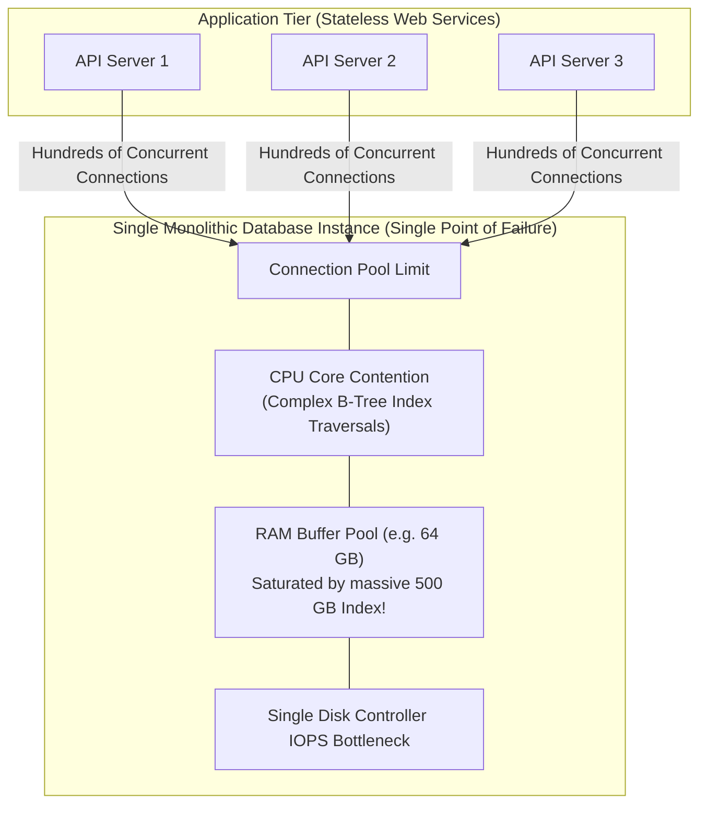
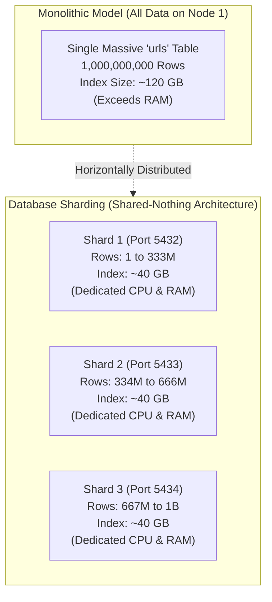
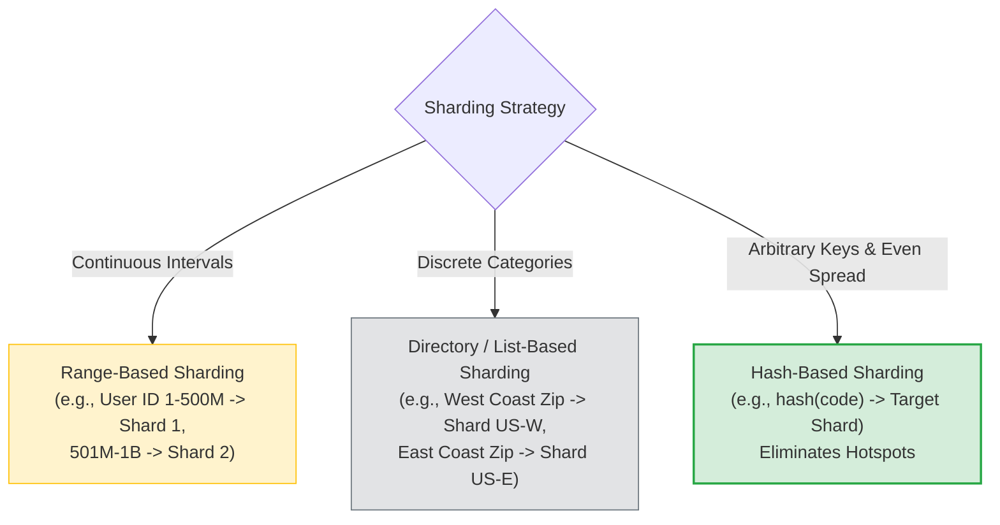
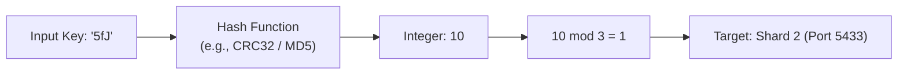
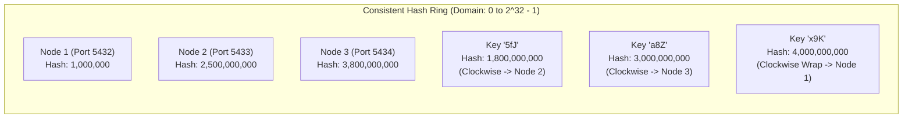
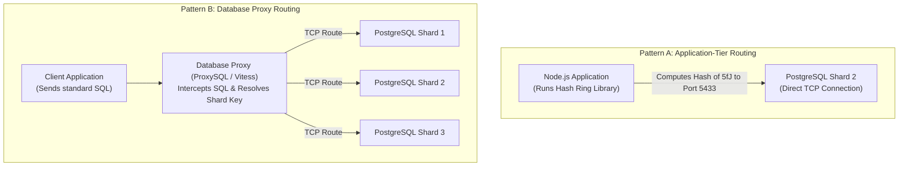

#Database #Sharding #DistributedSystems #ConsistentHashing #SystemDesign #DatabaseEngineering #Cassandra #Architecture #Scale #CoreConcept

> [!abstract] Executive Summary
> As transactional datasets scale past hundreds of millions of records, single-node database instances reach inescapable physical hardware ceilings: memory buffer saturation, CPU contention during concurrent index traversals, and storage I/O limits.
> 
> **Database Sharding** solves this bottleneck by horizontally segmenting a monolithic table row-wise across **independent physical database instances** (shared-nothing architecture). Each database server (shard) operates as an autonomous engine holding a unique subset of data.
> 
> This guide covers the core architectural principles of database sharding:
> 1. The anatomical failure points of centralized single-node databases at scale.
> 2. Sharding strategies: Range-based, List/Directory-based, and Hash-based.
> 3. The mathematics of **Consistent Hashing** and the **Hash Ring** (eliminating the catastrophic $O(N)$ rebalancing penalty of simple modulo arithmetic).
> 4. Shard routing architectures: Client-side routing vs. Database Proxies.
> 5. Real-world case study: Architecting a Distributed URL Shortener across multi-node PostgreSQL shards.

---

## 1. The Monolithic Bottleneck: Why Centralized Databases Fail at Scale

In traditional monolithic architectures, applications communicate with a single centralized database server:



### The Anatomy of the Degradation Curve:
1. **The B-Tree Working Set Bloat:** As analyzed in our [[B+ Trees_ The Superior Indexing Structure]] notes, when a table grows to 100M+ rows, the index footprint reaches tens or hundreds of gigabytes. Once the working set exceeds available RAM (`shared_buffers` or `innodb_buffer_pool_size`), every index traversal triggers high-latency random disk reads.
2. **CPU Contention:** Maintaining B-tree balance, locking table rows, and parsing query execution plans for thousands of concurrent connections saturates CPU cores.
3. **Write Amplification & Connection Limits:** Vertical scaling ("scale-up") becomes exponentially expensive and eventually hits physical hardware limits (maximum RAM sockets, PCIe lane saturation).

---

## 2. What is Database Sharding?



**Database Sharding** is a **shared-nothing** horizontal partitioning pattern where rows of a large dataset are partitioned across **distinct physical database instances**.
- Each shard runs its own autonomous DBMS engine (its own PostgreSQL or MySQL instance).
- Shards do not share CPU, memory, or disk storage.
- Every shard holds an identical schema, but a **mutually exclusive, non-overlapping subset of the data**.

```
┌─────────────────────────────────────────────────────────────────────────────────────────────────┐
│                        HORIZONTAL PARTITIONING vs. DATABASE SHARDING                            │
├───────────────────────────────┬─────────────────────────────────┬───────────────────────────────┤
│ Architectural Dimension       │ Single-Node Partitioning        │ Database Sharding             │
├───────────────────────────────┼─────────────────────────────────┼───────────────────────────────┤
│ **Physical Topology**         │ **1 Database Instance**         │ **Multiple Database Instances**│
│                               │ (Same CPU, RAM, OS process)     │ (Completely isolated servers) │
├───────────────────────────────┼─────────────────────────────────┼───────────────────────────────┤
│ **Client Awareness**          │ **Client is Agnostic**          │ **Client or Proxy Must Route**│
│                               │ Query hits parent; engine routes│ System must resolve target IP │
├───────────────────────────────┼─────────────────────────────────┼───────────────────────────────┤
│ **Transactions & Joins**      │ Native, fast ACID transactions  │ **Distributed 2PC / Scatter** │
│                               │ and cross-table joins.          │ (Costly network overhead)     │
├───────────────────────────────┼─────────────────────────────────┼───────────────────────────────┤
│ **Scale Boundary**            │ Bounded by 1 server's hardware  │ **Virtually Unbounded**       │
│                               │ limits (Scale-Up).              │ (Scale-Out across 100s nodes) │
└───────────────────────────────┴───────────────────────────────┴───────────────────────────────┘
```

---

## 3. Sharding Strategies & Shard Key Selection

The **Shard Key** (or Partition Key) is the column or attribute used to determine which physical shard holds a given record. Selecting the shard key is the single most critical decision in distributed system design:



### 1. Range-Based Sharding
- Rows mapped based on numeric or chronological intervals:
  - Shard 1: User IDs $[1, 500{,}000{,}000]$
  - Shard 2: User IDs $[500{,}000{,}001, 1{,}000{,}000{,}000]$
- **Pros:** Simple to implement; natural for range queries (`WHERE id BETWEEN 100 AND 500`).
- **Cons:** **Write Hotspots!** Auto-incrementing IDs or current timestamps direct 100% of incoming writes to the latest active shard, completely starving earlier shards while overwhelming the current node.

### 2. Directory / List-Based Sharding
- Rows mapped based on discrete lookup tables or business categories (e.g., State, Country, Tenant ID).
- **Pros:** Enables geographic localization (e.g., GDPR data residency compliance: European customers pinned to EU shards).
- **Cons:** Can lead to extreme data skew (e.g., California shard has 10x more users than Wyoming shard).

### 3. Hash-Based Sharding
- Applies a deterministic mathematical hash function to the shard key:
  $$\text{Shard ID} = f(\text{Shard Key})$$
- **Pros:** Uniformly distributes data across all available nodes, preventing write hotspots.
- **Cons:** Range queries become expensive scatter-gather operations across all nodes.

---

## 4. The Mathematics of Consistent Hashing

When our shard key is an arbitrary string—such as a short URL code (`"5fJ"`, `"a8Z"`, `"x9K"`)—how do we deterministically route reads and writes without querying every database server?

### The Naive Approach: Modulo Hashing ($Hash \pmod N$)
A developer might convert the key to an integer (e.g., sum of ASCII characters or CRC32) and modulo by the number of shards ($N$):

$$\text{Shard Index} = \text{hash}(\text{Key}) \pmod N$$

```
Suppose N = 3 Shards (Ports 5432, 5433, 5434):
- Key "5fJ" -> hash("5fJ") = 10 -> 10 mod 3 = 1 -> Port 5433
- Key "a8Z" -> hash("a8Z") = 21 -> 21 mod 3 = 0 -> Port 5432
- Key "x9K" -> hash("x9K") = 14 -> 14 mod 3 = 2 -> Port 5434
```



> [!danger] The Catastrophic Flaw of Modulo Hashing: Scale-Out Rebalancing
> What happens when your traffic surges and you add a 4th shard ($N: 3 \to 4$)?
> - Key `"5fJ"`: $10 \pmod 3 = 1 \implies \text{Node 1}$
> - New calculation: $10 \pmod 4 = 2 \implies \text{Node 2}$
> 
> Because the divisor changes from 3 to 4, **almost every key in the entire cluster re-hashes to a different node**!
> 
> Mathematical migration ratio:
> $$\text{Keys that must move} = \frac{N}{N + 1} = \frac{3}{4} = \mathbf{75\% \text{ of all cluster data!}}$$
> Moving 75% of a billion-row dataset over the network causes catastrophic cluster downtime, massive replication lag, and cache invalidation storms.

---

### The Production Solution: The Consistent Hash Ring

To solve the rebalancing crisis, computer scientists invented **Consistent Hashing** (pioneered by Karger et al. at MIT and popularized by systems like **Amazon Dynamo** and **Apache Cassandra**).



#### How the Ring Operates:
1. **The Circular Domain:** The hash function maps both **Nodes** and **Keys** onto a continuous mathematical circle spanning from $0$ to $2^{32} - 1$ (or $0$ to $2^{128} - 1$).
2. **Node Placement:** Each physical database server's IP/port is hashed and placed onto the ring:
   $$\text{position} = \text{hash}(\text{"192.168.1.10:5432"})$$
3. **Key Assignment:** To find which shard owns a key, hash the key (`hash("5fJ")`), locate its point on the ring, and travel **clockwise** until the first database node is encountered. That node owns the key!

#### Why Consistent Hashing Wins: $O(K/N)$ Rebalancing
When a new node (Node 4) is added to the ring:
- Only keys situated between Node 4 and its immediate counter-clockwise predecessor must move to Node 4.
- All other keys on the ring remain completely untouched!
- **Data migration fraction:**
  $$\text{Fraction of keys moved} = \frac{1}{N_{\text{new}}} = \frac{1}{4} = \mathbf{25\%}$$
  Instead of relocating 75% of your dataset, **only 25% moves**, while 75% remains instantly accessible with zero downtime.

---

## 5. Shard Routing Architecture: Who Directs the Query?

A client sending `SELECT url FROM urls WHERE code = '5fJ'` cannot blindly broadcast queries to all shards. Routing must be resolved via one of two production architectural patterns:



### Pattern A: Application-Tier Routing (Embedded Client Driver)
- The application code maintains connection pools to all database shards.
- The application executes the consistent hash function in-memory and opens a connection directly to the target shard.
- **Pros:** Lowest possible latency (zero intermediate network proxy hops); zero proxy infrastructure cost.
- **Cons:** Every client language/service must implement identical hashing logic and maintain multiple connection pools.

### Pattern B: Proxy-Tier Routing (Vitess, ProxySQL, Citus)
- The application connects to a single proxy endpoint using standard database drivers.
- The proxy parses the incoming SQL statement, extracts the shard key from the `WHERE` clause, and routes the query across internal backend connections.
- **Pros:** The application remains 100% agnostic of sharding infrastructure.
- **Cons:** Adds an additional network hop (~0.5–2 ms latency); introduces a proxy layer that must be maintained and scaled.

---

## 6. Architecture Preview: The Distributed URL Shortener

In our upcoming hands-on implementation, we build a production-style distributed URL shortener service in Node.js connected to three independent PostgreSQL shards running in Docker:

```
┌─────────────────────────────────────────────────────────────────────────────────────────────────┐
│                           DISTRIBUTED URL SHORTENER TOPOLOGY                                    │
├───────────────────────────────┬───────────────────────────────┬─────────────────────────────────┤
│ Instance Name                 │ Network Port                  │ Role                            │
├───────────────────────────────┼───────────────────────────────┼─────────────────────────────────┤
│ **`pg_shard1`**               │ `5432`                        │ Autonomous PostgreSQL Node 1    │
│ **`pg_shard2`**               │ `5433`                        │ Autonomous PostgreSQL Node 2    │
│ **`pg_shard3`**               │ `5434`                        │ Autonomous PostgreSQL Node 3    │
│ **`url-shortener-app`**       │ `3000` (Node.js Express / pg) │ Client-side Consistent Router   │
└───────────────────────────────┴───────────────────────────────┴─────────────────────────────────┘
```

### The Ingestion & Retrieval Contract:
1. **Write Request (`POST /shorten`):**
   - User submits long URL (`https://example.com/system-design-deep-dive`).
   - Service generates unique short code (`5fJ`).
   - Service computes `consistentHash("5fJ")` $\implies$ returns target port `5433`.
   - Node.js connects to Shard 2 and executes:
     ```sql
     INSERT INTO url_table (code, url) VALUES ('5fJ', 'https://example.com/...');
     ```
2. **Read Request (`GET /5fJ`):**
   - User requests `GET /5fJ`.
   - Service evaluates `consistentHash("5fJ")` $\implies$ deterministically returns port `5433`.
   - Direct point lookup on Shard 2:
     ```sql
     SELECT url FROM url_table WHERE code = '5fJ';
     ```
   - Shards 1 and 3 receive **zero query load**, allowing linear read/write horizontal scale!

---

## 7. Senior Engineer Summary Checklist

- [ ] **Sharding is multi-instance:** Never confuse single-node horizontal partitioning with multi-server database sharding.
- [ ] **Avoid modulo hashing in production:** Never use simple $Hash \pmod N$ for dynamic sharded environments; adding a node forces massive $O(N)$ data migrations.
- [ ] **Use Consistent Hash Rings:** Consistent hashing limits data relocation to $O(K/N)$, ensuring predictable, localized rebalancing.
- [ ] **Guard against hot keys:** If certain keys receive disproportionate traffic (e.g., viral URLs or celebrity users), implement application-level caching (Redis) in front of the shards to prevent individual node saturation.
- [ ] **Select immutable shard keys:** Changing a record's shard key requires a cross-network distributed transaction (`DELETE` on Shard A, `INSERT` on Shard B via Two-Phase Commit).
