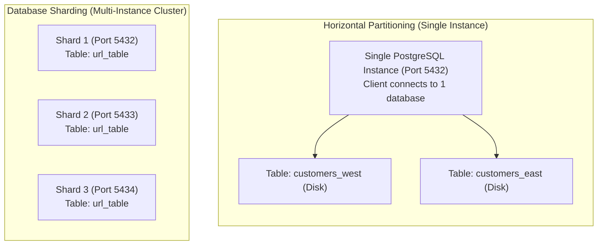
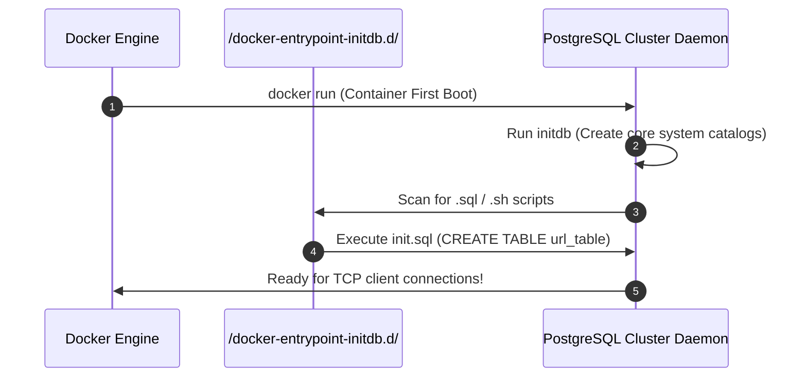
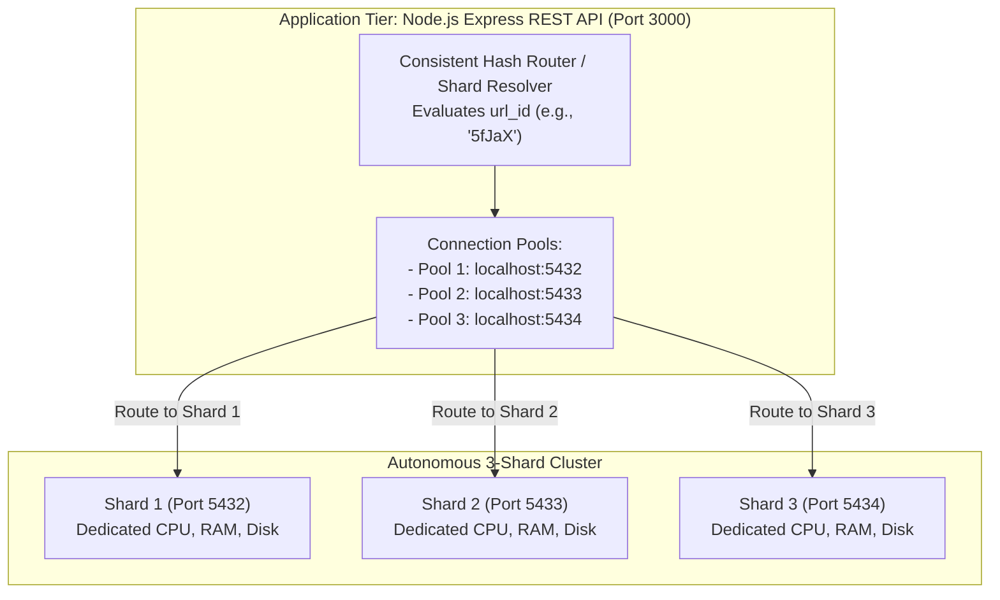

# 02. Hands-On Distributed Sharding Demo: Multi-PostgreSQL Cluster with Docker

#Database #Sharding #DistributedSystems #PostgreSQL #Docker #pgAdmin #DevOps #SystemDesign #URLShortener #Infrastructure #CoreConcept

> [!abstract] Executive Summary
> While database partitioning divides tables within a single database instance, **Database Sharding** distributes data across physically independent database servers (shared-nothing architecture).
> 
> In this hands-on engineering lab, we transition from architectural theory to a fully functional distributed database cluster:
> 1. We contrast the physical mechanics of **Partitioning** (changing table names on 1 server) vs. **Sharding** (identical table names across distinct server IPs/ports).
> 2. We architect an automated database initialization pipeline using a custom **Dockerfile** and PostgreSQL's `/docker-entrypoint-initdb.d/` lifecycle hook.
> 3. We spin up an autonomous **3-shard PostgreSQL cluster** in Docker, listening on host ports `5432`, `5433`, and `5434`.
> 4. We administer and verify cluster schema parity using **pgAdmin**.
> 5. We establish the infrastructure foundation for our distributed **URL Shortener** application tier.

---

## 1. Architectural Contrast: Partitioning vs. Sharding

Before provisioning infrastructure, senior engineers must internalize how table namespace and network boundaries invert between partitioning and sharding:

```
┌─────────────────────────────────────────────────────────────────────────────────────────────────┐
│                               THE NAMESPACE vs. NETWORK PARADOX                                 │
├───────────────────────────────┬─────────────────────────────────┬───────────────────────────────┤
│ Dimension                     │ Horizontal Partitioning         │ Database Sharding             │
├───────────────────────────────┼─────────────────────────────────┼───────────────────────────────┤
│ **Physical Boundary**         │ **1 Single Database Server**    │ **Multiple Database Servers** │
│                               │ (Same CPU, RAM, and Disk)       │ (Shared-nothing cluster)      │
├───────────────────────────────┼─────────────────────────────────┼───────────────────────────────┤
│ **Database / Server IP**      │ **Stays Exactly the Same**      │ **Changes Per Shard**         │
│                               │ `localhost:5432`                │ `10.0.1.1` vs `10.0.1.2`      │
├───────────────────────────────┼─────────────────────────────────┼───────────────────────────────┤
│ **Physical Table Names**      │ **Names Change on Disk:**       │ **Names Stay Identical:**     │
│                               │ `url_table_part_1`              │ Shard 1: `url_table`          │
│                               │ `url_table_part_2`              │ Shard 2: `url_table`          │
│                               │ `url_table_part_3`              │ Shard 3: `url_table`          │
├───────────────────────────────┼─────────────────────────────────┼───────────────────────────────┤
│ **Client Awareness**          │ **Client is Agnostic**          │ **Client / Proxy Must Route** │
│                               │ Query hits parent `url_table`.  │ Driver must resolve server IP.│
└───────────────────────────────┴───────────────────────────────┴───────────────────────────────┘
```



---

## 2. Automated Schema Provisioning via Docker Entrypoint

Each shard in our distributed cluster must be completely autonomous and hold an identical table schema. Manually connecting to every database to run DDL statements violates Infrastructure-as-Code (IaC) principles. 

We automate this using PostgreSQL's official **Entrypoint Initialization Hook**.

### Step 1: Define the Database Schema (`init.sql`)

We define the storage contract for our distributed URL Shortener:

```sql
-- init.sql: Schema initialization executed automatically upon container creation
CREATE TABLE url_table (
    id SERIAL NOT NULL PRIMARY KEY,
    url TEXT,
    url_id VARCHAR(5)
);
```

```
┌─────────────────────────────────────────────────────────────────────────────────────────────────┐
│                                   SCHEMA FIELD ANATOMY                                          │
├──────────────┬────────────────────────┬─────────────────────────────────────────────────────────┤
│ Column       │ Type                   │ Purpose & Distributed Role                              │
├──────────────┼────────────────────────┼─────────────────────────────────────────────────────────┤
│ **`id`**     │ `SERIAL PRIMARY KEY`   │ Local row sequence on this shard. Note: In distributed  │
│              │                        │ sharding, local serial IDs are NOT globally unique!     │
├──────────────┼────────────────────────┼─────────────────────────────────────────────────────────┤
│ **`url`**    │ `TEXT`                 │ The original, long target destination URL.              │
├──────────────┼────────────────────────┼─────────────────────────────────────────────────────────┤
│ **`url_id`** │ `VARCHAR(5)`           │ **The Shard Key** (e.g., '5fJaX'). The 5-character      │
│              │                        │ short code passed into the consistent hashing function! │
└──────────────┴────────────────────────┴─────────────────────────────────────────────────────────┘
```

---

### Step 2: The Custom Dockerfile

Official PostgreSQL Docker images feature an automated initialization mechanism: any file placed into `/docker-entrypoint-initdb.d/` ending with `.sql` or `.sh` is executed in alphabetical order during initial database creation (`initdb`).

```dockerfile
# Dockerfile: Build a specialized PostgreSQL shard image
FROM postgres

# Copy our DDL script into the automated initialization directory
COPY init.sql /docker-entrypoint-initdb.d/
```



---

## 3. Building the Image & Launching the 3-Shard Cluster

### Step 1: Build the Custom Docker Image
Execute the build command in the directory containing `Dockerfile` and `init.sql`:

```bash
docker build -t pgshard .
```

*Note:* The `-t pgshard` flag tags the custom image, and `.` designates the current build context.

---

### Step 2: Provision the 3 Shard Containers

We run three independent PostgreSQL containers, mapping them to distinct ports on our host machine (`5432`, `5433`, and `5434`):

```bash
# 1. Launch Shard 1 (Listening on host port 5432)
docker run -d --name pgshard1 -p 5432:5432 -e POSTGRES_PASSWORD=postgres pgshard

# 2. Launch Shard 2 (Listening on host port 5433)
docker run -d --name pgshard2 -p 5433:5432 -e POSTGRES_PASSWORD=postgres pgshard

# 3. Launch Shard 3 (Listening on host port 5434)
docker run -d --name pgshard3 -p 5434:5432 -e POSTGRES_PASSWORD=postgres pgshard
```

```
┌─────────────────────────────────────────────────────────────────────────────────────────────────┐
│                                   PORT BINDING MECHANICS                                        │
├─────────────────────────────────────────────────────────────────────────────────────────────────┤
│ The syntax `-p <Host_Port>:<Container_Port>`:                                                    │
│ - Inside each container, PostgreSQL listens on standard port `5432`.                            │
│ - The Docker bridge network maps incoming traffic from host ports `5432`, `5433`, and `5434`    │
│   directly into the respective container's port `5432`.                                         │
│ - This allows a single workstation to host multiple completely isolated database servers!        │
└─────────────────────────────────────────────────────────────────────────────────────────────────┘
```

### Step 3: Verify Running Shards
```bash
docker ps
```
```text
CONTAINER ID   IMAGE     COMMAND                  PORTS                    NAMES
a1b2c3d4e5f6   pgshard   "docker-entrypoint.s…"   0.0.0.0:5432->5432/tcp   pgshard1
b2c3d4e5f6a1   pgshard   "docker-entrypoint.s…"   0.0.0.0:5433->5432/tcp   pgshard2
c3d4e5f6a1b2   pgshard   "docker-entrypoint.s…"   0.0.0.0:5434->5432/tcp   pgshard3
```

---

## 4. Multi-Shard Administration via pgAdmin

To inspect and manage the distributed cluster visually, we use a `pgAdmin` container running on port `5555`:

```bash
docker run -d --name pgadmin -p 5555:80 -e PGADMIN_DEFAULT_EMAIL=admin@admin.com -e PGADMIN_DEFAULT_PASSWORD=admin dpage/pgadmin4
```

### Registering the Shards in pgAdmin:
Open `http://localhost:5555` in your browser and register each shard server:

```
┌─────────────────────────────────────────────────────────────────────────────────────────────────┐
│                                   PGADMIN SERVER REGISTRATIONS                                  │
├──────────────────┬──────────────────────┬──────────┬───────────┬──────────────┬─────────────────┤
│ Display Name     │ Host Name / Address  │ Port     │ Username  │ Password     │ Database        │
├──────────────────┼──────────────────────┼──────────┼───────────┼──────────────┼─────────────────┤
│ **Shard 1**      │ `host.docker.internal`│ `5432`   │ `postgres`│ `postgres`   │ `postgres`      │
│ **Shard 2**      │ `host.docker.internal`│ `5433`   │ `postgres`│ `postgres`   │ `postgres`      │
│ **Shard 3**      │ `host.docker.internal`│ `5434`   │ `postgres`│ `postgres`   │ `postgres`      │
└──────────────────┴──────────────────────┴──────────┴───────────┴──────────────┴─────────────────┘
```

*(Note: On local machines, use `localhost` or your machine hostname/IP; when connecting between Docker containers on macOS/Windows, use `host.docker.internal`).*

### Verifying Schema Parity:
Expanding the tree view for each server confirms:
- **Shard 1 (`5432`):** `Databases` $\to$ `postgres` $\to$ `Schemas` $\to$ `public` $\to$ `Tables` $\to$ **`url_table`** (Empty)
- **Shard 2 (`5433`):** `Databases` $\to$ `postgres` $\to$ `Schemas` $\to$ `public` $\to$ `Tables` $\to$ **`url_table`** (Empty)
- **Shard 3 (`5434`):** `Databases` $\to$ `postgres` $\to$ `Schemas` $\to$ `public` $\to$ `Tables` $\to$ **`url_table`** (Empty)

Every shard has independently booted with an identical schema, zero cross-server communication, and completely autonomous storage controllers.

---

## 5. The Application Routing Blueprint (Setting the Stage for Node.js)

Now that the physical storage tier is active, the application tier must be programmed to interact with this cluster.



### The Shard Map Configuration:
In our client application, we define the cluster topology:
```javascript
const SHARD_PORTS = {
    shard1: 5432,
    shard2: 5433,
    shard3: 5434
};
```

When an HTTP client executes:
- **Write:** `POST /shorten` with `{ "url": "https://google.com" }` $\to$ generates `url_id = '5fJaX'`, resolves target port, and executes `INSERT INTO url_table`.
- **Read:** `GET /5fJaX` $\to$ resolves target port via `consistentHash('5fJaX')`, queries `SELECT url FROM url_table WHERE url_id = '5fJaX'`, and redirects the user.

---

## 6. Senior Engineer Production Checklist

- [ ] **Automate container initialization:** Utilize `/docker-entrypoint-initdb.d/` or migration runners (Flyway, Liquibase) so shards always spin up with identical schemas.
- [ ] **Beware of local auto-increment keys:** Understand that `id SERIAL` on Shard 1 and Shard 2 will produce duplicate `id` values ($1, 2, 3$). If a globally unique primary key is required across the cluster, use **UUIDv7**, **Twitter Snowflake**, or a composite key (`(shard_id, local_id)`).
- [ ] **Isolate shard hardware in production:** In local development, shards share host CPU/disk. In production, each shard must reside on a separate physical/virtual server or availability zone.
- [ ] **Implement connection pooling per shard:** Client applications must maintain isolated connection pools (e.g., `pg.Pool`) per shard to prevent connection exhaustion.
