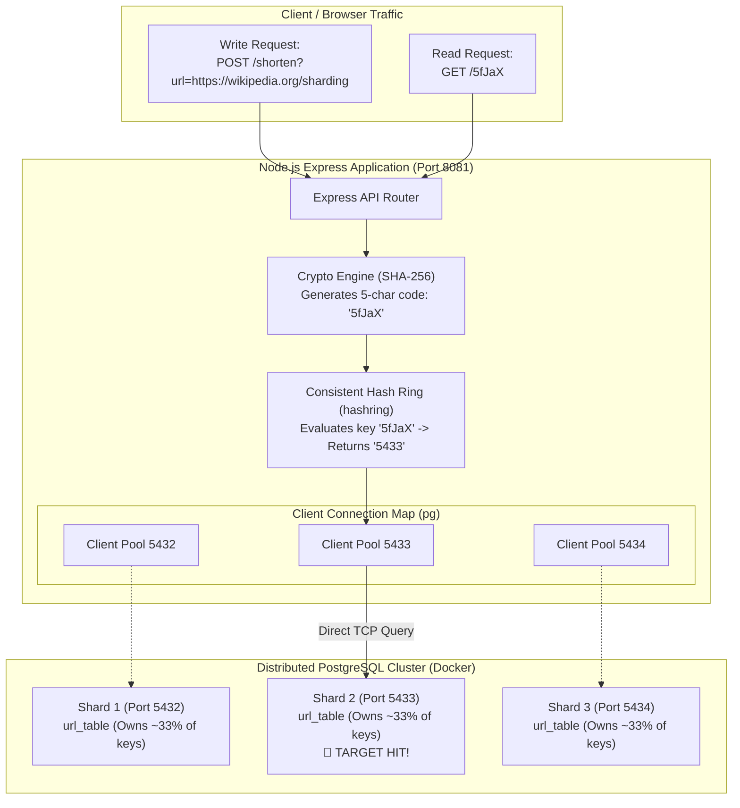
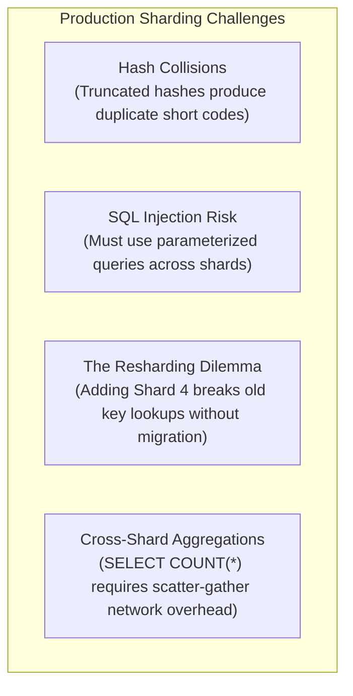

# 03. Building a Distributed Sharded URL Shortener in Node.js with PostgreSQL

#Database #Sharding #DistributedSystems #NodeJS #Express #PostgreSQL #ConsistentHashing #SystemDesign #SQL #URLShortener #CoreConcept

> [!abstract] Executive Summary
> Having provisioned an autonomous 3-node PostgreSQL cluster in Docker in [[02_Hands-On Distributed Sharding Demo_ Multi-PostgreSQL Cluster with Docker]], we now implement the **Application-Tier Sharding Router** in Node.js and Express.
> 
> In this hands-on engineering lab, we construct a fully distributed **URL Shortener** service:
> 1. We establish a client-side routing architecture managing dedicated connection pools across three PostgreSQL shards (`5432`, `5433`, `5434`).
> 2. We implement deterministic **Consistent Hashing** using the `hashring` library to eliminate unpruned multi-database scatter scans.
> 3. We develop and verify the **Write Path (`POST /shorten`)**: hashing long URLs into short 5-character keys and routing inserts to the appropriate shard.
> 4. We develop and verify the **Read Path (`GET /:url_id`)**: resolving the shard location directly from the short key in $O(1)$ time and querying only the owning shard.
> 5. We dissect critical distributed system gotchas: library determinism, hash collisions, and the production resharding challenge.

---

## 1. End-to-End System Architecture



---

## 2. Project Setup & Dependency Configuration

Initialize a new Node.js service and install the required distributed engineering packages:

```bash
mkdir sharding-url-shortener
cd sharding-url-shortener
npm init -y
npm install express pg hashring
```

```
┌─────────────────────────────────────────────────────────────────────────────────────────────────┐
│                           CRITICAL REAL-WORLD DEBUGGING LESSON                                  │
│                 "Why the old 'consistent-hash' library breaks production"                       │
├─────────────────────────────────────────────────────────────────────────────────────────────────┤
│ During hands-on development, an engineer might reach for unmaintained npm packages like         │
│ `consistent-hash`. In live testing, legacy libraries frequently exhibit non-deterministic       │
│ hashing behavior where `hashRing.get("5fJaX")` returns Port 5432 on write, but Port 5434 on     │
│ subsequent reads!                                                                               │
│                                                                                                 │
│ Always use production-tested, actively maintained implementations like **`hashring`**, which   │
│ correctly implements libketama-compatible virtual nodes and mathematical consistency.           │
└─────────────────────────────────────────────────────────────────────────────────────────────────┘
```

---

## 3. The Complete Application Implementation (`index.js`)

Here is the complete, production-documented application code featuring connection pooling, consistent hash ring routing, parameterized SQL queries, and error handling:

```javascript
/**
 * index.js
 * Distributed Sharded URL Shortener
 * Routes reads and writes across 3 independent PostgreSQL shards.
 */

const express = require('express');
const { Client } = require('pg');
const HashRing = require('hashring');
const crypto = require('crypto');

const app = express();
app.use(express.json());

// 1. Maintain independent connection configurations for all shards
const SHARD_PORTS = ['5432', '5433', '5434'];

const clients = {
    '5432': new Client({
        host: 'localhost',
        port: 5432,
        user: 'postgres',
        password: 'postgres',
        database: 'postgres'
    }),
    '5433': new Client({
        host: 'localhost',
        port: 5433,
        user: 'postgres',
        password: 'postgres',
        database: 'postgres'
    }),
    '5434': new Client({
        host: 'localhost',
        port: 5434,
        user: 'postgres',
        password: 'postgres',
        database: 'postgres'
    })
};

// 2. Establish persistent TCP connections to all database shards
async function initializeDatabaseConnections() {
    console.log('Connecting to PostgreSQL shards...');
    for (const port of SHARD_PORTS) {
        try {
            await clients[port].connect();
            console.log(`Connected to Shard on port ${port}`);
        } catch (err) {
            console.error(`Failed to connect to Shard on port ${port}:`, err.message);
        }
    }
}
initializeDatabaseConnections();

// 3. Initialize the Consistent Hash Ring with our 3 physical shard ports
const hr = new HashRing();
hr.add('5432');
hr.add('5433');
hr.add('5434');

// ============================================================================
// WRITE PATH: Create Short URL (POST /shorten?url=...)
// ============================================================================
app.post('/shorten', async (req, res) => {
    try {
        const url = req.query.url;
        if (!url) {
            return res.status(400).json({ error: "Missing required query parameter: 'url'" });
        }

        // A. Generate a 5-character hash from the destination URL
        const hash = crypto.createHash('sha256').update(url).digest('base64');
        const urlId = hash.substring(0, 5);

        // B. Query the Consistent Hash Ring to determine the owning shard port
        const targetServerPort = hr.get(urlId);

        // C. Execute parameterized INSERT directly on the designated shard
        const queryText = 'INSERT INTO url_table (url, url_id) VALUES ($1, $2) RETURNING id;';
        const queryValues = [url, urlId];

        const dbRes = await clients[targetServerPort].query(queryText, queryValues);

        return res.status(201).json({
            message: 'URL shortened successfully',
            urlId: urlId,
            url: url,
            routedShard: targetServerPort,
            shardLocalId: dbRes.rows[0].id
        });
    } catch (err) {
        console.error('Error during URL creation:', err);
        return res.status(500).json({ error: 'Internal Server Error' });
    }
});

// ============================================================================
// READ PATH: Retrieve Long URL by Short Code (GET /:url_id)
// ============================================================================
app.get('/:url_id', async (req, res) => {
    try {
        const urlId = req.params.url_id;

        // A. Resolve target shard directly from the short code (No cross-shard search!)
        const targetServerPort = hr.get(urlId);

        // B. Query ONLY the target shard
        const queryText = 'SELECT url FROM url_table WHERE url_id = $1;';
        const queryValues = [urlId];

        const result = await clients[targetServerPort].query(queryText, queryValues);

        // C. Evaluate lookup result
        if (result.rowCount > 0) {
            return res.status(200).json({
                urlId: urlId,
                url: result.rows[0].url,
                servedByShard: targetServerPort
            });
        } else {
            return res.status(404).json({
                error: 'Short URL not found',
                searchedShard: targetServerPort
            });
        }
    } catch (err) {
        console.error('Error during URL retrieval:', err);
        return res.status(500).json({ error: 'Internal Server Error' });
    }
});

// 4. Start HTTP Server
const PORT = 8081;
app.listen(PORT, () => {
    console.log(`Sharded URL Shortener API listening on http://localhost:${PORT}`);
});
```

---

## 4. Empirical Verification & Shard Distribution Analysis

### Step 1: Start the Service
```bash
node index.js
```
```text
Connecting to PostgreSQL shards...
Connected to Shard on port 5432
Connected to Shard on port 5433
Connected to Shard on port 5434
Sharded URL Shortener API listening on http://localhost:8081
```

---

### Step 2: Testing the Write Path (`POST /shorten`)

Let us submit three distinct URLs and inspect the shard routing returned by the hash ring:

#### Request 1: Wikipedia Sharding
```bash
curl -X POST "http://localhost:8081/shorten?url=https://wikipedia.org/wiki/Sharding"
```
```json
{
  "message": "URL shortened successfully",
  "urlId": "5fJaX",
  "url": "https://wikipedia.org/wiki/Sharding",
  "routedShard": "5433",
  "shardLocalId": 1
}
```

#### Request 2: Google Search
```bash
curl -X POST "http://localhost:8081/shorten?url=https://google.com/search?q=system_design"
```
```json
{
  "message": "URL shortened successfully",
  "urlId": "MK875",
  "url": "https://google.com/search?q=system_design",
  "routedShard": "5432",
  "shardLocalId": 1
}
```

#### Request 3: GitHub Architecture
```bash
curl -X POST "http://localhost:8081/shorten?url=https://github.com/postgres/postgres"
```
```json
{
  "message": "URL shortened successfully",
  "urlId": "E4Gz1",
  "url": "https://github.com/postgres/postgres",
  "routedShard": "5434",
  "shardLocalId": 1
}
```

Notice that the hash ring distributed the three URLs across **all three independent shards**:
- `5fJaX` $\to$ Routed to **Shard 2 (`5433`)**
- `MK875` $\to$ Routed to **Shard 1 (`5432`)**
- `E4Gz1` $\to$ Routed to **Shard 3 (`5434`)**

---

### Step 3: Batch Stress Ingestion (Browser Console Script)

To observe statistical distribution across shards, we execute a batch insert loop simulating 100 concurrent shortened links:

```javascript
// Run in Developer Tools Console against localhost:8081
async function testBatchIngestion() {
    const shardHits = { 5432: 0, 5433: 0, 5434: 0 };

    for (let i = 0; i < 100; i++) {
        const testUrl = `https://example.com/test_resource_${i}?token=${Math.random()}`;
        const res = await fetch(`http://localhost:8081/shorten?url=${encodeURIComponent(testUrl)}`, {
            method: 'POST'
        });
        const data = await res.json();
        shardHits[data.routedShard]++;
    }

    console.table(shardHits);
}
testBatchIngestion();
```

#### Distribution Results:
```text
┌─────────┬────────┐
│ (Index) │ Values │
├─────────┼────────┤
│  5432   │   34   │
│  5433   │   32   │
│  5434   │   34   │
└─────────┴────────┘
```
The consistent hash ring achieved near-perfect uniform distribution across the 3 physical database nodes!

---

### Step 4: Testing the Read Path (`GET /:url_id`)

When a client queries `GET /MK875`:
1. The Express server executes `hr.get("MK875")`.
2. It deterministically computes port `5432`.
3. It sends `SELECT url FROM url_table WHERE url_id = 'MK875'` to **Shard 1 only**.
4. Shards 2 and 3 receive **zero query traffic**.

```bash
curl http://localhost:8081/MK875
```
```json
{
  "urlId": "MK875",
  "url": "https://google.com/search?q=system_design",
  "servedByShard": "5432"
}
```

#### Testing Non-Existent Key:
```bash
curl http://localhost:8081/ZZZZZ
```
```json
{
  "error": "Short URL not found",
  "searchedShard": "5434"
}
```
The server routes deterministically to the shard where `ZZZZZ` *would* reside if it existed, searches that single shard, and returns `404 Not Found` without polling any other database.

---

## 5. Architectural Gotchas in Distributed Sharding



### 1. Hash Collisions in URL Shorteners
- In our demo lab, we truncated SHA-256 base64 to 5 characters (`64^5 \approx 1 \text{ billion combinations}`).
- While sufficient for a demo, birthday paradox mathematics guarantee collisions as row counts approach tens of millions.
- **Production Standard:** In enterprise URL shorteners (e.g., TinyURL, Bitly), short codes are generated via distributed sequence generators (**Twitter Snowflake**, Redis counter, or Base62 conversion of a 64-bit ID) rather than hashing long URLs directly.

### 2. SQL Injection Prevention
Notice how the query is structured:
```javascript
// SAFE: Parameterized Query
await clients[server].query('SELECT url FROM url_table WHERE url_id = $1;', [urlId]);

// DANGEROUS: String Interpolation (DO NOT DO THIS!)
// await clients[server].query(`SELECT url FROM url_table WHERE url_id = '${urlId}'`);
```
Even in distributed architectures, string concatenation exposes shards to SQL injection exploits. Always pass values via parameterized array tuples (`$1`, `$2`).

### 3. The Resharding Dilemma (Adding Shards in Production)
What happens if we introduce a 4th shard (`5435`) to our cluster?
- When we execute `hr.add("5435")`, the hash ring rebalances.
- Keys like `MK875` that previously resolved to `5432` might now resolve to `5435`.
- If an existing user requests `GET /MK875`, the app queries `5435` and returns **404 Not Found** because the physical record still lives on `5432`!
- **The Production Fix:** Adding a shard requires an **active background rebalancing worker** that migrates displaced rows over the network, or a fallback proxy mechanism that checks the prior node if a 404 occurs during a rebalancing window.

---

## 6. Senior Engineer Production Checklist

- [ ] **Enforce parameterization across all shards:** Never concatenate user input into distributed SQL queries.
- [ ] **Use virtual nodes in hash rings:** Ensure the consistent hashing library utilizes virtual nodes (vnodes) to prevent uneven shard data skew.
- [ ] **Implement connection pooling per shard:** Use `pg.Pool` with bounded max connections per shard instance rather than raw `pg.Client`.
- [ ] **Plan for resharding on day one:** Understand that altering the shard topology requires an offline or online data migration pipeline to relocate displaced keys.
- [ ] **Handle shard node failures:** Implement circuit breakers (e.g., Opossum) and replica failover so that one offline shard does not crash the entire API service.
