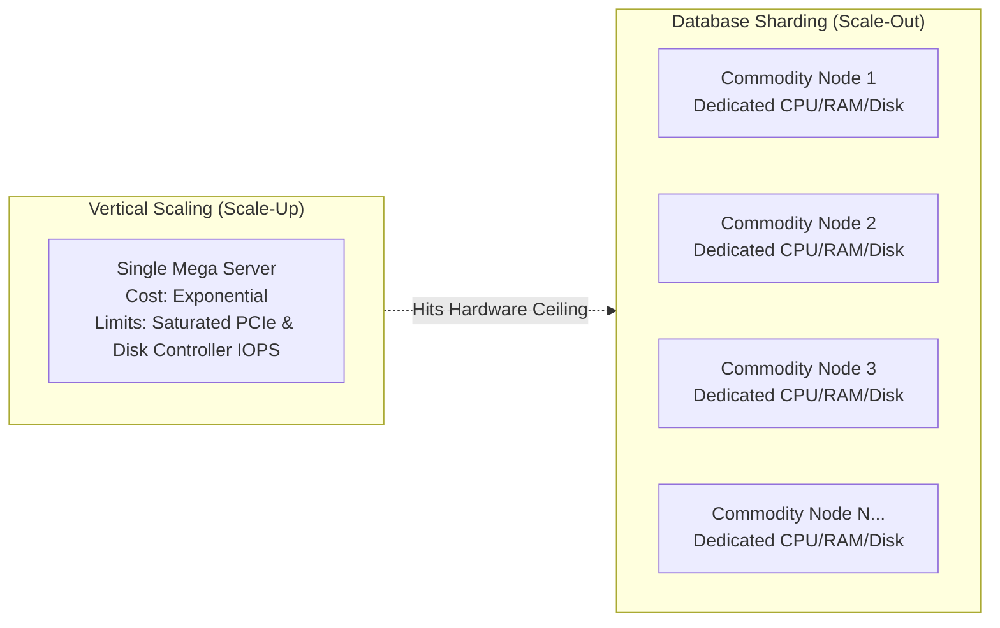
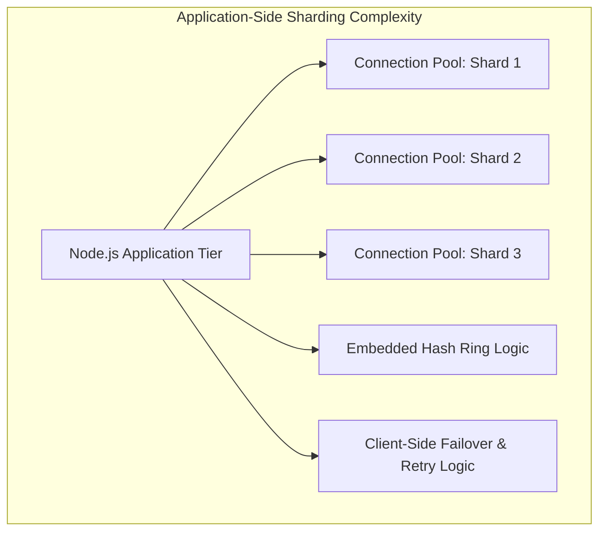
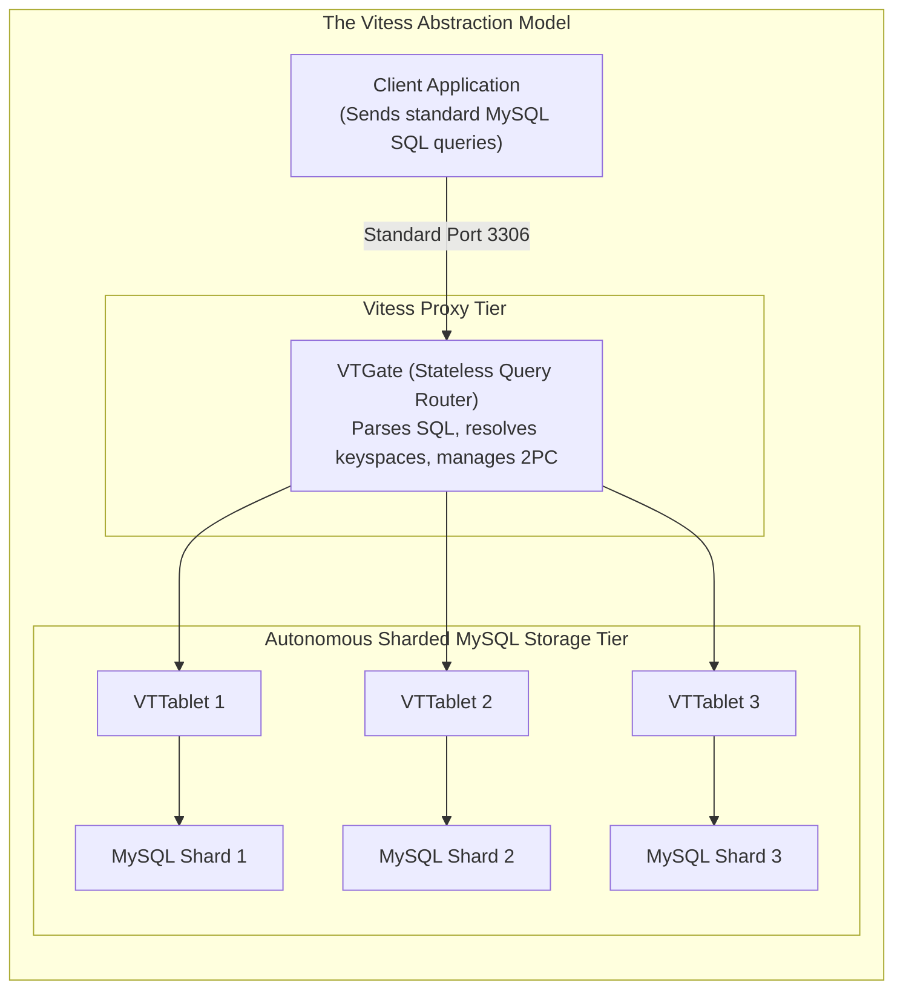
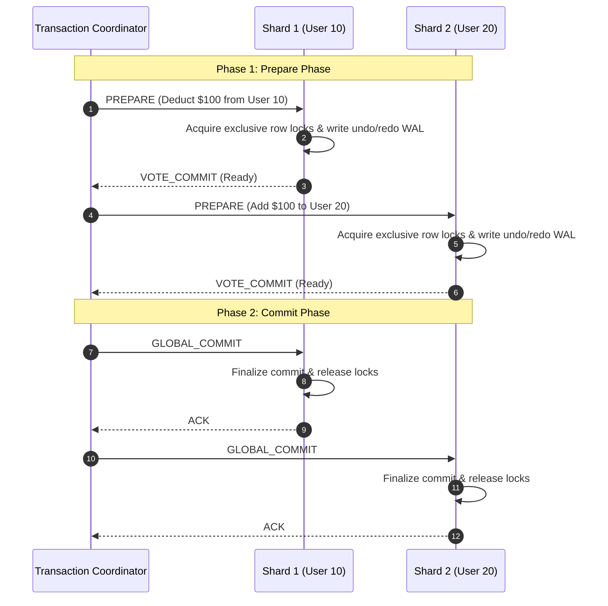
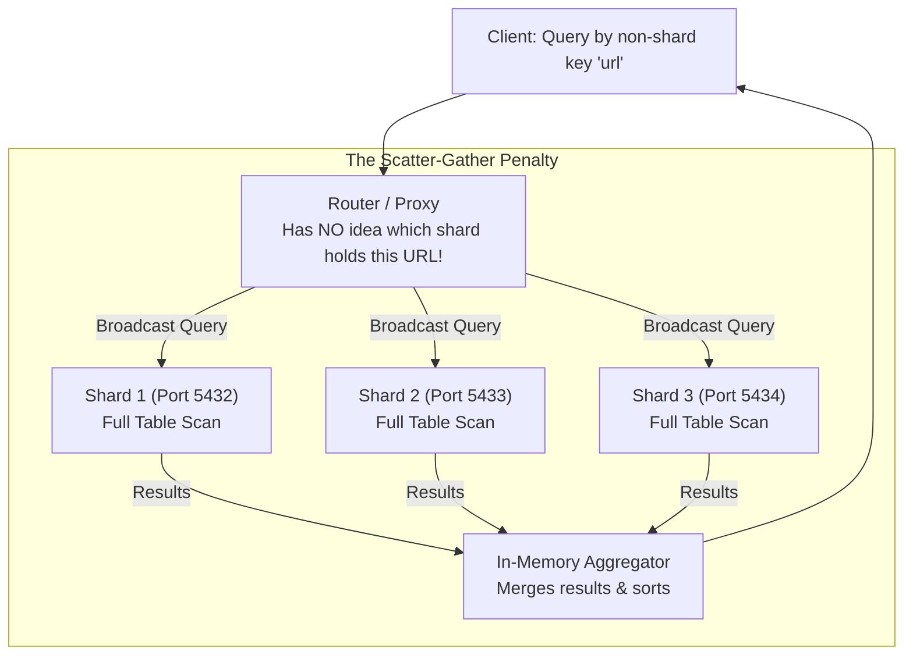
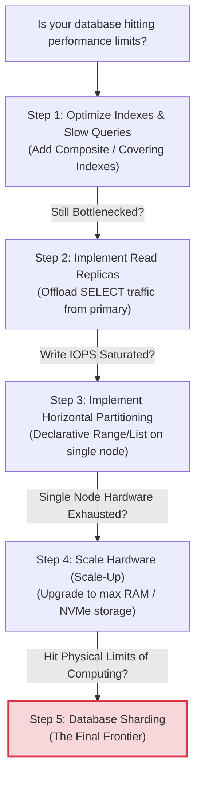

# 04. Database Sharding Trade-Offs: Pros, Cons, and the Vitess Architecture

#Database #Sharding #DistributedSystems #Vitess #SystemDesign #DatabaseEngineering #TwoPhaseCommit #ACID #Architecture #Scale #CoreConcept

> [!abstract] Executive Summary
> Database sharding is the ultimate architectural solution for horizontal database scalability. When an enterprise dataset scales past the physical capacity of the largest available server hardware, sharding allows the system to scale out across dozens or hundreds of independent machines.
> 
> However, sharding is also the most operationally expensive architectural pattern in software engineering. By moving from a single database engine to a distributed cluster, you forfeit the core conveniences of the relational model: **cross-node ACID transactions, distributed rollbacks, foreign keys, relational joins, and easy schema migrations**.
> 
> This guide details the **pros, cons, distributed failure modes, and architectural trade-offs** of database sharding, and examines how modern proxy engines like **YouTube's Vitess** mitigate application complexity.

---

## 1. Architectural Trade-Off Matrix

```
┌─────────────────────────────────────────────────────────────────────────────────────────────────┐
│                                 THE SHARDING TRADE-OFF MATRIX                                   │
├─────────────────────────────────────────────────────────────────┬───────────────────────────────┤
│ Advantages (The Pros)                                           │ Disadvantages (The Cons)      │
├─────────────────────────────────────────────────────────────────┼───────────────────────────────┤
│ **1. Unbounded Horizontal Scalability:** Scale CPU, RAM,       │ **1. Massive Client Complexity:** Applications│
│    disk IOPS, and network bandwidth across multiple servers.    │    must maintain shard maps and connection pools│
├─────────────────────────────────────────────────────────────────┼───────────────────────────────┤
│ **2. Physical Security & Multi-Tenancy:** Isolate VIP or       │ **2. The Cross-Shard Transaction Crisis:**    │
│    compliance-heavy data onto dedicated, firewalled nodes.      │    Two-Phase Commit (2PC) destroys throughput.│
├─────────────────────────────────────────────────────────────────┼───────────────────────────────┤
│ **3. Compact Index Footprints:** Sub-partitioned B-trees        │ **3. Impossible Cross-Shard Joins:** Relational│
│    remain small enough to stay 100% pinned in RAM buffers.      │    joins across network nodes require scatter. │
├─────────────────────────────────────────────────────────────────┼───────────────────────────────┤
│ **4. Blasted Blast Radiuses:** An outage on Shard 2 impacts    │ **4. Non-Shard-Key Scatter Penalty:** Queries │
│    only 33% of users; Shards 1 and 3 stay fully functional.     │    without the shard key hit every database.  │
└─────────────────────────────────────────────────────────────────┴───────────────────────────────┘
```

---

## 2. The Pros of Database Sharding

### 1. Unbounded Horizontal Scalability (CPU, RAM, and Disk IOPS)
When scaling vertically ("scale-up"):
- You eventually hit the physical constraints of single-node hardware: maximum socket counts, memory bus bandwidth limits, and PCIe lane saturation.
- Scaling vertically is non-linear in cost: a server with 2 TB of RAM and 128 cores costs vastly more per compute cycle than eight commodity servers with 256 GB of RAM.



Sharding transforms the database tier into a **shared-nothing horizontal architecture**:
- Adding nodes multiplies total cluster memory buffer space, CPU processing capacity, and aggregate disk IOPS linearly.
- Write throughput scales horizontally because write operations target distinct physical disk controllers.

---

### 2. Physical Data Isolation & Security Governance

Sharding enables granular, physical-tier access control and regulatory compliance:
- **VIP Tenant Isolation:** High-value enterprise customers can be allocated to dedicated, high-performance shards with dedicated compute, preventing noisy-neighbor contention from free-tier users.
- **Geographic Data Residency (GDPR / HIPAA):** Regulatory frameworks often mandate that customer data must not leave physical national borders.
  - European users $\to$ Hosted exclusively on shards physically residing in Frankfurt (`eu-central-1`).
  - US users $\to$ Hosted on shards in Northern Virginia (`us-east-1`).
- **Physical Firewalling:** Sensitive financial or medical shards can be secured behind dedicated network VLANs, while public shards operate under standard web tier policies.

---

### 3. Slim B-Tree Working Sets & Cache Residency

As established in [[04_Indexing/B_Plus_Trees/B+ Trees_ The Superior Indexing Structure]], query latency is governed by buffer cache residency:
- In a 1-billion-row monolithic table, the primary key B-tree index exceeds **120 GB**. A database with 64 GB of RAM experiences constant cache eviction and disk thrashing.
- When sharded across 10 machines, each shard indexes only 100 million rows.
- Each shard's B-tree index shrinks to **~12 GB**, fitting **100% inside that machine's memory buffer pool**.
- Every single point lookup becomes a sub-millisecond RAM hit with zero physical disk I/O.

---

### 4. Fault Tolerance & Reduced Blast Radius

In a centralized architecture, a database crash or disk corruption causes a **100% catastrophic outage** for the entire company.

In a 10-shard cluster:
- If Shard 3 experiences a hardware crash, **only 10% of users are impacted**.
- The remaining 90% of users on Shards 1, 2, and 4–10 continue transacting with zero downtime or performance degradation.

---

## 3. The Cons & Distributed Fallacies of Sharding

While horizontal scaling sounds ideal in theory, distributed systems introduce severe architectural penalties.

### 1. Massive Application & Client Complexity

As demonstrated in our [[03_Building a Distributed Sharded URL Shortener in Node.js with PostgreSQL]] lab, sharding shifts enormous complexity into the client layer:
- The application must maintain distinct connection pools for every single shard.
- Client code must implement hashing algorithms, handle connection retries, and route queries dynamically.
- Managing connections to 50 shards from 20 microservice replicas requires $50 \times 20 = 1{,}000$ active database connections, leading to connection exhaustion.



#### The Production Solution: The Vitess Architecture
To rescue software engineers from managing sharding in application code, YouTube engineered and open-sourced **Vitess** (now a CNCF graduated project powering companies like Slack, GitHub, and Pinterest).



- **VTGate:** A lightweight, stateless proxy that acts like a single giant MySQL server to the application. It parses SQL, inspects the `WHERE` clause, and dispatches queries across shards.
- **VTTablet:** A sidecar daemon managing connection pools and query health for each MySQL instance.
- **The Result:** Backend developers write standard SQL without needing to embed hash rings or manage multi-shard connection pools in application code!

---

### 2. The Cross-Shard Transaction Crisis (Two-Phase Commit)

In a monolithic database, executing atomic operations across multiple rows is trivial:
```sql
BEGIN;
UPDATE accounts SET balance = balance - 100 WHERE user_id = 10;
UPDATE accounts SET balance = balance + 100 WHERE user_id = 20;
COMMIT;
```
If User 10 and User 20 are on the same machine, ACID guarantees apply natively in memory and WAL.

#### What Happens When User 10 is on Shard 1 and User 20 is on Shard 2?
The database must invoke **Two-Phase Commit (2PC)**:



```
┌─────────────────────────────────────────────────────────────────────────────────────────────────┐
│                              THE TWO-PHASE COMMIT (2PC) PENALTY                                 │
├─────────────────────────────────────────────────────────────────────────────────────────────────┤
│ 1. **Extreme Latency Amplification:** Local transactions take ~1-2 ms. A 2PC distributed       │
│    transaction requires multiple network round trips across multiple servers, driving           │
│    latency to 30–100 ms!                                                                        │
│ 2. **Lock Holding & Throughput Collapse:** While waiting for the Coordinator's Phase 2 signal,  │
│    all participant shards hold **exclusive row locks**. Concurrent transactions attempting to   │
│    access those rows block, causing massive lock queue cascades across the entire cluster.      │
│ 3. **The Coordinator Crash Trap (In-Doubt Transactions):** If the coordinator crashes after     │
│    sending `PREPARE` but before sending `COMMIT`, Shards 1 and 2 are left stranded in an        │
│    "in-doubt" state, holding locks indefinitely until manual administrator intervention!        │
└─────────────────────────────────────────────────────────────────────────────────────────────────┘
```

#### Production Remedy: The Saga Pattern
Because 2PC destroys throughput, high-scale architectures abandon distributed ACID transactions in favor of **Eventual Consistency** using the **Saga Pattern**:
- Execute a local transaction on Shard 1.
- Emit an event via Kafka/RabbitMQ.
- Asynchronously consume the event and execute a local transaction on Shard 2.
- If Shard 2 fails, trigger a **Compensating Transaction** on Shard 1 (e.g., refunding the $100).

---

### 3. The Cross-Shard Join Impossibility

Relational database query engines execute joins (`INNER JOIN`, `LEFT JOIN`) by scanning contiguous memory buffers or building in-memory hash tables:
```sql
SELECT orders.id, customers.name 
FROM orders 
JOIN customers ON orders.customer_id = customers.id;
```

In a sharded architecture:
- If `orders` is sharded by `order_id` and `customers` is sharded by `customer_id`, the records for a single join reside on **physically separate machines**.
- Shard 1 has no physical network ability to inspect memory pages on Shard 2!

#### How Systems Attempt to Work Around This:
1. **Application-Side In-Memory Joins:** The client application queries Shard 1 for orders, queries Shard 2 for customers, and joins them in application RAM. This produces massive network serialization overhead and memory bloat.
2. **Denormalization:** In sharded architectures, developers abandon 3rd Normal Form (3NF) and **denormalize data**, duplicating customer names directly inside the `orders` table to eliminate joins entirely.
3. **Table Duplication (Reference Tables):** Small, static lookup tables (e.g., `countries`, `currencies`) are duplicated completely onto every single shard.

---

### 4. The Non-Shard-Key Query Penalty (Scatter-Gather Broadcasting)

Sharding is blazingly fast when your query contains the **Shard Key**.

What happens if you search by a non-shard key?
- In our URL Shortener, the shard key was `url_id`.
- What if an admin executes:
  ```sql
  SELECT * FROM url_table WHERE url = 'https://google.com';
  ```



#### The Cost of Scatter-Gather:
1. **Total Network Saturation:** The query must be broadcast to **100% of the shards in the cluster**.
2. **The Tail Latency Trap:** The response time of a scatter-gather query is bound to the **slowest shard in the cluster** ($P_{99}$ latency degrades rapidly).
3. **Hardware Waste:** Even though only one shard holds the record, all other shards waste CPU and disk I/O executing table scans.

---

### 5. Schema Migration Friction Across Distributed Shards

In a single-node database, adding a column is a single statement:
```sql
ALTER TABLE url_table ADD COLUMN created_at TIMESTAMP DEFAULT NOW();
```

In a 50-shard cluster:
- You must execute this DDL across **50 independent database servers**.
- If a migration script fails on Shard 27 due to a lock timeout, the cluster enters **Schema Drift** (where Shards 1–26 have the new column, but Shard 27 does not).
- Subsequent application writes referencing `created_at` will succeed on 98% of shards but crash whenever routed to Shard 27!
- Requires specialized distributed schema tools (e.g., `gh-ost`, `pt-online-schema-change`, or Vitess VReplication).

---

## 4. Architectural Comparison: Monolithic vs. Partitioning vs. Sharding

```
┌─────────────────────────────────────────────────────────────────────────────────────────────────┐
│                        COMPREHENSIVE DATA PERSISTENCE COMPARISON                                │
├───────────────────────────────┬───────────────────┬─────────────────────┬───────────────────────┤
│ Dimension                     │ Monolithic DB     │ Single Partitioning │ Database Sharding     │
├───────────────────────────────┼───────────────────┼─────────────────────┼───────────────────────┤
│ **Physical Servers**          │ 1 Machine         │ 1 Machine           │ **Multiple Machines** │
├───────────────────────────────┼───────────────────┼─────────────────────┼───────────────────────┤
│ **Client Awareness**          │ Agnostic          │ Agnostic            │ **Must Route / Proxy**│
├───────────────────────────────┼───────────────────┼─────────────────────┼───────────────────────┤
│ **ACID Transactions**         │ Fast, Native      │ Fast, Native        │ **2PC / Saga (Hard)** │
├───────────────────────────────┼───────────────────┼─────────────────────┼───────────────────────┤
│ **Relational Joins**          │ Fast, In-Memory   │ Fast, In-Memory     │ **Forbidden / Scatter**│
├───────────────────────────────┼───────────────────┼─────────────────────┼───────────────────────┤
│ **Secondary Global Uniques**  │ Supported         │ Partition key only  │ **Requires Redis/App**│
├───────────────────────────────┼───────────────────┼─────────────────────┼───────────────────────┤
│ **Operational Complexity**    │ Minimum           │ Low-Medium          │ **Massive Investment**│
├───────────────────────────────┼───────────────────┼─────────────────────┼───────────────────────┤
│ **Hardware Cost**             │ High (Scale-Up)   │ High (Scale-Up)     │ **Low (Commodity)**   │
├───────────────────────────────┼───────────────────┼─────────────────────┼───────────────────────┤
│ **Ultimate Scale Ceiling**    │ ~100M - 200M rows │ ~500M - 1B rows     │ **Virtually Infinite**│
└───────────────────────────────┴───────────────────┴─────────────────────┴───────────────────────┘
```

---

## 5. The Senior Engineer Decision Framework: When to Shard?



> [!important] The Golden Rule of Database Scaling
> **Exhaust every single-node optimization before attempting to shard!**
> 99% of companies never need database sharding. Companies that jump to sharding prematurely trade simple software for distributed systems nightmares, sacrificing cross-table joins, ACID transactions, and simple developer ergonomics.
> 
> Only introduce sharding when:
> 1. Write volume exceeds the physical write IOPS capacity of high-end PCIe NVMe arrays.
> 2. The active working set exceeds the maximum addressable RAM of a physical motherboard (e.g. $>2\text{ TB}$).
> 3. Regulatory mandates strictly require physical geographic data localization.

---

## 6. Senior Engineer Production Checklist

- [ ] **Always evaluate single-node horizontal partitioning first:** It provides compact indexes and data lifecycle purging without breaking ACID or joins.
- [ ] **Select immutable shard keys with high cardinality:** Never shard on mutable columns or low-cardinality enums that produce write hotspots.
- [ ] **Eliminate distributed transactions (2PC):** Architect services so that individual business transactions touch only one shard, or adopt asynchronous Saga patterns.
- [ ] **Denormalize data to avoid distributed joins:** Pre-aggregate parent-child relationships into the same shard.
- [ ] **Adopt proxy layers at scale:** When managing $>10$ shards, deploy proxies like **Vitess**, **ProxySQL**, or **Citus** to prevent application connection sprawl.
- [ ] **Establish automated schema migration pipelines:** Use tools like `gh-ost` to deploy DDL concurrently with automated drift verification across all shards.
