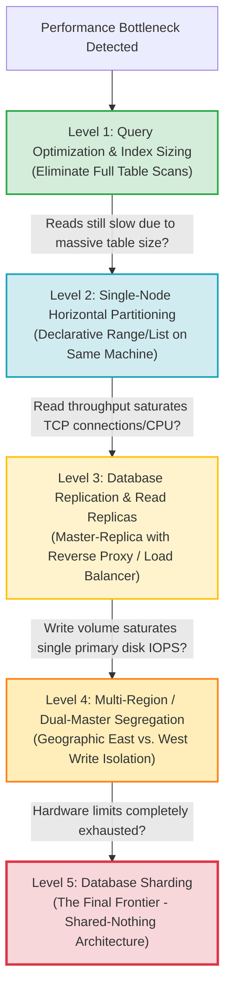
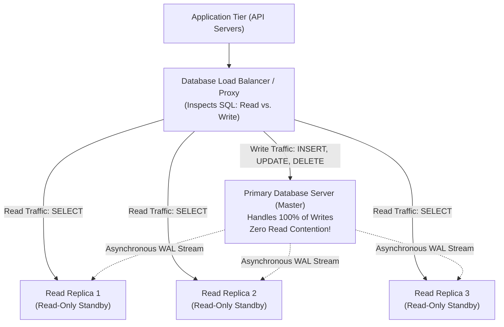
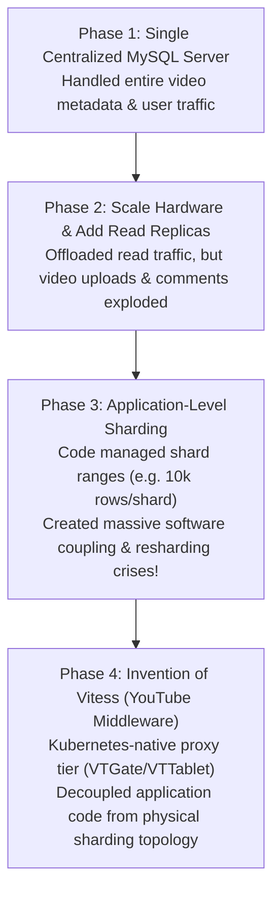

# 05. When to Shard: The Database Scaling Escalation Ladder

#Database #Sharding #DatabaseScaling #SystemDesign #DatabaseEngineering #ReadReplicas #Partitioning #Architecture #Vitess #Overengineering #CoreConcept

> [!abstract] Executive Summary
> **"When should I shard my database?"**
> **The short answer:** Sharding is the absolute **last thing** you should ever do to your database tier.
> 
> Sharding sounds prestigious in software engineering discussions, but in practice, it is an exceptionally complex, expensive, and operationally hazardous architectural pattern. Premature sharding introduces distributed transactions, network latency, resharding headaches, and client-side coupling long before they are necessary.
> 
> This master reference establishes the **Database Scaling Escalation Ladder**: an authoritative, five-stage architectural framework that exhausts single-node query optimization, horizontal partitioning, read replicas, and regional segregation before justifying the jump to distributed sharding.

---

## 1. The Overengineering Trap: Why Engineers Jump to Sharding Too Early

In modern backend system design, developers frequently suffer from **premature distributed systems syndrome**:

```
┌─────────────────────────────────────────────────────────────────────────────────────────────────┐
│                               THE PREMATURE SHARDING FALLACY                                    │
├─────────────────────────────────────────────────────────────────────────────────────────────────┤
│ "Our queries are slowing down and our table has 5 million rows. We need to shard!"              │
│                                                                                                 │
│ **The Reality:**                                                                                │
│ Sharding a 5-million-row database is catastrophic overengineering. Modern database engines     │
│ (PostgreSQL, MySQL) running on commodity NVMe hardware effortlessly process hundreds of         │
│ millions of records without sharding.                                                           │
│                                                                                                 │
│ When you shard prematurely:                                                                     │
│ 1. You forfeit native relational `JOIN`s and foreign key integrity constraints.                 │
│ 2. You forfeit atomic, single-phase ACID transactions and rollbacks.                            │
│ 3. You tightly couple application code to database physical network topology.                  │
│ 4. You multiply cloud infrastructure costs across multiple running database nodes.              │
└─────────────────────────────────────────────────────────────────────────────────────────────────┘
```

Before considering sharding, senior engineers must **diagnose the exact nature of the bottleneck**:
- Are **reads** slow?
- Are **writes** slow?
- Is **disk I/O** saturated?
- Is **memory buffer pool space** exhausted?
- Are **TCP network connections / file descriptors** maxed out?

---

## 2. The 5-Stage Database Scaling Escalation Ladder



---

## 3. Level-by-Level Escalation Breakdown

### Level 1: Query & Index Optimization (The First Line of Defense)
When a table reaches millions of rows and queries begin degrading from 1 ms to 20 ms to 100 ms:
- **The Problem:** The query planner is either performing full table sequential scans or the B-tree index has grown large enough that random lookups cause cache misses.
- **The Solution:**
  1. Audit slow queries using `pg_stat_statements` or MySQL slow query logs.
  2. Implement **Covering Indexes** (`INCLUDE` clause in PostgreSQL) so queries resolve directly in the B-tree without touching heap pages.
  3. Increase memory allocation: tune `shared_buffers` / `innodb_buffer_pool_size` so the active working set fits in RAM.

---

### Level 2: Single-Node Horizontal Partitioning (Slicing on 1 Server)
If queries are still slow because the monolithic index is simply too massive to stay in memory:
- **The Misconception:** "We need multiple database servers!"
- **The Reality:** You can partition tables on the **same single database instance**.
- **The Mechanics:**
  - Break the table into 10 partitions based on range (`created_at`, `id`) or list (`region`).
  - Each partition maintains a small, compact B-tree index (~50 MB instead of ~500 MB).
  - The database engine automatically prunes irrelevant partitions based on the `WHERE` clause.
- **Why Level 2 Beats Sharding:**
  - You stay on **one server** (one OS process).
  - The client application remains **completely agnostic**.
  - **Full ACID transactions, atomic rollbacks, and relational cross-table joins are 100% preserved!**

---

### Level 3: Database Replication & Read Replicas (Scaling Read Throughput)
If single queries are fast, but the volume of concurrent read clients overwhelms the server:
- **The Bottleneck:** Thousands of concurrent API clients opening TCP connections saturate CPU, exhaust operating system file descriptors, and consume database memory.
- **The Architecture:**
  - **Single Primary (Master):** Receives 100% of write traffic (`INSERT`, `UPDATE`, `DELETE`).
  - **Read Replicas (Standbys):** Continuously receive WAL / binary log streams from the Primary.
  - **Reverse Proxy / Load Balancer:** An intermediate proxy (HAProxy, Nginx, ProxySQL) or client connection pool balances `SELECT` traffic across 3 to 10 read replicas.



- **Why Level 3 Beats Sharding:**
  - Reads scale horizontally to hundreds of thousands of queries per second.
  - Writing remains trivial: all writes target one single authoritative master. **Zero write-conflict resolution required!**

---

### Level 4: Multi-Region / Dual-Master Segregation (Geographic Write Isolation)
What if the application writes an enormous volume of data, and the single primary server's disk controller IOPS are saturated?
- **The Reality:** Modern PCIe NVMe SSDs sustain **50,000 to 500,000 IOPS**. You must be writing an astronomical volume of data to exhaust a single modern database machine.
- If writes are high due to geographic distribution, deploy **Regional Segregation**:
  - **US-East Master:** Handles customers in Florida, New York, etc.
  - **US-West Master:** Handles customers in California, Washington, etc.
  - East Coast and West Coast users rarely transact against the same records, meaning write conflicts are virtually non-existent.
  - Cross-region replication synchronizes data asynchronously for disaster recovery and global reads.

---

### Level 5: Database Sharding (The Final Frontier)
Only after Levels 1, 2, 3, and 4 have been completely exhausted should a company consider Database Sharding.

#### The Mandatory Entry Criteria for Sharding:
1. Total dataset size exceeds **tens of terabytes**, surpassing the maximum physical storage or addressable RAM capacity of the largest enterprise servers.
2. Sustained write throughput permanently saturates the physical write IOPS limit of enterprise NVMe storage arrays.
3. The dataset can be cleanly divided by an immutable, high-cardinality shard key without requiring cross-shard atomic transactions.

---

## 4. The YouTube Case Study: The Evolution to Vitess

The architecture of **YouTube** illustrates how massive real-world systems navigate the scaling ladder:



### The Architectural Crisis at YouTube:
- **The Application Coupling Nightmare:**
  For years, YouTube maintained application-level sharding where application code routed queries based on user ID ranges (e.g., Users $1 \to 10{,}000$ on Shard 1).
- **The "Social Distancing" Principle in Software:**
  Coupling is the enemy of resilient software architecture. Software components should maintain "social distancing"—they should be completely isolated and know as little as possible about each other's physical implementation.
- **The Resharding Failure:**
  When YouTube needed to resize shard boundaries (e.g., expanding shard capacity from 10k to 100k rows), the entire application tier broke because thousands of codebase references were hardcoded to the old shard topology.
- **The Vitess Breakthrough:**
  YouTube engineers built **Vitess** to abstract sharding entirely behind a SQL-compliant proxy layer (`VTGate`). Application developers returned to writing standard SQL queries against a virtual single-endpoint database, while Vitess handled distributed routing, connection pooling, and resharding transparently in the background.

---

## 5. Architectural Comparison Matrix Across Scaling Stages

```
┌─────────────────────────────────────────────────────────────────────────────────────────────────┐
│                              THE COMPLETE SCALING STAGES COMPARISON                             │
├─────────────────────┬───────────────────┬───────────────────┬───────────────────┬───────────────┤
│ Dimension           │ Single Partition  │ Read Replicas     │ Regional Dual     │ Sharded       │
├─────────────────────┼───────────────────┼───────────────────┼───────────────────┼───────────────┤
│ **Physical Nodes**  │ 1 Machine         │ 1 Primary + N Reps│ 2+ Regional Prim. │ **N Shards**  │
├─────────────────────┼───────────────────┼───────────────────┼───────────────────┼───────────────┤
│ **Primary Target**  │ Large table scan  │ High read volume  │ Geo-write latency │ **Total scale**│
├─────────────────────┼───────────────────┼───────────────────┼───────────────────┼───────────────┤
│ **ACID Preserved?** │ **100% Yes**      │ **100% Yes**      │ Conditional       │ **No (2PC)**  │
├─────────────────────┼───────────────────┼───────────────────┼───────────────────┼───────────────┤
│ **Relational Joins**│ **100% Yes**      │ **100% Yes**      │ Same-region only  │ **Forbidden** │
├─────────────────────┼───────────────────┼───────────────────┼───────────────────┼───────────────┤
│ **Client Coupling** │ Zero (Agnostic)   │ Minimal (Proxy)   │ Medium (Geo-route)│ **Extreme**   │
├─────────────────────┼───────────────────┼───────────────────┼───────────────────┼───────────────┤
│ **Maintenance Cost**│ Negligible        │ Low               │ Medium            │ **Massive**   │
└─────────────────────┴───────────────────┴───────────────────┴───────────────────┴───────────────┘
```

---

## 6. Senior Engineer Diagnostic Checklist

Before approving any proposal to shard a database:

- [ ] **Have you indexed for your specific query patterns?** Confirm that queries utilize composite indexes and that no unindexed full table scans exist in slow query logs.
- [ ] **Can single-node horizontal partitioning solve the issue?** Verify if declarative range/list partitioning on the primary instance can shrink the active B-tree working set into RAM.
- [ ] **Are you offloading reads to read replicas?** Ensure that all non-transactional `SELECT` queries are directed to read-only standby nodes via a database load balancer.
- [ ] **Have you maximized vertical hardware capacity?** Compare the cost and complexity of a larger enterprise instance (e.g., 512 GB RAM, 64 cores) against the multi-year engineering salary cost of maintaining a distributed sharding cluster.
- [ ] **Does the domain support an immutable shard key?** If you cannot identify a high-cardinality shard key that isolates 95%+ of queries to single-shard lookups, sharding will destroy application performance.
- [ ] **Are you prepared to abandon cross-table joins and ACID transactions?** Ensure business stakeholders and product managers accept eventual consistency and Saga-pattern error recovery.
