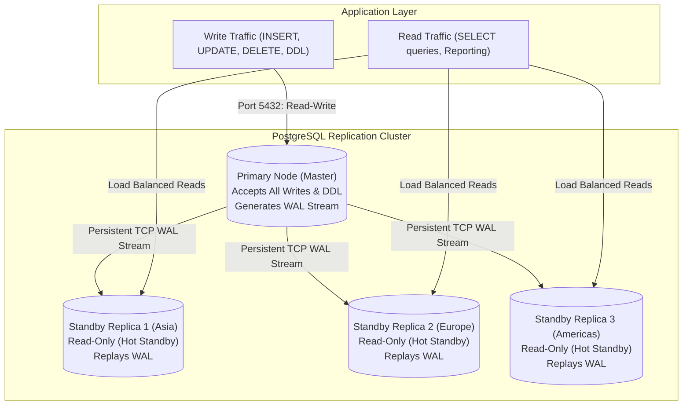
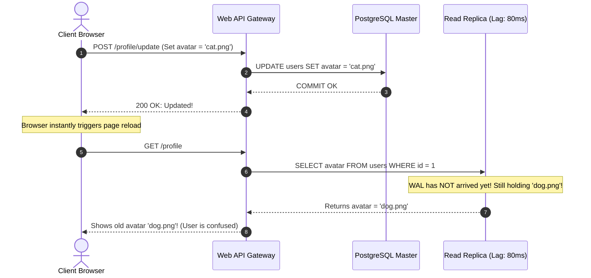
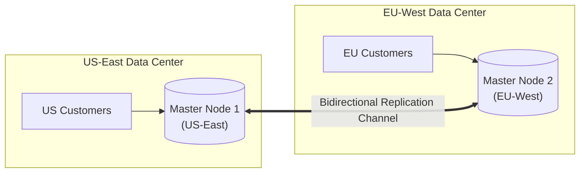

#Database #Replication #HighAvailability #MasterStandby #MultiMaster #PostgreSQL #SystemDesign #DistributedSystems #CoreConcept

> [!abstract] Executive Summary
> **Database Replication** is the process of continuously copying and synchronizing data across multiple redundant database instances to achieve **high availability (HA), fault tolerance, disaster recovery (DR), and read scalability**.
> 
> The architectural design of a replication topology dictates how writes and reads are routed, how consistency is preserved, and how failures are mitigated:
> 1. **Master-Standby (Primary-Replica / Leader-Follower):** A single master node accepts all writes (DML) and schema alterations (DDL). Changes are propagated via persistent streaming channels (WAL / Binlog) to read-only standby nodes. This architecture eliminates write conflicts entirely and serves as the enterprise standard for relational databases.
> 2. **Multi-Master (Leader-Leader / Active-Active):** Multiple coordinator nodes accept concurrent writes across different data centers or geographic regions. While this scales write throughput, it introduces the distributed systems nightmare of **concurrent write conflicts**, requiring complex conflict resolution mechanisms (LWW, CRDTs, or Paxos/Raft consensus).
> 
> Furthermore, contrary to popular belief, **relational databases running asynchronous replication exhibit eventual consistency**, exposing applications to anomalies like the **Read-Your-Own-Writes** dilemma.

---

## 1. The Core Objectives of Database Replication

In single-node database architectures, the server represents a **Single Point of Failure (SPOF)**. If the host experiences hardware failure, power loss, or network partitions, the entire system becomes unavailable.

```
┌─────────────────────────────────────────────────────────────────────────────────────────────────┐
│                               WHY WE REPLICATE DATABASES                                        │
├───────────────────────────────┬─────────────────────────────────────────────────────────────────┤
│ Dimension                     │ Engineering Purpose                                             │
├───────────────────────────────┼─────────────────────────────────────────────────────────────────┤
│ **1. High Availability (HA)** │ If the active node crashes, a secondary replica is promoted to   │
│                               │ primary (failover) with minimal downtime (MTTR).                │
├───────────────────────────────┼─────────────────────────────────────────────────────────────────┤
│ **2. Read Scalability**       │ Offload read-heavy workloads (`SELECT` queries, reporting,      │
│                               │ analytics) away from the write-master onto multiple replicas.   │
├───────────────────────────────┼─────────────────────────────────────────────────────────────────┤
│ **3. Disaster Recovery (DR)** │ Maintain real-time redundant copies in distant geographic        │
│                               │ regions to survive entire data center outages.                  │
├───────────────────────────────┼─────────────────────────────────────────────────────────────────┤
│ **4. Geographic Proximity**   │ Place read replicas physically close to global users (e.g.,     │
│                               │ Europe, Asia, Americas) to eliminate transatlantic latency.     │
└───────────────────────────────┴─────────────────────────────────────────────────────────────────┘
```

---

## 2. Master-Standby (Primary-Replica) Architecture

The **Master-Standby** model (also known as *Primary-Replica* or *Leader-Follower*) is the gold standard for relational database management systems (PostgreSQL, MySQL, Oracle, SQL Server).



### The Architectural Rules of Master-Standby:
1. **Single Point of Mutation:** Only **one** node (the Primary/Master) is permitted to accept data modifications (`INSERT`, `UPDATE`, `DELETE`) and schema migrations (`CREATE TABLE`, `ALTER TABLE`).
2. **Deterministic Total Write Order:** Because a single machine determines transaction commit ordering, write conflicts cannot occur. The primary assigns sequential Log Sequence Numbers (LSN) or transaction IDs.
3. **Dedicated Streaming Channel:** Standby nodes establish a persistent, bidirectional TCP connection to the primary using a dedicated replication user (e.g., `pg_walreceiver` in PostgreSQL).
4. **Read-Only Standbys:** Replicas run in **Hot Standby** mode. They reject any write statement (`ERROR: cannot execute INSERT in a read-only transaction`) and continuously replay incoming changes.

---

## 3. The Myth of Pure Consistency: Eventual Consistency in RDBMS

A common misconception among backend developers is: *"NoSQL databases are eventually consistent, but relational SQL databases are always strongly consistent."*

**This is false.** In production, nearly all Master-Standby relational database clusters operate with **Asynchronous Replication**. 

When a write is committed on the Master, the database returns success to the client immediately without waiting for replicas to confirm receipt. The time delay required for changes to cross the network and be replayed on a replica is known as **Replication Lag**.

```
Master WAL Flush (t = 0ms) ────────► Client receives 200 OK
      │
      │ Network Transit (15ms - 80ms)
      ▼
Replica Replays WAL (t = 65ms) ────► Data becomes visible on Replica
```

### The Three Classic Replication Lag Anomalies:

#### 1. The Read-Your-Own-Writes Anomaly
A user updates their account profile picture. The backend sends the `UPDATE` to the Master and immediately redirects the browser. The browser sends a `GET /profile` request, which the API load balancer routes to a Read Replica that is **50ms behind the Master**. The user sees their **old profile picture** and assumes the update failed!



#### 2. Monotonic Reads Anomaly (Time Travel)
A user refreshes an order status page. 
- Request 1 hits Replica A (Lag: 5ms) -> Status: `Shipped`.
- User refreshes again. Request 2 hits Replica B (Lag: 120ms) -> Status: `Processing`!
- The user perceives the system traveling backwards in time.

#### 3. Causal Consistency Violation
A user comments on a post. Another replica has replicated the comment but has not yet replicated the parent post, causing foreign key or referential display glitches.

### Engineering Solutions for Read-Your-Own-Writes in RDBMS:
- **Sticky Primary Reads for Mutating Users:** If a user performs a write, route all subsequent reads from that specific user to the Primary for a time window equal to maximum replication lag (e.g., 5 seconds).
- **Session LSN / Token Tracking:** The Primary returns the transaction's commit Log Sequence Number (`LSN`) in an HTTP response header or cookie. When reading from a replica, the client requests `WHERE pg_last_wal_replay_lsn() >= :client_lsn`. If the replica hasn't caught up, either wait or fall back to the primary.

---

## 4. Multi-Master (Active-Active) Replication

In **Multi-Master** (or *Leader-Leader*) architecture, two or more nodes simultaneously accept read and write operations. Every master independently processes local writes and asynchronously or synchronously replicates them to all peer masters.



### The Promise of Multi-Master:
1. **Local Write Latency:** Users in London write to the Frankfurt master with 5ms latency; users in New York write to the Virginia master with 5ms latency, avoiding transatlantic network round-trips for writes.
2. **High Availability for Writes:** If Master 1 dies, Master 2 continues accepting writes immediately without an automated failover promotion window.

### The Problem: Concurrent Write Conflicts
Because both nodes accept writes independently, **concurrent conflicting updates to the same record will inevitably occur**.

#### Concrete Conflict Scenario:
```
T = 0ms: User A in US updates: UPDATE inventory SET stock = 10 WHERE item_id = 1;
T = 2ms: User B in EU updates: UPDATE inventory SET stock = 5  WHERE item_id = 1;
```
When Master 1 attempts to replicate its update to Master 2, and Master 2 replicates its update to Master 1:
- Which value is correct? `10` or `5`?
- Without a single central coordinator, the two database nodes will diverge into corrupted, inconsistent states!

---

## 5. Conflict Resolution Strategies in Multi-Master Systems

Handling write conflicts in multi-master topologies is one of the most difficult challenges in computer science:

```
┌─────────────────────────────────────────────────────────────────────────────────────────────────┐
│                              CONFLICT RESOLUTION STRATEGIES                                     │
├───────────────────────────────┬─────────────────────────────────┬───────────────────────────────┤
│ Strategy                      │ Mechanism                       │ Trade-Offs & Pitfalls         │
├───────────────────────────────┼─────────────────────────────────┼───────────────────────────────┤
│ **1. Last Write Wins (LWW)**  │ Each write attaches a timestamp.│ ❌ **Silent Data Loss:**      │
│                               │ The highest timestamp wins.     │ Clock skew (NTP drift) drops  │
│                               │                                 │ valid transactions unnoticed. │
├───────────────────────────────┼─────────────────────────────────┼───────────────────────────────┤
│ **2. CRDTs**                  │ Data structures designed to     │ ✅ Mathematically convergent. │
│ *(Conflict-Free Replicated    │ merge deterministically without │ ❌ Limited to counters, sets, │
│   Data Types)*                │ coordination (e.g. PN-Counters).│ and append-only state.        │
├───────────────────────────────┼─────────────────────────────────┼───────────────────────────────┤
│ **3. Application Merge Hook** │ System records conflict in a    │ ✅ Zero data loss.            │
│                               │ delta table; application code   │ ❌ High developer overhead;   │
│                               │ executes custom resolution.     │ complex async error state.    │
├───────────────────────────────┼─────────────────────────────────┼───────────────────────────────┤
│ **4. Distributed Consensus**  │ Nodes run consensus (Raft/Paxos)│ ✅ Strong serializability.    │
│ *(Spanner / CockroachDB)*     │ before committing every write.  │ ❌ High write latency (RTT);  │
│                               │                                 │ requires quorum (N/2 + 1).    │
└───────────────────────────────┴─────────────────────────────────┴───────────────────────────────┘
```

> [!WARNING] Why Production RDBMS Avoid Pure Multi-Master
> While extensions like Bucardo, BDR (Bi-Directional Replication), or Galera Cluster exist for PostgreSQL and MySQL, the overwhelming consensus among database architects is: **Avoid multi-master replication unless geographically isolated write latency is an existential business requirement.**
> 
> The vast majority of global platforms (Instagram, Uber, Shopify) use **Single-Master with Read Replicas** or **Database Sharding with Single-Master per Shard**.

---

## 6. Architectural Scorecard: Master-Standby vs. Multi-Master

```
┌─────────────────────────────────────────────────────────────────────────────────────────────────┐
│                               ARCHITECTURAL COMPARISON MATRIX                                   │
├─────────────────────────┬───────────────────────────────┬───────────────────────────────────────┤
│ Dimension               │ Master-Standby (Primary-Replica)│ Multi-Master (Active-Active)          │
├─────────────────────────┼───────────────────────────────┼───────────────────────────────────────┤
│ **Write Scalability**   │ ❌ Bound to single node CPU/IO│ ✅ Scales across multiple nodes       │
├─────────────────────────┼───────────────────────────────┼───────────────────────────────────────┤
│ **Read Scalability**    │ ✅ Horizontally scales reads  │ ✅ Horizontally scales reads          │
├─────────────────────────┼───────────────────────────────┼───────────────────────────────────────┤
│ **Write Conflicts**     │ ✅ **Zero conflicts possible**│ ❌ **High conflict probability**      │
├─────────────────────────┼───────────────────────────────┼───────────────────────────────────────┤
│ **Operational Overhead**│ 🟢 Low to Moderate            │ 🔴 Extremely Complex                  │
├─────────────────────────┼───────────────────────────────┼───────────────────────────────────────┤
│ **Failover Mechanism**  │ Requires leader election      │ Built-in redundancy (other master hot)│
│                         │ (Patroni, Orchestrator)       │                                       │
├─────────────────────────┼───────────────────────────────┼───────────────────────────────────────┤
│ **DDL Schema Migration**│ Simple (Executed on Master)   │ Complex distributed schema locks      │
└─────────────────────────┴───────────────────────────────┴───────────────────────────────────────┘
```

---

## 7. Preview: Synchronous vs. Asynchronous Replication

The mechanism governing when the primary confirms a commit to the client defines the durability and latency of the replication topology:

```
┌─────────────────────────────────────────────────────────────────────────────────────────────────┐
│                            SYNCHRONOUS vs. ASYNCHRONOUS REPLICATION                             │
├───────────────────────────────┬─────────────────────────────────────────────────────────────────┤
│ Mode                          │ Commit Contract & Trade-Off                                     │
├───────────────────────────────┼─────────────────────────────────────────────────────────────────┤
│ **Asynchronous Replication**  │ Master writes to local WAL, commits, and returns `200 OK` to   │
│ *(Default in 99% of systems)* │ client immediately. Changes stream in background.               │
│                               │ - **Pros:** Maximum write throughput; zero network wait.        │
│                               │ - **Cons:** Risk of data loss if master dies before WAL streams.│
├───────────────────────────────┼─────────────────────────────────────────────────────────────────┤
│ **Synchronous Replication**   │ Master writes to local WAL, sends WAL to replica, and **waits   │
│                               │ for replica acknowledgement (ACK)** before confirming commit.   │
│                               │ - **Pros:** RPO = 0 (Zero data loss guarantee upon failover).   │
│                               │ - **Cons:** Write latency bounded by slowest replica RTT;       │
│                               │   master freezes if replica becomes unreachable.                │
└───────────────────────────────┴─────────────────────────────────────────────────────────────────┘
```

---

## 8. Senior Engineer Production Checklist

- [ ] **Separate Application Connection Pools:** Maintain two distinct connection pools in your application:
  - `primaryPool`: For write operations (`INSERT`, `UPDATE`, `DELETE`) and critical reads.
  - `replicaPool`: For read-only operations (`SELECT`).
- [ ] **Monitor Replication Lag Continuously:** On PostgreSQL, query `pg_stat_replication` to track `replay_lag`, `write_lag`, and byte lag:
  ```sql
  SELECT client_addr, state, sync_state, 
         pg_wal_lsn_diff(pg_current_wal_lsn(), replay_lsn) AS replay_byte_lag,
         replay_lag
  FROM pg_stat_replication;
  ```
- [ ] **Implement Read-Your-Own-Writes Guardrails:** Prevent user UI confusion by pinning recent mutators to the primary node for 3-5 seconds after any write.
- [ ] **Configure Automated Failover (Patroni / Raft):** Ensure your Master-Standby cluster utilizes consensus-backed orchestration (e.g., Patroni with etcd/Consul) to prevent **Split-Brain** disasters where two nodes declare themselves primary simultaneously.
- [ ] **Audit Replica Load Imbalance:** Use a connection load balancer (e.g., HAProxy, Envoy, PgBouncer) in front of read replicas to distribute query traffic evenly.

---

## 9. Related Notes & Conceptual Navigation

- [[02_Synchronous vs. Asynchronous Replication_ Consistency, Quorums, and the Latency Trade-Off|Synchronous vs. Asynchronous Replication]]
- [[03_Hands-On PostgreSQL Streaming Replication Demo_ Docker Cluster, WAL Streaming, and standby.signal|Hands-On PostgreSQL Streaming Replication Demo]]
- [[04_Database Replication Trade-Offs_ Pros, Cons, and Global Multi-Region Architecture|Database Replication Trade-Offs & Multi-Region Architecture]]
- [[01_Database Partitioning Fundamentals_ Horizontal vs. Vertical Partitioning|Database Partitioning Fundamentals]]
- [[01_Database Sharding Fundamentals_ Architecture, Routing, and Consistent Hashing|Database Sharding Fundamentals]]
- [[05_Database Connection Pooling_ Mechanics, Node.js Benchmark, and Sizing Strategies|Database Connection Pooling]]

